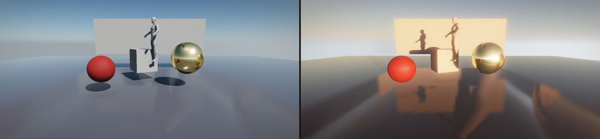
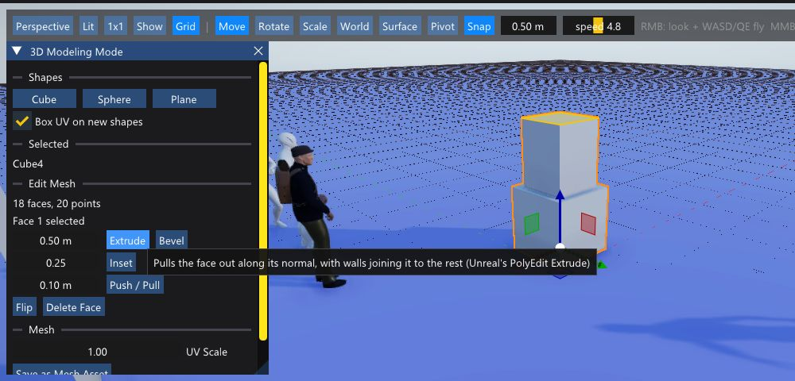

# LSD_Engine


**An MIT-licensed, data-oriented 3D game engine with an Unreal-style, editor-first workflow.**
Import a file, find it in the Content Browser, open it in its own editor, wire it up by clicking.
Code is for new behaviour, never for hooking up content.

C++20 core. Gameplay in LuaJIT, visual scripts, C / C++ or JavaScript. Direct3D 12, Vulkan and OpenGL 4.6 backends behind one RHI. Windows and Linux.
By [Kittakin Studios](https://github.com/Kittakin-Studios).


*The editor: menu bar, Play / Simulate, workspace tabs, viewport, Outliner, Details and the Content Browser.*

## Download

Get the latest Windows build from [Releases](https://github.com/Kittakin-Studios/LSD_Engine/releases/latest):

- **`LSD_Engine_Setup.exe`**: the installer. It installs for your user only (no administrator rights) into
  `%LOCALAPPDATA%\Programs\LSD_Engine`, adds a Start Menu (and optional desktop) shortcut and an uninstaller.
- **`LSD_Engine_Windows.zip`**: the portable version. Unzip it anywhere you can write to and double-click `lsd_editor.exe`.

Both hold the editor (also the game runtime), the sample project (Coin Run and the Quaternius character) and the docs.
The editor keeps its project in its own folder (`Content/`, `Config/`, and the `Saved/` / `DerivedData/` it writes), so do not unzip into `Program Files`.

System requirements: Windows 10 or 11, 64-bit; a graphics card with Direct3D 12, Vulkan 1.3 or OpenGL 4.6.
For C / C++ game code you also need Visual Studio 2022 or newer with *Desktop development with C++*.
Linux users build from source (see [Building](#building)).

## Screenshots

| | |
| --- | --- |
| [](docs/GRAPHICS.md) <br> Sky, sun and reflections at two times of day | [](docs/GRAPHICS.md) <br> Rect and Disc lights |
| [](docs/MANUAL.md) <br> Particle editor with live preview | [](docs/MANUAL.md) <br> Material Graph with live preview |
| [](docs/MANUAL.md) <br> Visual scripting, compiled to Lua | [](docs/MANUAL.md) <br> 2D mode: tile maps, sprites, flipbooks |
| [](docs/MANUAL.md) <br> 3D Modeling mode: extrude, bevel, inset | [](docs/Multiplayer.md) <br> Multiplayer workspace: host, join codes |

## What it has

- **Architecture:** data-oriented. Entities are generational handles, components are reflected plain structs in packed pools, systems loop over arrays. Text source assets and hot reload.
- **Reflection:** one `LSD_STRUCT` / `LSD_PROPERTY` layer and a code generator give the Details panel, JSON save / load, undo, Lua access and Play copies.
- **Gameplay languages:** LuaJIT, visual scripts (compiled to Lua), C / C++ game modules (reloaded on rebuild) and JavaScript (QuickJS-ng).
- **Graphics:** D3D12 (default), Vulkan 1.3 and OpenGL 4.6 backends; PBR, shadows, skinned meshes, particles, Material Graphs, SSAO, TAA, depth of field, bloom, baked lightmaps and light probes, reflection captures, CPU and GPU culling.
- **Editor:** Content Browser, Outliner, Details, Play-in-Editor, undo, asset editors for materials, animation graphs, particles, behaviour trees, UI and visual scripts, and Level modes (3D Modeling, Foliage, Landscape, PCG, VFX, 2D).
- **Systems:** Jolt physics and character controller, Recast / Detour navigation, behaviour trees, ozz animation with motion matching, miniaudio, RmlUi (HTML / CSS) game UI, localisation, save games, packaging.
- **Multiplayer:** ENet replication, text and voice chat, playtests by join code.
- **LSD Assistant:** an optional in-editor AI helper that uses your own model (Anthropic or OpenAI-compatible).
- **Scaling:** picks the best GPU, sizes memory use to VRAM and RAM budgets, scales jobs to CPU cores.

The ideas come from the public Bitsquid / Stingray talks, implemented from scratch under a [clean-room rule](docs/CLEAN_ROOM.md).

## Status

Milestones 0 to 7 are done and each has an exit test. CI builds and runs the 15 CTest tests on Windows (MSVC) and Linux (Clang) on every push, and both compilers build with 0 warnings.

| # | Milestone | State |
| --- | --- | --- |
| 0-2 | Core, RHI, reflection, assets, Content Browser | Done |
| 3 | Editor shell: viewport, gizmos, Outliner, Details, undo, Play-in-Editor | Done |
| 4 | Gameplay: prefabs, Lua + visual scripting, input, Jolt physics, character | Done |
| 5 | Content editors: materials, animation, audio, particles | Done |
| 6 | Vertical slice: packaging, save games, AI, game UI, localisation, profiling | Done |
| 7 | Gameplay languages: C / C++ game code, JavaScript scripts | Done |

Some items are partial (marked in the backlog). Every feature by milestone, ticked when done, is in [docs/BACKLOG.md](docs/BACKLOG.md); plans are in [docs/ROADMAP.md](docs/ROADMAP.md).

## Documentation

| Document | What is in it |
| --- | --- |
| [Examples (first timers)](docs/Examples/Examples.md) | Start here: Input Actions (move, look, jump, crouch, sprint, swim, interact), a health and stamina HUD, draining each, a door, step by step |
| [MANUAL](docs/MANUAL.md) | How to use the engine, panel by panel, with pictures |
| [EXAMPLES](docs/EXAMPLES.md) | Step-by-step tutorials (a first level, a HUD, a guard AI, a menu, a campfire, shipping) |
| [How to code in LSD_Engine](docs/How%20to%20code%20in%20LSD_Engine.md) | Lua and visual scripts from scratch |
| [CODING](docs/CODING.md) | C / C++ gameplay and every command |
| [GRAPHICS](docs/GRAPHICS.md) | Step by step to high-end graphics |
| [Multiplayer](docs/Multiplayer.md) | Playtests: join codes, Tailscale |
| [ARCHITECTURE](docs/ARCHITECTURE.md) | How the engine works inside |

## Building

Requirements: CMake 3.24+, a C++20 compiler (MSVC 2022, Clang 16+ or GCC 13+), Ninja recommended.

```sh
# Windows (Visual Studio 2022 developer prompt; CI uses windows-2022)
cmake --preset windows-msvc
cmake --build --preset windows-msvc
cmake --build --preset windows-msvc --config Release   # also copies lsd_editor.exe to the project root

# Linux (Ubuntu / Debian; verified on Ubuntu 26.04 with Clang 21). The system packages SDL3 needs:
sudo apt install clang lld cmake ninja-build pkg-config libx11-dev libxext-dev libxrandr-dev \
  libxcursor-dev libxi-dev libxss-dev libxfixes-dev libxtst-dev libxkbcommon-dev libwayland-dev \
  wayland-protocols libegl1-mesa-dev libgl1-mesa-dev libdrm-dev libgbm-dev libasound2-dev \
  libpulse-dev libudev-dev libdbus-1-dev libvulkan-dev
cmake --preset linux-clang
cmake --build --preset linux-clang

# Run tests and the hardware report
ctest --preset linux-clang
./build/linux-clang/runtime/lsd_runtime -rhi=vulkan
```

### Build options

| Option | Default | Meaning |
| --- | --- | --- |
| `LSD_RHI_D3D12` | ON on Windows | Direct3D 12 backend |
| `LSD_RHI_VULKAN` | ON | Vulkan backend |
| `LSD_RHI_OPENGL` | ON | OpenGL 4.6 fallback backend |
| `LSD_COMPUTE_CUDA` | OFF | Optional CUDA plugin for editor/offline tools |
| `LSD_COMPUTE_HIP` | OFF | Optional ROCm/HIP plugin for editor/offline tools |
| `LSD_BUILD_EDITOR` | ON | Build the editor |
| `LSD_BUILD_TOOLS` | ON | Build the data compiler |
| `LSD_BUILD_TESTS` | ON | Build unit tests |

### Runtime flags

- `-rhi=d3d12|vulkan|opengl` — force a graphics backend
- `-gpu=<index>` — force a GPU instead of automatic selection

## Repository layout

```
engine/
  foundation/   types, memory, logging, handles, hashing, system info
  rhi/          graphics interface + backends (d3d12, vulkan, opengl)
  core/ world/ script/ render/ audio/ physics/ ui/   (milestones 1-6)
editor/         the editor application
tools/          data compiler and other command-line tools
runtime/        game executable
tests/          unit tests
docs/           architecture, roadmap, clean-room rules
third_party/    vendored or fetched dependencies
```

## Contributing

Issues and pull requests are welcome. Before you send code:

- Read [`docs/CLEAN_ROOM.md`](docs/CLEAN_ROOM.md): ideas from public talks and papers only, never code or data from other engines.
- Keep both compilers at 0 warnings (MSVC `/W4`, Clang `-Wall -Wextra -Wpedantic -Wshadow -Wconversion`) and `ctest` passing.
- New dependencies must be permissive (MIT, BSD, zlib, Apache-2.0, public domain), pinned in `third_party/CMakeLists.txt`
  and listed in [THIRD-PARTY-NOTICES.md](THIRD-PARTY-NOTICES.md).
- Sample content in `Content/` must be your own work or CC0. The sample character, its animations and textures (`Content/Character/Quaternius/`) are by [Quaternius](https://quaternius.com), CC0 ([LICENSE.txt](Content/Character/Quaternius/LICENSE.txt)).

## License

MIT — Copyright (c) 2026 Kittakin Studios. See [LICENSE](LICENSE).
Third-party components keep their own licences. The full list of dependencies, versions and
licences is in [THIRD-PARTY-NOTICES.md](THIRD-PARTY-NOTICES.md) — ship it (or its FreeType
credit line) with the engine, and keep FreeType built under its permissive FreeType Licence.
