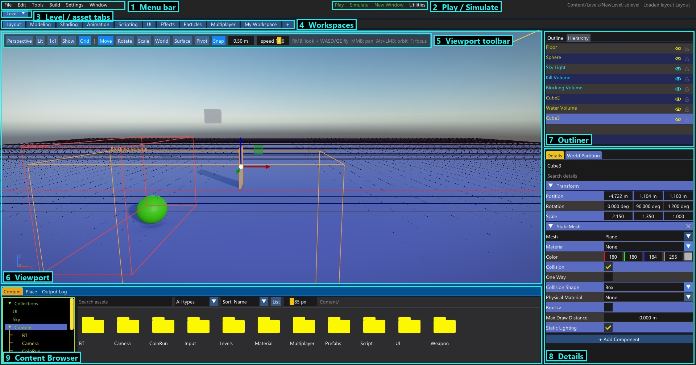

# LSD_Engine

A data-oriented, editor-first 3D game engine by Kittakin Studios.

- **Core:** C++20, data-oriented design, generational handles, hashed IDs, per-system allocators
- **Gameplay:** LuaJIT and visual scripting, both generated from one reflection layer
- **Graphics:** one RHI with Direct3D 12, Vulkan and OpenGL 4.6 backends; NVIDIA, AMD and Intel GPUs
- **Scaling:** picks the best GPU automatically, sizes memory use to live VRAM and RAM budgets, scales jobs to CPU cores
- **Editor:** Unreal-style workflow — Content Browser, asset editors, Details panel, Play-in-Editor

The full plan (architecture, feature spec, editor layout, roadmap) lives in the
The full documentation is in [`docs/`](docs/).

## Status


*The editor: menu bar, Play, workspaces, viewport, Outliner, Details, Content Browser and the asset editor dock.*

| # | Milestone | State |
| --- | --- | --- |
| 0-2 | Core, RHI, reflection, assets, Content Browser | Done |
| 3 | Editor shell: viewport, gizmos, Outliner, Details, undo, Play-in-Editor | Done |
| 4 | Gameplay: prefabs, Lua + visual scripting, input, Jolt physics, character | Done |
| 5 | Content editors: materials, animation, audio, particles | Done |
| 6 | Vertical slice: packaging, save games, AI, game UI, localisation, profiling | Done |
| 7 | Gameplay languages: C / C++ game code, JavaScript scripts | Done |

Since then: multiplayer (one checkbox), text and voice chat, vehicles / transports / movers, 2D
(Paper2D), sub-level streaming, Unreal-style post-processing (Color Grading LUT, motion blur, contact shadows), mesh and ribbon
particles, montages and root motion, CPU occlusion culling, cooked Shipping packages, and LSD Assistant (an in-editor AI that
writes and tests code, with lessons). Every feature
by milestone is in [docs/BACKLOG.md](docs/BACKLOG.md).

## Documentation

| Document | What is in it |
| --- | --- |
| [Examples (first timers)](docs/Examples/Examples.md) | Start here: Input Actions (move, look, jump, crouch, sprint, swim, interact), a health and stamina HUD, draining each, a door, step by step |
| [MANUAL](docs/MANUAL.md) | How to use the engine, panel by panel, with pictures |
| [EXAMPLES](docs/EXAMPLES.md) | Step-by-step tutorials (a first level, a HUD, a guard AI, a menu, a campfire, shipping) |
| [How to code in LSD_Engine](docs/How%20to%20code%20in%20LSD_Engine.md) | Lua and visual scripts from scratch |
| [CODING](docs/CODING.md) | C / C++ gameplay and every command |
| [ARCHITECTURE](docs/ARCHITECTURE.md) | How the engine works inside |

## Building

Requirements: CMake 3.24+, a C++20 compiler (MSVC 2022, Clang 16+ or GCC 13+), Ninja recommended.

```sh
# Windows (Visual Studio 2022 developer prompt)
cmake --preset windows-msvc
cmake --build --preset windows-msvc
cmake --build --preset windows-msvc --config Release   # also copies lsd_editor.exe to the project root

# Linux (Ubuntu / Debian; verified on Ubuntu 26.04 with Clang 21). The system packages SDL3 needs:
sudo apt install clang lld cmake ninja-build pkg-config libx11-dev libxext-dev libxrandr-dev \
  libxcursor-dev libxi-dev libxss-dev libxfixes-dev libxtst-dev libxkbcommon-dev libwayland-dev \
  wayland-protocols libegl1-mesa-dev libgl1-mesa-dev libdrm-dev libgbm-dev libasound2-dev \
  libpulse-dev libudev-dev libdbus-1-dev libvulkan-dev
cmake --preset linux-clang
cmake --build --preset linux-clang

# Run tests and the hardware report
ctest --preset linux-clang
./build/linux-clang/runtime/lsd_runtime -rhi=vulkan
```

### Build options

| Option | Default | Meaning |
| --- | --- | --- |
| `LSD_RHI_D3D12` | ON on Windows | Direct3D 12 backend |
| `LSD_RHI_VULKAN` | ON | Vulkan backend |
| `LSD_RHI_OPENGL` | ON | OpenGL 4.6 fallback backend |
| `LSD_COMPUTE_CUDA` | OFF | Optional CUDA plugin for editor/offline tools |
| `LSD_COMPUTE_HIP` | OFF | Optional ROCm/HIP plugin for editor/offline tools |
| `LSD_BUILD_EDITOR` | ON | Build the editor |
| `LSD_BUILD_TOOLS` | ON | Build the data compiler |
| `LSD_BUILD_TESTS` | ON | Build unit tests |

### Runtime flags

- `-rhi=d3d12|vulkan|opengl` — force a graphics backend
- `-gpu=<index>` — force a GPU instead of automatic selection

## Repository layout

```
engine/
  foundation/   types, memory, logging, handles, hashing, system info
  rhi/          graphics interface + backends (d3d12, vulkan, opengl)
  core/ world/ script/ render/ audio/ physics/ ui/   (milestones 1-6)
editor/         the editor application
tools/          data compiler and other command-line tools
runtime/        game executable
tests/          unit tests
docs/           architecture, roadmap, clean-room rules
third_party/    vendored or fetched dependencies
```

## Clean-room rule

LSD_Engine is written from scratch. See [`docs/CLEAN_ROOM.md`](docs/CLEAN_ROOM.md) before contributing.

## License

Proprietary — Copyright (c) 2026 Kittakin Studios (Richard Pauli, aka Charlize Pauli). All rights reserved. See [LICENSE](LICENSE).
Third-party components keep their own licences. The full list of dependencies, versions and
licences is in [THIRD-PARTY-NOTICES.md](THIRD-PARTY-NOTICES.md) — ship it (or its FreeType
credit line) with the engine, and keep FreeType built under its permissive FreeType Licence.
