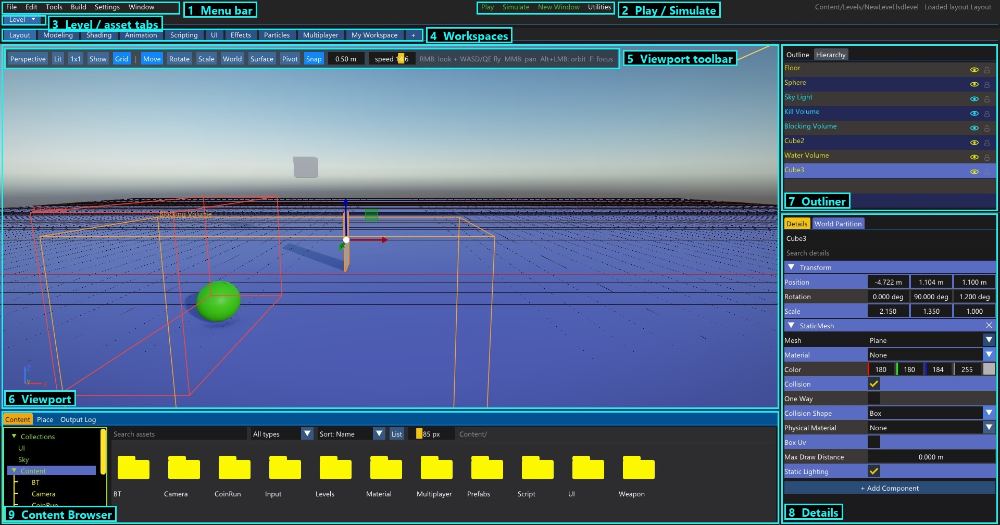
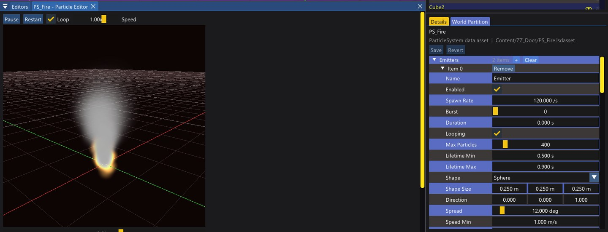
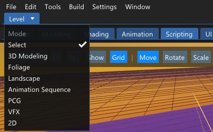
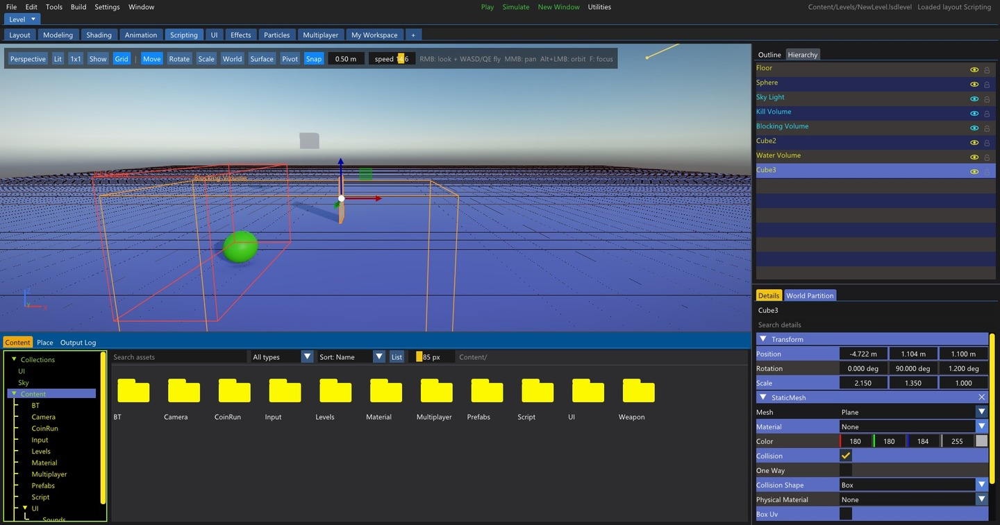

# How LSD_Engine works

The engine's design, module by module. For using it, see [MANUAL.md](MANUAL.md).

## The big picture


*The editor (which is also the game): viewport, Outliner, Details, Content Browser and the asset editor dock.*

```text
                 ┌──────────────────────────── editor/ (lsd_editor.exe) ───────────────────────────┐
                 │  main.cpp: window, frame loop, rendering        editor_ui.cpp: panels (ImGui)   │
                 │  play_session: Play (physics, scripts, AI, UI)  caches: mesh, texture, material │
                 │  graph / particle / UI / table editors           packaging, validation          │
                 └───────────────┬───────────────────────────────────────────────┬─────────────────┘
                                 │                                               │
   gameplay        script (LuaJIT, graphs)   ai (Recast, BTs)   ui (RmlUi)   audio (miniaudio)
   simulation      physics (Jolt)            animation (ozz)    particles    input
   data            world (entities, components, levels, prefabs)   asset (registry, import, tables)
   rendering       render (meshes, materials)   rhi (D3D12 / OpenGL / Vulkan)
   base            reflect (types, JSON)   core (jobs, console, crash)   foundation (memory, log, math)
```

Lower layers never include higher ones. Each folder under `engine/` is a static library
(`lsd_<name>`) with its public headers in `include/lsd/<name>/`. The editor executable links them
all and is also the shipped game (game mode).

Principles carried through every module:

- **Data-oriented.** Entities are handles; components are plain structs in packed arrays; systems
  loop over arrays. No inheritance in gameplay data.
- **Reflection drives tools.** A struct is declared once with annotations; its Details panel, file
  format, undo, Lua access and Play copies all come from the generated type information.
- **Text source, compiled on demand.** Assets stay in readable source formats in `Content/`;
  anything slow to read is compiled into `DerivedData/` and recompiled when the source changes.
- **Hot reload everywhere.** File timestamps are checked about once a second; textures, materials,
  meshes, scripts, graphs, particle systems and data tables reload while the editor (or Play) runs.

## Foundation and core

- `foundation`: fixed-size types (`u32`, `f32`...), `Allocator` (heap and arena; systems take an
  `Allocator&`), `Array<T>` (plain-data vector), generational `Handle<Tag>`, FNV-1a hashed ids,
  `Vec3` / `Mat4` math (column-major, Z-up), the log (console, an optional file, a sink for the
  Output Log, an error counter), system info (cores, SIMD, RAM), profiling macros (Tracy).
- `core`: the job system (workers = cores − 1, counters, waiting threads help with work), console
  variables and commands (the Output Log's command line), crash reporting (an unhandled-exception
  filter writes a minidump and a copy of the log, and leaves a marker the next start reports;
  `abort()` and `std::terminate` (an exception out of a destructor, a joinable thread destroyed) go
  through the same report instead of the C runtime's dialog, and every report logs the stack with
  function, file and line via dbghelp).

## Reflection

```cpp
LSD_STRUCT(Component, Category = "Gameplay")
struct Character {
    LSD_GENERATED()
    LSD_PROPERTY(Edit, Units = "m/s", Min = 0) f32 walk_speed = 5.0f;
    LSD_PROPERTY(Edit, Widget = "Asset:InputMappingContext") char mapping_context[33] = "";
};
```

`tools/reflect` (`lsd_reflect_gen`) reads headers listed with `lsd_reflect(<target> <headers>)` in
CMake and writes a `.gen.cpp` with a `TypeInfo` per struct: fields, offsets, kinds (number, bool,
string, colour, vector, nested struct, `List<T, N>`), and metadata (Min / Max / Units / Tooltip /
Widget / Category). From that:

- `debug_ui` draws any struct as a Details panel (widgets chosen by kind and `Widget`: `Choice:A,B`,
  `Asset:<Type>` pickers, `Key` capture, colour pickers).
- `reflect` saves and loads any struct as JSON text (levels, data assets, settings) and binary.
- The world stores components by `TypeInfo`, so levels, undo snapshots, copy / paste, prefabs and
  Play copies need no per-component code.
- Lua's `lsd.get` / `lsd.set` / `lsd.add` convert components to and from tables by field name.

## World

`world::World` holds entities (generational handles, names, parent links, hidden / locked /
transient flags) and one packed pool per component type (up to 64 types: the engine's, listed in
`components.h` and registered in `world.cpp`, plus game-code components registered at run time with
`register_component_type`; pools are made on first use). Transient objects (a streamed sub-level's)
are not saved with the level; `load_sublevel` / `unload_sublevel` add and remove a level's objects
under a Sub Level object. World transforms are computed from the hierarchy. A level file (`.lsdlevel`) is JSON:
World Settings then each entity with its components as reflected JSON. Prefabs (`.lsdprefab`) are
the same format for a sub-tree; instances remember per-field overrides.

## Assets

- `AssetRegistry` scans `Content/` recursively. Each file has a sidecar `<file>.meta` (created on
  first sight) with its GUID and import / asset settings (import scale, texture max size, sound
  volume, animation notifies...). The type comes from the extension (data assets also record the
  reflected type inside).
- References between assets are GUID strings, so renames and moves never break them.
- Importers: FBX (ufbx) and glTF (cgltf) to meshes (indexed and optimised with meshoptimizer, saved
  as compiled `.lsdmesh` in DerivedData), skinned FBX + clips through ozz, images through stb_image
  (mip chains built in linear light), sounds through miniaudio, CSV data tables, localisation tables.
- **Normals** are set per mesh in its import settings (`AssetMeta::normals`): Smooth by default,
  Solid (Flat), Import (the file's) or Auto Smooth by angle. `asset::compute_normals` works on any
  vertex layout (static `MeshVertex` and rigged `SkinnedVertex`): it groups triangle corners by
  position (`meshopt_generatePositionRemap`), so UV seams share normals, and sums area-weighted face
  normals (only faces within the angle for Auto Smooth). The setting is part of the compiled mesh's
  settings hash, so changing it recompiles.
- **Mesh parts**: a mesh key is a GUID (the whole file, merged) or `<guid>#<k>`, part k = one mesh
  node and one material. `list_mesh_parts` reports each part's name, material values, texture file
  names and node transform; a part compiles to `DerivedData/<guid>_<k>.lsdmesh` in its node's space,
  with any shear the Transform cannot hold kept in its vertices. Create Prefab from Parts writes a
  prefab with one child per part (placed by the node transform) and a Material per file material.
- **Material import** (`engine/asset/material_import.*`, `editor/mesh_materials.*`): `list_mesh_materials`
  reads each file material's values and maps (paths as the exporter wrote them, embedded bytes copied);
  the editor locates each map (exporter path, the import's source folder, `<name>.fbm`, Content by
  name, texture-set siblings of the colour map), copies or packs it (`pack_channels`: nearest-sampled
  to the largest source, any channel per output channel, optional invert) into `<mesh>/Textures`,
  rescans, writes `M_<mat>` and fills `AssetMeta::material_slots` (by file material name).
  `anim::import_skinned` groups the indices by material into `SkinnedModel::sections`; `SkinnedCache`
  keeps an index buffer per section plus the slot materials from the .meta (reloaded when it changes),
  and `section_material()` resolves a section: the object's `material_overrides`, else its Material,
  else the slot. The viewport and Mesh Editor draw each section with `MaterialCache::apply`; shadows
  still draw the whole index buffer once.
- **Thumbnails** (`editor/thumbnails.*`): meshes are rendered into a 128² target, Materials /
  Instances / Material Graphs as a sphere with `MaterialCache::apply`, sounds drawn on the CPU from
  `audio::waveform` peaks; each is saved as `DerivedData/Thumbnails/<guid>-<source time>.png` and
  loaded from there on the next start. Behaviour trees and Lua scripts are drawn as text tiles.
- `validate_assets` scans text assets for GUIDs no asset has (part keys too), oversize textures and
  name prefixes.

## Rendering

### RHI

`rhi::Device` is one interface with three backends (`engine/rhi/backends/`): Direct3D 12 (default),
OpenGL 4.6 and Vulkan 1.3 (in progress: HLSL compiled to SPIR-V by the Vulkan SDK's DXC; lit, skinned and instanced meshes, every light and its shadows, sky, lines, particles, game UI and the editor UI). The
device is chosen by scoring adapters (discrete over integrated, VRAM, features). The interface is
built-in pipelines rather than general command lists:

| Call | Draws |
| --- | --- |
| `draw_mesh(MeshDraw)` | lit meshes (static or GPU-skinned, up to 256 joints), optionally a material graph shader |
| `begin_shadow_pass` / `draw_shadow_caster` | depth into shadow atlases |
| `draw_sky(SkyDraw)` | the gradient sky with a sun disc |
| `draw_particles` | camera-facing sprites (alpha or additive) |
| `draw_ui(UiDraw)` | 2D triangles for RmlUi (premultiplied alpha, scissor) |
| `draw_lines` | the grid and debug lines |

Per-frame data (lights, skinning matrices, material parameters, particle and UI vertices) is copied
into ring buffers that cycle with the swapchain. The editor's ImGui panels are drawn by the same
device.

**Culling**: frustum culling per mesh (`in_view`), then CPU occlusion culling
(`engine/render/occlusion.*`, `r.OcclusionCulling`): the 16 nearest big opaque static meshes (up to
4096 triangles each, from `MeshCache::triangles`) are rasterised into a 256 x 128 depth buffer, each
triangle at its farthest corner's distance and only on pixels whose centre it covers; a mesh is
skipped when every pixel its box touches holds something nearer. That keeps it conservative: it can
miss a hidden mesh but never drop a visible one. Instanced Static Meshes with 32+ copies are culled on
the GPU (`r.GPUCulling`).

**Reflection captures** (no cubemaps in the RHI): each Reflection Capture renders six 128 x 128 faces
with `draw_world` into render targets, read back after the frame and unwrapped by
`render::unwrap_reflection` into a 256 x 128 latitude-longitude tile of one 512 x 512 atlas with a
decoded-average mip chain. The atlas sits beside the decal atlas in one D3D12 descriptor table (t5,
t6; the root signature is full) and the captures' positions and radii in the light constants; the lit
shader samples the tile of the capture a pixel is most inside, at a mip by roughness.

**Post pass additions**: the composite pass's third input takes an ordinary texture, the Color
Grading LUT (a 256 x 16 strip, applied last in display colours); motion blur is its own pass after
depth of field, smearing each pixel along its screen movement found through the TAA reprojection and
depth (the camera's motion only); contact shadows march a short ray toward the sun inside the AO pass
(its unused reprojection rows carry the ray) and multiply into the occlusion it blurs and applies.

### The lit shader

One HLSL shader (with a GLSL mirror kept in step) shades every mesh: physically based (GGX, Smith,
Schlick), up to 16 lights a frame (directional in lux; point and spot in candela with smooth range
falloff), sky / ground ambient, normal maps without stored tangents (a frame from screen
derivatives), emissive. Shadows: the sun has 4 cascades in a 4096² atlas (practical split scheme,
texel-snapped, 3×3 hardware PCF, slope bias + normal offset); spot and point lights share a second
atlas of 16 tiles (6 per point light). Output is exposed, then `finish()` applies tint, the ACES
tonemapper, exponential height fog (integrated along the view ray), saturation, contrast and
vignette, and the result is encoded to sRGB by hand.

**Post-processing.** When a Post Process Volume applies, each viewport is drawn into its own scene
target with `LightSetup.output` on: the shaders then write the exposed colour (fog applied)
range-compressed into the 8-bit target (`e = sqrt(c / (1 + c))`, so highlights up to a few hundred
times white survive), and `draw_post` decodes it: a soft-knee bright pass and five half-size
downsamples, tent-filtered upsamples back up (bloom), then tint, ACES, saturation, contrast and
vignette into an LDR target with luma in alpha, and FXAA into the window. Without a volume the
forward shaders tonemap and grade directly, as before.

The editor builds the light setup each frame (`editor/lighting.cpp`): lights from components (the
nearest local lights first), cascades fitted to the camera, the camera's Post Process Volume, the
fog, and the player's quality setting. Meshes outside the camera's frustum are culled first. Static meshes of 512+ triangles get up to
three simpler LODs when they load (meshoptimizer simplify, sharing the LOD 0 vertices); the draw picks
one from the mesh's bounding radius over its distance against the mesh's own LOD screen sizes (its
import settings; `r.ForceLOD n` to inspect one). `pick_static_lod` does this for the main view and
both shadow passes (casters use the camera's LOD), and culls a mesh past its Max Draw Distance or the
distance a Cull Distance Volume gives its size (the volumes are gathered once per frame). **Box UV**
meshes are cached variants (`MeshCache::get_box_uv`, key `<mesh>|box:x,y,z` at the object's scale
rounded to 1 cm) whose UVs are projected from the scaled position on the face's main axis.

The post pass (`draw_post`) can read the scene target's depth (a sampleable depth texture on both
backends). Its order: ambient occlusion (from depth: 12 samples rotated by a 4×4 Bayer pattern, then
a 4×4 depth-aware blur that sees every rotation once, so no noise is left; multiplied into the
scene), TAA (the editor jitters the projection by a Halton offset; each pixel is found in last
frame's output through `reproject`, clamped to its neighbours and blended 10 % per frame), depth of
field (a disc gather sized by each pixel's blur), bloom, then the composite (tint, ACES, grading)
and FXAA when TAA is off. The passes share one 48-float constant block.

### Material graphs

A material graph is the same node graph format as visual scripts (`script::Graph`) with the material
node library. `compile_material_graph` walks back from the Material Output, declares one `float3`
temporary per node output (every value is a float3, so scalars and colours mix), and emits a single
function, `Surface material_main(MaterialIn mi)`, in HLSL spelling. The backends insert it into the
lit shader at a marker (OpenGL maps `float3` / `lerp` / `frac` / `saturate` with macros) and compile
static and skinned pipelines (`create_material_shader`). Parameters live in a 16-entry constant
buffer, so instances only change data. The material cache recompiles a graph when its file changes;
the graph window regenerates its preview's shader code 0.3 s after an edit and rebuilds the shader
only when that code changed (building one stalls the frame on D3D12), so moving nodes, comments and
parameter values cost nothing.

## Play

`PlaySession` owns everything that only exists while playing:

1. **Start**: a snapshot of the level is saved (Stop restores it). The Game Mode runs (player
   prefab, game script, HUD). Static geometry and volumes become Jolt bodies; Rigid Bodies are
   simulated; joints are created; the navmesh is built; scripts start (`on_start`).
2. **Each frame**: input actions are evaluated (Enhanced Input-style triggers), the character moves
   (Jolt CharacterVirtual), followers move along splines, physics steps, transforms are written
   back, triggers and hits become script events, scripts update, AI perceives and its behaviour trees
   tick, Nav Agents move, UI elements following objects are placed, sounds follow their objects.
   First, `apply_live_edits` applies Details edits made while playing: it compares the player's
   Character with last frame's copy (speeds, camera, input, capsule radius / slope / step through
   `PhysicsWorld::set_character_limits`), each Rigid Body's mass / friction / bounciness
   (`set_body_mass` / `set_body_material`) and gravity, and four times a second the Mapping Context's
   and Input Actions' file times (reloaded with the player's rebinds kept). Data assets edited in
   Details save themselves (at most ten times a second) and the caches check their files at once.
3. **Stop**: everything is released and the level snapshot restored.

**The player's view**: the head (Eye Height), or a Camera (not Auto Activate) on the Character or
a child of it (`player_camera`): its position, its rotation as an offset to mouse look, First / Third
Person (Arm Length, wall-pulled), and Motion: Orbit Bone circles a bone, Ride Bone keeps the
Camera's first-frame offset from a bone. **Skeletal meshes** are drawn, picked, socketed and IK'd
through `skeletal_matrix()` (`skinned_cache.h`): the object's matrix turned by the mesh's Facing
(Auto: Unreal rigs, whose front is -Y in the file, turn +90).

## Scripting

- **Lua** (LuaJIT, built by our CMake): each Script component gets its own environment table with
  `on_start` / `on_update` / events and a `self` table. `ScriptSystem` reloads a script when its file
  changes (keeping `self`), and stops a script that errors until it is fixed. The `lsd` table is
  implemented in C++ (`script.cpp`); the game supplies callbacks (`ScriptHost`) for spawning,
  sounds, navigation, UI, settings... Instances live in fixed slots (256 Lua / JS, 256 C / C++);
  `attach` (a spawned object's scripts) reuses the slot of a destroyed object, so spawning and
  destroying can go on for the whole session.
- **Graphs** (`script/graph.h`): one data model and canvas for four node libraries: visual scripts,
  sound cues, material graphs and behaviour trees. A visual script compiles to Lua: each node is a
  code template (`$1` inputs, `$o1` outputs, `#0` exec chains), so a graph runs exactly like a
  hand-written script and the two cannot drift apart. The compiler keeps going after a problem
  and reports every one, a line each naming its node (the editor's Compiler Results).
  `collapse_to_function` rewrites a graph in place: the selected nodes move under a new
  FunctionEntry (+ Return), a CallFunction replaces them and the crossing links are rerouted
  through its pins (white wire in / out, A-C arguments, Result).
- **Declared variables** (`script::GraphVariable`, saved in the `.lsdgraph`): the compiler emits
  `properties = {...}` for Instance Editable numbers / booleans / text (the Details panel reads that
  table to offer per-object values) and `defaults = {...}` for the rest; `ScriptSystem` copies both
  onto `self` before `on_start`. The graph window's side panel (My Blueprint, variable Details,
  Palette) edits them; undo covers them because it snapshots the graph text.
- **Text**: `asset::format_text` fills `{0}`..`{9}` and picks `{0}|plural(zero=,one=,other=)` choices
  by the language's rule; `lsd.text(key, ...)` formats with the host's current language.
- **Save games** are Lua values as versioned JSON; `lsd.save_objects` / `load_objects` (Lua in the
  prelude) store chosen components of objects by name through `lsd.get` / `lsd.set`.

### C, C++ and JavaScript gameplay

One API, several languages. Everything a script can do already goes through two plain-data
layers: `ScriptHost` (C function pointers the game fills in) and the reflection tables (component
types and fields by name). They become the public C API:

```text
 Game.dll (C / C++, Source/)      .lua scripts        .js scripts        visual scripts (.lsdgraph)
        |                              |                    |                       | compiled to Lua
 lsd_game.h (C ABI) + C++ wrappers   LuaJIT bindings     QuickJS bindings  ---------+
        \______________________________|____________________/
                     one binding list over ScriptHost + reflection
                                       |
                        World, physics, audio, UI, AI (unchanged)
```

**Built so far** (`engine/game_api/include/lsd/lsd_game.h`, `lsd/game.hpp`, `engine/script/src/native.cpp`,
`editor/game_module.*`): the C API is a versioned table of function pointers (`lsd_api`) that the
engine hands to the DLL's exported `lsd_game_register`, so the DLL links nothing of the engine; the
inline `lsd_*` wrappers call through it. A module registers `lsd_behaviour` structs (events as
function pointers, state size or create / destroy, property offsets) into a `NativeModule`.
`ScriptSystem` owns the running instances (`natives_`): it creates them before Lua's `on_start` so
events sent at start reach them, then calls their `on_start`; `update`, `send`, `broadcast` and Lua's
`lsd.call` / `lsd.broadcast` reach them; `on_hit` / overlaps map to their fields, other names to
`on_event`. The C++ layer turns a struct's member functions into those pointers with `requires`
checks and registers it from a static `Registrar`. A C file's `LSD_C_SCRIPT(fn)` puts a pointer in
the C runtime's initializer table (`.CRT$XCU` on MSVC, `constructor` elsewhere) that hands `fn` to
`lsd_game_add_c_script`, defined by `LSD_GAME_MODULE()`, so C and C++ scripts register alike. User
wording is "C / C++ script"; the C API keeps `lsd_behaviour` with `lsd_script` as its alias. The editor loads `Binaries/Game.dll` from a
numbered copy in `Intermediate/GameModule/`, checks it once a second, and on a change runs
`stop_natives` -> reload -> `start_natives` (state starts over). Tools > Compile Game Code writes
`Intermediate/compile_game.bat` (vcvars from vswhere, CMake + Ninja, Debug with the release C
runtime) and streams its output to the log from a thread. Packaging copies `Binaries/`.

**Eye adaptation** (rhi `draw_post`): after DOF and before bloom, a METER pass renders one pixel
from 32 x 32 taps of the scene (centre-weighted log luminance), computes the exposure that brings it
to mid grey (plus compensation, clamped to min / max EV) and eases it from last frame's 1 x 1 target
(`1 - exp(-dt * speed)`, faster up than down); the value is stored as 16 bits in the R / G of an
RGBA8 target, two targets ping-pong per post chain. An EXPOSE pass multiplies the scene by it, so
bloom and the tonemapper see the adapted image. Sky reflections (both mesh shaders) use the
`sky_radiance` gradient along the reflection and an analytic split-sum BRDF instead of cubemaps.

**Performance notes**: `Array::resize` grows by doubling (exact growth made repeated appends
quadratic); the editor caches look keys up through `editor/key_index.h` (FNV-64 to slot, confirmed by
a compare); the Outliner's hierarchy uses per-frame child lists; shadow passes cull casters against
each cascade's side planes only, since pancaking keeps casters in front of the near plane. `stat dump`
prints the frame's CPU parts with the GPU / vsync wait separated. Automatic instancing (main.cpp
`can_batch` / `draw_batches`): eligible opaque draws are keyed by an FNV hash of everything but the
transform, sorted, and runs of 2+ become one `draw_mesh` with `instance_rows`; shadow casters group by
vertex / index buffer into `draw_shadow_instances` (an INSTANCED shadow shader in both backends,
chunks of 256). `FrameMeshes` holds each Static Mesh's world matrix and mesh for the frame.

**Game-code components**: `lsd_api.register_component` copies an `lsd_component` (name, size,
defaults, `lsd_property` fields) into the NativeModule; `register_native_components` (on every module
load) builds a `reflect::TypeInfo` with engine-owned properties / defaults and calls
`world::register_component_type`, which appends to the component list (64 at most). A World made
earlier gets the pool on first use (`pool_index` adds it; every record already holds 64 slots), so
Details, JSON save / load, undo, Lua's lsd.get / set and the C API work unchanged. A rebuild that
changes a type's fields is detected by a signature and reported (pools keep the old stride until a
restart). `register_native_nodes` adds a typed Get / Set node per field. The C++ layer fills the
defaults at run time (MSVC drops char-array initialisers of a constant-initialised static).

**Voice chat**: `net::VoiceEncoder` / `VoiceDecoder` wrap Opus (48 kHz mono, 20 ms frames, in-band
FEC, concealment for lost packets). The client sends kVoice (unreliable) to the server, which routes
kVoiceOut with the chat rules (never back to the speaker; the voice channel switches are separate
from text). `audio::VoiceIO` (miniaudio) captures into a lock-free ring the game thread reads as
frames and mixes speakers from one ring each, starting a speaker once 60 ms is buffered and again
after it runs dry. PlaySession reads the microphone every frame (dropping it unless push-to-talk is
held, so nothing stale is sent) and scales proximity voice by distance between avatars.

**Vehicles, transports, movers** (play_session.cpp, end of file): Mover and Vehicle objects get a
kinematic body and a `Moving` record instead of a static body; `update_rides` runs before the physics
step (E to board, Mover routes and start / repeat conditions, the driven vehicle's arcade model with
`raycast(..., ignore_body)` for ground and walls) and moves their bodies with `move_kinematic`, so the
character and objects on them are carried; `place_rider` after the step puts the driver / rider on its
seat; `vehicle_view` follows behind. Scripts reach it through `ScriptHost.ride`.

**Multiplayer** (`engine/net`, ENet): `NetSession` hosts or joins; channel 0 is reliable (welcome,
spawn, destroy, events, chat, joins, teams), channel 1 unreliable sequenced (snapshots, owner states).
Level objects get ids from FNV of their names (identical everywhere), spawned ones a counter; the
server notices replicated objects without an id (spawned) and ids whose object died (destroyed) in
`send`. Snapshots carry the server clock; clients keep a smoothed clock offset (half the round trip)
and interpolate the last 4 states per object at `now - delay`, holding the newest rather than
guessing ahead. Owner states from a client are accepted only for objects it owns and are smoothed on
the server over ~1.5 ticks. Reader checks every length and float, so a hostile packet stops being
read instead of crashing. PlaySession owns the session: hosts / joins before bodies and scripts
exist, makes replicated rigid bodies kinematic on clients, spawns avatars (owner = player), feeds
events to scripts through `ScriptSystem::net_call` (JSON arguments), and the Lua prelude implements
server_event / multicast / client_event on `_net_send`.

**2D** (`editor/paper2d.*`, Paper2D): Sprite and TileMap components are drawn by the main loop as
generated meshes in the X-Z plane (quads facing -Y plus their backs). A sprite cell's quad is cached
by sheet size, cell and flips ("Sprite:..."), a tile map's mesh by its entity ("TileMap:<id>") and
rebuilt when the FNV hash of its tiles changes. MeshDraw.pixel_art packs a flag (1024) the mesh
shaders read to sample the base colour at whole texels (no sampler change). Picking uses their
flat boxes; Play adds a box per sprite with Collision and per run of solid tiles in a row;
RigidBody.lock_2d sets Jolt's allowed DOFs; Character.side_scroller walks along X and flips the
player's Sprite; an orthographic Camera gives the lens an ortho height.

**JavaScript** (`engine/script/src/js.*`, QuickJS-ng) lives inside the Lua script system rather
than beside it. A `.js` instance gets a Lua environment like any script; loading the file in its own
JS context (one per instance, all in one runtime: 256 MB, 0.5 s per call) fills that environment
with a Lua C closure per top-level function (looked up by name on each call) and copies its
`properties` / `defaults` objects in as tables. So `call`, `send`, `broadcast`, `lsd.call`,
`call_task` and the exposed-properties code see JS scripts as ordinary Lua scripts. The other way,
each context's `lsd` object is made from the Lua `lsd` table's functions (built-in and prelude), so
the binding list is the Lua registration and the two cannot drift. Values cross by copy: tables with
keys 1..n are arrays, other tables objects; several Lua results become an array; a JS function given
to Lua (timers) is a userdata closure holding its context. A JS exception becomes a Lua error (so
the instance stops like a failing Lua script, with the JS stack in the message), a Lua error inside
`lsd.*` a catchable JS exception. A reload makes a new context and carries `self` over as JSON.
`self` itself is built from the Lua one on the first call (entity, name, properties).
**JavaScript nodes**: `register_js_nodes` evaluates a `.js` file in a throwaway runtime (with a stub
`lsd`) and turns its `nodes` description into `NodeDef`s whose code is
`lsd.js_call("<path>", "<fn>", $1...)`; at run time `lsd.js_call` loads the file into a shared
library context (32 at most) and drops it when the file changes. The editor registers them with the
ScriptNode assets after every scan.
**C / C++ nodes**: `lsd_api.register_function` (appended to the table; fields are only added at the
end, so the version stays 1) stores an `lsd_function` (typed `lsd_pin`s, output type, pure, a `call`
taking `lsd_value`s) in the `NativeModule`; `register_native_nodes` turns them into `Cpp_<name>`
nodes calling `lsd.native_call(name, ...)`, which converts the Lua arguments by the declared types.
`LSD_NODE` deduces the pins from the C++ signature (`Node<&fn>` + an index sequence). Both node
kinds go through `register_call_node` (graph.cpp). The editor re-registers after every scan and
module reload.

**Still planned:**

- **Game module**: `Source/` builds `Game.dll` against `lsd_game.h` only (a C header, so C works
  and the ABI does not depend on the engine's compiler settings). The editor copies the DLL before
  loading it, so rebuilding is never blocked by the file lock, and reloads it when a build finishes.
- **Native Script** component: names a behaviour the module registered (a C++ class or a C struct of
  function pointers); the play session calls its events where it calls Lua's today.
- **Module components**: `LSD_STRUCT(Component)` in `Source/` goes through `lsd_reflect_gen` like
  engine headers; the world's component registry becomes runtime so these types get pools,
  Details, save / load, undo and Play copies. On hot reload their data is written out through
  reflection and read back into the new types by field name (added fields take defaults).
- **Nodes**: visual scripts stay the no-code layer for all of it. Functions a module or a `.js` file
  registers become node definitions (typed pins, category, tooltip) next to the built-in ones and
  ScriptNode assets; a graph calls them through the same binding list, so a C++ function is one more
  node in the Palette (Unreal's BlueprintCallable).
- UI keeps HTML / CSS on RmlUi with each document's own `.js` (`engine/ui/src/ui_script.*`).

## Animation

ozz-animation behind `anim::SkinnedModel` (mesh + skeleton from FBX), `Clip` (every take, sampled
at 30 fps, matched by bone name so animations can come from other files) and `Pose` (sampling,
blending up to 6 clips, joint matrices for GPU skinning). An `AnimGraph` is a state machine of clip,
1D or 2D blend-space states with parameter-driven, crossfading transitions (2D: barycentric in the
smallest triangle of samples around the point, the nearest edge outside them); the editor's
animation player steps it each frame and fires notifies.

**Morph targets**: `import_skinned` reads each blend channel's full shape as sparse per-vertex
offsets (`MorphTarget` / `MorphDelta`, moved into model space like the vertices); `import_clips`
samples animated channel weights at 30 fps into the clip. Each frame the animation player takes a
weight per target (a SkeletalMesh Morphs row, else the playing clips' curves blended like the pose),
and when the set of weights changes it mixes the offsets into a copy of the bind pose on the CPU
(`apply_morphs`) and uploads it as that object's own vertex buffer, which the skinning shader then
uses instead of the shared one.

**The State Machine window** (`editor/anim_graph_editor.*`) edits an AnimGraph asset on a canvas: box
positions are saved per state (`node_x`, `node_y`, not shown in Details), the side panel is
`draw_properties` with the editor's Details style, and `anim::rename_state` / `remove_state` keep the
transitions and the entry state in step with edits.

**Montages and root motion**: `lsd.play_montage` hands the animation player a montage (an animation
file's first clip, a start bone, rate, blend). After a pose is sampled (clip, Anim Graph or Motion
Matching) and before IK, `Pose::layer` samples the montage clip and mixes it in with ozz's per-joint
blending weights: 1 - w under the start bone for the pose underneath, w for the clip, so the legs keep
walking while the upper body reloads. When it plays out (or `stop_montage` fades it), the object is
queued and Play sends it `on_montage_ended`. With root motion, `Pose::strip_root` takes the root
joint's sideways travel out of the pose each frame; the difference from last frame, turned into world
space, is what `PlaySession` moves the Character by instead of the input. Sockets and Attach To Socket
use joint frames with their scale removed (`without_scale`), so centimetre rigs keep metre offsets.

## Audio

miniaudio behind `audio::AudioSystem`: voices in Sound Class groups, each class routed through its
Submix effect chain into a master group, an environment reverb and the device. Per-voice low-pass
filters, 3D attenuation, concurrency limits, Sound Mixes (stacked volume adjustments with fades).
A voice's low-pass is the lower of what its caller sets (Audio Volume walls, occlusion when a
physics ray from the listener is blocked) and its class's mix cutoff (adjusters faded in log space,
inherited down the class tree). The project's Base Sound Mix is pushed whenever Play starts.
`audio::waveform` decodes a file into per-column peaks for thumbnails. Sound Cues are graphs evaluated when played (random, mixer, delay,
modulator...).

## Particles


*The Particle Editor previewing a system simulated by ParticleInstance.*

`particles::ParticleSystem` (a data asset of up to 8 emitters) and `ParticleInstance` (the CPU
simulation: spawn rate and bursts, shapes, cone directions, gravity, wind, drag, colour and size from start to
end or along Over Life keys (`size_at` / `color_at`), spin, local or world space). A Particle Effect
with Auto Destroy is deleted by the editor loop once its instance reports `finished()` (Play only).
Collision is part of `update`: Floor is a plane test; World asks a `ParticleCollider` (a segment
callback plus a ray budget per frame) that the Play session answers with a Jolt ray cast. Each frame
the editor (`ParticlePlayer`) draws every emitter by its renderer: Sprite builds camera-facing quads
(`build_sprites`, sorted back to front for alpha), Ribbon builds one strip through the particles
sorted by age (`build_ribbon`, the same vertex format and pipeline), both drawn after the opaque
meshes; Mesh sends one instanced `draw_mesh` per emitter (a 3x4 matrix per particle) through the
lit mesh pipeline.

## AI

- `ai::NavMesh` wraps Recast and Detour: it voxelises the level's collision boxes inside the Nav
  Mesh Bounds into a single-tile navmesh (Z-up to Recast's Y-up inside), answers path queries, and
  runs a Detour crowd for agents with avoidance.
- `ai::BehaviorTree` is a flat array of nodes built from a `.lsdbt` graph; `BtRunner` ticks it from
  the root every frame (reactive selectors abort lower-priority branches; sequences remember where
  they were), against a `Blackboard` of named numbers and locations. Movement, random points and Lua
  tasks are provided by the Play session through `BtHost`. Decorators and services are nodes with
  one child: Condition (re-tested every tick, aborting its child when false), Loop, Cooldown (a
  per-node time kept through aborts), Time Limit, Force Success and Service (a Lua call every
  interval). Perception (sight range, field of view,
  physics line of sight; hearing by reported noises) writes into the blackboard.

## UI

RmlUi (HTML / CSS layout and styling) with FreeType fonts. `engine/ui` implements RmlUi's render
interface on the RHI (geometry kept on the CPU, drawn with `draw_ui`; textures premultiplied) and
system interface (time, log, translation). A `UiContext` is a screen of UI: documents, SDL input
(mouse, keys, text, spatial navigation for gamepads), and inline `on<event>="name"` attributes that
become actions; the Play session sends actions to Lua. Text that equals a string table key is
translated as documents load; switching language reloads them in place.

## Level modes


*The Level tab's mode menu.*

`EditorState::mode` (the Level tab's list, `editor/editor_modes.*`). The mode panel draws the active
mode's tools; `mode_brush` runs in `draw_viewport` after the gizmo and, in Foliage / Landscape, takes the
LMB (selection is skipped) and paints at the surface under the mouse (`surface_ray` = the editor's
mesh raycast). A **Landscape** component keeps 65 x 65 heights; `update_landscapes` (main loop, editor
and game) gives its entity a Static Mesh keyed `Landscape:<id>` and, when the heights' hash changes,
builds the grid and hands it to `MeshCache::set_generated`, which also stores its triangles, so drawing,
picking, Mesh collision in Play and the brush's own raycast all use the sculpted surface. Foliage
copies go to InstancedStaticMesh objects named `Foliage*`. A **PCG Volume** casts rays down through its
box (seeded, so the layout is stable) into an ISM on its `output` object; `update_pcg` rebuilds it when
a hash of its rules and box changes, after the mouse is released and before the frame's undo commit.

## Workspaces


*The Scripting workspace: a saved arrangement of the same panels.*

The tab strip is a viewport side bar under the main menu bar (`draw_workspace_tabs`), so the
dockspace below shrinks to fit. A built-in workspace (`kWorkspaces` in `editor/editor_ui.cpp`) is a
function that splits the dockspace with DockBuilder, always splitting panels *off* the viewport so
the remaining node stays the transparent central node the 3D view draws through, and returns its
editor area node, where an always-present placeholder window (`Editors`) is docked. Switching saves
the ImGui ini of the active workspace to `Saved/Layouts/Workspaces/<name>.ini` and loads the target's
(or builds it fresh) before the dockspace is submitted. User workspaces are copies of an ini plus the
built-in they came from (for their editor area).

Above it, a second side bar holds the **panel tabs** (`draw_panel_tabs`): `Level`, then one tab per
asset editor. Asset editors open with `begin_editor(title, &open)` instead of `ImGui::Begin`
(`editor/workspaces.h`). With an editor area in the active workspace it docks there
(`SetNextWindowDockID`, Appearing; Always when it was a panel tab). Otherwise it is a panel tab:
keyed by the title's `###` id, it is a borderless window filling the work rect while its tab is
active, and not begun at all (returns false) while another is. A tab's x sets `*open` false on the
editor's next draw, so the editor runs its own close. While an editor tab is active the workspace row
and the 3D viewport are skipped (`viewport_count` 0); Play selects the Level tab.

## Editor plugins and the Claude MCP bridge

Editor Preferences > Plugins is a table of plugins (`kPlugins` in `editor/editor_ui.cpp`: name,
summary, its enabled flag in `EditorSettings`, a draw function for its page). **Claude MCP**: while
enabled, the main loop keeps the remote console listening on 127.0.0.1 at the plugin's port (a
`-remote` run keeps its own). `tools/mcp/lsd_mcp` (built next to the editor) is an MCP server on
stdio that Claude Code starts: `initialize`, `tools/list`, `tools/call`; each tool becomes one console
line on one kept connection (`console` as is, `lua` with line breaks sent as 0x1F, `list_objects` =
`scene.List`, `list_assets` = `asset.List`, `read_log` = `log.Tail`) and its answer is what the line
logged, plus text the list commands hand to `remote::print`. Console lines take up to 16 KB.

**LSD Assistant** (`editor/assistant.*`, the protocol in `editor/assistant_core.*`, tested without the
network): a chat with the user's own model over `curl` on a worker thread. Requests ask for a stream
(server-sent events); `parse_stream` rebuilds the text, thinking blocks with their signatures and tool
calls for Anthropic and OpenAI-compatible APIs. Tools are the MCP bridge's set run in-process:
`remote::run_captured` executes a console line and returns what it logged; `read_file` and
`write_file` stay inside Content/ and Source/, writing code files only. Calls wait for Allow / Deny
(or run when allowed), their results go back as the next turn, up to 12 rounds a message. Lessons
(`editor/assistant_lessons.*`) are teaching text whose code blocks are the files; Apply writes them,
makes the input assets and sockets and attaches the component to the selection.

## Packaging and game mode

`package_project` validates the assets, copies the Release executable (renamed to the project),
`Content/`, `Config/` and the app-local Visual C++ runtime into `Build/<Project>/`, and writes
`game.json`. An executable that finds `game.json` beside it switches to that folder and runs as the
game: no editor panels, the Game Default Level straight into Play, Esc quits, no autosave or lock
files. Assets compile into the package's own DerivedData on first run.

**Cooking** (Project Settings > Packaging > Cook Used Assets Only): `cook_set` (`editor/references.cpp`)
starts from the project settings as text and follows GUIDs, and in text assets (levels, data, graphs,
scripts, UI) quoted names and paths, through the registry; only those assets go into the package, each
with its .meta and its DerivedData, plus Content/Fonts and `cook_report.txt` listing the rest.
**Shipping** (Build Configuration) is written into `game.json`; a Shipping game ignores `-remote`,
`-exec` and `-smoketest`.

## Files written at runtime

| Path | What |
| --- | --- |
| `Saved/Logs/Editor.log` (`Game.log`) | this session's log; the last kept as `-previous` |
| `Saved/Crashes/<date-time>/` | `crash.dmp` + `log.txt` |
| `Saved/Autosaves/` | autosaved levels |
| `Saved/GameUserSettings.json` | the player's settings |
| `Saved/SaveGames/<slot>.json` | save games (`{"lsd_save": 1, "data": ...}`) |
| `Saved/editor_settings.json`, `Saved/editor_layout.ini` | editor preferences and panel layout |
| `DerivedData/` | compiled meshes and other caches |

## Tests

`tests/` holds framework-free unit tests, one executable per module (foundation, reflect, render,
asset, world, editor, input, physics, script, audio, animation, particles, ai), run by CTest. They
cover the logic without a GPU: serialisation, import against ufbx's own skinning, physics, Lua, graph
compilers (Lua and shader code), behaviour trees, navmesh paths, save games, localisation. Rendering
is checked with editor screenshots (`-screenshot`) and D3D12 debug-layer runs (`-validation`);
gameplay with smoke tests (`-smoketest`).
