# LSD_Engine Examples

First time in the engine? Do [Examples for first timers](Examples/Examples.md) first (input actions,
health and stamina bars, interacting), then come back here.

Step-by-step projects, smallest first. Each one names its Unreal equivalent and uses only what the
[manual](MANUAL.md) describes. Asset names follow the usual prefixes (`UI_`, `M_`, `BT_`...); they
are only names, use your own.

1. [A first playable level](#1-a-first-playable-level)
2. [Coins, a score HUD and a save game](#2-coins-a-score-hud-and-a-save-game)
3. [A glowing lava material](#3-a-glowing-lava-material)
4. [A guard that patrols and chases](#4-a-guard-that-patrols-and-chases)
5. [A main menu for mouse, keyboard and gamepad, in two languages](#5-a-main-menu-for-mouse-keyboard-and-gamepad-in-two-languages)
6. [A campfire: particles, sound and light](#6-a-campfire-particles-sound-and-light)
7. [A door that opens with a visual script](#7-a-door-that-opens-with-a-visual-script)
8. [Ship it](#8-ship-it)
9. [Coin Run: a whole small game](#9-coin-run-a-whole-small-game)

---

## 1. A first playable level

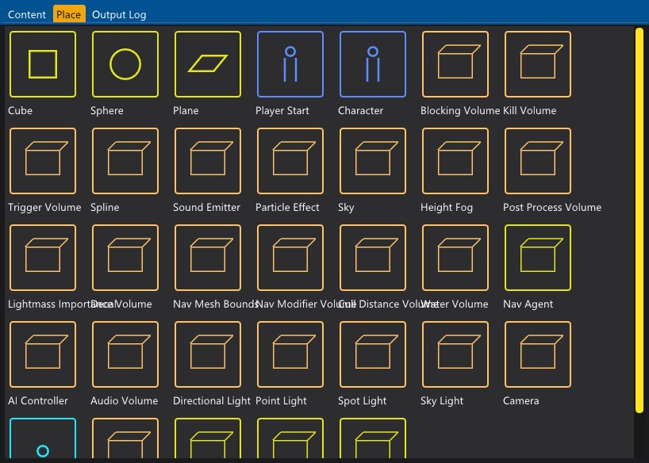
*Step 1: the Place tab. Drag shapes, a Player Start and lights into the viewport.*

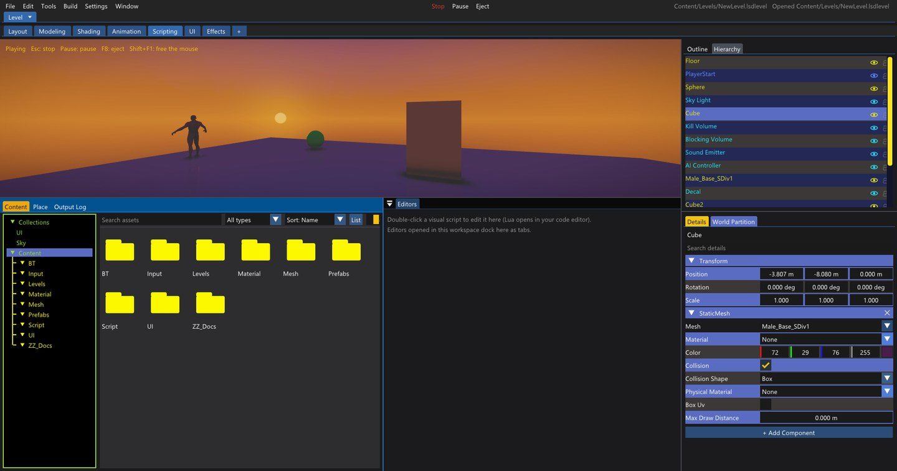
*Then press Play: the level runs in the viewport.*

*Unreal: a blockout level with the Third Person template's character.*

1. **File > New Level**. You get a floor and a Player Start.
2. **Place** tab > **Directional Light**; rotate it (E) so it points down at an angle.
   **Place > Sky Light** for ambient.
3. Block out with shapes: Place > **Cube**, scale it (R) into walls and steps; **Ctrl+D**
   duplicates the selection and **W** moves the copy. Turn Snap on in the toolbar for tidy 0.5 m steps.
4. Select the Player Start and press **Alt+P**. You walk with **WASD**, look with the mouse, jump
   with **Space**. **Esc** stops.
5. For a third-person character instead: Place > **Cube** (the body), **Add Component >
   Character**, set **Camera Distance** to 4. Play again: the camera follows behind the cube.
6. Proper input assets: Content Browser > **New Input Setup (Move, Look, Jump)** creates
   `IA_Move`, `IA_Look`, `IA_Jump` and `IMC_Default`. Pick `IMC_Default` and the three actions on the
   Character in Details. Edit `IMC_Default` to remap keys.
7. **Ctrl+S** to save the level into `Content/`.

---

## 2. Coins, a score HUD and a save game

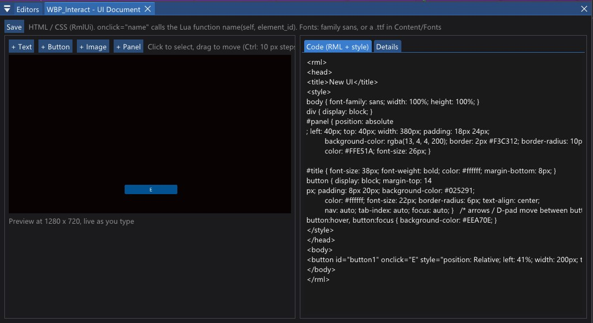
*The HUD is a UI document: double-click it to edit it in the UI window (designer on the left, code on the right).*

*Unreal: overlap events, a UMG HUD widget and a SaveGame object.*

**The HUD.** Content Browser > **New UI Document**, rename it `UI_HUD`, double-click and replace the
code:

```html
<rml>
<head>
<style>
body { font-family: sans; }
div { display: block; }
#score { position: absolute; left: 30px; top: 30px; color: #FFE51A; font-size: 32px;
         background-color: rgba(0, 0, 0, 140); padding: 6px 14px; border-radius: 6px;
         white-space: nowrap; }
</style>
</head>
<body><div id="score">Coins: 0</div></body>
</rml>
```

Save (Ctrl+S).

**The game script.** New Lua Script `game.lua`:

```lua
-- Runs for the whole game (Game Mode). Globals in _G are shared by every script.
function on_start(self)
  local save = lsd.load_game("Progress")
  _G.coins = save and save.coins or 0
  _G.hud = lsd.ui_open("UI_HUD")
  lsd.ui_set_text(_G.hud, "score", "Coins: " .. _G.coins)
end
```

New Data Asset > **Game Mode** named `GM_Coins`, pick `game.lua` as its Script, and pick `GM_Coins`
in **Window > World Settings > Game Mode**.

**A coin.** New Lua Script `coin.lua`:

```lua
function on_update(self, dt)               -- spin
  local x, y, z = lsd.rotation(self.entity)
  lsd.set_rotation(self.entity, x, y, z + 120 * dt)
end

function on_overlap_begin(self, other)     -- this object's Trigger Volume was entered
  if not lsd.has(other, "Character") then return end
  _G.coins = _G.coins + 1
  lsd.ui_set_text(_G.hud, "score", "Coins: " .. _G.coins)
  lsd.save_game("Progress", {coins = _G.coins})
  lsd.destroy(self.entity)
end
```

Place > **Trigger Volume**, scale it to about 1 × 1 × 1.5, add a **Static Mesh** (Sphere, scale 0.5,
untick Collision, a yellow colour) and a **Script** with `coin.lua`. Right-click it in the Outliner >
**Create Prefab**, then drag the prefab around the level. The player needs a Character (example 1,
step 5). Play, collect, stop, play again: the count continues from the save.

To start over, call `lsd.delete_save("Progress")` (or delete `Saved/SaveGames/Progress.json`).

---

## 3. A glowing lava material

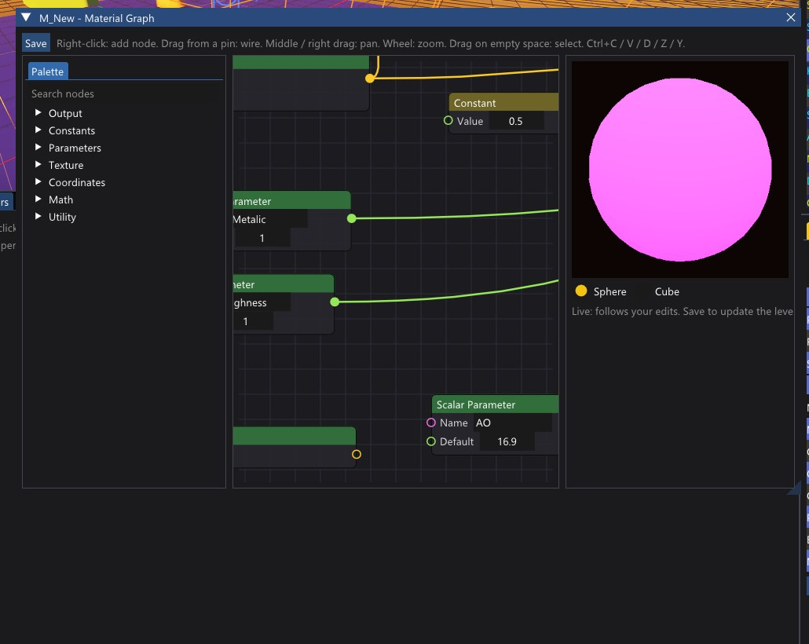
*The Material Graph editor: add nodes from the Palette, wire them to the Material Output, watch the preview.*

*Unreal: a Material with a Panner, Time and emissive, and a Material Instance.*

1. Drop a lava-like texture (`T_Lava.png`) into the Content Browser.
2. **New Material Graph**, name it `M_Lava`, double-click.
3. Right-click the canvas to add, then wire:
   - **Texture Coordinate** (Tiling 4, 4, 1) → **Panner** UV; Panner Speed `0.05, 0.02, 0`.
   - Panner → **Texture Sample** UV; pick `T_Lava`, Type Color.
   - Texture Sample RGB → **Material Output > Base Color**.
   - **Time** → **Sine** → **Lerp** Alpha, with Lerp A `0.5` and B `1.5`;
     **Multiply** A = Texture Sample RGB, B = Lerp → Material Output **Emissive**.
   - **Constant** 0.9 → **Roughness**.
4. Watch the preview on the right, then **Save** and drop `M_Lava` onto a floor cube.
5. Make it adjustable: replace the Lerp's B with a **Scalar Parameter** named `Glow` (default 1.5).
   Save. **New Data Asset > Material Instance**, parent `M_Lava`, click **Add the graph's
   parameters**, set Glow to 4: a hotter lava with no recompile.

Emissive is in the same units as lights: with a bright sun and high exposure, raise it.

---

## 4. A guard that patrols and chases

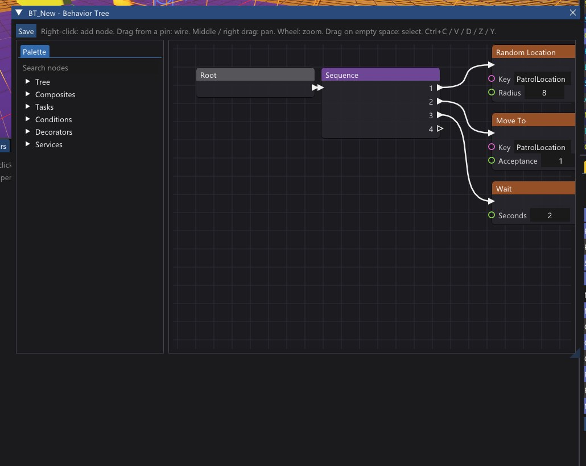
*The guard's Behavior Tree: Sequence > Random Location > Move To > Wait for the patrol.*

*Unreal: a Nav Mesh Bounds Volume, an AI Controller with a Behavior Tree and AI Perception.*

1. Build a level with a floor and a few walls (meshes with Collision on). Place > **Nav Mesh
   Bounds** and scale it over the floor. Press **P**: the walkable area shows in green.
2. Place > **Nav Agent** (a cube that will walk). Rename it `Guard`. Its +X axis is where it looks.
3. **New Behavior Tree** `BT_Guard`. It starts as a patrol (Root → Sequence → Random Location →
   Move To → Wait). Make it chase when it sees the player:
   - Add a **Selector** between the Root and the patrol Sequence (Root → Selector, Selector pin 2 →
     the patrol Sequence).
   - Add a **Sequence** on Selector pin 1 with **Is Set** (Key `CanSeePlayer`) then **Move To**
     (Key `PlayerLocation`, Acceptance 1.5).
   - Save.
4. Select the Guard, **Add Component > AI Controller**, pick `BT_Guard`; sight range 15 m, field of
   view 120°.
5. Play with the tree window open: it wanders, and as soon as you step into its view the chase branch
   glows green and it comes for you. Out of sight it goes back to patrolling.

Make it attack with Lua: add **Run Script** (Function `bt_attack`) after the chase's Move To, and a
Script on the Guard:

```lua
function bt_attack(self, dt)
  lsd.log("Caught you!")
  lsd.report_noise(lsd.position(self.entity))   -- other guards in hearing range get NoiseLocation
  return true                                      -- success; return nothing to keep running
end
```

---

## 5. A main menu for mouse, keyboard and gamepad, in two languages


*The menu is a UI document; buttons get an On Click in Details.*

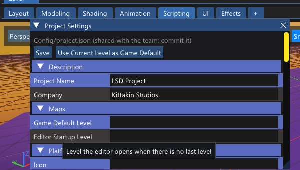
*Project Settings: set the Game Default Level and the languages.*

*Unreal: a main menu Widget, Common UI focus navigation and a String Table.*

**Text.** Make `ST_Menu.csv` (Excel or a text editor), drop it into the Content Browser:

```csv
Key,en,fr
MENU_PLAY,Play,Jouer
MENU_LANGUAGE,Français,English
MENU_QUIT,Quit,Quitter
```

**Edit > Project Settings > Localization**: String Table `ST_Menu`, Default Language `en`.

**The menu.** New UI Document `UI_MainMenu`:

```html
<rml>
<head>
<style>
body { font-family: sans; width: 100%; height: 100%; background-color: rgba(13, 4, 4, 230); }
div { display: block; }
#menu { position: absolute; left: 80px; top: 120px; width: 320px; }
button { display: block; margin-top: 12px; padding: 10px; font-size: 26px; text-align: center;
         background-color: #025291; color: white; border-radius: 6px;
         nav: auto; tab-index: auto; focus: auto; }
button:hover, button:focus { background-color: #EEA70E; }
</style>
</head>
<body>
<div id="menu">
  <button id="play" onclick="menu_play" autofocus>MENU_PLAY</button>
  <button id="language" onclick="menu_language">MENU_LANGUAGE</button>
  <button id="quit" onclick="menu_quit">MENU_QUIT</button>
</div>
</body>
</rml>
```

**The script** (`menu.lua`, as the Game Mode's script):

```lua
function on_start(self)
  self.menu = lsd.ui_open("UI_MainMenu")
  lsd.ui_show_cursor(true)                 -- the mouse drives the menu, not the player
end

function menu_play(self, id)
  lsd.ui_close(self.menu)
  lsd.ui_show_cursor(false)
end

function menu_language(self, id)
  local now = lsd.get_settings().language
  lsd.set_language((now == "fr") and "en" or "fr")   -- the open menu reloads translated
end

function menu_quit(self, id)
  lsd.log("Quit pressed")                  -- in a packaged game, Esc quits
end
```

Play: click the buttons, or use the **arrow keys / D-pad** to move the orange focus and **Enter /
gamepad A** to press. The language choice is saved in the player's settings.

---

## 6. A campfire: particles, sound and light

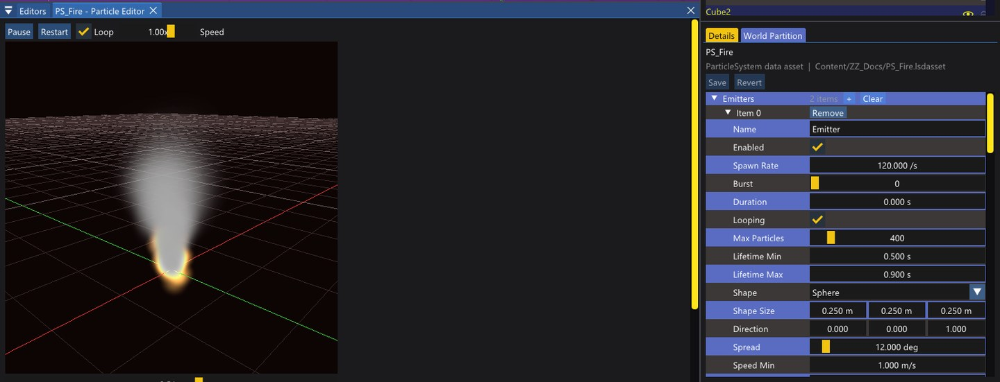
*PS_Fire in the Particle Editor: tune the emitters in Details while the preview plays.*

*Unreal: a Niagara System, an Ambient Sound and a Point Light, grouped.*

1. **New Data Asset > Particle System** `PS_Fire`. In Details add three emitters:
   - **Flames**: spawn rate 120, lifetime 0.5–0.9 s, shape Sphere (0.25), spread 12°, speed 1–2,
     Blend Additive, colour start orange (alpha 0.6) → end dark red (alpha 0), size 0.5 → 0.15.
   - **Sparks**: rate 0, burst 40, duration 1.5 s looping, spread 60°, speed 3–5, gravity scale 1,
     Additive, size 0.06 → 0.03.
   - **Smoke**: rate 25, lifetime 2–3 s, speed 0.8–1.2, wind (0.4, 0, 0), drag 0.3, Alpha blend,
     grey colour (alpha 0.6 → 0), size 0.4 → 1.6.
   Double-click `PS_Fire` to tune it in the Particle Editor (preview, timeline, particle counts).
2. Drag `PS_Fire` into the viewport.
3. Drop a crackling `.ogg` into the Content Browser, set it to Looping in its Details, drag it onto
   the fire: a Sound Emitter. Give it a Sound Attenuation asset so it fades with distance.
4. Place > **Point Light** just above the flames: orange (or 1900 K), 800 lumens, Cast Shadows.
5. Select the three, **Ctrl+G** to group them, then Outliner > **Create Prefab** `BP_Campfire`.

---

## 7. A door that opens with a visual script

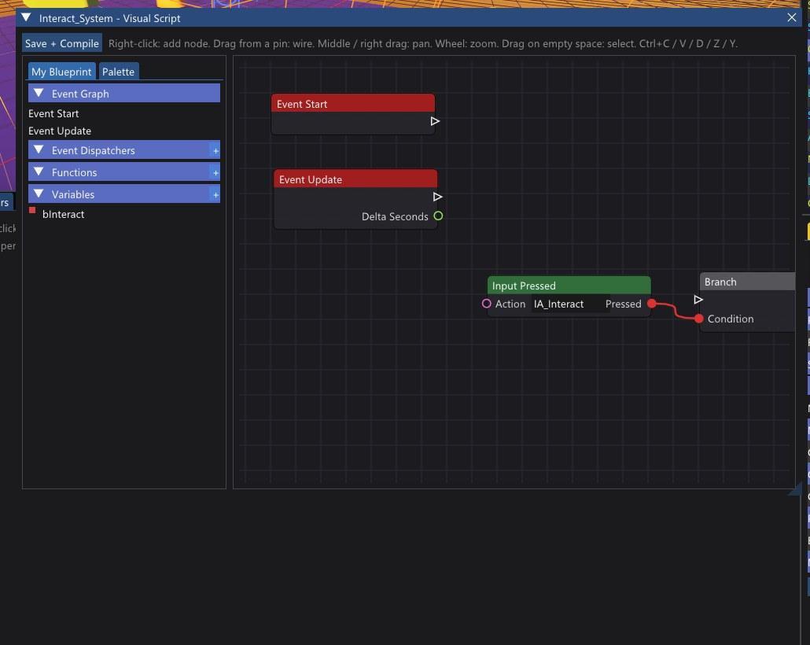
*A visual script: events on the left of the canvas, white exec wires for order, coloured wires for values.*

*Unreal: a Blueprint with an overlap event and a timeline-like move.*

1. Place a **Cube** scaled into a door; add a **Trigger Volume** in front of it as its child
   (drag the trigger onto the door in the Outliner).
2. **New Visual Script** `VS_Door`, double-click. Right-click > **Event Overlap Begin**; wire it to
   **Add Offset** (Target: Find Object "Door", Offset `0, 0, 3`); wire Add Offset's exec on to
   **Print String** "Door opened".
3. **Save + Compile**. Give the Trigger Volume a **Script** component and pick `VS_Door`.
4. Play and walk into the trigger: the door rises.

For a smooth slide, a Lua script with a timer does the same:

```lua
function on_overlap_begin(self, other)
  local door = lsd.find("Door")
  local x, y, z = lsd.position(door)
  local start = lsd.time()
  self.timer = lsd.every(0, function()
    local t = math.min((lsd.time() - start) / 1.5, 1)      -- 1.5 s
    lsd.set_position(door, x, y, z + 3 * t)
    if t >= 1 then lsd.cancel(self.timer) end
  end)
end
```

---

## 7b. A gun in the hand (LSD Assistant lesson)

A Cube gun in a character's right hand: 10/10 ammo, RMB aims, LMB shoots, R reloads, and a crosshair
dot set in Details. One Script component, Weapon, that works on any rigged character. The lesson
text in the editor walks through every line of its code, with these pictures.

1. Select the character (the soldier, `FBX_Char01_Update_Rig`) in the Outliner.
2. **Tools > LSD Assistant**, the **Lessons** tab, **Gun on a hand socket**, then **Apply to
   Selected Character**. It writes `Content/Weapon/Weapon.lua` and `WBP_Crosshair.rml`, makes
   `IA_Aim` (Right Mouse Button), `IA_Fire` (Left Mouse Button) and `IA_Reload` (R) and adds them to
   the character's Mapping Context, adds the socket and the component. Files already there are kept.

   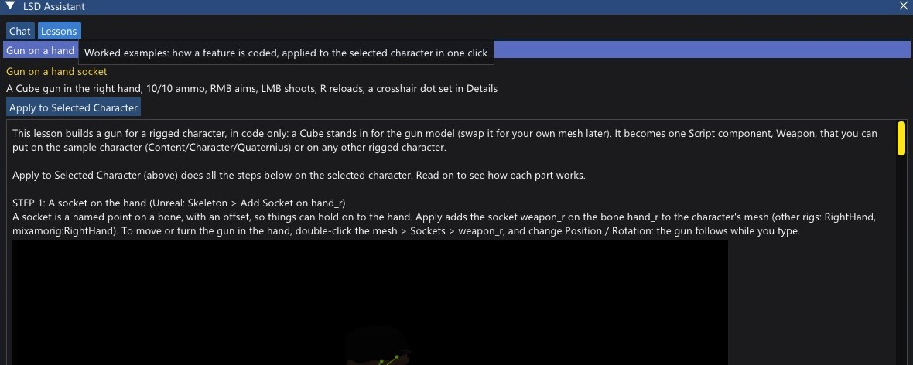
   *The Lessons tab: the lesson, its Apply button and the steps it explains.*

3. **The socket** (Unreal: Skeleton > Add Socket): `weapon_r` on the bone `hand_r`, the point the gun
   holds on to. Double-click the mesh > **Sockets** > `weapon_r` to move or turn the gun in the hand.

   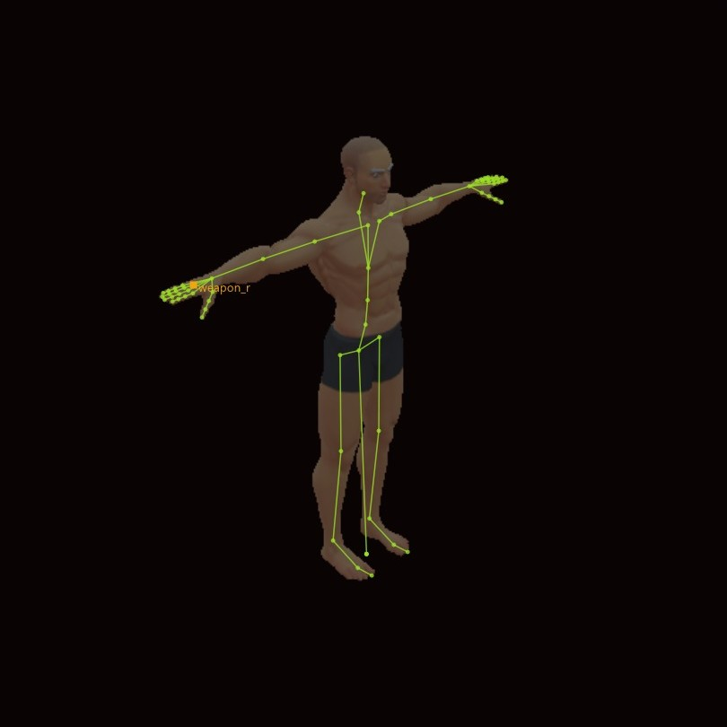
   *The Mesh Editor: the skeleton, and the `weapon_r` socket in the right palm.*

4. **The component** (Unreal: an Actor Component): the character's Details now has a Script running
   Weapon, with every value of its `properties` table per character: socket, ammo, max ammo, range,
   damage, reload time, aim distance and shoulder, the aim pose's bones and reach, the crosshair's size
   and colours, the shoot and reload montages.

   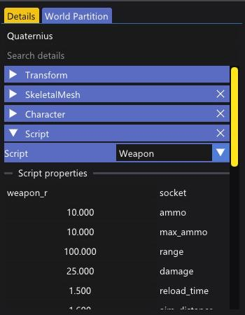
   *Details: Script = Weapon, then its properties (collapse the other components to find it).*

5. **Play**. The crosshair dot is in the middle of the screen and the ammo at the bottom right.

   
   *From the hip: the white dot, 10/10.*

6. **Hold RMB** to aim: the camera's spring arm comes in over the right shoulder, IK raises the arm
   along the view so the gun points at the dot, and the dot turns red.

   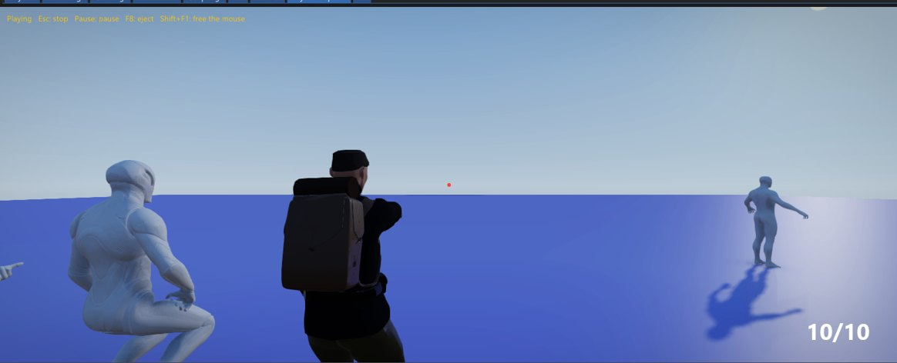
   *Aiming.*

7. **Click LMB** to shoot: one round less, a tracer from the gun to where the dot was, and
   `on_damage(self, amount, shooter)` on what it hit (give a target a script with that function).

   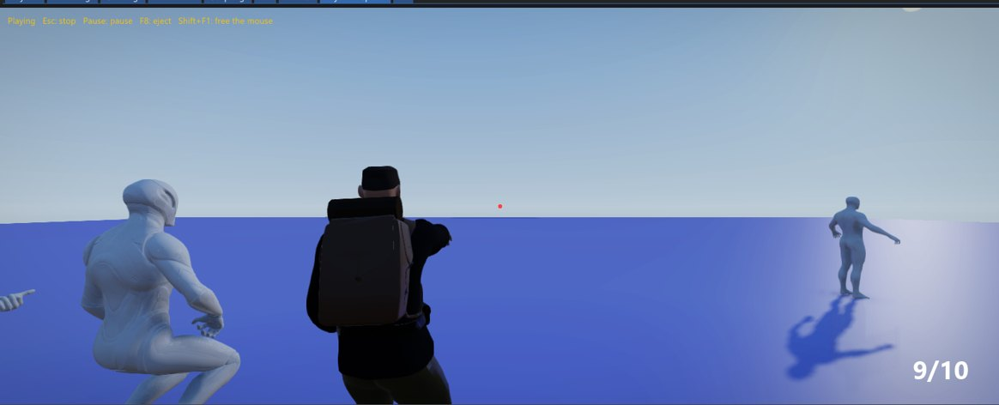
   *After one shot: 9/10.*

8. **Press R** to reload: the reload montage plays on the upper body, the HUD says Reloading... until
   Reload Time has passed, and the magazine is full again.

   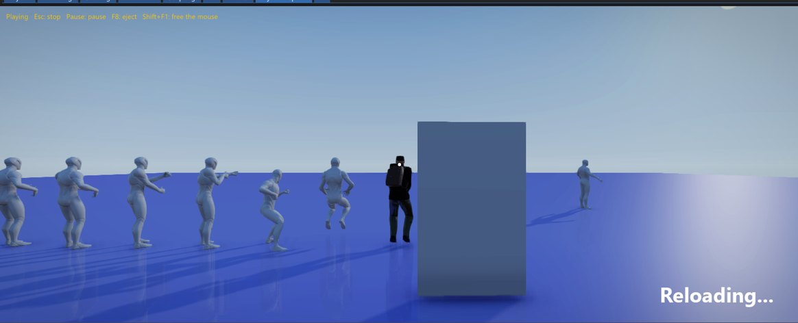
   *Reloading.*

## 8. Ship it

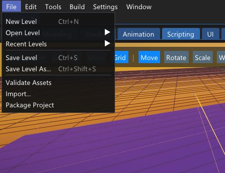
*File > Package Project (also in the Build menu) writes Build/<Project Name>/.*

*Unreal: Project Settings, Package Project, and an automation test on a build machine.*

1. **Edit > Project Settings**: Project Name `Coin Run`, **Game Default Level** (the level from
   example 2), Icon (a 256 × 256 PNG), optionally the Steam App ID.
2. **File > Validate Assets** and fix anything in the Message Log.
3. Build the Release engine once:

   ```powershell
   cmake --build --preset windows-msvc --config Release
   ```

4. **File > Package Project**. The status bar names the folder: `Build/Coin Run/`.
5. Copy `Build/Coin Run/` to another PC and double-click `Coin Run.exe`. It runs the level full
   window; players' settings and saves go to its `Saved/` folder.
6. On a build server, check every level still plays without errors:

   ```powershell
   lsd_editor.exe -nosound -level=Content/Levels/Main.lsdlevel -smoketest=10
   ```

   Exit code 0 means no errors were logged in 10 seconds of play.

---

## 9. Coin Run: a whole small game

*Unreal: the Third Person template turned into a game with a Level Blueprint, overlap events, an AI
chaser, a UMG main menu and HUD, a SaveGame for the best time, a sound and a Niagara burst; an
Editor Utility builds it.*

A menu (Play / Quit, mouse or arrow keys and Enter) comes first, with the best time. Play: take all 8
coins in 60 seconds without the red guard catching you. Each coin chimes and bursts into sparks. The
end message, the best time and Play again / Quit come back in the same menu. Everything is in
`Content/CoinRun/`:

| File | What it is |
| --- | --- |
| `CoinRun.lsdlevel` | the Third Person template's arena with the coins, the guard and a Nav Mesh Bounds; the player is the rigged soldier |
| `ABP_CoinRun.lsdasset` | the player's Animation Graph (Unreal's Anim Blueprint state machine): Idle, Walk, Jump |
| `CoinRun_Game.lua` | the Level Script (World Settings): menu, HUD, timer, win / lose; counts the coins with `lsd.find_all("Coin")` |
| `CoinRun_Coin.lua` | spins; `on_overlap_begin` plays `S_Coin`, spawns `PS_CoinBurst`, counts it and destroys it |
| `CoinRun_Guard.lua` | a Nav Agent: waits while a menu is up, walks the corners with `lsd.move_to`, chases within 10 m, catches at 1.6 m |
| `UI_CoinRun.rml` | the HUD and the menu (`#menu`, its buttons call `coinrun_play` / `coinrun_quit`) |
| `S_Coin.wav` | the pickup blip (two short sine notes, made by a script) |
| `PS_CoinBurst` | a Particle System: one burst of 40 additive sparks, not looping, so the spawned effect deletes itself |
| `EU_BuildCoinRun.lua` | the Editor Utility that placed it all: spawns, `lsd.set_name`, the player's Skeletal Mesh (`lsd.assets("AnimGraph")` finds the graph), `lsd.set_world_settings({level_script = ...})` |

**The player** (Unreal: a Skeletal Mesh on the Character with an Anim Blueprint): the template's cube
body is now a Skeletal Mesh, `Content/Character/FBX_Char01_Update_Rig` (its materials come from its Material
Slots), on the `Body` child of `Player` at the feet (position 0, scale 1, Facing Auto: a UE5 rig is turned to
face +X). Its **Anim Graph** is `ABP_CoinRun`; double-click it for the State Machine window:

| State | Plays | Gets there when |
| --- | --- | --- |
| Idle (entry) | `Anim_Idle_Sheath` | Speed < 0.3, or from Jump when InAir is False |
| Walk | `Anim_Walk` at Play Rate 2 | Speed > 0.3 |
| Jump | `Anim_Walk` held on its first frame (Play Rate 0, not looping) | InAir is True, from any state |

The Character fills Speed and InAir every frame; the clips are UE5 Manny takes, retargeted onto the soldier
by bone name when they load. Select `Body` while playing: Details > Skeletal Mesh shows the state ("State:
Walk (blending from Idle)"). `Content/Character` has no run or jump take, so Walk plays twice as fast for the
5 m/s Walk Speed (the feet still slide a little) and Jump is a held pose; drop a run take in and make Walk a
blend space on Speed (walk at 1.5, run at 5) when you have one.

How the parts work:

- **The menu** is a `<div id="menu">` in the HUD document. `lsd.ui_style(hud, "menu", "display", "none")`
  hides it, `"block"` shows it; `lsd.ui_show_cursor(true / false)` frees the mouse for it or gives the
  mouse and keys back to the game. While it is up the player's Character has `walk_speed = 0`.
- **Quit** calls `lsd.quit()`: Play stops in the editor, the packaged game closes.
- **Play again** sets `lsd.game_instance().replay = true` and `lsd.open_level("CoinRun")`: the level comes
  back with every coin and its `on_start` sees the flag and starts the round without the menu.
- **Best time**: `lsd.save_game("CoinRun", {time = t})` when it beats `lsd.load_game("CoinRun")` (in
  `Saved/SaveGames/CoinRun.json`).
- **Pickup**: `lsd.play_sound("S_Coin", x, y, z)` and `lsd.spawn("PS_CoinBurst", x, y, z)` at the coin.

To build it again: `template.New Third Person`, save the level as `CoinRun`, run **EU_BuildCoinRun**
(Tools > Editor Utilities), Ctrl+S. Package it with Project Settings > Maps > Game Default Level set to
`CoinRun` (example 8).
