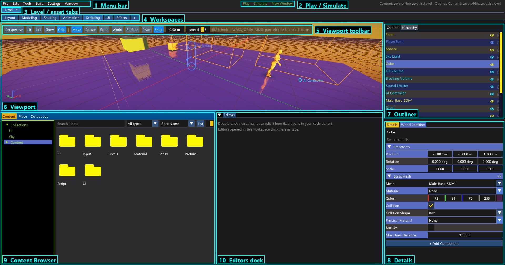
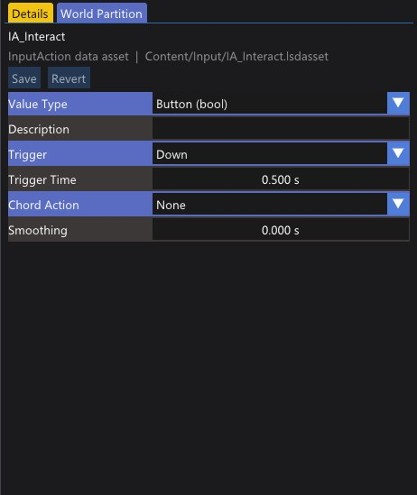
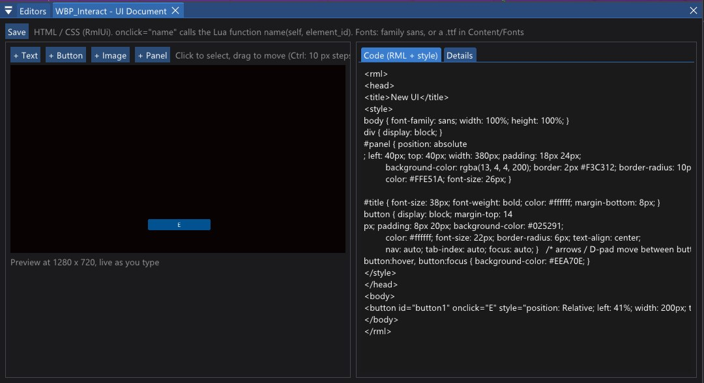
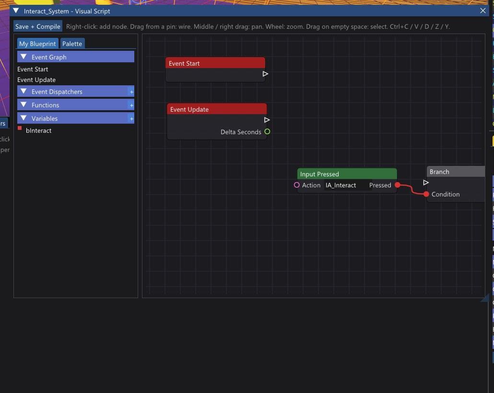

# Examples: your first game systems, step by step

New to LSD_Engine? Start here. Each example builds one small, real game system from nothing, and
says exactly where to click and what to type. By the end you will have:

1. Input Actions for **Move, Look, Jump, Crouch, Sprint, Swim and Interact**, all mapped to keys and
   a gamepad
2. A **HUD** with a **health bar** and a **stamina bar**
3. **Sprinting that drains stamina** (and stamina that comes back)
4. **A hurt zone that drains health**, separately from stamina, and a zone that heals
5. **Interacting**: press E on a door to open it, in Lua and as a visual script

You need no programming experience. Every script is short, and every line is explained. If you know
Unreal: Input Actions and Mapping Contexts are Enhanced Input, the HUD is a UMG widget, scripts are
Blueprints (or their Lua twin), and the Details panel is Unreal's Details panel.

The other guides go further: the [MANUAL](../MANUAL.md) (every panel and feature),
[How to code in LSD_Engine](../How%20to%20code%20in%20LSD_Engine.md) (the scripting workflow and
debugging), [EXAMPLES](../EXAMPLES.md) (bigger projects: a level, a guard AI, a menu, shipping) and
[CODING](../CODING.md) (C / C++).

---

## 0. Before you start: the four things you will use


*The editor. You will use the Content Browser (9) to make assets, the Details panel (8) to change
them, the Outliner (7) to pick objects, and Play (2) to try things.*

| You want to... | Do this |
| --- | --- |
| Make a new asset | **Content Browser**: right-click empty space in a folder, pick **New ...** |
| Rename an asset | Select it, press **F2**, type, **Enter** |
| Change an asset or object | Select it; edit it in **Details** (changes apply at once, even while playing) |
| Add something to an object | Select it, **Details** > **+ Add Component** at the bottom |
| Try your game | **Play** (Alt+P). **Esc** stops. **Shift+F1** frees the mouse |
| Read what scripts print | The **Output Log** tab next to Content Browser |

Make one folder for this tutorial so everything stays together: in the Content Browser, right-click
empty space > **New Folder**, name it `Tutorial`, double-click it to go in. (Mouse 4 takes you back
to the previous folder.)

Your level needs a floor and a player. If it has none yet: **Place** tab > drag a **Cube** into the
viewport and scale it flat and wide (R, then drag) for a floor; drag a **Character** above it.

---

## 1. Input Actions: Move, Look, Jump, Crouch, Sprint, Swim, Interact

Input works in two layers, exactly like Unreal's Enhanced Input:

- An **Input Action** is a *meaning*: "Jump", "Move". Scripts and the Character ask about actions,
  never about keys.
- An **Input Mapping Context** says *which keys* trigger which action. Change keys there (or let the
  player rebind them) and nothing else needs to change.

### 1.1 Make the Input Actions

For each row of the table: Content Browser > right-click > **New Data Asset** > **InputAction**,
press **F2** and give it the name, then set **Value Type** (and **Trigger**) in Details.

| Name | Value Type | Trigger | What it is for |
| --- | --- | --- | --- |
| `IA_Move` | Axis 2D (Vector2D) | Down | walking: x = right / left, y = forward / back |
| `IA_Look` | Axis 2D (Vector2D) | Down | turning the camera: x = turn, y = look up / down |
| `IA_Jump` | Button (bool) | Down | jumping; in water, swimming up |
| `IA_Crouch` | Button (bool) | Down | crouching while held; in water, diving |
| `IA_Sprint` | Button (bool) | Down | running while held (our script uses it) |
| `IA_Interact` | Button (bool) | **Pressed** | doors, pickups, levers: fires once per press |

Why these choices:

- **Axis 2D** for Move and Look: one action carries two numbers, so W/A/S/D and a thumbstick can
  feed the same action.
- **Down** means "true every frame it is held" (good for Sprint and Crouch). **Pressed** means
  "true only on the frame it is pushed" (good for Interact: one press, one door).
- **Swim** is not a separate action: inside water, **Jump** swims up and **Crouch** dives, and
  **Move** swims where you look. Same keys, different place: players never learn extra buttons.

Fill in **Description** too ("Sprint while held"): the key rebinding menu shows it to players.


*An Input Action in Details: Value Type, Description, Trigger and Trigger Time.*

### 1.2 Map keys to them: the Input Mapping Context

Content Browser > right-click > **New Data Asset** > **InputMappingContext**, name it `IMC_Player`.
In Details, under **Mappings**, press **+** once per row below. In each row pick the **Action**,
click **Key** and press the key (or move the stick), and set **Axis** and **Scale**:

| Action | Key | Axis | Scale | Why |
| --- | --- | --- | --- | --- |
| `IA_Move` | W | Y | 1 | forward is +y |
| `IA_Move` | S | Y | -1 | back is -y (Scale -1 is Unreal's Negate) |
| `IA_Move` | D | X | 1 | right is +x |
| `IA_Move` | A | X | -1 | left is -x |
| `IA_Move` | Gamepad Left Stick | X | 1 | a stick is already 2D: both x and y |
| `IA_Look` | Mouse XY | X | 1 | the mouse is already 2D |
| `IA_Look` | Gamepad Right Stick | X | 12 | sticks give -1..1; 12 makes them turn as fast as a mouse |
| `IA_Jump` | Space | X | 1 | |
| `IA_Jump` | Gamepad Face Bottom | X | 1 | A on Xbox, Cross on PlayStation |
| `IA_Crouch` | Left Ctrl | X | 1 | |
| `IA_Crouch` | Gamepad Face Right | X | 1 | B / Circle |
| `IA_Sprint` | Left Shift | X | 1 | |
| `IA_Sprint` | Gamepad Left Thumb | X | 1 | pressing the left stick in |
| `IA_Interact` | E | X | 1 | |
| `IA_Interact` | Gamepad Face Left | X | 1 | X / Square |

**Axis** only matters when a 1-key input (W) feeds a 2D action (Move): it says which half of the
action that key drives. Buttons ignore it.

### 1.3 Give them to the Character

Select your **Character** in the Outliner. In Details, in the **Character** section:

| Field | Pick |
| --- | --- |
| Mapping Context | `IMC_Player` |
| Move Action | `IA_Move` |
| Look Action | `IA_Look` |
| Jump Action | `IA_Jump` |
| Crouch Action | `IA_Crouch` |

Press **Play**: WASD walks, the mouse looks, Space jumps, Ctrl crouches. Sprint and Interact do
nothing yet: they need the scripts below. (Edits to the Input Actions and the Mapping Context apply
while playing, within a quarter of a second, so you can try a new key without stopping.)

Want swimming? **Place** tab > drag a **Water Volume** into the level and scale it into a pool. Walk
in: Move swims where you look, Space rises, Ctrl dives. **Swim Speed** on the Character sets how fast.

---

## 2. Lua in five minutes

Scripts are small text files in **Lua**, a simple language made for games. This is all of Lua you
need for this tutorial:

```lua
-- Two dashes start a comment: notes for people, ignored by the engine.

local speed = 5            -- a variable: a named value. "local" keeps it inside this file.
local name = "Door"        -- text goes in quotes
local open = false         -- true or false

if speed > 3 then          -- do something only when a condition holds
    lsd.log("fast")        -- lsd.log prints to the Output Log
else
    lsd.log("slow")
end

local function double(x)   -- a function: a named recipe you can run again
    return x * 2
end
lsd.log(double(21))        -- prints 42
```

The engine runs some functions for you, by name:

| Function | When the engine runs it |
| --- | --- |
| `on_start(self)` | once, when Play starts (or when the object is spawned) |
| `on_update(self, dt)` | every frame; `dt` is the seconds since the last frame (about 0.016) |
| `on_overlap_begin(self, other)` | something entered this object's Trigger Volume |
| `on_overlap_end(self, other)` | it left again |
| any name you choose | when another script calls it with `lsd.call(object, "name", ...)` |

`self` is this script's own table: `self.entity` is the object the script is on, and anything you
put in it (`self.health = 100`) stays there between frames. Everything the engine offers starts with
`lsd.` (`lsd.input`, `lsd.ui_open`, `lsd.set`...): the [MANUAL's Lua API list](../MANUAL.md) has
them all.

**Why multiply by `dt`?** A game runs at 30, 60 or 144 frames a second. "Lose 25 stamina per second"
is `stamina - 25 * dt` each frame: the same speed on every PC.

### Making and attaching a script

1. Content Browser > right-click > **New Lua Script**, press F2, name it (for example `PlayerStats`).
2. Double-click it: it opens in VS Code (or your code editor). Type the script, save (Ctrl+S).
3. Select the object it belongs to, **Details** > **+ Add Component** > **Script**, and pick the
   script in its **Script** field.

Saved changes reload while playing; you do not need to stop.

---

## 3. The HUD: a health bar and a stamina bar

A HUD is a **UI Document**: HTML for what is on screen, CSS for how it looks (Unreal's UMG widget).

1. Content Browser > right-click > **New UI Document**, name it `WBP_HUD`.
2. Double-click it to open the **UI window**: design view on the left, code on the right.
3. Replace all the code with this, then **Save**:

```html
<rml>
<head>
<style>
body { font-family: sans; }
div { display: block; }

/* The panel holding both bars, bottom-left of the screen. */
#bars { position: absolute; left: 30px; bottom: 30px; width: 320px; }

/* A label above each bar. */
.label { color: #FFFFFF; font-size: 16px; margin-top: 10px; }

/* The dark empty bar... */
.bar { height: 20px; background-color: #00000099; border: 2px #000000; }

/* ...and the coloured part inside it. Its width is how full it is. */
.fill { height: 100%; width: 100%; }
#health_fill { background-color: #D93030; }
#stamina_fill { background-color: #3FBF4F; }
</style>
</head>
<body>
<div id="bars">
    <div class="label">Health <span id="health_text">100</span></div>
    <div class="bar"><div class="fill" id="health_fill"></div></div>

    <div class="label">Stamina <span id="stamina_text">100</span></div>
    <div class="bar"><div class="fill" id="stamina_fill"></div></div>
</div>
</body>
</rml>
```


*The UI window: the live preview / designer on the left, the code on the right.*

How a bar works: the **fill** sits inside the **bar**. Its width is a percentage of the bar: 100% is
full, 25% is a quarter. Our script will change that width; every element we want to change has an
**id** (`health_fill`, `stamina_text`) so the script can find it.

Nothing shows in the game yet: a script opens the document in the next step.

---

## 4. Player stats: health and stamina, and sprinting that drains stamina

One script on the player keeps both numbers, draws both bars, and handles sprinting.

1. New Lua Script `PlayerStats` (see "Making and attaching a script").
2. Type this:

```lua
-- PlayerStats: the player's health and stamina, shown on the HUD.
-- Put it on the Character.

local MAX_HEALTH = 100
local MAX_STAMINA = 100
local SPRINT_COST = 25     -- stamina lost per second while sprinting
local STAMINA_REGEN = 15   -- stamina regained per second while not sprinting
local REGEN_DELAY = 1.0    -- seconds of rest before stamina starts coming back
local SPRINT_SPEED = 9     -- metres per second while sprinting

-- Draw both bars from the numbers in self.
local function show(self)
    local health_pct = math.floor(self.health / MAX_HEALTH * 100)
    local stamina_pct = math.floor(self.stamina / MAX_STAMINA * 100)
    lsd.ui_set(self.hud, "health_fill", "style", "width: " .. health_pct .. "%")
    lsd.ui_set(self.hud, "stamina_fill", "style", "width: " .. stamina_pct .. "%")
    lsd.ui_set_text(self.hud, "health_text", math.floor(self.health))
    lsd.ui_set_text(self.hud, "stamina_text", math.floor(self.stamina))
end

function on_start(self)
    self.health = MAX_HEALTH
    self.stamina = MAX_STAMINA
    self.rest = 0                          -- seconds since we last sprinted
    self.hud = lsd.ui_open("WBP_HUD")      -- show the HUD; keep its handle
    self.walk_speed = lsd.get(self.entity, "Character").walk_speed  -- remember the normal speed
    self.sprinting = false
    show(self)
end

function on_update(self, dt)
    -- Is the player holding Sprint while moving?
    local move_x, move_y = lsd.input("IA_Move")
    local moving = move_x ~= 0 or move_y ~= 0
    local sprint_held = lsd.input("IA_Sprint") > 0
    local sprinting = sprint_held and moving and self.stamina > 0

    if sprinting then
        self.stamina = math.max(0, self.stamina - SPRINT_COST * dt)   -- drain, never below 0
        self.rest = 0
    else
        self.rest = self.rest + dt
        if self.rest >= REGEN_DELAY then                                -- rested long enough
            self.stamina = math.min(MAX_STAMINA, self.stamina + STAMINA_REGEN * dt)  -- refill, never above max
        end
    end

    -- Change the Character's speed only when sprinting starts or stops.
    if sprinting ~= self.sprinting then
        self.sprinting = sprinting
        lsd.set(self.entity, "Character", {walk_speed = sprinting and SPRINT_SPEED or self.walk_speed})
    end

    show(self)
end

-- Other scripts hurt or heal the player with lsd.call(player, "take_damage", 10).
function take_damage(self, amount)
    self.health = math.max(0, self.health - amount)
    show(self)
    if self.health <= 0 then
        lsd.log("You died!")
        self.health = MAX_HEALTH   -- a real game would show a Game Over menu here
    end
end

function heal(self, amount)
    self.health = math.min(MAX_HEALTH, self.health + amount)
    show(self)
end
```

3. Select the **Character**, **+ Add Component** > **Script**, pick `PlayerStats`.
4. **Play**. Hold **Shift** while walking: you run, and the green bar shrinks. Let go: after a
   second it fills again. If it empties, you slow down until it comes back.

What each part does:

- The `local NAME = value` lines at the top are **settings**. Change `SPRINT_COST` to 50 and save
  while playing: stamina now drains twice as fast.
- `show(self)` turns numbers into the bars: 37 stamina of 100 becomes `width: 37%`.
  `..` joins text together: `"width: " .. 37 .. "%"` is `"width: 37%"`.
- `lsd.input("IA_Sprint")` gives 1 while Sprint is held, 0 when not.
  `lsd.input("IA_Move")` gives two numbers, x and y; both 0 means standing still.
- `math.max(0, ...)` and `math.min(MAX, ...)` **clamp**: they keep a value inside its limits.
- `lsd.set(self.entity, "Character", {walk_speed = ...})` changes the Character's walk speed, the same
  as typing it in Details. We only call it when sprinting changes, not every frame.
- `take_damage` and `heal` are our own functions. The engine never calls them; other scripts do
  (next example).

---

## 5. Draining health (separately): a hurt zone and a heal zone

Stamina drains from sprinting. Health drains from something else: standing in fire, lava or poison.
This is a second, separate script on a different object, which keeps the two systems apart.

1. **Place** tab > drag a **Trigger Volume** into the level, scale it into a patch on the floor, and
   rename it `Lava` (F2 in the Outliner). A Trigger Volume tells scripts when something enters it.
   (To see it, also give it a red Cube: drag a Cube in and scale it to the same size.)
2. New Lua Script `HurtZone`:

```lua
-- HurtZone: hurts whoever stands inside, a little every half second.
-- Put it on a Trigger Volume.

local DAMAGE = 5        -- health lost per hit
local EVERY = 0.5       -- seconds between hits

function on_overlap_begin(self, other)
    self.victim = other   -- remember who walked in
    self.clock = 0
end

function on_overlap_end(self, other)
    if other == self.victim then
        self.victim = nil  -- they left: stop hurting them
    end
end

function on_update(self, dt)
    if not self.victim then return end      -- nobody inside: nothing to do
    self.clock = self.clock + dt
    if self.clock >= EVERY then
        self.clock = 0
        lsd.call(self.victim, "take_damage", DAMAGE)   -- runs take_damage in PlayerStats
    end
end
```

3. Select `Lava`, **+ Add Component** > **Script**, pick `HurtZone`.
4. **Play** and walk into the lava: the red bar drops 5 every half second (10 health a second).
   Walk out: it stops. The stamina bar does not change, because health and stamina are separate.

**A heal zone** is the same idea the other way round. Copy `HurtZone` (Content Browser: right-click
it > **Duplicate**), rename the copy `HealZone`, and change one line:

```lua
        lsd.call(self.victim, "heal", DAMAGE)          -- runs heal in PlayerStats
```

Put it on another Trigger Volume (a green one): standing there refills health.

**Why `lsd.call` and not changing the health directly?** The zone does not need to know how health
works. It says "take 5 damage", and PlayerStats decides what that means: armour, shields and death
screens can all be added there later without touching any zone. In Unreal terms, `take_damage` is
an interface message.

**Draining only one bar on purpose:** to test, add this to PlayerStats' `on_update`. **H** costs
health only; there is no key for stamina, which only Sprint drains. (Make `IA_Debug_Hurt`, a
Pressed button, and map H to it first.)

```lua
    if lsd.pressed("IA_Debug_Hurt") then take_damage(self, 20) end
```

---

## 6. Interact: press E to open a door

The player presses **Interact**, we look for something in front of them, and tell it "you were
interacted with". Each interactable object decides for itself what that means.

1. Place a **Cube**, scale it into a door (thin, tall), name it `Door`.
2. New Lua Script `Door`, and put it on the door:

```lua
-- Door: swings open (or shut) when the player interacts with it.

function on_start(self)
    self.open = false
    local x, y, z = lsd.rotation(self.entity)
    self.closed_turn = z            -- how it is turned when shut
end

function on_interact(self, who)
    self.open = not self.open       -- flip: open becomes shut, shut becomes open
    local turn = self.open and self.closed_turn + 90 or self.closed_turn
    lsd.set_rotation(self.entity, 0, 0, turn)
    lsd.log(self.open and "Door opened" or "Door closed")
end
```

3. Now the player's side. Add this to **PlayerStats** (or make a new script `Interactor` on the
   Character):

```lua
-- Press Interact: look up to 3 metres ahead; whatever is there gets on_interact.
local REACH = 3

local function interact(self)
    local px, py, pz = lsd.position(self.entity)        -- the player's feet
    local _, _, yaw = lsd.rotation(self.entity)         -- which way they face (degrees)
    local dx = math.cos(math.rad(yaw))                  -- turn the angle into a direction
    local dy = math.sin(math.rad(yaw))
    local hit = lsd.raycast(px, py, pz + 1.5, dx, dy, 0, REACH)   -- a line from chest height
    if hit and lsd.implements(hit, "on_interact") then
        lsd.call(hit, "on_interact", self.entity)
    end
end
```

and call it in `on_update`:

```lua
    if lsd.pressed("IA_Interact") then interact(self) end
```

4. **Play**, walk up to the door, face it, press **E**: it swings open. Press again: it shuts.

What is new here:

- `lsd.raycast(x, y, z, dx, dy, dz, distance)` draws an invisible line and returns the first object
  it hits (or `nil`). It never hits the player itself.
- `math.cos` / `math.sin` turn the facing angle into a direction: facing 0 degrees is +x, 90 is +y.
- `lsd.implements(hit, "on_interact")` asks "can this thing be interacted with?", so walls do
  nothing.
- Anything with an `on_interact` function now works with E: a lever, a chest, a pickup
  (`lsd.destroy(self.entity)` makes it vanish). This is the interface pattern: one key, many objects.

### The same door as a visual script (no typing)

Prefer nodes, like Blueprints? Make the door with a **visual script** instead (Content Browser >
right-click > **New Visual Script**, name it `VS_Door`, double-click it):

1. Right-click the canvas > **Custom Event**; set its **Name** to `on_interact`. (In My Blueprint
   it shows under **Event Dispatchers**.)
2. Drag from its white exec pin > **Branch**. For the Condition: right-click > **Get Variable**,
   name `open`.
3. From Branch **True**: **Set Rotation** (Target: self, Rotation 0, 0, 0), then **Set Variable**
   `open` = false.
4. From Branch **False**: **Set Rotation** (0, 0, 90), then **Set Variable** `open` = true.
5. **Save + Compile** (Ctrl+S). Put `VS_Door` on the door with **+ Add Component** > **Script**.

The player's Lua `interact` works unchanged with it: `lsd.call(hit, "on_interact", ...)` reaches
Custom Events by name, whatever language the door is in.


*The visual script editor: My Blueprint on the left, nodes and wires on the canvas.*

---

## 7. Crouch, jump and swim: already done

These come from the Character itself once its actions are set (step 1.3). Tune them in Details on
the Character, even while playing:

| Setting | Does |
| --- | --- |
| Walk Speed, Jump Speed | how fast it walks; how high it jumps |
| Crouch Height, Crouch Speed | how low and how fast while crouched; it stands up only where there is room |
| Swim Speed | speed in a Water Volume |
| Camera Distance, Camera Offset | third person (and over-the-shoulder) without a Camera object |

For a scripted extra, the Character tells animations what it is doing: an Animation Graph gets
**Crouching** and **Swimming** (0 or 1) to switch poses.

---

## 8. When something does not work

| Problem | Check |
| --- | --- |
| Nothing happens when I press a key | The action is in `IMC_Player` with that key, and the Character's **Mapping Context** is `IMC_Player` |
| Sprint does nothing | `IA_Sprint` exists with that exact name, and PlayerStats is on the **Character** |
| A script reads 0 from an action that works for walking | Two Input Actions share that name (one in another folder): scripts use the first one found. Keep action names unique in the project |
| The bars do not show | The document is named `WBP_HUD` exactly; the Output Log shows errors from `lsd.ui_open` |
| The bars show but do not move | The ids in the code (`health_fill`) match the ids in the document |
| Lava does not hurt | HurtZone is on a **Trigger Volume** (not only a Cube), and the volume reaches the floor where you walk |
| E does not open the door | Face the door from within 3 metres; the door's script has `on_interact` |
| A script error | The **Output Log** shows the file and line; fix it and save, it reloads while playing |

Use `lsd.log(...)` anywhere to print a value and see what your script is doing:
`lsd.log("stamina", self.stamina)`.

## What next

- Make the bars smooth: keep a `shown` value that moves toward the real one a little each frame.
- Put an **Animation Graph** on the character with Crouching / Swimming / Speed.
- Turn `take_damage` into armour: `amount = amount * 0.5` when a shield is up.
- Show a Game Over menu ([EXAMPLES](../EXAMPLES.md), the main menu example) when health reaches 0.
