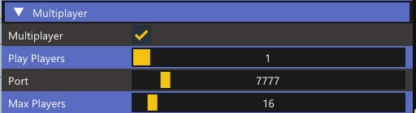
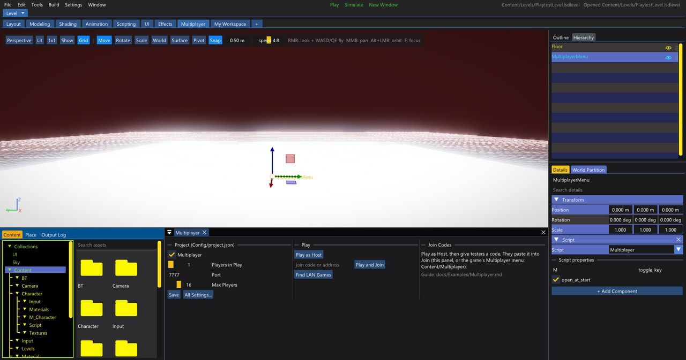
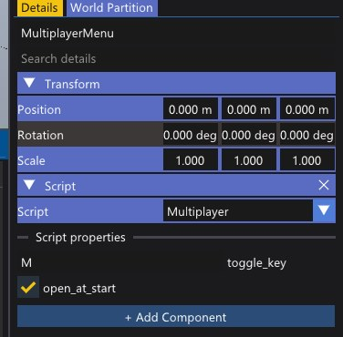
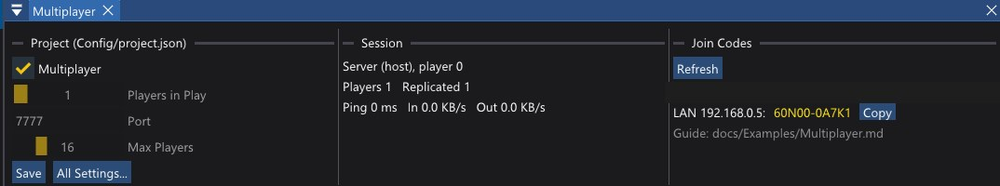
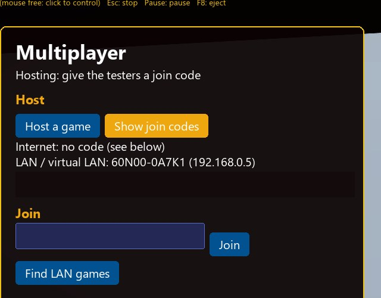
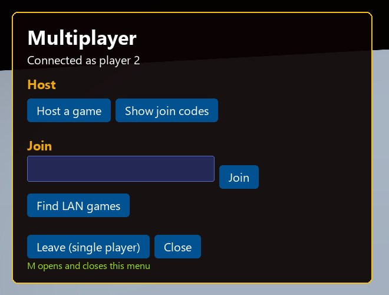

# Multiplayer playtests, step by step

How to get playtesters into your game: switch multiplayer on, add the Host / Join menu, host, send
a join code, and let the testers join. In Unreal terms: the multiplayer options of Play (Net Mode,
Number of Players), a Host / Join widget over Create / Find / Join Session, and Session Frontend's
player list, in one workspace tab.

What you need: the editor, and the same packaged build on every tester's PC (File > Package Project,
then send them the `Build/<Project Name>/` folder).

---

## 1. Switch multiplayer on

**Edit > Project Settings > Multiplayer**: tick **Multiplayer**, then **Save** at the top of the
window (it writes `Config/project.json`, so commit it: the whole team gets it).

- **Play Players**: how many players Play opens in the editor (1 = only you; 2 or more opens a game
  window per extra player, all on this PC).
- **Port**: the UDP port the host listens on (7777 unless something else uses it).
- **Max Players**: how many players one host takes, the host included.

The same settings are in the Multiplayer workspace (next step), so you rarely need this window again.

## 2. Open the Multiplayer workspace

Click the **Multiplayer** tab in the workspace row under the menu bar (next to Effects). It keeps the
viewport, Outliner and Details, and puts the **Multiplayer** panel under the viewport, in three
columns:

| Column | What it does |
| --- | --- |
| **Project** | Multiplayer on / off, Players in Play, Port, Max Players, **Save**, **All Settings...** (chat, voice) |
| **Play** (before Play) | **Play as Host**, a code box with **Play and Join**, **Find LAN Games** |
| **Session** (while playing) | server or client, your player number, players connected, replicated objects, ping, traffic |
| **Join Codes** (while hosting) | **Show Join Codes**, each code with **Copy** |

## 3. Give your game the Host / Join menu

The testers need a way to type a code in the packaged game. The engine has one ready:

1. Open the level the game starts on (Project Settings > Maps > Game Default Level).
2. Select any object, or make an empty one (Place tab).
3. Details > **+ Add Component** > **Script**, and pick **Multiplayer** (`Content/Multiplayer/Multiplayer.lua`).
4. Its properties show under it: **toggle_key** (M: opens and closes the menu) and **open_at_start**
   (the menu shows when the game starts). Save the level.

The menu's look is `Content/Multiplayer/WBP_Multiplayer.rml`: double-click it to restyle it in the UI
window, like a UMG widget.

## 4. Host

Either:

- in the editor: Multiplayer panel > **Play as Host** (or just Play, Alt+P), or
- in the packaged game: it hosts when it starts; the menu also has **Host a game**.

The Session column then says **Server (host), player 0**.

## 5. Get a join code

Click **Show Join Codes** (in the panel, or **Show join codes** in the game's menu). A join code is
10 letters and digits, like `60N00-0A7K1`: your address and port in a form that is easy to read out
or paste. Typos are caught. **Copy** puts it on the clipboard; send it to the testers over Discord,
email or a message.

You get one line per way in:

| Line | Who can use it |
| --- | --- |
| **Internet** | anyone on the internet. The first Show Join Codes asks your router to forward the port (UPnP, a couple of seconds). The forward is removed when Play stops |
| **Tailscale** | testers on your Tailscale network (step 7) |
| **LAN** | testers on the same Wi-Fi / network as you (or on a ZeroTier network) |

When there is no Internet line, the reason is under the codes, for example:

> the router's internet address 100.x.x.x is shared (CGNAT or a second router): use a virtual LAN code

That is not an error in the game. It means your internet provider shares one public address
between several customers (CGNAT: common on mobile, 4G / 5G home internet and some fibre), so no
one outside can reach your PC through it. Use step 7. (Kittakin's connection is like this.)

## 6. The testers join

Each tester:

1. Starts the packaged game. The Multiplayer menu shows (or press **M**).
2. Pastes the code into the box under **Join** and clicks **Join**. A plain address works too
   (`192.168.0.5` or `203.0.113.7:7777`). On the same network, **Find LAN games** fills the box.
3. The status line says **Connecting...**, then **Connected as player N**. If you are on another level,
   the game takes the tester there by itself.

Your Session column shows the player count go up. **Leave (single player)** goes back to playing
alone; **Close** (or M) hides the menu.

If the status says it could not reach the host: check the code, check that you are still hosting, and
check the firewall (step 8).

## 7. Playtesting behind CGNAT: Tailscale

[Tailscale](https://tailscale.com) makes your PC and the testers' PCs one private network over the
internet (a virtual LAN). It works behind any router or CGNAT, and is free for small groups.

1. **You**: install Tailscale, sign in (Google, Microsoft or GitHub account).
2. **You**: in the Tailscale admin page (login.tailscale.com > Users > **Invite users**), invite each
   tester by email. Or share only your PC: Machines > your PC > **Share...**.
3. **Each tester**: accepts the invite, installs Tailscale and signs in. Their PC shows in your
   Machines list.
4. **You**: host (step 4), Show Join Codes. Send the **Tailscale** line's code (your 100.x.x.x address).
5. **Testers**: join with that code (step 6).

Find LAN games does not find games over Tailscale: use the code.

**ZeroTier** works the same way: you make a network at my.zerotier.com, testers join its network ID
in the ZeroTier app, you tick them in as members. Your ZeroTier address is one of the **LAN** lines.

**By hand instead**: forward UDP 7777 in your router to your PC, and give testers your public address
(a "what is my IP" page) as `1.2.3.4:7777`. Not possible behind CGNAT.

## 8. When it does not connect

| What you see | What to do |
| --- | --- |
| "Could not reach the host (or it left)" | the code is old (the host's address changed), or the host stopped Play: get a new code |
| Connecting... forever | Windows Firewall on the host: allow the game (Private and Public) when Windows asks, or in Windows Security > Firewall > Allow an app |
| "Could not host on port 7777 (in use?)" in the Output Log | another copy of the game is hosting on this PC; it is fine for a second copy that joins |
| "The server is on level X, which this machine does not have" | the tester has an older build: send the new package |
| No Multiplayer menu in the game | Project Settings > Multiplayer is off, or the Multiplayer script is not on an object in the starting level |

## For scripters

The menu is ordinary Lua: copy it and change it. The calls it uses:

| Call | Does |
| --- | --- |
| `lsd.net_host([level])` | host from a menu; Play restarts as the server (on `level`, default this one) |
| `lsd.net_join(code)` | a join code or address; Play restarts as a client and follows the server to its level |
| `lsd.net_leave([level])` | back to single player |
| `lsd.net_join_code()` | `{upnp, message, internet, lan = {{address, code, tailscale}, ...}}` for the host |
| `lsd.net_find_games(seconds)` | games on the local network |
| `on_connected(self, id)`, `on_disconnected(self)` | how a join went |

More in [MANUAL.md](../MANUAL.md#multiplayer) (replication, events, chat, voice) and [CODING.md](../CODING.md).
