# Epic graphics: a step-by-step guide

How to take a level from "it draws" to the best picture LSD_Engine can make, in the order that
matters most. Each step names the Unreal equivalent. The details of every setting are in the
[MANUAL](MANUAL.md) (section 5, Lighting, sky and post-processing, and section 6, Materials).

Work through the steps in order. Lighting and exposure come before post-processing: grading a
badly lit scene only hides the problem.

---

## Step 0: Set the quality to Epic and check the graphics backend

1. Menu bar > **Settings > Engine Scalability > Epic** (Unreal's Engine Scalability Settings).
   Make sure every group (**Shadows, Post Processing, View Distance, Effects**) follows it, or is set
   to Epic itself. At High or below you lose things this guide relies on:
   - **Shadows**: Epic casts the sun's shadows furthest; local light shadows need High or Epic.
   - **Post Processing**: reflections, depth of field, motion blur, contact shadows and TAA need
     High or Epic.
   - **View Distance**: Epic draws further and keeps the detailed LODs longer (x 1.5).
   - Texture streaming keeps twice the texture detail at Epic.
2. Use **Direct3D 12** (the default) or **Vulkan** (`-rhi=vulkan`). OpenGL draws the same picture but
   is the fallback.
3. To get Epic on every PC that can run it, add a **Device Profile** data asset (Unreal's Device
   Profiles) for strong graphics cards (for example "RTX 40") that sets Epic.

**Check:** `stat unit` in the console shows the frame time. Keep an eye on it from here on.

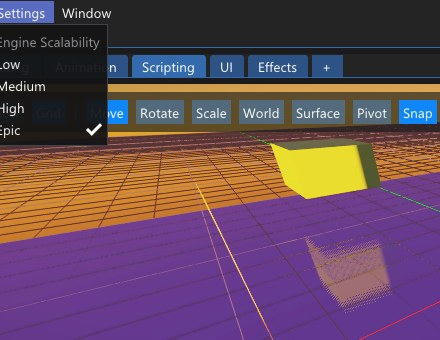
*Settings > Engine Scalability: the overall level and each group.*

---

## Step 1: Exposure (World Settings)

Everything uses physical units, as in Unreal, so the camera's exposure must suit your lights.

1. **World Settings > Exposure (EV100)**: about **1.5** for the engine's default sun; about **15**
   for a real 100 000 lux sun.
2. Keep **Auto Exposure** on in the Post Process Volume (Unreal's eye adaptation). Clamp it with
   **Min / Max EV** so a dark corridor doesn't turn grey and a sunny field doesn't wash out.

**Check:** a mid-grey wall in your main lighting should look mid grey, not white or black.

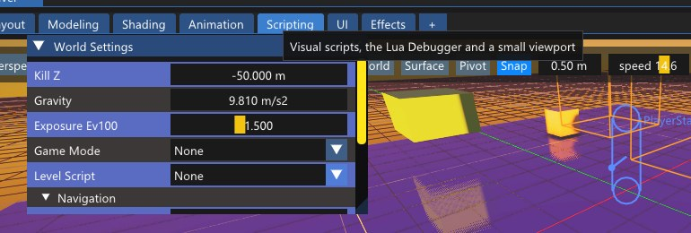
*World Settings > Exposure EV100: 1.5 for the default sun.*

---

## Step 2: Sky and sun (time of day)

1. Place a **Directional Light** (lux). Its angle is the time of day.
2. Place a **Sky** with **Atmosphere** on (Unreal's Sky Atmosphere). The sky, the sun's colour and the
   ambient light follow the sun's height (blue noon, orange sunset).
3. Add a **Sky Light** with **Capture Sky** on, so the level's ambient light takes the sky's colours.
4. Or, for a photographed sky, pick an **HDRI** (`.hdr` / `.exr`) on the Sky (Unreal's Sky Light
   cubemap). The backdrop, the reflections and the ambient light all come from it.
5. Turn on **Directional Light > Contact Shadow Length** (try 0.2 m) for the small shadows the shadow
   map misses: feet on the floor, cups on a table.

**Check:** turn the sun; the whole level should change mood.

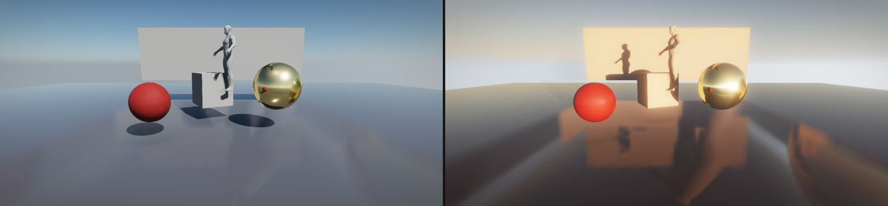
*The same level at noon (left) and with the sun 3 degrees above the horizon (right): Atmosphere colours the sky, the sunlight and the ambient light; shadows stretch.*

---

## Step 3: Lights that look real

1. Set colours by **temperature** (Kelvin): 2700 K warm bulbs, 6500 K daylight. Real colour
   temperatures look right next to each other.
2. Give lamps a **Source Radius** (Point / Spot: sphere lights). Highlights get wider and shadows get
   softer, like real bulbs.
3. Use a **Rect Light** (Unreal's Rect Light) for windows, screens, softboxes and ceiling panels. It is
   lit exactly, so glossy floors reflect its real shape.
4. Use **IES** profiles for real fixtures (drop the `.ies` file in Content and pick it).
5. Use a **Light Function** for gobos, window frames, leaves and moving clouds.
6. Shadows:
   - Set **Shadow Resolution > High** on your one or two hero lights (four times the texels).
   - Set **Low** on fill lights, so more of them get shadows.
   - Use **Mobility: Stationary** for lights you want with soft baked shadows (up to 4 per level)
     that you can still dim in play.
   - Use **Mobility: Static** for lights that never change. Once you've built lighting (step 5) they
     cost nothing at run time.

**Check:** the **Lighting Only** view mode (Alt+6) shows the light without textures. Is every area
lit on purpose?

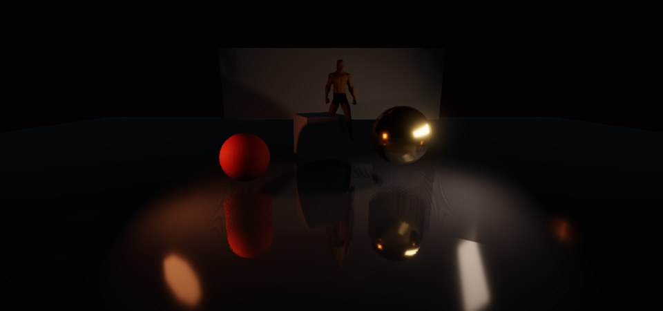
*Night, lit only by a 5000 K Rect Light (right of the camera) and an orange Disc Light (left): the glossy floor reflects each panel's real shape (bottom), and the gold sphere picks up both.*

---

## Step 4: Atmosphere and fog

1. Place a **Height Fog** (Unreal's Exponential Height Fog). Keep it subtle: depth, not soup.
2. Tick **Volumetric** (Unreal's Volumetric Fog) for light shafts. The sun lights the fog, and its
   shadows cut through it. Start with **Steps 16** and raise **Scattering** slowly. Point and Spot
   Lights get halos and visible cones.

**Check:** look toward the sun past a wall or pillar. You should see shafts of light.

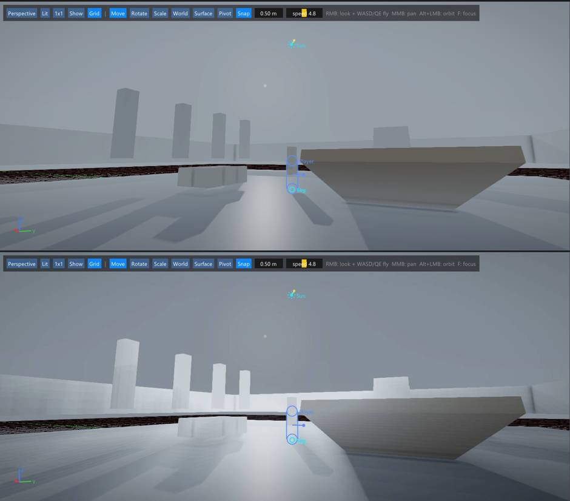
*Height Fog without (top) and with Volumetric: sunlit fog glows, shadowed fog stays dark.*

---

## Step 5: Build the lighting

Without baking, the inside of a closed room is as bright as an open field.

1. Save the level.
2. Place a **Lightmass Importance Volume** around the playable area (lower **Probe Spacing** gives
   finer probes).
3. **World Settings > Lightmap Resolution**: 1024 to start, **2048 or 4096** for the final look
   (sharper baked light and shadows; slower to bake).
4. Keep **Static Mesh > Static Lighting** on for everything that never moves; untick it on movers.
5. **Build > Build Lighting** (Unreal's Lightmass). You get directional lightmaps (normal maps keep
   their bumps), three bounces, colour bleeding, the sun's baked shadows and the probes for moving
   objects.
6. Build again whenever walls or lights move.

**Lights or walls that move?** (a day / night cycle, doors, torches) Skip the bake and tick **World Settings >
Dynamic Global Illumination** (Unreal's Lumen): probes around the camera are relit all the time, so bounces and dark
interiors follow the sun and the walls. It replaces the bake while on. For smoother light raise
`r.DynamicGI.Rays` (96 or 128); for a wider reach raise `r.DynamicGI.Spacing` (3 or 4 m, coarser). `stat dump`
shows its cost.

**Check:** the **Lightmap Density** view mode shows even texels where you look most. Corners and
contact areas should darken softly.

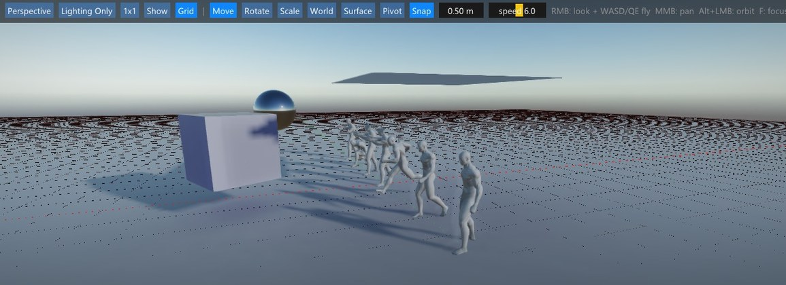
*Lighting Only (Alt+6) after Build Lighting: sky light, the floor's coloured bounce and soft contact shadows from the lightmap.*

---

## Step 6: Reflections

1. Put a **Reflection Capture** in the middle of each room (Unreal's Reflection Capture). Use
   **Shape: Box** sized to the room, so shiny floors show the walls where they really are. Up to 8 per
   level, and overlapping captures blend smoothly.
2. **Build > Build Reflection Captures** after moving things or changing the time of day a lot.
3. Turn **Reflections** on in the Post Process Volume (screen-space reflections on top).

**Check:** a metal sphere should mirror the room it's in, not only the sky.

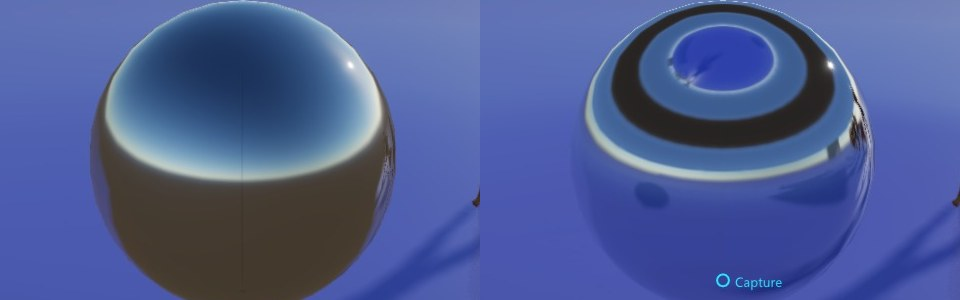
*A mirror sphere with the sky only (left) and with a Reflection Capture (right).*

---

## Step 7: Materials and meshes

Lighting can't fix flat assets.

1. Import meshes with **Import Materials and Textures** (Unreal's import with materials on), so the
   normal, roughness / metallic (ORM) and emissive maps land on the right slots.
2. Every material should have a **normal map** and a **roughness** (ORM) map. Roughness variation
   is what makes things look real: smudges, wear, wet patches.
3. Keep metallic at 0 or 1 (it rarely belongs in between), as in Unreal.
4. Emissive in daylight needs an **Emissive Strength** in the thousands (physical units). Bloom then
   makes it glow.
5. Meshes are shaded **Smooth** by default. Use **Auto Smooth** for hard-surface props (sharp edges
   above the Smoothing Angle) and **Import** to keep the artist's own normals.
6. Use **Masked** for leaves and fences (their shadows get the holes too) and **Translucent** for
   glass.

**Check:** with Alt+6 (Lighting Only) off and on, the material should carry the detail, not the
light.

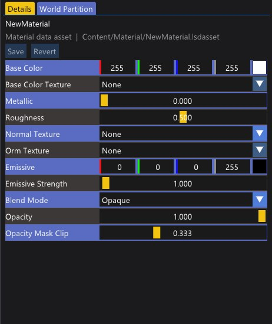
*A Material: base colour, metallic, roughness, normal and ORM maps, emissive, blend mode.*

---

## Step 8: Post Process Volume (the final look)

Place a **Post Process Volume** with **Unbound** on (Unreal's Post Process Volume), then set these
in order:

| Setting | Epic starting point | Why |
| --- | --- | --- |
| Anti-aliasing | **Temporal AA** | Smooth, stable edges (FXAA is the cheap one) |
| Ambient Occlusion | on, intensity ~0.5–1, radius ~1 m | Grounds objects; darkens only ambient light |
| Reflections | on | Screen-space detail in shiny floors and water |
| Bloom | intensity low, threshold ~1 | Bright and emissive parts glow; too much looks cheap |
| Tonemapper | filmic (ACES) | Film-like highlights (default) |
| Auto Exposure | on, Min / Max EV clamped | See step 1 |
| Motion Blur | Amount ~0.5 | Camera and object motion feel smooth |
| Depth of Field | focal distance on your subject (0 = off) | Cinematic shots, bokeh on lights |
| Color Grading LUT | your graded strip, LUT Intensity 1 | The final mood (grade a screenshot in Photoshop / GIMP) |
| Vignette, Saturation, Contrast | small amounts | Finish, not a fix |

Use a second, box-shaped volume with a higher **Priority** and a **Blend Radius** for places with
their own mood (a cave, a neon room).

**Check:** compare against a reference photo or a still from the game you are aiming for, side by
side.

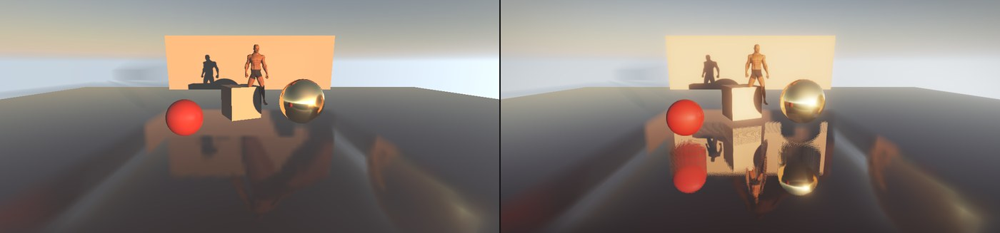
*Sunset without post-processing (left: no tonemapper, no AO, bloom or vignette; the bright wall clips) and with the Epic starting values above (right: filmic highlights, bloom on the gold, soft vignette).*

---

## Step 9: Effects

1. Use **Lit** sprites for smoke, dust and snow (Particle Editor > Renderer > Lit), with
   **Soft Distance** so they don't cut a hard line into the ground.
2. For big effects (sparks, magic, rain), set **Sim Target GPU** (Niagara's GPU Compute Sim): up to a
   million particles. Use Additive blending, since GPU particles aren't sorted.
3. Use **Min Quality** on emitters that only stronger PCs need.

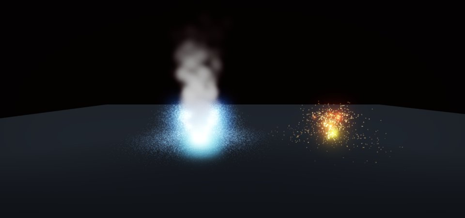
*A GPU emitter (left: 400 000 additive particles bouncing on the floor, with an alpha smoke emitter) next to a CPU emitter (right).*

---

## Step 10: Keep it fast

Epic should still hit your frame rate. These are all on by default; check them with `stat dump`
(GPU time per stage):

- **GPU culling** (`r.GPUCulling`): Instanced Static Meshes and batches of 32+ copies are culled
  and LOD-picked on the GPU, with Hi-Z occlusion.
- **Occlusion culling** (`r.OcclusionCulling`): meshes behind big walls are skipped.
- **Shadow caching** (`r.ShadowCaching`): still lights cost nothing per frame.
- **LODs**: meshes of 512+ triangles get LODs. Use **Max Draw Distance** and **Cull Distance
  Volumes** on small props.
- **Texture streaming** and **BC compression** keep video memory in check.
- **Instanced Static Mesh** for repeated props, **Foliage** painting for vegetation.
- Use fewer, better shadowed lights. **Static** lights cost nothing after a bake.

If the frame is too slow, drop one setting at a time and take the cheapest win first: depth of
field, then volumetric fog steps, then shadow resolution.

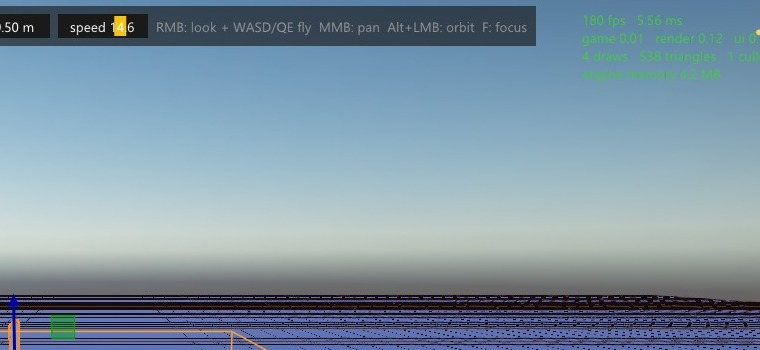
*`stat unit`: frame rate and the time per part of the frame.*

---

## Step 11: Capture it

- **HighResShot 2** (console) saves the view at twice its size, post-processing included.
- Package with **Shipping** to check the real frame rate outside the editor.

---

## Checklist

- [ ] Engine Scalability: Epic (all groups); D3D12 or Vulkan
- [ ] World Settings exposure fits the sun; Auto Exposure clamped
- [ ] Sky with Atmosphere (or HDRI), Directional Light, Sky Light capturing the sky
- [ ] Contact shadows on the sun
- [ ] Lights in Kelvin, Source Radius on lamps, Rect Lights for panels, IES where real fixtures are
- [ ] Hero lights at Shadow Resolution High; fill lights Low or Static / Stationary
- [ ] Height Fog with Volumetric
- [ ] Lightmass Importance Volume, Lightmap Resolution 2048+, Build Lighting
- [ ] Box Reflection Capture per room, Build Reflection Captures
- [ ] Materials with normal + ORM maps, real roughness variation, emissive in the thousands
- [ ] Post Process Volume: TAA, AO, Reflections, bloom, ACES, motion blur, LUT
- [ ] Particles: Lit + Soft for smoke, GPU for big effects
- [ ] `stat dump` within your frame budget; tested in a Shipping package
