# LSD_Engine Manual

How to use LSD_Engine to build a game. Written for people who know Unreal Engine: every feature is
mapped to its Unreal name. For how the engine works inside, see [ARCHITECTURE.md](ARCHITECTURE.md);
for step-by-step projects, see [EXAMPLES.md](EXAMPLES.md); for game code in C / C++ and every
command, see [CODING.md](CODING.md); to start coding step by step, see
[How to code in LSD_Engine](How%20to%20code%20in%20LSD_Engine.md). **New to the engine?** Start with
[Examples for first timers](Examples/Examples.md): input actions, a health and stamina HUD, interacting.

Contents

1. [Getting started](#1-getting-started)
2. [The editor](#2-the-editor)
3. [Content and assets](#3-content-and-assets)
4. [Building a level](#4-building-a-level)
5. [Lighting, sky and post-processing](#5-lighting-sky-and-post-processing)
6. [Materials](#6-materials)
7. [Playing and the player](#7-playing-and-the-player)
8. [Physics](#8-physics)
9. [Lua scripting](#9-lua-scripting)
10. [Visual scripting](#10-visual-scripting)
11. [Animation](#11-animation)
12. [Audio](#12-audio)
13. [Particles](#13-particles)
14. [AI](#14-ai)
15. [Game UI](#15-game-ui)
16. [Saving, settings and languages](#16-saving-settings-and-languages)
17. [Packaging and shipping](#17-packaging-and-shipping)
18. [Testing and profiling](#18-testing-and-profiling)
19. [Reference](#19-reference)

---

## 1. Getting started

### Build

LSD_Engine builds with CMake and MSVC (Visual Studio 2026) on Windows; Clang on Linux.

1. Open the repository folder in VS Code (with the CMake Tools and C/C++ extensions).
2. Pick the configure preset **windows-msvc** when CMake Tools asks.
3. Build (F7), or in a terminal:

   ```powershell
   cmake --preset windows-msvc
   cmake --build --preset windows-msvc
   ```

4. Run the tests: `ctest --preset windows-msvc`.

The first configure downloads the third-party libraries (SDL3, Jolt, LuaJIT, RmlUi...), pinned to
fixed versions; it takes a few minutes once.

### Run the editor

Double-click **`lsd_editor.exe`** in the project folder (`E:\LSD_Engine\LSD_Engine`). Every Release
build copies itself there (`cmake --build --preset windows-msvc --config Release`); it is not in Git.
The Debug build, for debugging, stays in the build folder:

```powershell
build\windows-msvc\editor\Debug\lsd_editor.exe
```

Close the editor before building: Windows locks a running exe, so the build (or its copy to the
project folder) fails while it is open.

If a build fails at once with `ar.exe` / `ld.exe` from MinGW in the errors, the build folder was
configured from a terminal without the Visual Studio tools (MinGW was found first on PATH). Delete
`build\windows-msvc\CMakeCache.txt` and `build\windows-msvc\CMakeFiles\`, then configure again from
VS Code or a *Developer PowerShell for VS*; the downloaded libraries are kept.

It picks the best graphics card and Direct3D 12. Add `-rhi=opengl` to use OpenGL instead. The
editor reopens the last level you had open. The project lives next to the executable's working folder:

| Folder | What it holds | Unreal |
| --- | --- | --- |
| `Content/` | Your assets: meshes, textures, levels, scripts, sounds... | Content |
| `Config/` | Project settings (`project.json`) and the editor theme | Config |
| `Saved/` | Logs, autosaves, crash reports, the player's settings and save games | Saved |
| `DerivedData/` | Compiled assets (made automatically, safe to delete) | DerivedDataCache |

### Project templates

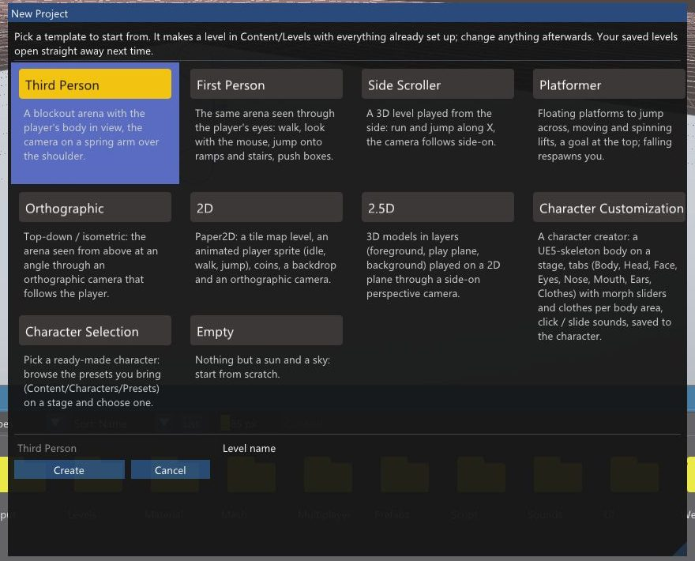
*The first time the editor opens (no level saved yet) it asks which template to start from.*

The first time the editor opens, with no saved level to go back to, it shows **New Project**
(Unreal's New Project templates). Pick one and **Create** (or double-click it): the editor builds
the level, saves it as `Content/Levels/<name>.lsdlevel` (the name you typed, else the template's)
and opens it. Next time the editor opens that level straight away; the picker does not come back.
**File > New from Template...** opens it again whenever you want another starter level. Every
template plays at once (Play): the player uses the built-in WASD / mouse / Space controls until
you give it an Input Mapping Context.

The picker lists the five game perspectives first, then the rest:

| Template | What you get | Viewports |
| --- | --- | --- |
| **Third Person** | A walled blockout arena (ramp, stairs, ledge, columns, crates to push), the player's body in view on a spring arm over the shoulder | 3D |
| **First Person** | The same arena seen from the player's eyes | 3D |
| **Side Scroller** | A 3D level run along X (pits, platforms, a lift, a goal) with a side-on follow camera | 2.5D + 3D |
| **Platformer** | Floating platforms, a lift, a spinning bar and a slider (Movers), a goal at the top; falling below Kill Z respawns you | 3D |
| **Orthographic** | Top-down / isometric: the arena through an orthographic camera 45 degrees above and behind the player, riding along (W walks up the screen) | 2D + 3D |
| **2D** | Paper2D: a painted Tile Map level, an animated player Sprite (idle, walk, jump), coins to collect with a HUD counter, crates (2D physics), a backdrop, an orthographic follow camera; the Level tab opens in 2D mode | 2D |
| **2.5D** | 3D models in depth layers (mountains, trees, rocks) around a 2D play plane, seen through a side-on perspective camera | 2.5D |
| **Character Customization** | A character creator (below): the body on a stage, tabbed morph sliders, clothes per body area, sounds, saved to the character | 3D |
| **Character Selection** | Pick a ready-made character from the presets you bring (below) | 3D |
| **Empty** | A sun and a sky, nothing else: start from scratch | 3D |

The **2D** template also writes its starter files into `Content/Templates/2D/` (kept if you change
them): `T_Tiles` (the tileset: grass, dirt, bricks, planks and colour tiles to paint with), `T_Hero`
(the player's sprite sheet), `T_Coin` (a spinning flipbook), `T_Backdrop`, `Coin.lua` (collects a coin
the player touches), `Player2D.lua` (counts them) and `UI_HUD2D` (the counter). The console runs a
template too: `template.New 2D`.

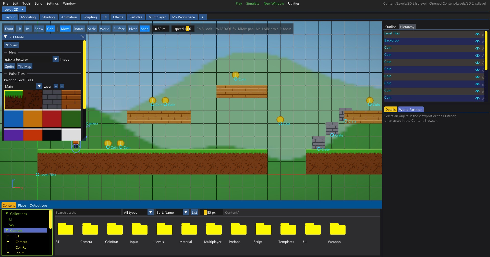
*The 2D template in the editor: the 2D viewport, the Level tab's 2D mode with the tile palette.*

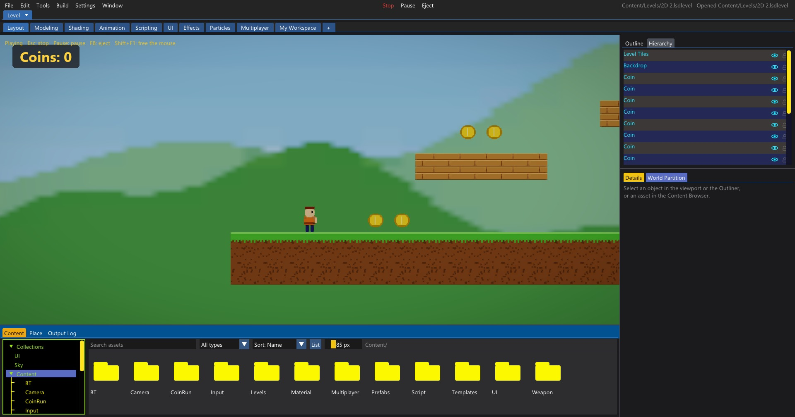
*Playing it: the player walks with A / D, jumps with Space, and the coin counter goes up.*

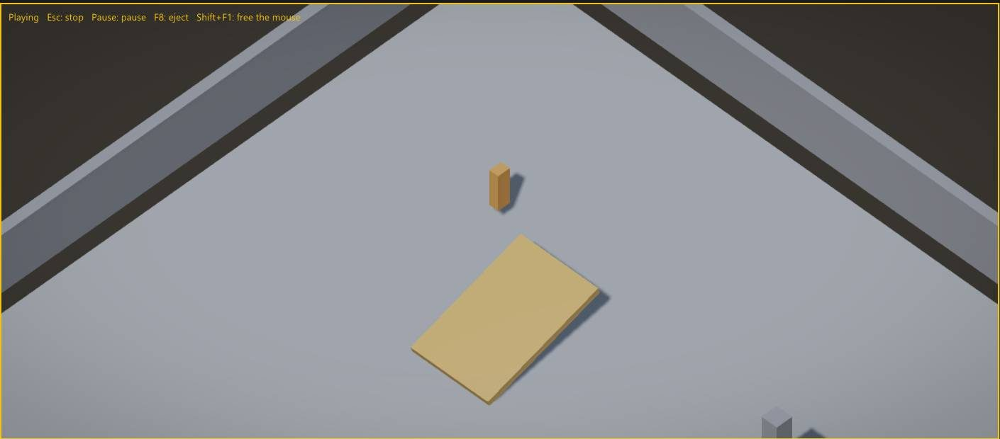
*The Orthographic template in Play: an isometric orthographic view that follows the player.*

#### Character Customization and Character Selection

Two ready-made levels for character creators (Unreal's MetaHuman-style creator screens and the
character select of a menu). Both put a **Character** on a lit stage with a camera on it. The
Character is a Skeletal Mesh using the project's **UE5-skeleton** body: the template looks for a
rigged mesh with UE5 Manny bones (a UE4 Mannequin, then any rig, if there is none; names such as
Manny, Quinn, SKM or Char are tried first). With no rigged mesh in Content, a grey stand-in shows
until you set **Skeletal Mesh > Mesh**. Their scripts, UI documents and sounds go into
`Content/Templates/Character/` (kept if you change them), and the folders for your own art are
made in `Content/Characters/`.

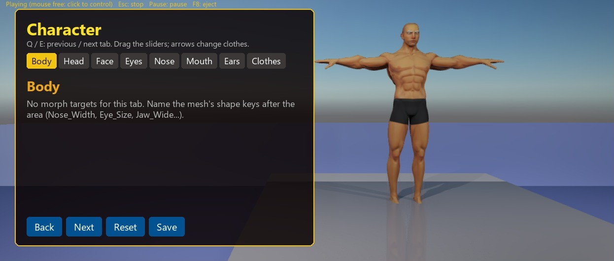
*Character Customization in Play: tabs along the top, a slider per morph target, Back / Next / Reset / Save.*

**Character Customization** (`CharacterCustomization.lua`, `UI_CharacterCustomization`):

- **Tabs**: Body, Head, Face, Eyes, Nose, Mouth, Ears, Clothes. Click one, use **Back / Next**, or
  press **Q / E** (gamepad shoulders).
- **Sliders**: each morph target of the body (Unreal's Morph Targets: export them with the FBX) gets
  a slider (0..1) on the tab whose word its name contains: `Nose_Width` goes to Nose, `Eye_Size` to
  Eyes, `Jaw_Wide` to Face, `Lip_Full` and the visemes (`V_Open`...) to Mouth, `Ear_Point` to Ears.
  Everything else goes to Body (anatomy: `Chest`, `Belly`, `Arm_Muscle`...). Up to 12 per tab.
- **Clothes**: one row per body area (Hair, Hat, Glasses, Shirt, Jacket, Gloves, Pants, Belt, Shoes,
  Backpack). The arrow buttons (`<` and `>`) step through the meshes in `Content/Characters/Clothes/<area>/` (and None).
  Clothes skinned to the same UE5 skeleton follow the body's animation bone by bone. Rigid pieces
  (a hat, glasses, a watch) stick to that area's bone: head, spine_03 (chest), spine_05, hand_r,
  pelvis, foot_r. A rigid pair adds its left piece from a mesh named `<name>_L` (`Boot_Leather` +
  `Boot_Leather_L`).
- **Sounds**: `SFX_UI_Click` on every button, tab and clothes step, `SFX_UI_Slide` while a slider moves
  (swap them with the script's `click_sound` / `slide_sound` properties in Details).
- **Save** writes the look (morph weights and the clothes per area) to the save game
  `appearance_<character>`. The character is the one picked in Character Selection, else the
  object's name. The next time the level plays, the look is back. **Reset** clears it.

Put `CharacterAppearance.lua` on the object with the Skeletal Mesh in your game level (a Character's
body) and the chosen body and saved look are applied there when Play starts.

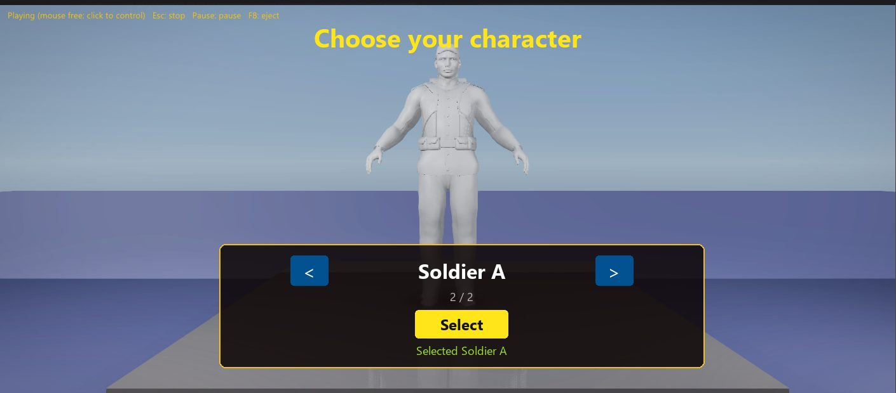
*Character Selection: < and > (A / D, the arrows, the gamepad shoulders) browse, Select picks.*

**Character Selection** (`CharacterSelection.lua`, `UI_CharacterSelection`) shows the rigged
characters in `Content/Characters/Presets/` one at a time on the stage. Drop in your own FBX / glTF
characters; each needs a skeleton. **Select** (Enter, gamepad A) saves the choice as
`selected_character`. Character Customization then edits that character, and `CharacterAppearance.lua`
puts it in your levels. Set the script's `next_level` property in Details to open the game level after
Select. `presets_folder` changes where the presets come from.

---

## 2. The editor

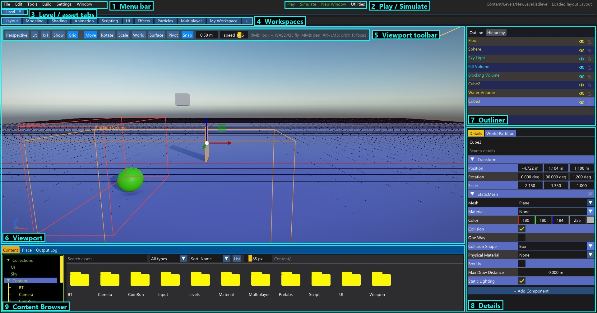
*The editor: 1 menu bar, 2 Play / Simulate / New Window, 3 the Level tab and one tab per open asset editor, 4 workspaces, 5 viewport toolbar, 6 viewport, 7 Outliner, 8 Details, 9 Content Browser (with Place and Output Log), 10 the dock where asset editors open.*

**The menus** (Unreal's main menu): click a name in the menu bar.

| | |
| --- | --- |
| 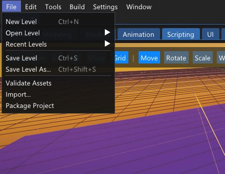 | **File**: new / open / save levels, recent levels, Validate Assets, Import, Package Project. |
| 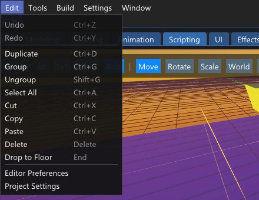 | **Edit**: undo / redo, duplicate, group, copy / paste, Drop to Floor, **Editor Preferences**, **Project Settings**. |
|  | **Tools**: smoke test and unit tests, Compile Game Code, New C / C++ Script, Set Up Debugging (VS Code), Lua Debugger, Remote Console; Asset Audit, Size Map, Fix Up Redirectors. |
| 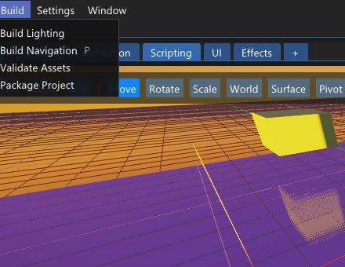 | **Build**: Build Lighting, Build HLODs, Build Navigation, Compile All Assets, Build Release Engine, Validate Assets, Package Project. |
|  | **Settings**: Engine Scalability (Low / Medium / High / Epic), and per group: Shadows, Post Processing, View Distance, Effects. |
| 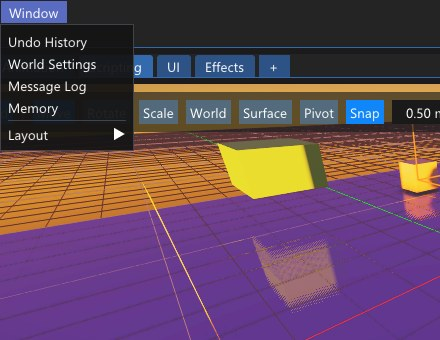 | **Window**: Undo History, World Settings, Message Log, Memory, Layout (save / load panel layouts). |

| Panel | Where | Unreal equivalent |
| --- | --- | --- |
| Viewport | Top-left | Level Viewport |
| Outliner / Hierarchy | Top-right | World Outliner |
| Details / World Partition | Bottom-right | Details panel |
| Content Browser, Place, Output Log | Bottom | Content Browser, Place Actors, Output Log |

The menu bar has **File** (levels, Recent Levels, Validate Assets, Package Project), **Edit** (undo, copy, Project
Settings, Editor Preferences), **Tools** (smoke test, unit tests) and **Window** (Undo History, World
Settings, Message Log, **Layout**). While playing it shows **Stop / Pause / Eject**. Window > Layout
saves the panel arrangement under a name (Unreal's Save Layout As), loads one back, or resets to the default.

### Level modes (click the Level tab)

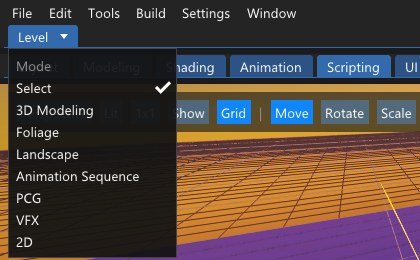
*Click the Level tab to pick a mode (Unreal's Modes): Select, 3D Modeling, Foliage, Landscape, Animation Sequence, PCG, VFX, 2D.*

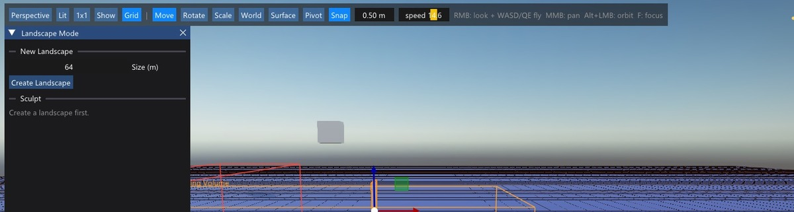
*Landscape mode: its tools open on the left of the viewport (Create, Sculpt, Smooth, Flatten).*

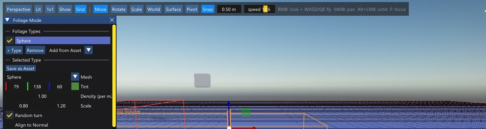
*Foliage mode: pick a mesh, set brush size and density, then paint on surfaces with LMB (Shift+LMB erases).*

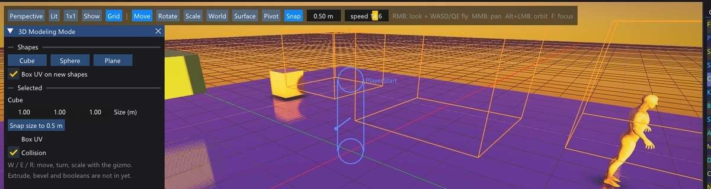
*3D Modeling mode: place blockout shapes (Cube, Sphere, Plane) with Box UV and collision.*

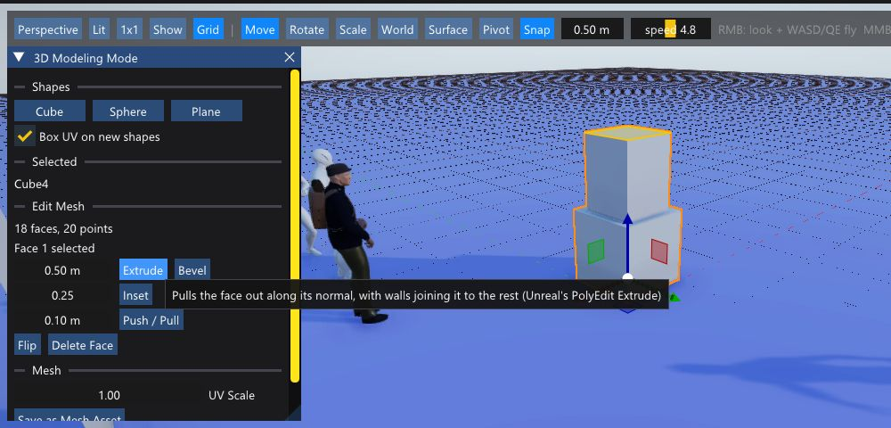
*An Editable Mesh: the top face bevelled, then extruded; the picked face is outlined in yellow.*

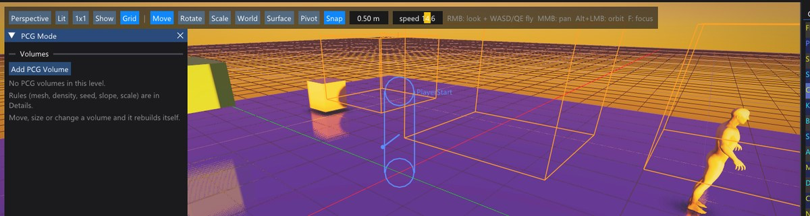
*PCG mode: add a PCG Volume; it scatters a mesh on the surfaces inside its box.*

Like Unreal's mode dropdown: click the **Level** tab (when it is showing) and a list opens: **Select**
(the default), **3D Modeling**, **Foliage**, **Landscape**, **Animation Sequence**, **PCG** and **VFX**.
The tab then reads e.g. *Level: Landscape*, and the mode's tools open in a panel at the viewport's left
(close it, or pick Select, to go back). Console: `mode Landscape`.

| Mode | What it does (Unreal) |
| --- | --- |
| **3D Modeling** | Place Cube / Sphere / Plane blockout shapes (Box UV on by default), size the selected one in metres, snap its size to 0.5 m. A selected Cube shows a white **handle on each face** (Unreal's box handles): drag one to move that side only while the opposite side stays put (one undo step per drag). **Convert to Editable Mesh** on a Cube makes it editable face by face (Unreal's PolyEdit): click a face in the viewport (it turns yellow), then **Extrude** (out along its normal, with walls), **Inset** (a smaller face inside it), **Bevel** (inset, then extrude: a chamfered step), **Push / Pull** (moves the face, its neighbours stretch), **Flip**, **Delete Face**; click near a corner instead to pick that **point** (yellow dot; the nearest one is ringed as you hover): **Position** moves it, the faces using it follow, and **Delete Point** removes those faces; click near an **edge** to pick it (yellow line): **Move** drags both its points, **Delete Edge** removes the faces on both sides. **UV Offset** and **UV Rotation** slide and turn the texture (UV tools). **Boolean** (Unreal's Modeling Boolean): pick another Editable Mesh or Cube in **With**, where it stands in the level, then **Union** (join them), **Subtract** (cut it out: doors, windows, holes) or **Intersect** (keep the overlap); the other object is hidden afterwards (undo brings it back); every step undoes with Ctrl+Z. **Save as Mesh Asset** writes it as `Content/Meshes/SM_<name>.obj`, a mesh you can place again or open in Blender |
| **Foliage** | A list of **Foliage Types** (Unreal's Foliage Types, up to 8, kept in your editor settings; **Save as Asset** writes one as a Foliage Type asset in Content/Foliage and **Add from Asset** brings one in, so the team paints with the same types; **Save to Asset** writes your edits back): **+ Type**, Remove, a tick to paint each; the selected one's mesh, tint, density (copies per m2), scale range, random turn, **Align to Normal** (tilted to the slope: grass, rocks; off: upright trees) and
**Collision** (each copy blocks in Play with a box around it: trees, rocks; off for grass). **LMB drag** paints every ticked type at once, each spaced by its own density; **Shift+LMB** erases the ticked types. Copies go to *Foliage* objects (Instanced Static Meshes, one per mesh, 1024 each) |
| **Landscape** | **Create Landscape** (a square of terrain, 65 x 65 heights) where the view looks; **Add Tile** (+X / -X / +Y / -Y) puts another beside the selected one with the shared edge joined, for bigger worlds (the brushes sculpt across tiles; far tiles draw simpler LODs that still meet at the seams). Then sculpt: **Sculpt** (LMB raises, Shift lowers), **Smooth**, **Flatten** (to the height where the stroke began), brush size and strength, Flatten All; **Paint** layers (below); **Holes** (Unreal's Visibility tool: LMB cuts the terrain for caves and tunnels, Shift fills; no drawing or collision there); **Heightmap**: Import sets the selected landscape's heights from a greyscale image (black 0, white Max Height; a 16-bit PNG keeps its 65 536 steps) or Unreal's RAW `.r16` (square, 16-bit), Export writes them as a 65 x 65 `.r16` (16-bit, for World Machine, Gaea or Unreal) or PNG (8-bit) by the file name's extension. It collides in Play; without layers its material is on its Static Mesh |
| **Animation Sequence** | Your Timelines (double-click to edit), New Timeline, a button to the Animation workspace (Sequencer) |
| **PCG** | **Add PCG Volume**: a box that scatters copies of a mesh on the surfaces inside it by rules in Details (mesh, density per 100 m2, seed, max slope, scale range, random turn, align to surface). Move, size or change it and it rebuilds; the copies are in *<volume>_Output*. **More Meshes** scatters several kinds at once (each point picks one by **Weight**; their copies are in the output's *Variant N* children). Tick **Exclude** on a volume to make it a clearing: it scatters nothing and the others leave its box empty (paths, buildings). Add a **Spline** to a PCG Volume and it scatters along the curve instead (PCG's spline input): one copy every **Spline Spacing** metres, in a strip **Spline Width** wide, dropped onto what is below (fence posts, trees by a road). **Graph** (Unreal's PCG Graph): Content Browser > right-click > **New PCG Graph**, pick it on the volume, and its nodes replace the rules above: **Surface Sampler** (Density, Seed) and **Spline Sampler** make points, **Slope / Height / Density Filter** keep some (Density Filter's **Patch Size** keeps or drops whole patches: clumps and clearings), **Transform Points** sizes, turns, tilts and lifts them, **Merge** joins two sets, and each **Spawn Mesh** puts a mesh (name or GUID, material, colour) on the points reaching it (its own Instanced Static Mesh). Save the graph and the volumes using it rebuild; exclusion volumes still clear their boxes |
| **VFX** | Your particle systems (double-click to edit, **Place** puts one where the view looks), New Particle System, a button to the Effects workspace (Niagara) |

**Landscape paint layers** (Unreal's Landscape Paint with Layer Infos):

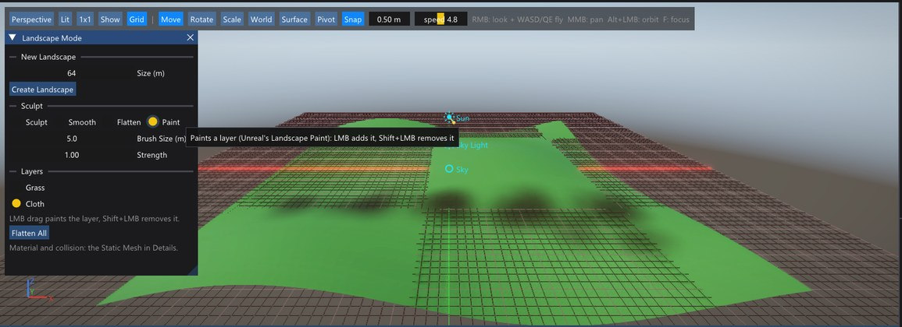
*Landscape mode > Paint: the Cloth layer painted over Grass on sculpted hills.*

1. Select the landscape. In Details > Landscape > **Layers**, add 2 to 4 layers: a **Name**
   (Grass, Rock, Sand...), a **Texture** (or none: the tint alone), a **Tint** and **Tile** (metres
   per texture tile). The first layer covers the whole terrain to start with.
2. Landscape mode > **Paint**, pick the layer in the **Layers** list, and LMB-drag on the terrain
   (Shift+LMB removes it). Brush Size and Strength work as for sculpting; every stroke is undoable.
3. The layers are blended into one colour texture for the whole landscape (a few times a second
   while you paint) and used instead of the Static Mesh's material and colour; it is saved with the
   level (the weights) and rebuilt in the game.

Detail is limited by that texture (1024 x 1024 over the landscape: about 16 texels a metre on a 64 m
one), so keep Tile at a few metres and use textures that read well from a distance.

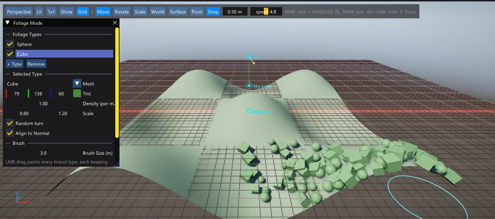
*Foliage mode with two types, Sphere and Cube (Align to Normal), painted in one stroke on hills.*

In Foliage and Landscape a ring shows the brush; clicks paint instead of selecting (Alt, RMB and MMB
still move the camera). Every stroke is one undo step.

### Panel tabs and workspaces (the two rows under the menu bar)

| | |
| --- | --- |
|  |  |
| *Modeling: a big viewport, mesh and prefab editors docked on the left.* | *Shading: material graphs dock under the viewport.* |
| 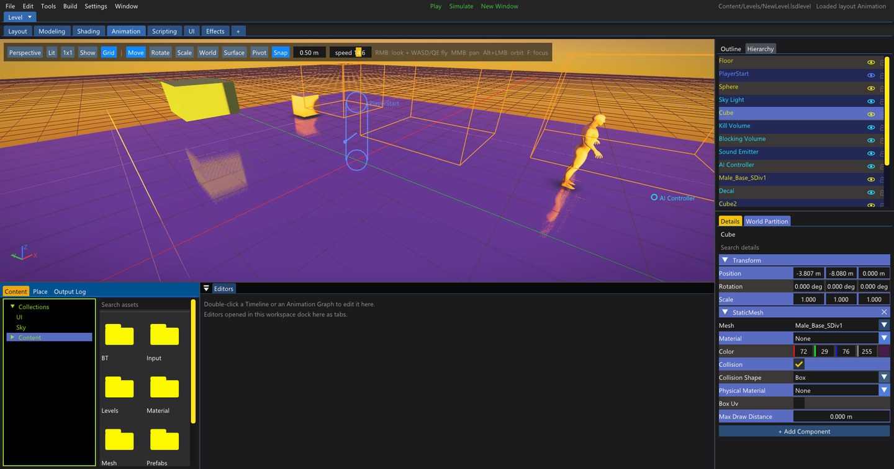 | 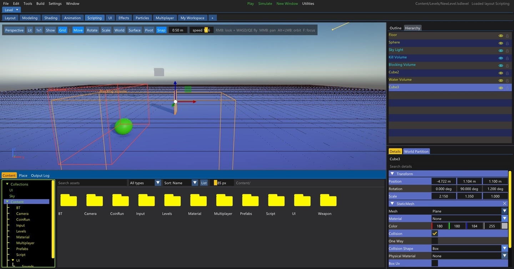 |
| *Animation: timelines and animation graphs.* | *Scripting: the Lua Debugger and visual scripts beside a small viewport.* |
|  |  |
| *UI: UI documents and their designer.* | *Effects: particle systems and sound cues.* |
| 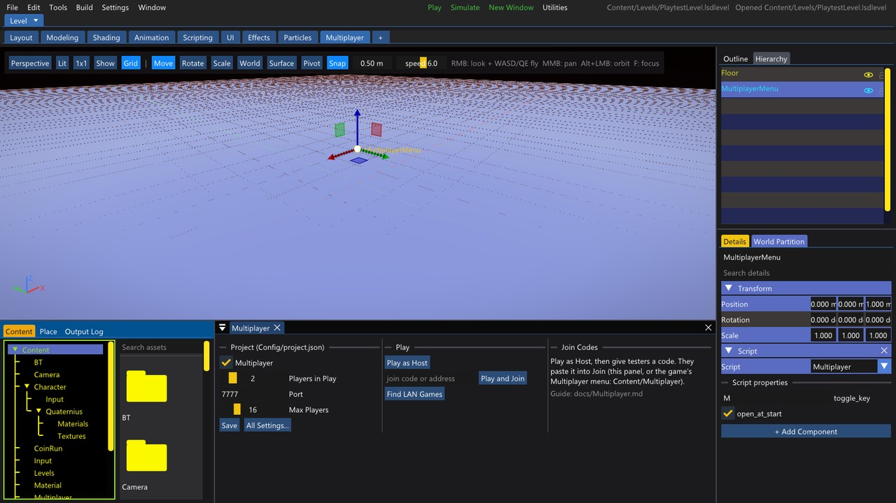 | 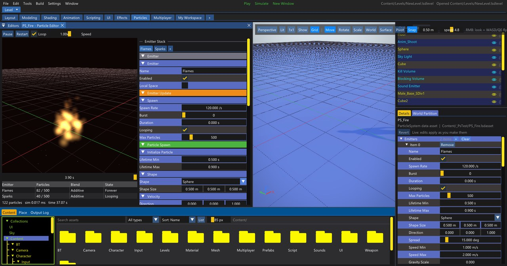 |
| *Multiplayer: settings, Play as Host / Join, the session, join codes.* | *Particles: the Particle Editor (preview and Emitter Stack) big, a small viewport beside it.* |

**Panel tabs** (the top row, like Unreal's tabs across the top of the editor): the first tab is
**Level** (the viewport, Outliner, Details, Content Browser). An editor you open from Layout (double-click
a Material Graph, a Timeline, a mesh..., or Tools > Lua Debugger) opens as its own full-screen tab
next to it and comes forward. Click a tab to switch; its **x** (or middle-click) closes it, saving a
changed graph like the window's own close did. Drag tabs to reorder them. Play always shows the Level.

**Workspaces** (the second row, only on the Level tab) are Blender's workspace tabs: each is a whole
arrangement of the level's panels for one job; the original arrangement is **Layout**, and it is
unchanged.

| Tab | What it shows | Editor area (asset editors opened there dock in it) |
| --- | --- | --- |
| **Layout** | Viewport, Outliner, Details, Content Browser (the original) | none: editors open as panel tabs |
| **Modeling** | Viewport with an editor beside it | Mesh Editor, Prefab editor |
| **Shading** | Content Browser left, viewport, node editor under it | Material Graphs (Blender's Shader Editor) |
| **Animation** | Viewport, editor along the bottom | Timelines (Sequencer), Animation Graphs |
| **Scripting** | Small viewport, big editor area with the **Lua Debugger** | Visual scripts |
| **UI** | Viewport, editor along the bottom | UI documents (UMG) |
| **Effects** | Viewport with an editor beside it | Particle systems (Niagara), Sound Cues |
| **Particles** | A big editor area beside a smaller viewport; double-clicking a Particle System switches here (Unreal opens Niagara in its own window) | The Particle Editor |
| **Multiplayer** | Viewport, the **Multiplayer** panel under it: project settings, Play as Host, Play and Join (a code or address), Find LAN Games, the session (players, ping, traffic), join codes with Copy | none |

Each workspace remembers how you resize and rearrange it (in `Saved/Layouts/Workspaces/`).
Right-click a tab > **Reset to Default** to rebuild it. **+** saves the current arrangement as a new
workspace under a name; right-click yours > **Delete**. Window > Layout > Reset to Default resets the
active workspace. Console: `workspace Shading`.

### Moving around the viewport

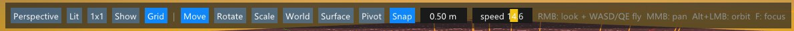
*The viewport toolbar: view (Perspective / Lit / 1x1 / Show / Grid), gizmo (Move / Rotate / Scale, World or Local, Surface, Pivot, Snap and its step), camera speed.*

Unreal's controls: hold the **right mouse button** and use **W A S D Q E** to fly, the mouse to
look; **middle mouse** pans; **Alt + left mouse** orbits; **F** frames the selection; the mouse wheel
during a fly changes speed. **Alt+G / J / H / K**: perspective / top / front / right view. The layout
button on the viewport toolbar cycles **1x1 → 1x2** (perspective beside top) **→ 2x2** (perspective, top,
front, right); each pane keeps its own camera. Console: `layout 1|2|4`.
**Window > Viewports** picks the views by kind, side by side: **2D Viewport** (orthographic, looking
along +Y: how a side-on 2D game is seen), **2.5D Viewport** (perspective from the side with a long
lens: 3D layers on a 2D plane) and **3D Viewport** (the free perspective view), so a 2D or 2.5D level
can be previewed in 3D next to its game view. The choice is remembered.

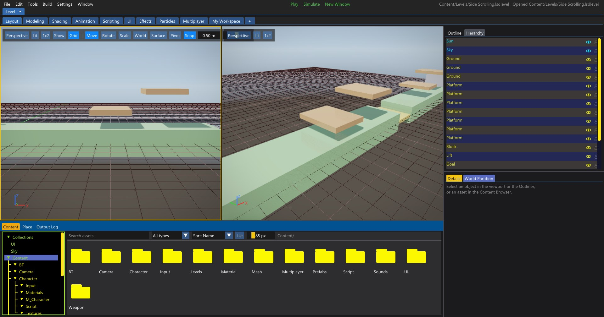
*Window > Viewports with 2.5D and 3D on (the Side Scrolling template).* **Show** on the toolbar turns on
the grid, axis gizmo, navigation (P), **Bounds** (yellow mesh boxes) and **Collision** (cyan: what blocks in Play).
**Alt+4 / 3 / 2**: Lit / Unlit / Wireframe; the view mode button also has **Normals**, **Lighting Only**
(Alt+6: every surface grey), **Collision** (Alt+C: what blocks in Play) and **Overdraw** (Alt+0: bright where
many surfaces stack) and **Lightmap Density** (after Build Lighting: a checker of the lightmap's texels on
lightmapped surfaces, grey on the rest; bigger squares, blurrier baked shadows; console `viewmode lightmapdensity`).
**G**: game view (hides editor icons).

### Selecting and transforming


*The Outliner (Unreal's World Outliner): every object in the level; click to select, the eye hides it, the lock stops it being picked. Hierarchy shows parents and children.*

Click an object to select it; Ctrl+click to add; drag a box to select many. Selected meshes and
sprites get an orange outline, like Unreal's. **W / E / R** switch the
gizmo to move / rotate / scale. Hold **LMB** on an arrow to move along that axis (X red, Y green, Z blue,
the level's axes in World space), on a square between two arrows to move in that plane;
**Alt+LMB** drag duplicates and moves the copy; **Shift+LMB** drag brings the camera along with the
object. **Ctrl+`** toggles local / world space; Snap (toolbar) uses the snap
steps from Editor Preferences; **Surface** (toolbar) keeps moved objects on the surface under them and
holding **V** while moving snaps to the nearest vertex of another mesh. **Pivot** (or **Alt+V**) lets the
gizmo move the pivot the object turns and scales about (right-click it: Reset Pivot). Clicking picks
the triangle under the mouse, not just the box around a mesh. **End** drops the selection to the floor, **Delete** removes it,
**Ctrl+D** duplicates, **Ctrl+G / Shift+G** group / ungroup, **Ctrl+C / X / V** copy, cut, paste.
Drag one object onto another in the Outliner to attach it (children follow their parent).
**Folders** (Hierarchy tab, like Unreal's Outliner folders): right-click objects > Move to Folder > New
Folder, then type its name. Click a folder to fold it, drop objects on it to file them, right-click it to
rename or delete it (its objects stay). Folders only organise the Outliner; they have no transform.
The Outline tab's **type filter** lists only objects with a chosen component (StaticMesh, PointLight...).

### Details


*Details for the selected object: one block per component (Transform, Static Mesh...), + Add Component at the bottom, Search details at the top.*

**Live editing:** every edit takes effect as you make it, while playing too: objects' components,
the player's Character (speeds, camera, capsule, input), rigid bodies (mass, friction, bounciness),
World Settings gravity, the player's Mapping Context and Input Actions (keys, triggers: reloaded
within a quarter second, the player's rebound keys kept), and data assets selected in the Content Browser (materials, particle
systems, curves...: written as you edit, at most ten times a second, and reloaded at once; **Revert**
goes back to how it was when you selected it). Mesh import settings are the exception: Save reimports
the file (a big mesh would stall frames if it reimported while you drag a slider).

**Hover help everywhere:** rest the mouse on any property, button, menu item, Place tab item or
component in **+ Add Component** for a short description of what it does.

The Details panel shows the selected object's components (each a collapsible section) or the
selected asset's settings. Every field has a tooltip. Right-click a field for **Reset to Default**.
Select several objects to edit them together. **Add Component** at the bottom adds any component.

### Undo, autosave, crash recovery

Every change is undoable (**Ctrl+Z / Ctrl+Y**, Window > Undo History). Unsaved levels are
autosaved to `Saved/Autosaves` every few minutes. If the editor crashes, the next start offers to
restore the autosave, and the Message Log names the crash report folder (`Saved/Crashes/...`).

**When the graphics driver stops** (Unreal's "GPU crashed or D3D device removed"): a message box says
*The graphics driver stopped responding (reason)* and the editor (or the game) closes instead of freezing.
An unsaved level, in Play the level as it was before Play, is kept in `Saved/Autosaves` and offered at the
next start. The log has one `[d3d12] The GPU device was removed (reason ...)` line; start the editor with
`-gpu-debug` (D3D12 DRED, cheap enough to leave on while you hunt it) and it also logs `DRED:` lines: the
GPU operations around the one that never finished and, for a GPU page fault, its address and whether
the memory was freed. Send `Saved/Logs/Editor.log` (all its `[d3d12]` lines). `debug.DeviceLost` tries it.

### Console

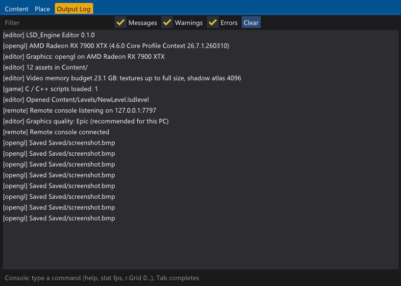
*The Output Log tab (beside Content and Place): filters for messages, warnings and errors, and the console line at the bottom.*

The **Output Log** tab has a console line at the bottom. Type `help` to list every command. A few:
`stat unit` (frame timings), `stat audio`, `view top`, `viewmode wireframe`, `validate`, `package`,
`test.Smoke`. While playing, `lua <code>` runs Lua (e.g. `lua lsd.log(lsd.time())`).
Input recording: `input.Record <file>`, `input.StopRecord`, `input.Play <file>` (see Input below).

---

## 3. Content and assets


*The Content Browser: folders on the left (and Collections), assets on the right with search, type filter, sort and list / tile view. Double-click an asset to open its editor.*


*The Mesh Editor (double-click a mesh): preview, size and triangle counts, import settings (scale, normals), LOD screen sizes; Save / Reimport.*

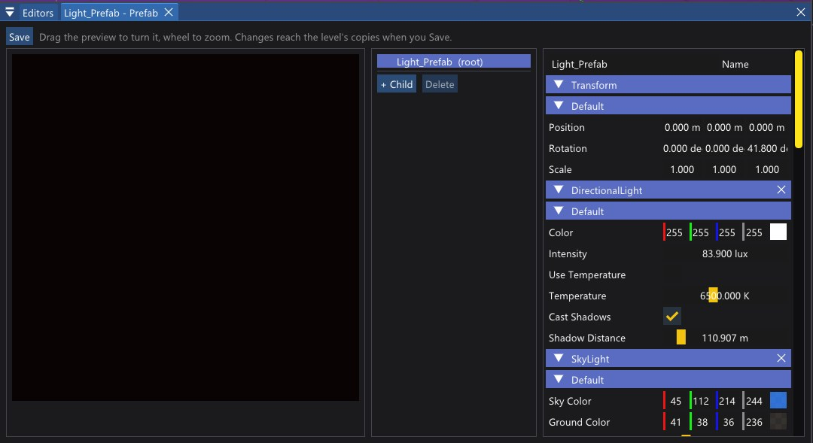
*The Prefab Editor (double-click a prefab): its objects on the left, a preview, and Details for the selected part; Save updates every copy in the level.*

Drop files from Explorer onto the editor window to import them into the open Content Browser folder.

**Back / forward:** with the mouse over the Content Browser, **Mouse 4** goes back to the folder you
were in before and **Mouse 5** forward again (like a web browser). Anywhere else in the editor, Mouse 4 /
Mouse 5 go back and forward between the tabs under the menu bar (Level and the asset editors).
Every asset gets a `.meta` file next to it holding its GUID (its permanent identity) and import
settings. Rename and move assets in the Content Browser: references keep working because they point
at the GUID, not the file name. Select an asset and type words into **Tags** in Details (comma-separated,
like Unreal's asset metadata): the Content Browser search box matches tags as well as names.

| You drop / create | It becomes | Opens in | Unreal |
| --- | --- | --- | --- |
| `.fbx`, `.gltf`, `.glb` | Mesh (a skinned mesh if it has bones) | Details (import scale) | Static / Skeletal Mesh |
| `.png .jpg .tga .bmp .psd .hdr .exr` | Texture (HDR / EXR: float images, kept as half floats on the GPU with values above 1, so an HDR emissive map glows as bright as it is; thumbnails and UI show them clipped). Colour textures are block-compressed as they load (BC1 when opaque, BC3 with alpha: 4 to 8 times less video memory, Unreal's default texture compression) when their size is a multiple of 4, once (kept in `DerivedData/Textures` until the image changes); normal maps become BC5 (their X and Y; the shader rebuilds Z, as Unreal's TC_Normalmap), masks (ORM) BC1 (BC3 with a Specular map in alpha), linear, as Unreal's TC_Masks | Details (max size) | Texture |
| `.wav .ogg .flac .mp3` | Sound | Details (volume, class...); double-click plays | Sound Wave |
| `.csv` | Data Table | Data Table window | Data Table |
| `.lua` | Lua Script | your text editor | — |
| New Level / File > Save Level As | Level (`.lsdlevel`) | the viewport | Level |
| New Material | Material (data asset) | Details | Material (simple) |
| New Material Graph | Material Graph (`.lsdmatgraph`) | graph window + live preview | Material Editor |
| New Visual Script | Visual Script (`.lsdgraph`) | graph window | Blueprint Event Graph |
| New Sound Cue | Sound Cue (`.lsdcue`) | graph window | Sound Cue |
| New Behavior Tree | Behavior Tree (`.lsdbt`) | graph window | Behavior Tree |
| New UI Document | UI Document (`.rml`) | UI window | Widget Blueprint |
| New Data Asset > type | Data asset (`.lsdasset`) | Details | Data Asset |
| Outliner: right-click an object > Create Prefab | Prefab (`.lsdprefab`) | the level | Blueprint Class (placed actor) |

Data asset types: Input Action, Input Mapping Context, Game Mode, Curve, Curve Vector, Curve Color, Physical Material, Material, Material
Instance, Sound Class, Sound Attenuation, Sound Concurrency, Sound Mix, Submix, Animation Graph,
Particle System.

**Data Tables**: right-click a column name > **Type** (number, int, bool, string, vector; the header
becomes `Damage:number`) and cells that do not fit turn red; Lua then reads them typed (`007` stays
text in a string column). **Export JSON** writes the rows next to the .csv. A Data Table whose column
headers are times is a **curve table** (Unreal's Curve Table): `lsd.curve_table("CT_Levels", "Damage", t)`
or the Evaluate Curve Table node reads a row, linear between columns.

**Curves**: drag keys in the graph, double-click to add, right-click to delete; click a key, then
drag its handle to set its tangent (the key turns User; Auto in Details goes back). **Curve Vector**
(X, Y, Z) and **Curve Color** (R, G, B, A) pick the channel to edit with buttons above the graph;
`lsd.curve` returns 3 or 4 values for them (Evaluate Vector Curve node).

All text assets (levels, graphs, data assets, UI) are plain text: they merge and diff in Git.

**Importing**: drop files or a whole folder (its sub-folders are kept) onto the editor, or **File >
Import...** to pick several. They go into the Content Browser's current folder. Changed source files
recompile on their own; select an asset to change its import settings in Details (Save writes its
`.meta`).

**Live Link** (Blender, Maya...): set Edit > Editor Preferences > **Live Link Folder** to the folder
you export to. Every time you export there (FBX, textures, sounds), the editor copies the file into
`Content/LiveLink/` and it reloads in the level, also while playing.

**Thumbnails**: meshes show themselves; Materials, Material Instances and Material Graphs show a
sphere wearing them (colour, textures, a graph's shader); textures show the image and sounds their
waveform; Behavior Trees and Lua scripts are dark tiles reading **BT** and **.Lua**. They update when
the asset's file changes.

**Browsing**: **List** / **Tiles** and the size slider change the view; the sort menu orders by name,
type, last change or size. Ctrl-click and Shift-click select several assets (then right-click:
Delete Selected, Reimport, Add to Collection). Right-click a folder > **Add to Favourites**; right-
click assets > **Add to Collection** (a named set of assets from any folders, like Unreal's
Collections). Both appear above the folder tree. Right-click an asset > **Duplicate** copies it
with its import settings; **Reimport** reads the source file again. In the Outliner, right-click an
object > **Find in Content Browser** (or Ctrl+B) shows its mesh or script.

**Files with several meshes** (Unreal's import with Combine Meshes off): a mesh asset draws the whole
file as one mesh. Right-click it > **Create Prefab from Parts** makes `BP_<name>`: one child object
per mesh and material in the file (named `Node` or `Node_Material`), each with its node's pivot,
position, rotation and scale from the DCC (a door turns about its hinge), plus an `M_<material>`
Material for each material in the file, made by Import Materials and Textures (below). The file's
node tree is kept: a part sits under its parent node's part (a door leaf under its frame moves with
it), and a node without a mesh becomes an empty group object at its parent's pivot. Drag the prefab
into the level and move, hide or re-material its parts like any objects. Console:
`asset.CreatePrefabFromParts <mesh>`.

**Import Materials and Textures** (Unreal's FBX import with Import Materials / Import Textures on):
importing an FBX, glTF or GLB does it by itself when the file's textures can be found; for a mesh
already in Content, right-click it > **Import Materials and Textures** (or the console:
`asset.ImportMaterials <mesh>`). For every material of the file:

1. Its texture maps are found: where the file says (the exporter's path, e.g. `F:\Art\Char.fbm\`),
   next to the file, in its `<name>.fbm` folder, then any texture in Content with the same file name.
   Images embedded in the file (FBX *Embed Textures*, GLB) are written out. Maps the file does not
   connect are found by the texture set's naming (see **Texture names** below): the set named after the
   colour map the file gives, or after the material itself, so an Unreal export whose FBX names no
   textures at all still finds `MI_Bike_Body01_BaseColor.png`, `_Normal`, `_Roughness` for the material
   `MI_Bike_Body01`.
2. They are copied into `<mesh folder>/Textures/`, packed into the engine's slots: metallic,
   roughness and occlusion into one `T_<material>_ORM` (R occlusion, G roughness, B metallic, as
   Unreal's ORM), an opacity map into the colour's alpha (`T_<material>_BaseColor`, and the material
   becomes **Masked**: eyelashes, hair cards, lace); an emissive map becomes the Material's Emissive
   Texture, with the file's emissive colour and strength (white when the file gives none).
3. A Material `M_<material>` is made in `<mesh folder>/Materials/` (one that exists is kept, with your
   edits) and set on the mesh's **Material Slots**.

**Texture names.** One map per file, the kind after the last `_` or `-` (any case), the rest is the
set's name; maps with the same name are one material:

| Suffix | Map | Goes to |
| --- | --- | --- |
| `BaseColor`, `BaseCol`, `Albedo`, `Diffuse`, `Color`, `_B`, `_D` | colour | Base Color Texture |
| `Normal`, `Norm`, `Nrm`, `_N` | normal | Normal Texture |
| `Roughness`, `Rough`, `_R` (`Glossiness`, `Smoothness`: inverted) | roughness | ORM green |
| `Metallic`, `Metalness`, `Metal`, `_M` | metallic | ORM blue |
| `AmbientOcclusion`, `Occlusion`, `AO` | occlusion | ORM red |
| `ORM`, `ARM`, `OcclusionRoughnessMetallic` | already packed (R, G, B as above) | ORM |
| `MetallicRoughness` | glTF packed (G roughness, B metallic) | ORM (occlusion white) |
| `Specular`, `Spec` | specular | Specular Texture |
| `Opacity`, `Alpha`, `Mask` | cut-out | the colour's alpha, Blend Mode Masked |
| `Emissive`, `EmissiveColor`, `Emission` | glow | Emissive Texture |
| `Height`, `Displacement`, `Bump` | ignored (the lit shader has no height input) | not used |

**Create Material** on a texture (Content Browser right-click) does the same without a mesh: the
selected textures and the ones next to them are grouped by name, and one `M_<name>` is made per set
with every map on its own input (right-click `MI_Bike_Body01_AmbientOcclusion.png` and you get the
whole `MI_Bike_Body01` material, not a material per texture).

The mesh asset's Details > **Materials** lists its slots (one per material of the file, like a
Skeletal Mesh's Material Slots in Unreal); change one there for every object using the mesh. A Static
Mesh of the whole file uses them too while its own **Material** is empty (each part draws with its
slot); set a Material on the object to paint all of it with one. On a placed object, Details > Static
Mesh > **Materials** has a row per slot (Unreal's Materials list on the component): pick another material
to override that slot on this object only (the row turns gold; **<** reverts it); saved in the level and undoable.
The **Mesh Editor** (double-click the mesh) has a **Material Slots** list: each material of the file by its
name there, its index, its triangles and a material picker (or drop one from the Content Browser; Save writes
them), and the preview wears them. UV0 is the file's first UV set; Build Lighting makes the lightmap UV1. A
slot cannot be added by hand: slots are the file's materials (triangles are assigned to them in Blender or
Maya); one the file no longer has can be removed. Textures
use the mesh's own UVs, so each part looks as it did in Blender, Maya or Substance. Missing textures
are listed in the Output Log; put them next to the file and run the menu again. It works one material
at a time while the editor keeps running: a progress bar in the menu bar names the material it is on
(Build Lighting shows its progress there too).

**References**: right-click an asset > **Reference Viewer** lists what uses it and what it uses
(click to follow, double-click to find in the Content Browser). Deleting warns about anything that
still uses the asset. A missing reference shows in red with **Replace with selected**; **Replace its
references with...** points everything at the asset selected in the Content Browser instead
(Unreal's Replace References). Reopen the level afterwards to see the change.

**Size Map** (Unreal's Size Map): right-click an asset (or several) or a folder > **Size Map...**, or
Tools > **Size Map** for all of Content/ (console: `asset.SizeMap [asset | folder]`). It lists the asset and
everything it uses (by reference, and by name or path in scripts and UI, as cooking follows them) as bars,
biggest first, with each one's share of the total: what a level really brings into a package. Click a bar to
find the asset in the Content Browser. Sizes are the source files on disk.

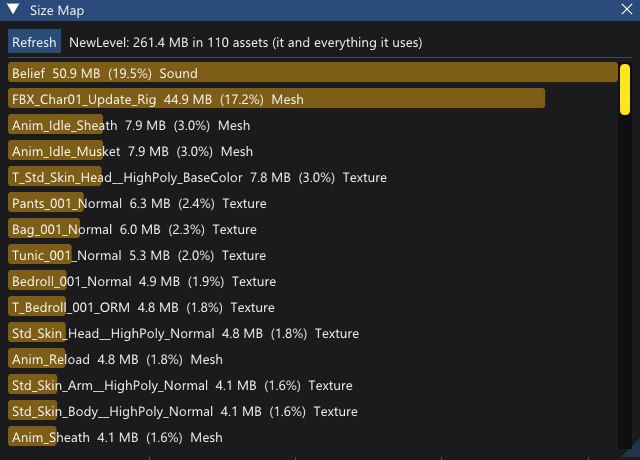

**Asset Audit** (Unreal's Asset Audit): Tools > **Asset Audit** (`asset.Audit`) is a table of every asset:
name, type, path, size on disk, compiled size (its data in DerivedData/, when built), and how many assets
use it. Click a column header to sort; filter by folder, by type, or tick **Unused only**: assets that no
asset uses and the game does not reach by name either (Project Settings' levels and what they lead to), so
Cook Used Assets Only leaves them out. Double-click a row to find the asset. **Refresh** reads it all again.

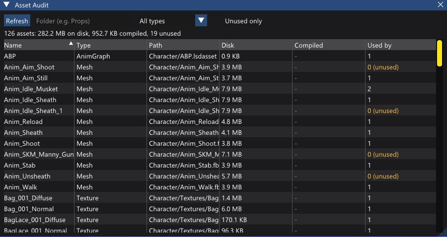

**Fix Up Redirectors** (Unreal's Fix Up Redirectors). References between assets use the asset's ID
(its `.meta`), so renaming or moving never breaks them and no redirector files are left behind. What can
go stale is a name or path written as text: `lsd.play_sound("Door")` in a script, a level path in Project
Settings > Maps. The editor writes down every rename and move (Saved/AssetRedirects.txt); Tools > **Fix Up
Redirectors** (also on a folder's right-click menu, or `asset.FixRedirectors`) rewrites those names and
paths in scripts, UI documents, text assets and the project settings, then clears the list. A bare name is
only rewritten when no other asset has the old name now.

**Editing several assets at once** (Unreal's Property Matrix / editing several assets in Details): Ctrl- or
Shift-click assets of the same type in the Content Browser; Details shows the one you clicked last and
says how many are selected. For data assets (materials, input actions, curves...) each change you make
goes to all of them at once; for meshes, textures and sounds, **Save** writes the settings you changed to
every selected one (the settings you left alone stay as each asset had them).

**Source control** (Unreal's Source Control, Git only). When the project folder is a Git repository,
asset tiles get a badge: yellow **M** changed, green **A** new, blue **R** renamed (the `.meta`
counts too). Right-click an asset > **Source Control**: **History** (its last 50 commits), **Diff
Against Last Commit**, **Submit...** (commits the asset and its `.meta` with your description; push
from your Git tool to share it), **Refresh Status**. Status is re-read every few seconds.

**Locking** (Unreal's Check Out / Check In, with Git LFS: `git lfs install`, and a remote that supports
locks, such as GitHub or GitLab): **Lock (Check Out)** tells the team you are changing an asset (levels,
meshes and other files that cannot be merged), **Unlock (Check In)** releases it after you push. A locked
tile gets an **L** badge in its top-left corner: green when it is yours, red when a teammate holds it
(hover it for who). **Break Lock** removes a teammate's lock when they cannot. Locks are re-read
every 20 seconds.

**Revert...** (Source Control menu) throws away your changes to an asset and its `.meta`, back to the
last commit. It asks first, because the changes cannot be brought back. **View Changes...** (also
**Tools > Source Control Changes**; Unreal's View Changelists) lists every changed asset with its
badge: tick the ones that belong together, write a description and **Submit Selected** commits them
in one go, or **Revert** a single row. New assets have nothing to revert to.

**File > Validate Assets** reports references to missing assets, oversize textures and (optional,
Project Settings > Validation) name prefixes such as `SM_`, `T_`, `M_`, `BT_`, `UI_`.

### Large projects (thousands of meshes and textures)

LSD_Engine is meant to hold a whole Unreal asset pack (hundreds of FBX meshes, thousands of 4K textures) and stay
smooth. What happens on its own:

- **Unreal FBX conventions are understood on import.** Nodes named `<name>_LOD1`, `_LOD2`, `_LOD3` (and the
  children of an FBX LOD group after the first) become the mesh's **own LODs**: LOD 0 is drawn near, the file's
  LODs farther away at the mesh's LOD 1 / 2 / 3 Screen Size (Mesh Editor), instead of generated ones. Nodes named
  `UCX_`, `UBX_`, `USP_`, `UCP_` (Unreal's collision hulls, boxes, spheres, capsules) are **not drawn**; the Output
  Log says how many were left out. Collision in Play comes from the Static Mesh's Collision Shape: Box (the bounds),
  Mesh (the triangles themselves) or **Collision Nodes**: those nodes, each a convex hull, in one static body (Unreal's
  simple collision: an arch you walk through, a rock that is not its box). FBX and OBJ; a file without such nodes
  falls back to the Box (the Output Log says so). Rigid Bodies and Movers keep their own shapes. Neither kind shows up as a part (Create Prefab from Parts). glTF files follow the same
  node names. Deeper than LOD 3 is left out (logged).
- **Meshes compile in the background.** The first time a mesh is drawn (a project opened for the first time, a
  mesh imported or changed), it is compiled into `DerivedData/` on worker threads (half the CPU cores) together
  with its generated LODs, and shows up when it is ready; the editor keeps drawing meanwhile. The menu bar shows
  **Compiling assets n / m** while that runs. Play, Simulate and Build Navigation wait for the meshes still
  compiling, so collision and the navmesh always have every mesh.
- **Textures decode and compress in parallel** (a quarter of the cores), each once into `DerivedData/Textures`.
- **The Content Browser and the Outliner cost the same with 50 assets or 50,000**: only the rows on screen are
  built, the filtered list is kept until the search, filters or files change, the folder tree comes from the
  background scan (no disk access in a frame). Searches, pickers (with a search box), `lsd.assets` and the Outliner
  have no size limits; console commands that take a name (`asset.Open`, `mesh.Open`...) prefer the exact name.
- **The asset scan** reads one directory listing per folder, reads new `.meta` files on every core, and skips
  applying a scan when nothing on disk changed.
- **Shaders are compiled once and kept** (Unreal's DerivedDataCache for shaders). The built-in ones go to your
  user folder, shared by every project: `%LOCALAPPDATA%\LSD_Engine\ShaderCache` on Windows,
  `~/.cache/lsd_engine/shaders` on Linux. Material Graph and post-process shaders go to the project's
  `DerivedData/Shaders`. On D3D12 the first start compiles them (a few seconds; the slow ones side by side), every
  later start reads them back (the favela level: first frame at 1.4 s instead of 33 s). Vulkan keeps its Material Graph
  shaders there too. To clear it, close the editor and delete those folders; a damaged file is noticed and compiled
  again on its own. The log says how many were compiled and how many read (`Built-in pipelines: ...`), and the
  `[startup]` lines give the time to the device, the level and each of the first frames.
- **Play builds the navmesh on every core** (only the tiles whose floors changed since the last Play).

**Build > Compile All Assets** (console `asset.CompileAll`; `asset.CompileStatus [wait]` reports it) compiles every
mesh and every texture the project's Materials use that is not in DerivedData yet, in parallel, with the progress
in the menu bar: run it before a playtest, or after pulling a big change, so nobody waits for first-use compiles.
DerivedData is safe to delete; it is rebuilt.

**Project Settings > Packaging > Cook Max Texture Size** halves packaged textures until they fit (Unreal's
per-platform max texture size): a smaller download and less video memory; the project's own files stay as they
are. 0 keeps them as imported.

Meshes imported before this version had their `_LOD` and `UCX_` nodes baked into LOD 0: they recompile once
(the compiled format changed) and look right afterwards; parts numbered `#k` of such files are renumbered.

---

## 4. Building a level

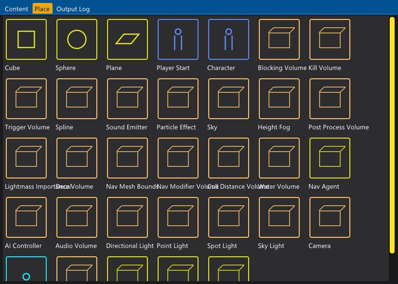
*The Place tab (Unreal's Place Actors): drag a shape, light, volume, camera, vehicle... into the viewport.*

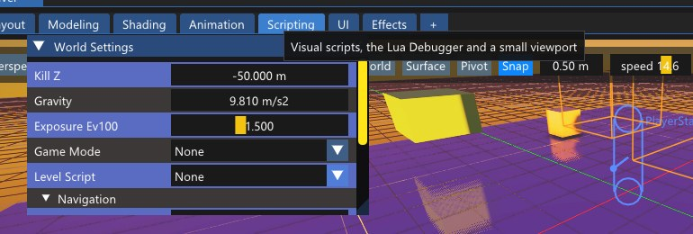
*Window > World Settings: Kill Z, gravity, exposure, Game Mode, Level Script and navigation settings for this level.*

- **File > New Level** starts with a floor and a Player Start (add lights from the Place tab).
- Drag meshes from the Content Browser into the viewport, or use the **Place** tab for built-in
  shapes (Cube, Sphere, Plane), lights, volumes, Player Start, Sky, Fog, Post Process Volume, Sound
  Emitter, Particle Effect, Spline, Nav Mesh Bounds, Nav Agent, AI Controller...
- Drop a Material onto an object in the viewport to apply it.
- **Volumes** are the unit cube scaled by their transform: **Blocking Volume** (invisible wall),
  **Kill Volume** (respawns the player), **Trigger Volume** (tells scripts when something enters),
  **Audio Volume** (reverb inside), **Post Process Volume**, **Nav Mesh Bounds**, **Nav Modifier Volume** (cut out of the navmesh).
- **Prefabs** are reusable objects: right-click an object in the Outliner > Create Prefab (it takes
  its children too), then drag the prefab in as often as you like. Edit one copy and **Apply to
  Prefab** (Details) to update the prefab; per-copy changes are
  remembered as overrides (**Revert to Prefab** in Details). That includes components and child
  objects a copy adds or removes: they stay so when the prefab changes (Revert drops them too).
  Prefabs inside prefabs refresh from their own asset, so a changed lamp prefab shows in every room
  prefab that holds it.
- **Splines**: place a Spline, click a point to move it with the gizmo, Add / Remove Point in Details;
  **Alt-drag** a point to add one after it; the selected point shows a **tangent handle** (drag it to
  bend the curve there; Tangents in Details, zero = automatic). **Spline Meshes** (Add Component) puts
  copies of a mesh every Spacing metres along it, turned along the curve: fences, rails, lamp posts.
  A **Spline Follower** moves an object along it (moving platforms, patrols).
- **World Settings** (Window menu): kill height, gravity, exposure, the Game Mode and the navmesh
  settings for this level.

Save with **Ctrl+S**. Levels live in `Content/` like any asset.

---

**Prefab editor**: double-click a prefab to edit it on its own (Unreal's Blueprint editor viewport):
drag the preview to turn it, pick objects in the tree, **+ Child** adds a part, **Delete** removes
one, edit components on the right (+ Add Component, X to remove). **Save** updates every copy in
the level; what a copy overrides stays its own.

## 5. Lighting, sky and post-processing

For the steps to the best picture, in order, see [GRAPHICS.md](GRAPHICS.md) (Epic graphics: a step-by-step guide).

Lights use physical units, like Unreal:

| Component | Units / notes |
| --- | --- |
| Directional Light | lux; its +X axis is the light's direction; Cast Shadows, Shadow Distance (cascaded shadows) |
| Point Light | lumens, attenuation radius, shadows; **Source Radius** makes it a sphere light (softer, wider highlights); **IES** (Unreal's IES Texture): drop a photometric `.ies` file in Content and pick it, and the light takes that fixture's pattern by angle from its forward axis (rotate the light to aim it; averaged around the axis, 16 steps from front to back) |
| Spot Light | lumens, inner / outer cone, shadows, Source Radius, IES (inside the cone); **Light Function** (Unreal's): an image projected along the light whose brightness dims it (a window frame, leaves, a gobo), **Function Tiling** repeats it, **Function Scroll X / Y** slide it (clouds, caustics); Rect Lights have it too. Light functions share the 16 decal image slots |
| Rect Light | lumens from its front (+X); **Shape** Rect (Source Width across Y x Height along Z) or Disc (Width across): windows, screens, softboxes, ceiling panels. Unreal's Rect Light. Lit exactly: up close the panel's whole outline lights a surface (light reaches points its centre is behind), and glossy floors show its true shape in their reflection. **Cast Shadows** (one shadow tile, a 150 degree view from its front; light leaving almost sideways is unshadowed), softer the bigger the panel. Point and Spot Lights' shadows soften with their Source Radius too |
| Sky Light | ambient from above and below |

Colour can be set by temperature (Kelvin). **World Settings > Exposure (EV100)** sets the camera
exposure: 1.5 suits the default sun; a real 100 000 lux sun wants about 15.

Atmosphere:

- **Sky**: a gradient (zenith, horizon, ground) with a sun disc where the first Directional Light
  comes from. Without one the viewport stays its plain dark colour. **Atmosphere** (on by default,
  Unreal's Sky Atmosphere): the colours follow the sun's height, so turning the Directional Light
  sets the time of day: blue noon, an orange horizon and red sun at sunrise / sunset, dark night. The
  sky is computed from how air, haze and ozone scatter sunlight (single scattering), redrawn as the sun
  turns; shiny surfaces outside Reflection Captures reflect it and the ambient takes its colours.
  Reflection Captures keep the sky they saw: Build > Build Reflection Captures again after changing the
  time of day a lot.
  The sun's light takes the same colour, and a **Sky Light** with **Capture Sky** (default) lights
  the level with the sky's colours. Untick Atmosphere to pick the colours yourself.
  **HDRI** (Unreal's Sky Light cubemap): pick a latitude-longitude `.hdr` or `.exr` image. Shiny surfaces
  outside every Reflection Capture reflect it (blurrier on rougher ones), the backdrop shows it, and the
  ambient light takes its averages overhead, at the horizon and below it, times **Brightness**. It uses one of the 8 reflection
  tiles, so a level with an HDRI has room for 7 captures.
- **Reflection Capture** (Unreal's Sphere Reflection Capture; Place tab): metal and other shiny
  surfaces within its **Radius** reflect what is around it (the room, the props, the characters)
  instead of only the sky, sharp on smooth surfaces and blurrier on rough ones. It captures when the
  level opens; after moving things, **Build > Build Reflection Captures** (console `BuildReflections`).
  Up to 8 in a level; where two overlap, a surface blends them by how far inside each it is (no seam where one room meets the next). Put one in the
  middle of each room. **Shape: Box** (Unreal's Box Reflection Capture) fits a room: set **Box Size**
  to the room (world axes, centred on the capture) and surfaces inside reflect it bent to where each
  ray meets the walls, so a shiny floor shows the walls where they really are; it fades in over
  **Box Transition** inside the walls.

  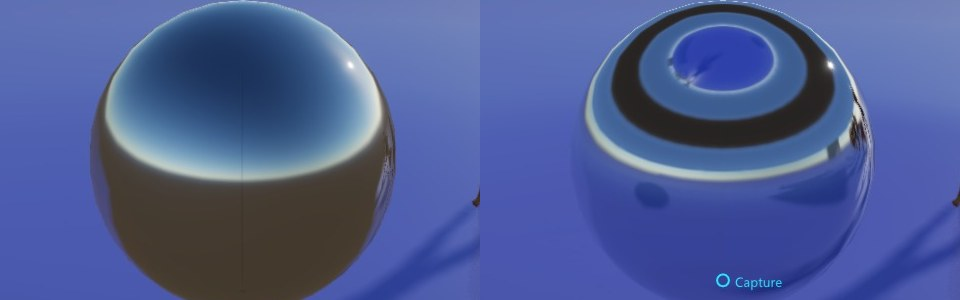
  *A mirror sphere: the sky gradient only (left), and with a Reflection Capture (right): the floor, the characters and the real sky.*
- **Height Fog**: exponential fog, thickest at the object's height and thinning upwards; density,
  falloff, colour, start distance, max opacity. Particles fade into it like meshes (smoke takes on the
  fog's colour, additive sparks and glows fade out). **Volumetric** (Unreal's Volumetric Fog): the sun
  lights the fog and its shadows cut through it, so fog glows in sunlight, stays dark behind walls
  and columns, and makes light shafts, against the sky too (for that it needs a Directional Light that casts shadows). Point
  and Spot Lights light it too: a lamp gets a glowing halo, a spot a visible cone (without their shadows).
  **Scattering** is how strong the effect is, **Anisotropy** how much brighter it glows looking toward
  the sun, **View Distance** how far it is traced, **Steps** its quality (16 is a good start).

  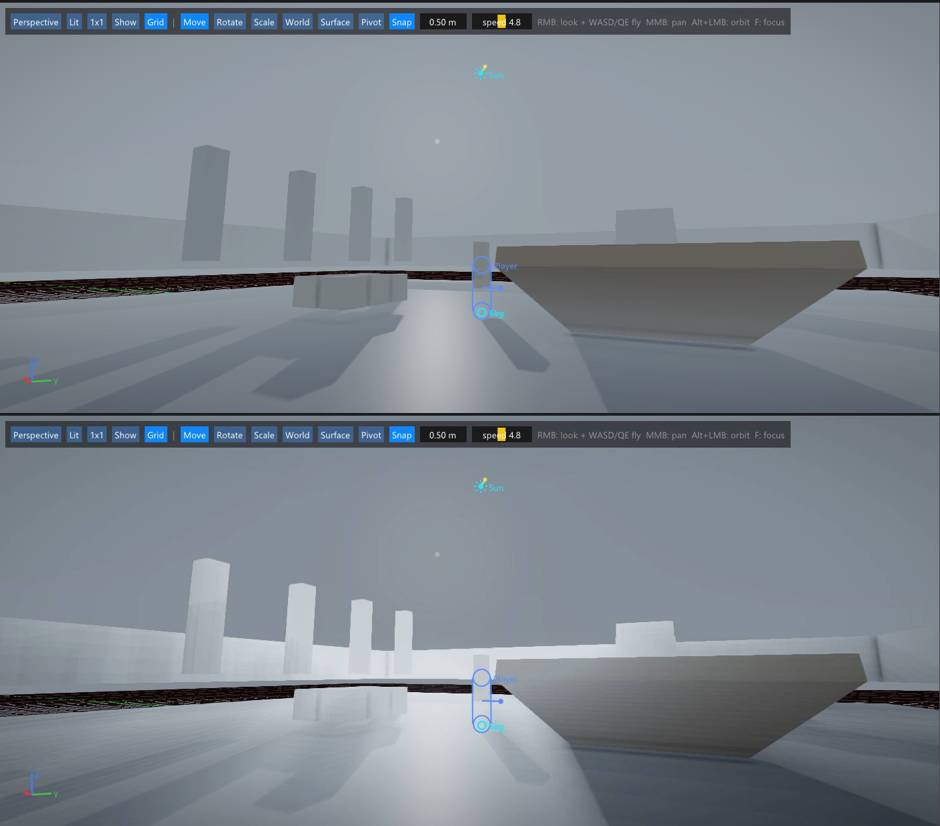
  *The same view without (top) and with Volumetric: sunlit fog glows, shadowed fog stays dark.*
- **Post Process Volume**: unbound (everywhere) or a box. Volumes blend as in Unreal: each the camera
  reaches is mixed in by its **Blend Weight**, lowest **Priority** first (higher ones on top), and a box's
  look fades in over its **Blend Radius** as the camera nears it (0 = a hard edge); switches such as the
  tonemapper and the LUT come from a volume once it is at least half in. Exposure compensation, filmic (ACES) tonemapper, saturation, contrast, tint, vignette,
  **bloom** (intensity, threshold: bright and emissive parts glow) and **anti-aliasing** (FXAA, or
  **Temporal AA**: smoother and steadier, a little softer, can ghost on fast motion).
  **Reflections** (screen-space: smooth surfaces mirror what is on screen; intensity, distance),
  **Ambient Occlusion** (intensity, radius: darker creases and contact points, from the depth
  buffer like Unreal's SSAO) and **Depth of Field** (focal distance, focal region that stays sharp,
  transition, max blur in pixels; focal distance 0 = off; out-of-focus lights open into soft bokeh discs;
  needs Post Processing quality High or Epic). Reflections and Ambient Occlusion take each pixel's normal from a
  normals pass (the opaque meshes drawn once more, their smooth normals into a texture, like Unreal's GBuffer World
  Normal), so a low-poly mesh shaded smooth reflects and darkens smoothly instead of triangle by triangle. It runs
  only while one of them is on. Ambient Occlusion darkens only the ambient light (sky, bounces, reflections), as
  Unreal's does: a sunlit surface stays bright, the same crease in shade goes dark.
  **Color Grading LUT** (Unreal's): a 256 x 16 texture strip (16 tiles of 16 x 16; red across, green
  down, blue tile by tile) applied last, in display colours, with **LUT Intensity**. To make one,
  paste a neutral strip into a screenshot, grade the whole picture in Photoshop / GIMP, crop the strip
  out and import it as a texture.
  **Post Material** (Unreal's Post Process Material): Content Browser > right-click > **New Post Process
  Material** makes a `.hlsl` with `float3 post_main(PostIn pi)`; pick it here and it runs on every pixel
  before tonemapping. `pi.color` is the scene there (linear), `pi.uv` its place (0..1, top-down),
  `pi.time` seconds and `pi.params` this volume's **Post Parameters**; `scene_color(uv)` reads the scene
  anywhere and `texel_size()` is one pixel. Write it like a shader asset (float3, lerp, saturate, frac:
  OpenGL maps them). Saving it recompiles; compile errors go to the Output Log.
  **Motion Blur** (Amount 0 = off, Max as % of the screen's width): turning or moving the camera
  smears the picture along the movement. Objects moving by themselves blur too (a velocity pass, Unreal's
  velocity buffer: each mesh's movement on screen since the last frame), over what is behind them as well, and
  TAA follows them instead of leaving a ghost. Particles and the sky take the camera's movement.
- **Contact shadows** (Unreal's Contact Shadow Length): **Directional Light > Contact Shadow Length**
  (metres, 0 = off) sends a short ray toward the sun through the depth buffer from every surface that
  faces it, for the small shadows the shadow map misses (feet on the floor, props on a table). It runs
  with the post pass (a volume's look or the default one). For now it darkens the shaded colour, so it
  also deepens a little what the shadow map already shades.
  **Exposure** (Unreal's Auto Exposure / eye adaptation, on by default): the image is metered every
  frame and eased toward mid grey, so dark interiors brighten and sunlit views darken over a moment;
  Min / Max EV limit how far it moves from World Settings exposure, Speed Up / Down how fast,
  exposure compensation shifts the result. Untick Auto Exposure for a fixed, manual exposure.
  The scene is drawn into a target and these run as a post-process pass. **Without a volume the
  level gets a new volume's defaults** (filmic tonemapper, bloom, AO, reflections, FXAA, auto
  exposure), as in Unreal; add one to change them. AO, DOF and TAA need a perspective view.

Reflections and ambient light (Unreal's Sky Light): every surface reflects the sky / ground colours
along its reflection, sharper the smoother it is (metals and polished floors pick up the sky), with
the usual energy-conserving split-sum BRDF, darkened by AO and where baked probes say it is
indoors. Screen-space reflections add what is on screen on top.

Quality (the player's setting, Low → Epic) scales shadows: Low has none, Medium sun only, Epic
casts further.

### Water (lakes, oceans, rivers)

Place tab > **Water Body** (Unreal's Water plugin: Water Body Lake / Ocean / River). Pick its
**Kind** in Details:

- **Lake**: a rectangle of **Size X** x **Size Y** metres around the object, at the object's height.
- **Ocean**: water to the horizon at the object's height (drawn around the camera wherever it goes).
- **River**: give the same object a **Spline** (Details > Add Component, or start from a Spline):
  the water follows the curve, **River Width** across, at the curve's height.

**Waves**: **Wave Height** (trough to crest of the biggest wave), **Wavelength**, **Wave Speed**
and **Wave Direction** (degrees, 0 = +X). Three smaller waves cross the main one so the pattern
never looks like stripes. **Look**: **Color** (shallow) and **Deep Color**; the water reads the
depth of what is under it on screen, so it gets darker and more opaque over **Depth Fade** metres
and you see the floor through the shallows (**Clarity**). It reflects the sky and Reflection
Captures, more at grazing angles (fresnel), with sun glints. **Depth** is how far below the surface
swimming and floating reach.

In Play the Character swims when its chest is under a Water Body (as in a Water Volume: Swim
Speed, Jump rises, Crouch dives), and Rigid Bodies float on the waves you see (**Buoyancy**: 1
neither floats nor sinks, higher floats higher; 0 = off), slowed by the water's drag.

Limits for now: the waves move the surface's points on the CPU each frame (fine for a few water
bodies); rivers do not flow along their curve; no foam, caustics or underwater fog; the depth tint
needs the post-process view (the editor viewport and the game have it) and a perspective camera.

### Sub-levels and streaming

Place tab > **Sub Level** (Unreal's Level Instance / level streaming): pick a **Level** in Details and
that level's objects appear under this object, moving with it. They are not saved into this level
(open the sub-level to edit them; the copy here updates when you save it) and clicking them selects
the Sub Level object. In Play a sub-level is loaded from the start, or, with **Load Distance**, only
while the player is that near (it unloads a little further away); untick **Load at Start** to load it
only from scripts: `lsd.load_sublevel(e)` / `lsd.unload_sublevel(e)` or the **Load / Unload Stream
Level** nodes. Their scripts and physics start and stop with them. Sub-levels inside sub-levels are
not loaded yet.

**Level Streaming Volume** (Place tab, Unreal's Level Streaming Volume): a box that streams by where
the player is instead of by distance. Size it over an area, then in Details > **Sub Levels** add the
names of the Sub Level objects (as in the Outliner) it controls. In Play (and the packaged game) each
listed Sub Level is loaded while the player (or the camera, with no Character in the level) is inside
any volume that lists it, and unloaded once the player is a metre outside all of them (no flicker at
the edge). Listed Sub Levels ignore their Load Distance and a script's load / unload (the volumes
decide every frame); untick the volume's **Enabled** to hand them back.

### Vehicles, transports and moving meshes

Three ready-made objects in the **Place** tab, coloured cubes as placeholders (put your own mesh in
their Static Mesh):

- **Drivable Vehicle** (red, Unreal's vehicle Blueprint): walk up and press **E** to get in. **W / S**
  throttle and reverse, **A / D** steer, **Shift** boost, **Ctrl** or **Space** handbrake, **E** gets
  out (beside it). It hugs the ground (steps and ramps up to half a metre), stops at walls, pushes
  what it hits, and the camera follows behind. Details > Vehicle: Ground or **Flying** (Space climbs,
  Ctrl sinks), top speed, reverse, acceleration, braking, turn rate, boost, the seat, camera distance.
  The camera stops in front of walls between it and the car.
  - **Physics model** (Unreal's Chaos Wheeled Vehicle): Details > Vehicle > Physics > **Model =
    Physics** makes it a real car: a body on wheels with suspension, an engine (torque, max RPM), an
    automatic gearbox and brakes. It rolls down slopes, bounces over bumps, slides, and can be pushed.
    W / S throttle (pressing against the way it rolls brakes first), A / D steer, **Ctrl** brake,
    **Space** handbrake, **Shift** boost. Mass, steering angle, wheel radius / width, the suspension
    (travel, stiffness, damping), **Tire Friction** (Unreal's Friction Force Multiplier: 1 tarmac, 0.3
    ice), **Gear Ratios** (Unreal's Transmission Setup: first gear first; empty = five gears) and
    **Reverse Gear Ratio** are there too.
  - **Your own car mesh** (like a Chaos Vehicle Blueprint with its wheel bones): put the body mesh on the
    vehicle object and the four wheel meshes as its children, where the wheels are, and name them
    **Wheel...** (Wheel FL, Wheel_RR...). With no **Wheels** listed, Play finds them, takes each one's
    place, radius and width from its mesh, makes the front half steer and the back half take the
    handbrake (Drive picks which are driven), and spins, steers and bounces each mesh with its wheel,
    whatever its pivot or rotation. A rigged car works the same way: a **Skeletal Mesh** on the vehicle
    (or a child) whose wheel bones are named **wheel...** (wheel_fl, Wheel_RR...) has those bones turned.
    To set wheels up by hand, list them: a wheel's **Object** (a child mesh) or **Bone** is what turns,
    and **Fit** takes its place and size from that mesh or bone instead of Position / Radius. With
    nothing found it gets four wheels at the corners of its box and a ring shows each one in Play.
    Keep the vehicle's scale uniform (scale the mesh in its import settings): a wheel under a squashed
    parent cannot spin without stretching.
  - **Multiplayer**: give the vehicle **Net Replicated**. The server hands out the seats: the first
    player in drives (their machine simulates the car, everyone else sees it move), the next ones sit
    on the **Passenger Seats** (positions in the vehicle's space) with the follow camera. Getting out,
    or leaving the game, gives the car back to the server.
- **Transport (Ride)** (blue: trains, ferries, lifts, cable cars): **E** near it hops on, and you
  travel on its seat without driving; **E** gets off. It comes with a Mover going back and forth
  20 m with a 3 s stop at each end: change its route in the Mover (a Spline for rails), or use a
  Spline Follower instead.
  When the rider stands inside its mesh (a closed train car), the view is inside too: **Camera Offset**
  moves the rider's view in the transport's own directions (x forward, y left, z up, in metres, not
  scaled with it: 0, 1.4, 0 at a window, 0, 0, 2.5 over the roof) and **Camera Distance** puts it on a
  spring arm that far behind where you look (8 shows the train from outside; the transport itself
  never pulls the arm in). Both 0: the rider's own camera, as before. Vehicle passengers already get
  the vehicle's follow camera (Camera Distance / Height on the Vehicle).
- **Moving Mesh (Mover)** (green): moves by itself. **Path**: *Direction* (any velocity vector,
  forever or for Duration seconds), *Back and Forth* (to Offset and back), or *Spline* (a Spline
  object's route by name, facing along it). **Repeat**: Once, Loop or Ping-Pong; **Pause** at each
  end; **Spin** turns it while it moves. **Start**: Begin Play, **Trigger** (when the player enters a
  Trigger Volume of that name), **Game Time** (seconds into the game) or **Script**; **Repeat
  Minutes** runs the route again from the start every so many minutes (60 = hourly, 0 = never).
  What stands on it rides along.

Visual scripts: **Enter Vehicle**, **Exit Vehicle**, **Get Driven Vehicle**, **Hitch Ride**,
**Leave Ride**, **Start / Stop / Restart Mover**. Lua: `lsd.enter_vehicle(e)`, `lsd.exit_vehicle()`,
`lsd.vehicle()`, `lsd.ride(e)`, `lsd.stop_riding()`, `lsd.start_mover(e)`, `lsd.stop_mover(e)`,
`lsd.restart_mover(e)`; vehicles and transports get `on_enter(self, player)` / `on_exit`.

### Multiplayer

One checkbox: **Settings > Project Settings > Multiplayer > Multiplayer**. Off (the default), the
game is single player and nothing networked runs. On:

- **Play** hosts (a listen server: you are player 0) and opens a game window for each other player
  (**Play Players**, default 2), which joins it on the level as it is. Stop closes them.
- Tick **Net Replicated** on an object (Details > Add Component > Multiplayer) to share it (Unreal's
  Replicates): the server's copy is the real one, every client shows it. Clients play other objects
  back about 100 ms in the past (**Interpolation**), blending between updates, so lag and lost
  packets look smooth instead of jumpy; physics runs on the server only. Objects scripts spawn on the
  server appear everywhere, and go everywhere when destroyed.
- Every player has an **avatar** the others see (**Player Avatar**: a mesh asset or shape). Your
  own player moves on your machine (no waiting for the network) and the others see it.
- Scripts: `lsd.has_authority()` (the server, or single player), `lsd.server_event(name, ...)`
  (Run on Server), `lsd.multicast(name, ...)` (server to everyone), `lsd.client_event(player, name,
  ...)`, `lsd.set_team(player, team, squad)`, events `on_player_joined(self, id)`,
  `on_player_left`, `on_connected`, `on_disconnected`. In single player the same calls just run
  locally, so one script works both ways.
- **Text chat** (Project Settings > Chat): All, Team, Squad (off by default) and Proximity (off by
  default, with a range). The server routes every line (a client cannot pick who hears it). The
  built-in **Chat Box** (Enter to type, Tab for the channel, Esc to cancel) can be turned off to make
  your own with `lsd.chat(channel, text)` and `on_chat(self, from, channel, text)`.
- **Voice chat** (Project Settings > Voice; on by default in multiplayer games): hold **V** to talk
  to your team (or, if team voice is off, the first of proximity / squad / all that is on), hold **B**
  to talk to everyone when **Voice All** is on, or tick **Open Mic**. **Voice Squad** and **Voice
  Proximity** are optional; proximity voice gets quieter with distance and is silent past Chat >
  Proximity Range. Opus at about 24 kbit/s per speaker; the server decides who hears whom, like chat;
  each speaker plays through a short jitter buffer, so a slow network costs a little delay, not
  stutter. The chat box shows *Talking* while you transmit. The microphone opens only when voice chat
  is on and the game is multiplayer (never in `-nosound` runs).
- Packaged games: `-server` hosts, `-dedicated` hosts without a player, `-connect=address[:port]`
  joins (port 7777 by default). Tick rate, port and max players are in the same settings; `-port=<n>`
  overrides the port for that run (two test copies on one PC, each Play's extra player windows follow it).
- **Replicated Fields** (Unreal's Replicated properties): Net Replicated > Replicated Fields lists more
  values to share, `Component.field` comma-separated (`StaticMesh.color, PointLight.intensity,
  Tags.tags`); the server sends each when it changes, reliably, and players joining later get them.
- **Relevancy Distance** (Unreal's Net Cull Distance): players farther than this from an object get
  no updates of its movement, which saves bandwidth in big levels (0 = always sent).
- **Max Speed** (server-side move check): for objects a player's machine moves (avatars, driven cars),
  a move faster than this is refused by the server and the player is put back, so speed and teleport
  hacks do not work (0 = no check).
- **Lag compensation**: `lsd.net_seen_position(target, player)` on the server gives where `target` was
  when that player saw it (their half round trip plus the interpolation delay ago). Check a client's
  shot against it, not against where the target is now, and fast targets hit fairly.
- **Level travel together**: `lsd.open_level(name)` on the server takes every player to the new level
  (they reconnect on their own); on a client it is refused (only the server changes the level).
- **LAN browser**: `lsd.net_find_games(seconds)` lists games hosting on the local network
  (`{address, name, players, max_players}`) for a join menu; the server answers on its port + 1.
- **Host / Join from a menu** (Unreal's Create / Find / Join Session): `lsd.net_host([level])`,
  `lsd.net_join(code)` and `lsd.net_leave([level])` switch a running game between server, client and
  single player (Play restarts on the level in that mode). A player who joins follows the server to
  its level. `lsd.net_join_code()` gives the host's **join codes**: 10 letters and digits such as
  `60N00-0A7K1` holding the address and port (any case, dashes optional, typos are caught). Join also
  takes a plain address (`1.2.3.4` or `1.2.3.4:7777`).
- **The ready-made menu**: `Content/Multiplayer/Multiplayer.lua` with `WBP_Multiplayer`. Put the script
  on any object in the level the game starts on (Project Settings > Multiplayer on). It has Host,
  Show join codes, a code box with Join, Find LAN games and Leave; **M** opens and closes it
  (`toggle_key` in Details), and `open_at_start` shows it when the game starts. In the editor it
  shows only in the Multiplayer workspace (`lsd.editor_workspace()`); a packaged game always has it.

#### Playtesting over the internet

Step by step with pictures: [Multiplayer.md](Multiplayer.md). The host clicks
**Show join codes** (the game's menu, or the Multiplayer workspace's panel). There are three ways in,
best first:

1. **Internet code** (no setup). The first Show join codes asks the router to forward the game's
   UDP port to this PC (UPnP, a couple of seconds) and reads the public address. When it works, the
   menu shows `Internet: <code>`: send it to the testers, they paste it into Join. The forward is
   removed when Play stops. It fails when UPnP is off in the router, or when the internet provider
   shares one address between customers (CGNAT, common on mobile and some fibre): the menu then says
   why. Kittakin's own connection is behind CGNAT (100.x.x.x), so use 2 there.
2. **Virtual LAN** (works behind any router; best for a closed test). Everyone installs
   [Tailscale](https://tailscale.com) (free for small groups) and joins the host's tailnet: the host
   invites testers by email from the Tailscale admin page, or shares the PC with them. The host's
   menu then shows a `Tailscale: <code>` line (its 100.x address): testers join with that. ZeroTier
   works the same way (create a network, testers join its ID, the host approves them; its address is
   one of the `LAN / virtual LAN` lines). Find LAN games does not cross Tailscale; use the code.
3. **Port forwarding by hand**: forward UDP 7777 (Project Settings > Multiplayer > Port) to the host
   PC in the router, then give testers your public address (any "what is my IP" page) as
   `1.2.3.4:7777`. Not possible behind CGNAT.

Everyone needs the same build (File > Package Project, then send the Build folder). If the
host's firewall asks, allow the game on private and public networks.

### Multi-User Editing

Unreal's Multi-User Editing: two or more editors of the same project edit one level together.
**Window > Multi-User Editing**:

1. One person clicks **Host** (UDP port 7790; their firewall may ask: allow it). The panel lists
   their **join codes** (one per network address, Tailscale's included: see
   [Multiplayer.md](Multiplayer.md) for getting across the internet).
2. The others paste a code or an address (`192.168.1.20` or `192.168.1.20:7790`) and click **Join**.
   Their level is replaced by the host's, as it is now (save yours first).
3. Edit as usual. Each finished change (the steps Undo History lists: moves, Details edits, placing,
   deleting, renaming, Undo / Redo, opening another level) appears on everyone else's editor; it is
   an undo step there too ("Multi-User edit").
4. The others' cameras show in the viewport as a coloured ball with their name, and what they have
   selected as a box of the same colour. The panel's **Users** list says what each has selected;
   **Go To** moves your camera to theirs. **Your Name** is what they see.
5. **Leave** ends it (the host leaving ends it for everyone). Everyone saves their own copy.

Every editor needs the same Content/ (use source control): assets are not sent, only the level.
There are no locks: when two people change one object, the last change wins. Edits that arrive
while you are playing are applied when you press Stop.

Console: `multiuser.Host [port]`, `multiuser.Join <code or address>`, `multiuser.Leave`,
`multiuser.Users` (who is there, their camera and selection), `multiuser.Name <name>`, and
`object.Move <name> <x> <y> <z>` (an undoable move, for scripts and tests).

### 2D games (Paper2D)

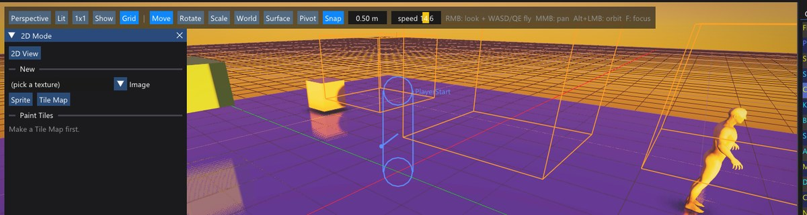
*The Level tab's 2D mode: 2D View (orthographic, top-down on the X / Z plane), New Sprite / Tile Map, and the tile palette for painting.*

Click the Level tab > **2D**. The panel's **2D View** looks along +Y without perspective (H in
the viewport), the way a side-on 2D game is seen; 2D content lives in the X-Z plane.

- **Sprite** (Unreal's Paper2D Sprite + Flipbook): pick an Image, click **Sprite**. A 1 m quad
  (scale it with the Transform), pivot at the bottom centre. For a **sprite sheet** set Columns /
  Rows in Details and the cell in **Frame**; **Frame Count** > 1 plays that many cells at **FPS**
  (a flipbook, Loop or once). Flip X / Y mirror it; **Pixel Art** keeps texels sharp; **Lit** lets
  the level's lights shade it (off: its own colours, like most 2D games); **Collision** makes it
  block in Play. Scripts switch animations with `lsd.set(e, "Sprite", {frame = 8, frame_count = 4})`.
- **Tile Map** (Paper2D Tile Map): pick the tileset image, click **Tile Map**, set the tileset's
  Columns / Rows, the map's Width / Height and Tile Size in Details. The panel shows the tileset:
  click a tile, then **LMB paints** it on the map in the viewport and **Shift+LMB erases** (each
  stroke is one undo). Painted tiles block in Play (rows of tiles become boxes).
  **Layers** (Unreal's Tile Map layers): the panel's **Layer** list picks what the brush paints:
  **Main** (the map's own tiles) or one of up to 3 more (**+** adds one, **-** removes the chosen one).
  Each layer has **Visible**, **Depth** (negative in front of the main tiles, such as foreground
  grass; positive behind, such as walls and windows) and, in Details, **Collision**. All layers use the map's tileset.
- **2D physics**: RigidBody > **Lock 2D** keeps a body in its X-Z plane, turning only around Y.
- **Side-scroller player**: Character > **Side Scroller**: Move's left / right walks along X,
  Jump jumps, and the player's Sprite faces the way it walks. Its animations (Unreal's Paper2D
  Character flipbooks) are on the Sprite: **Frame / Frame Count** is idle, **Character Animation >
  Walk Frame / Walk Count** plays while walking and **Jump Frame / Jump Count** in the air (a Count of
  0 keeps the idle one). The 2D template's player has them set up. **Walk Flipbook / Jump Flipbook**
  take Flipbook assets instead of cell ranges.
- **Flipbook assets** (Unreal's Paper2D Flipbook): Content Browser > New Data Asset > **Flipbook**:
  a list of frames, each a **Cell** of the sprite's sheet with its own **Duration** and an optional
  **Event**. A Sprite's **Flipbook** plays it instead of Frame / Frame Count / FPS (held on the last
  frame when Loop is off). In Play, when a frame with an Event starts, the sprite's scripts run that
  function: an Event `step` calls `function step(self)` (footsteps, a sword swing's hit frame).
  **Double-click a Flipbook** for its window (Unreal's Flipbook Editor). Pick the **Sheet** and its
  Columns / Rows at the top. The animation plays in the corner, with the current frame's event.
  Click a cell of the sheet to add it as the next frame. Each frame in the list has its cell,
  duration and event, arrows to move it and X to delete it; **Set All Durations** gives an even
  pace. **Save**: sprites using the flipbook play the new frames at once.

  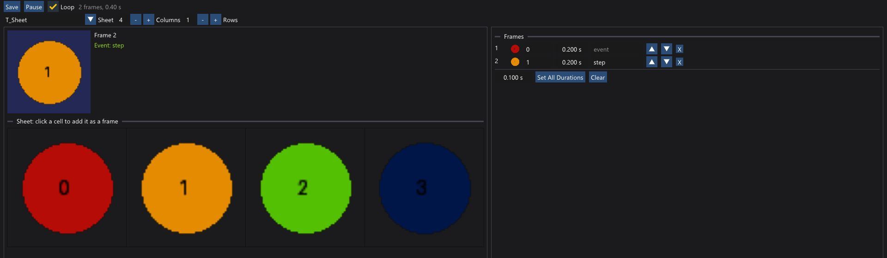
  *The Flipbook window: the playing preview with the frame's event, the sheet to click frames from, the frame list.*
- **Tile collision shapes**: in the 2D mode, pick a tile in the palette and set **Tile Collision**:
  Full, None (decoration only), Top Half, Bottom Half, Slope Up (a ramp rising to the right) or
  Slope Down, or **One Way** (a jump-through platform: the player jumps up through it and lands on
  top). It applies to every painted copy of that tile (the map's Collision > Tile Shapes list).
  Static Meshes and Sprites have **One Way** too (with Collision on), for 3D or sprite platforms.
  A second Tile Map with Collision off is a decoration layer in front of or behind the play layer.
- **Translucent sprites**: Sprite > **Translucent** blends soft edges and see-through colours (glass,
  smoke, glows) over what is behind instead of cutting them out; they draw after the solid ones, far
  to near, and **Sort Order** decides which is on top at the same depth (higher wins, Unreal's
  Translucency Sort Priority).
- **Shadows**: a **Lit** Sprite or Tile Map casts its cut-out shadow from the level's lights (Cast
  Shadows, on by default), for 2D scenes lit by a sun or lamps.
- **2D camera**: a Camera with **Orthographic** (and Ortho Height, metres of world on screen) and
  Auto Activate; make it a child of the player, about 10 m back on -Y turned to look along +Y
  (rotation Z 90), so it follows.

### Baked lighting (Build Lighting)

Without baking, the Sky Light's ambient is the same everywhere, so the inside of a closed room is
as bright as a field. **Build > Build Lighting** (Unreal's Lightmass with a Volumetric Lightmap)
fixes that:

1. Save the level (the result goes next to it as `<Level>_BuiltData.lsdlight`, loaded with it and
   packaged with it).
2. Optional: place a **Lightmass Importance Volume** (Place tab or Add Component) around the
   playable area. Without one, probes cover all the static meshes up to 30 m high. Its **Probe
   Spacing** sets the distance between probes (0: as fine as the 512-probe budget allows).
3. Build > Build Lighting. The status bar shows the progress; the editor stays usable.

Each probe records the sky it can see and the light bounced once off the surfaces around it (from
the sun, local lights and sky; colours from the object's Color and its Material's base colour).
Static and moving objects use it for their ambient light: rooms get darker, colours bleed onto
neighbours. Rebuild after moving walls or lights.

**Lightmaps** (Unreal's lightmaps from Lightmass): static meshes also get a lightmap texture,
detailed per surface where the probes are coarse. They are directional (Unreal's directional lightmaps):
each texel also keeps where its light mostly comes from, so normal maps still show their bumps under
baked light. Lighting built before this keeps working, flat, until you build it again.

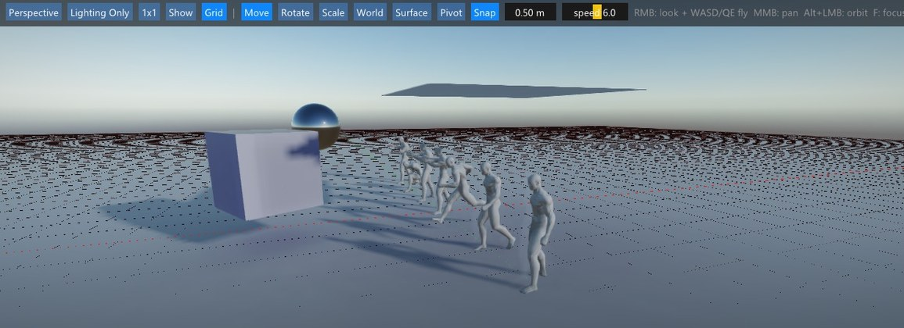
*Lighting Only view (Alt+6) after Build Lighting: the sky light, the blue floor's bounce, and the
dark contact under the statue's feet come from the lightmap.*

- **World Settings > Lightmap Resolution** (Off, 256 ... 4096, default 1024): the size of the
  level's lightmap atlas. Every lightmapped object shares it, at one texel density (the bake log
  says how many texels per metre it got): raise it for sharper baked light, lower it to bake faster.
- Each texel stores the light from the sky and three bounces reaching that spot (it replaces the
  probes there: corners, contact under objects, colour from neighbours; a red carpet bounces red, its
  material's texture taken into account) and how much of the **sun**
  reaches it: the sun's shadows are baked too, so they stay beyond the real-time Shadow Distance.
- **Point / Spot Light > Mobility: Static** (Unreal's Static lights): Build Lighting bakes its light and shadows into
  the lightmaps and probes, and once the level is baked it costs nothing at run time. It never moves, and moving
  objects (characters) get only what the probes saw of it. Before a bake it lights like a Movable one.
- **Mobility: Stationary** (Unreal's Stationary lights, with shadow masks): it lights every frame (change its colour
  or brightness in play), but Build Lighting bakes its shadows on lightmapped surfaces, soft by its Source Radius
  and at any quality (at Medium, where local lights have no shadow tiles, they still show). Moving objects still
  take a shadow tile when one is free. Up to 4 per level (the bake's shadow mask has 4 channels); move it and
  build again.
- **Static Mesh > Static Lighting** (on by default, Unreal's Mobility: Static): untick it for
  objects that move; objects with a Rigid Body, Mover, Vehicle or Transport never get a lightmap.
  Moving objects, skeletal meshes and Instanced Static Meshes use the probes.
- The lightmap UVs are made for you (xatlas charts every object); no second UV channel is needed
  in the FBX.
- An object moved, renamed or given another mesh after the bake goes back to the probes until the
  next Build Lighting. Real-time shadows inside the Shadow Distance stay as they were.

### Dynamic Global Illumination (Unreal's Lumen)

When lights or walls move (a day / night cycle, a door, a torch carried around), baked light is wrong. Tick
**World Settings > Dynamic Global Illumination** instead: a grid of light probes follows the camera (10 x 10 probes
across, 5 high, 2 m apart: 18 m around you) and is relit all the time on worker threads. Each probe sees the sky
(dark under a roof), the light bounced off the surfaces around it (from every light, through their shadows, and the
light those surfaces already got: bounces add up) and the colours of the meshes, as Build Lighting's probes do, but
live: move the sun or a wall and the bounce and the room's darkness follow within a few frames.

- While it is on it replaces Build Lighting's probes and lightmaps (no bake needed), and Static lights light in real time like Movable ones; untick it to go back to the bake.
- Beyond the grid the ambient fades back to the Sky Light's.
- Console: `r.DynamicGI 0` turns it off everywhere (a quality switch), `r.DynamicGI.Spacing <m>` sets the distance
  between probes (larger reaches further, coarser), `r.DynamicGI.Rays <n>` the rays per probe (8 .. 256, default 64:
  more is smoother and slower). `stat dump` prints how long a sweep takes.
- Limits: it sees Static Meshes only (not skeletal meshes, landscapes or instanced meshes) with their Color and
  Material base colour (no textures); the light is soft and coarse (2 m), so small contact shadows still need SSAO or
  the lightmaps.

---

### HLOD (Build HLODs)

A street of two hundred small meshes costs two hundred draws even when it is a smudge in the distance. **Build > Build
HLODs** (Unreal's Hierarchical LOD) fixes that: it cuts the level's Static Meshes into square cells, merges each cell's
objects into a few simplified proxy meshes (a quarter of the triangles of each), and saves them next to the level as
`<Level>_BuiltData.lsdhlod` (save the level first). Beyond a distance a cell draws its proxies instead of its objects;
nearer, the objects as before. It works in the editor viewport, in Play and in a packaged game (Package Project copies
the file, also with Cook Used Assets Only). Console: `BuildHLODs`.

**World Settings**: **Hlod Enabled** (off: always the objects), **Hlod Cell Size** (metres, the grid; rebuild after
changing it), **Hlod Distance** (metres from the camera to the nearest point of the cell; Engine Scalability > View
Distance scales it). `stat dump` shows the draws: look from far away and they drop to one per look per cell.

What is merged: opaque, visible Static Meshes that do not move (no Rigid Body, Mover, Vehicle or Transport), with no
Material or a plain opaque Material (not a Material Instance or Graph), no Max Draw Distance and no per-slot Materials.
Cells with fewer than two such objects are left alone. Limits: one proxy per distinct Material + tint in a cell (no
baked atlas), no lightmaps on the proxies (they use the probes), shadows still come from the objects, and a
moved or renamed object is not recognised until you build again.

## 6. Materials

### Simple Materials


*A Material asset is edited in Details: base colour (or texture), metallic, roughness, normal / ORM textures, emissive (+ texture), blend mode, opacity.*

**New Material** creates a physically based material: base colour (+ texture), metallic, roughness,
normal map, ORM map (occlusion / roughness / metallic packed like glTF) or the separate **Roughness
Texture**, **Metallic Texture** and **Ambient Occlusion Texture** (one channel each, multiplying Roughness
and Metallic; they are packed into one ORM texture when the material loads, kept in `DerivedData/Materials`,
and win over the ORM Texture's channel when both are set), **Specular** (0..1, Unreal's: 0.5 is the usual
4% reflectivity of non-metals, 0 removes the highlight, 1 doubles it; metals ignore it) with an optional
**Specular Texture** multiplying it, emissive (+ **Emissive
Texture**: where it glows, multiplying Emissive; set Emissive to white for the map's own colours.
Lighting is in physical units, so a glow you see in daylight needs an Emissive Strength in the
thousands, as in Unreal). Drop it on an
object or pick it in the object's Static Mesh > Material. Edits show immediately. **Blend Mode**:
Opaque; **Masked** (cut-outs from the base colour alpha below Opacity Mask Clip: leaves, fences; their
shadows have the same holes, on static and skeletal meshes, for every light);
**Translucent** (glass, water; Opacity sets how see-through; drawn after opaque objects, far to near);
**Additive** (adds light: fire, glows).

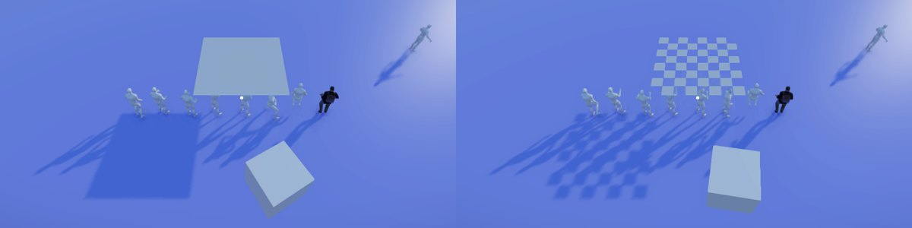
*The same panel with an Opaque material (left: a solid shadow) and a Masked one (right: the checker's holes in the shadow too).*

**Texture Setup** (Details, for maps made in Unreal or Substance, used as they are, no copies to make):
- **Tiling U / V**: every texture of the material repeats this many times across the mesh's UVs (Unreal's TexCoord
  UTiling / VTiling or a "Tiling" parameter multiplying the UVs). 1 = as authored. Masked cut-out shadows tile too.
- **Normal DirectX**: the Normal Texture is DirectX style (green points down), as Unreal's and most `_N` maps from
  Unreal packs are; its green is flipped when the material loads (a copy in `DerivedData/Materials`, the file is
  not changed). Leave it off for OpenGL / glTF style maps (the engine's own convention). If bumps look pressed in
  where they should stand out (or lit from below), tick it.
- **AO / Roughness / Metallic Channel**: which channel of the ORM Texture holds each (R, G, B, A, or None: the value
  alone). The defaults read glTF / Unreal ORM (R occlusion, G roughness, B metallic). Other packings: HRM (height,
  roughness, metallic): AO None, Roughness G, Metallic B; MRA: Metallic R, Roughness G, AO B; SMRA: Metallic G,
  Roughness B, AO A. **Roughness Is Gloss** inverts the roughness channel (glossiness / smoothness maps). The texture
  is repacked once when the material loads (`DerivedData/Materials`).

**Material Instance**: a parent material plus ticked overrides (Unreal's Material Instance Constant).

**Shading Model: Hair** (Unreal's Hair shading model, for hair cards): two highlights run along the strands (a
white one and a hair-coloured one, Roughness sets how sharp) and light wraps softly round into the shadow side. Lay the
strands along the texture's V, use Blend Mode Masked with the hair texture's alpha; cards are drawn from both sides.

**Global material parameters** (Unreal's Material Parameter Collection): **Project Settings > Materials > Material
Parameters** names up to 16 values every material can read, each with a starting value (Wind, Wetness, SnowAmount,
TimeOfDay). In a Material Graph the **Global Parameter** node (Parameters) gives one by name (a colour, or a number in
all three channels). Scripts change it for every material at once: `lsd.set_material_parameter("Wetness", 0.8)` (or
`name, r, g, b[, a]`) or the **Set Global Material Parameter** node; Play starts from the starting values and Stop
puts them back. Renaming or reordering the list compiles the materials again.

### Material Graphs

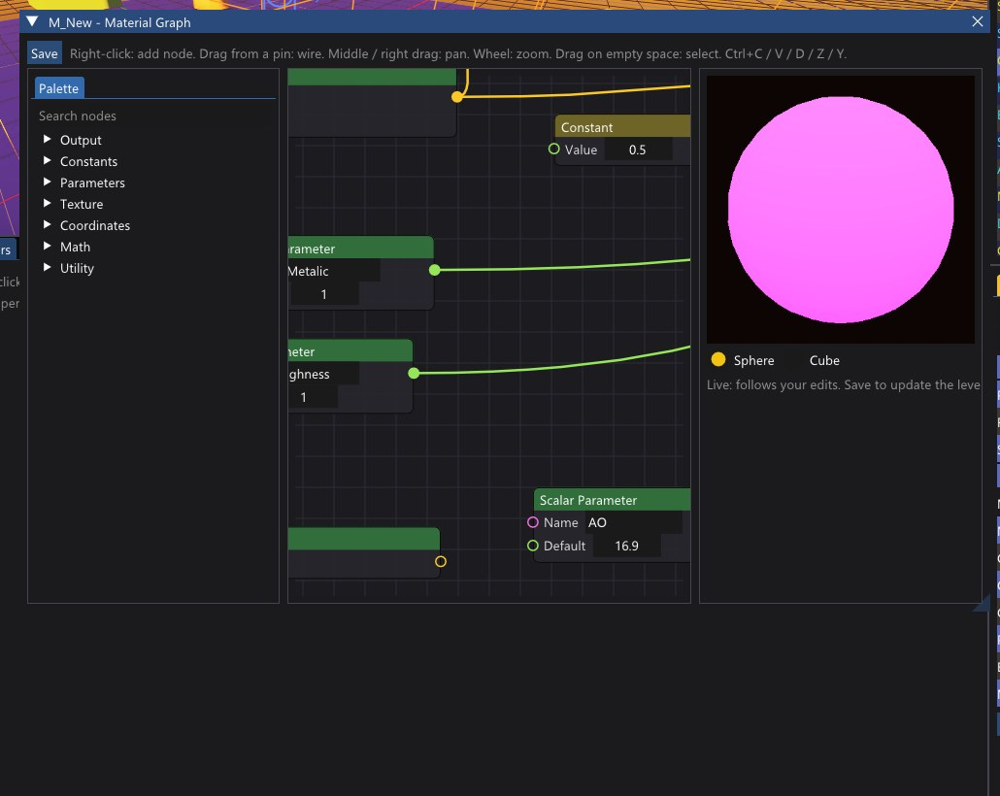
*The Material Graph editor: node Palette on the left, the graph in the middle, a live preview (sphere or cube) on the right. Save updates every object that uses it.*

**New Material Graph** opens a node graph (Unreal's Material Editor). Right-click to add nodes; drag
from a pin to wire. The preview on the right (sphere or cube) updates 0.3 s after each change.

| Category | Nodes |
| --- | --- |
| Output | Material Output: Base Color, Metallic, Roughness, Emissive, Normal, Ambient Occlusion, Opacity, Blend Mode (Opaque, Masked, Translucent, Additive) |
| Constants | Constant, Color, Time |
| Parameters | Scalar Parameter, Vector Parameter (changed by Material Instances, no recompile) |
| Texture | Texture Sample (pick the texture; Type: Color / Normal / Data) |
| Coordinates | Texture Coordinate (tiling), Panner, World Position, Vertex Normal, Camera Vector, Fresnel |
| Math | Add, Subtract, Multiply, Divide, Lerp, One Minus, Power, Clamp, Dot, Normalize, Sine, Abs, Frac |
| Utility | Break Vector, Make Vector |
| Functions | Material Function (calls another graph by name, with A / B / C inputs), Function Input, Function Output |

Numbers and colours connect freely (a number becomes a grey colour). Up to 4 textures and 16
parameters per material. **Save** to update the level. A Material Instance whose parent is a graph
lists the graph's parameters (button **Add the graph's parameters**) to set per instance.

**Shader assets** (a material written as code, like a whole-material version of Unreal's Custom
node): Content Browser right-click > **New Shader** makes `SH_New.hlsl`; double-click opens it in your
code editor, and saving recompiles it. It writes the function a Material Graph compiles to:

```hlsl
// texture: T_Rock color        (color, normal or data: lsd_tex0 .. lsd_tex3 in this order)
// param: Tint 1, 0.45, 0.2     (lsd_params[0]; Material Instances change it by name)
// param: Pulse 2               (lsd_params[1].x)
// blend: translucent           (optional: masked, translucent, additive)
Surface material_main(MaterialIn mi) {   // mi.uv, mi.wpos, mi.normal, mi.view, mi.time
    Surface s;
    s.base_color = lsd_tex0(mi.uv).rgb * lsd_params[0].xyz;
    s.metallic = 0.0; s.roughness = 0.5; s.emissive = lsd_v3(0.0);
    s.normal = float3(0.0, 0.0, 1.0); s.ao = 1.0; s.opacity = 1.0;
    return s;
}
```

Use it like a Material Graph: drag it onto an object, put it in a Material Slot, or make a Material
Instance of it. The same code runs on D3D12, Vulkan and OpenGL (keep to `float3`, `lerp`, `frac`,
`saturate` and the usual maths: OpenGL translates those).

**Material Functions** (Unreal's): make a Material Graph, say `MF_Tint`, that ends in a **Function
Output** instead of a Material Output, and reads its inputs through **Function Input** nodes (Input A,
B or C; Preview is the value used while you look at the function on its own, where it shows as the
base colour). In any other material, a **Material Function** node with Function `MF_Tint` runs it
there, its A / B / C pins feeding the inputs and Result giving the output. Functions can call other
functions, up to 4 deep. Their textures and parameters count toward the material's 3 and 16.

---

## 7. Playing and the player

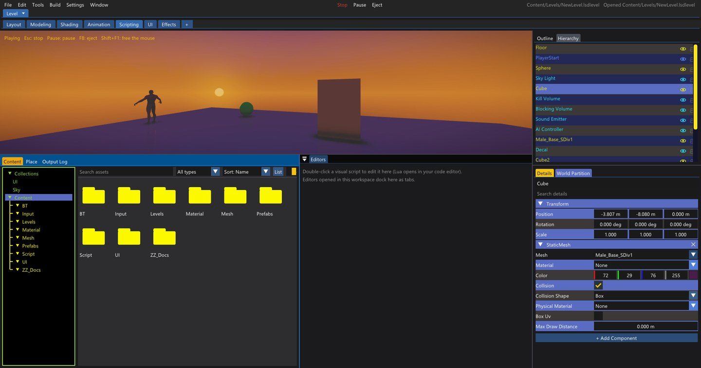
*Play in the editor: the viewport becomes the game. Esc stops, Pause pauses, F8 ejects to fly around; the top line says so.*

**Keep Simulation Changes**: while playing, right-click objects in the Outliner (or press K when
ejected with F8) to keep what Play did to them (where physics dropped them, changed properties):
when you stop, they keep it, as one undo step.

Press **Play** (or **Alt+P**). **Esc** stops; **Pause** pauses (`]` steps a frame); **F8** ejects to
fly around the running game; **Shift+F1** frees the mouse. Changes made while playing are undone
when Play stops, like Unreal's PIE. **Simulate** (**Alt+S**, next to Play) runs physics, scripts and AI
while you keep the editor camera and selection (F8 possesses the player). **New Window** (**Alt+N**)
plays the level as it is now, unsaved edits included, in a window of its own, the way the packaged
game runs (Unreal's New Editor Window PIE); the editor stays free to edit, and the button becomes
**Close Window**. The menu bar's **Settings >
Engine Scalability** sets the graphics quality (Low to Epic), saved with the player's settings. The
first run picks one for the PC (from its graphics card and memory); **Auto-detect** picks again.
**Device Profiles** (Unreal's) let the project decide for some PCs: New Data Asset > **DeviceProfile**,
then a GPU name to look for ("Van Gogh" for the Steam Deck, "Intel", "RTX 40"), a video memory range,
a platform, and the quality and group levels to use there. Profiles are tried by name and the first
that matches wins, over the recommendation.
Under it each group (Unreal's Scalability groups) can follow that or take its own level:

| Group | Low | Medium | High | Epic |
| --- | --- | --- | --- | --- |
| Shadows | none | the sun's only, nearer | as set | further |
| Post Processing | bloom, tonemap, grading, FXAA | + ambient occlusion | everything the volume sets (reflections, depth of field, motion blur, contact shadows, TAA) | the same |
| View Distance | draw / cull distances and LOD switches x 0.5 | x 0.75 | x 1 | x 1.5 |
| Effects | particles x 0.25 | x 0.5 | x 1 | x 1 |

A game's options menu sets them from Lua too: `lsd.set_settings({quality = 1, post_quality = 4})`
(groups: 0 = Overall, 1 Low .. 4 Epic).

The player is the first object with a **Character** component; without one, a default walker
appears at the Player Start (or the camera). A Character walks, jumps, climbs steps and slopes, and
can have a third-person camera (**Camera Distance**). Give it a **Crouch Action** (an Input Action,
held) to crouch to **Crouch Height** at **Crouch Speed**; it stands up again only where there is room.
Inside a **Water Volume** or under a **Water Body**'s surface (Place tab) it swims at **Swim Speed** where you look, Jump rising and Crouch diving. Animation
Graphs get the parameters **Crouching** and **Swimming** (0 / 1) along with Speed, VerticalSpeed and InAir.

How it gets going (Unreal's Character Movement); the defaults keep the old snappy feel, so set them for weight:

| Setting | Unreal | What it does |
| --- | --- | --- |
| Acceleration | Max Acceleration | m/s² toward Walk Speed while moving (20 reaches 5 m/s in a quarter second); 0 = full speed at once |
| Braking | Braking Deceleration Walking | m/s² down to a stop when the input is let go; 0 = stops at once |
| Turn Rate | Rotation Rate (Yaw) | deg/s the body turns to face where the view looks (540 is brisk); 0 = at once |
| Air Control | Air Control | steering in the air: 1 = as on the ground, 0.2 = mostly keeps its momentum, 0 = none. With Acceleration 0 the air steers at 10 × Walk Speed per second times this |

All four are live in Play (Details or `lsd.set(lsd.player(), "Character", {acceleration = 20})`).

**The player's camera** (Unreal's Camera + Spring Arm on the Character): add a child object to the
Character (Outliner: drag it onto the Character), give it a **Camera** component (Auto Activate off)
and move it in the viewport; Play looks from where you put it, and mouse look turns it (Use Pawn
Control Rotation). On the Camera, **Player View**:

| Setting | What it does |
| --- | --- |
| View: First Person | the view sits at the Camera (or at **Follow Bone**) |
| View: Third Person | the view sits **Arm Length** behind the Camera, pulled in when a wall is in the way |
| Follow Bone | First Person follows this bone of the Character's skeleton, so head bob and crouching move it: `head` on UE4 / UE5 rigs |
| Motion: Mouse Look | the mouse turns the view; rotate the Camera object (E) to tilt it, e.g. 10° down |
| Motion: Orbit Bone | the mouse circles the view around Follow Bone at Arm Length |
| Motion: Ride Bone | the Camera keeps where you put it relative to Follow Bone (place it in the viewport) and moves and turns only with that bone's animation: a head or body cam |
| FOV | the player's lens |

Move, rotate and scale the Camera object with the gizmo like any object (it is the Unreal Camera
component: a child of the Character); scale does not change what a camera sees.

The Character's **Camera Offset** (x forward, y left, z up) shifts the view without a Camera object:
`0, -0.5, 0.2` looks over the right shoulder. **Free Look Key** (Left Alt by default): held, the mouse turns only the camera, on foot and in a vehicle, so the player looks around without turning or steering; let go and the view swings back behind them (empty: off). Switch views while playing with the **Set Camera View**
node (or `lsd.set_camera_view("first" | "third" | "camera")`); **Get Camera Location** and **Is Third
Person** read it back.

While playing, the mouse belongs to the game: the cursor is hidden and the editor's panels ignore it.
**Shift+F1** (or a game menu that shows the cursor) gives it back; click the viewport to return.

### Input (Enhanced Input)

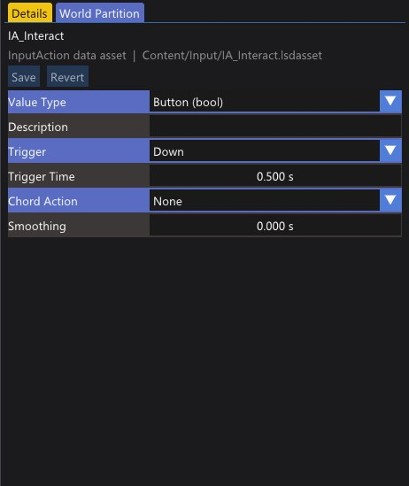
*An Input Action (IA_Interact) in Details: value type, trigger (Down, Pressed, Hold...), trigger time, chord action.*

- **Input Action** data assets: Move (2D axis), Look, Jump (button), with a **Trigger** (Pressed,
  Released, Hold, Tap...), a **Chord Action** (counts only while another action is held too: Shift + E,
  Unreal's Chorded Action) and **Smoothing** (seconds the value eases over: steadier look).
- **Input Mapping Context**: which keys, mouse axes and gamepad buttons drive which action; each
  mapping has a scale (-1 negates) and its own **Dead Zone** (on top of the sticks' built-in 0.15).
- Pick the context and the Move / Look / Jump actions on the Character. Content Browser > **New
  Input Setup** creates a ready set (WASD, mouse, Space, gamepad).
- A Character with no context set uses the built-in WASD / mouse / Space controls.
- Players rebind keys from your options menu with `lsd.bindings`, `lsd.rebind` and `lsd.key_pressed`
  (Lua API); rebinds are saved in `Saved/GameUserSettings.json` and applied every time Play starts.
- **Input recording** (Unreal's input recording, for tests and demos): while playing, console
  `input.Record walk.inputrec` records every Input Action's value and each frame's time to
  `Saved/walk.inputrec`; `input.StopRecord` (or Stop) saves it. `input.Play walk.inputrec` plays it
  back in place of the keys, frame by frame with the recorded frame times, so the same run happens
  again (a test: `-play -exec="input.Play walk.inputrec" -frames=<n>`). From scripts:
  `lsd.input_record(file)`, `lsd.input_play(file)`, `lsd.input_stop()`. Only Input Actions are
  recorded (not UI clicks, raw keys or `lsd.key_pressed`), and changing level ends a recording.

**Mouse wheel**: **Mouse Wheel Up** and **Mouse Wheel Down** are keys like any other (Unreal's Mouse Wheel Up /
Down): pressed for the frame the wheel turned that way. Use them in a mapping (next / previous weapon, zoom
steps), with `lsd.key_down("Mouse Wheel Up")`, and `lsd.key_pressed()` returns them.

**Touch and gyro** (Unreal's touch input, Touch Interface and motion controls). Use these key names in a
mapping, like any other key:

| Key | Gives |
| --- | --- |
| Touch Tap, Touch Swipe Up / Down / Left / Right | A button for one frame when a finger is lifted after a quick tap (under 0.3 s, barely moved) or a quick swipe (over a tenth of the screen height in 0.6 s) |
| Touch Hold | A button while one finger rests in place for 0.4 s or more |
| Touch Pinch | 1D axis: how much two fingers moved apart (+) or together (-) this frame; 1 = a tenth of the screen height. Scale it with the mapping's Scale |
| Touch Drag XY | 2D axis: the first finger's move this frame in pixels, up positive (look by dragging, like Mouse XY) |
| Gyro XY, Gyro Yaw, Gyro Pitch, Gyro Roll | Degrees the controller turned this frame (Switch Pro, DualSense, Steam Deck); the mapping's **Scale** is the sensitivity. 0 when no gyro |
| Tilt XY, Tilt X, Tilt Y | -1..1 from the accelerometer (a controller's or a tablet's): lean the device to steer. 0 when none |

**Virtual joystick** (Touch Interface): console `input.VirtualPad 1` (on by default when the PC has a touch screen)
draws two thumbsticks (they float where the thumb lands in the lower left and right) and two buttons on the right during Play.
They fill the gamepad's Left / Right Stick and Face Bottom / Face Right, so the same mappings work with no extra setup.
Fingers on the pad are not gestures. From scripts: `lsd.touch_count()` and `lsd.touch(i)` (1-based; x, y of
finger i, 0..1 of the window, y down) for your own gestures. To try touch with a mouse, `input.MouseTouch 1` (free the
mouse with Escape) makes the left button a finger. Tests: `input.Touch <finger> <down|move|up> <x> <y>`, `input.Tap x y`,
`input.Swipe x0 y0 x1 y1`. The pad and gestures cover the whole window, not only the game viewport.

### Game Mode

A **Game Mode** data asset, picked in World Settings, sets the player prefab, a Lua script that runs
for the whole game (on an object called GameMode), a **Player Controller** script (on an object called
PlayerController: the player's input and menus, apart from the body; `lsd.player()` is the Character it
drives), a **HUD** UI document shown when the game starts and **Show Cursor** for menus.

**Changing level** (Unreal's Open Level): `lsd.open_level("Level2")` loads another level after this
frame. Data that must survive the change lives in kept tables, plain data only (numbers, strings,
booleans, tables):

| Lua | Unreal |
| --- | --- |
| `lsd.game_instance()` | Game Instance |
| `lsd.player_state()` | Player State |
| `lsd.subsystem("Quests")` | a Game Instance Subsystem |

They last for the whole Play (a new Play starts them empty); write to `lsd.save_game` to keep them
between runs. In the editor, Stop always returns to the level you were editing.

---

## 8. Physics

Jolt Physics. Meshes with **Collision** ticked and Blocking Volumes are static; a mesh's **Collision
Shape** is its bounds (Box, fast) or its own triangles (**Mesh**: arches, ramps, stairs; Unreal's Use
Complex As Simple). Add a **Rigid Body** component to simulate an object (box, sphere, capsule or
**Convex** hull of the mesh; mass, friction, bounciness). A **Physical Material** data asset (friction,
bounciness) picked on a mesh or Rigid Body sets its surface: ice, rubber, mud. Rigid Body
**Collision Preset**: Block All, or **Debris** (hits only the static level: not the player or other
objects). **Kinematic** Rigid Bodies follow their Transform (scripts, timelines) and push what they
meet without being pushed. **Physics
Joint** links two objects (fixed, hinge, ball, slider, **cone**: swings within a cone, twist limited; limits;
motors: doors, chains, rotating platforms). **Spring Frequency** makes hinge / slider limits give like a
spring; **Break Force** makes it snap when pulled harder (the object's scripts get `on_joint_break`).

**Ragdolls** (Unreal's Physics Asset + Simulate Physics on a Skeletal Mesh): tick **Skeletal Mesh > Physics > Simulate
Physics** and the body falls as a ragdoll when Play starts, or call `lsd.ragdoll(e)` (the **Set Ragdoll** node) when a
character dies; `lsd.ragdoll(e, false)` gives it back to its animation. The physics asset is made from the mesh: a
capsule for each big bone, fitted to the skin that bone moves most (head, hands and feet included; fingers and twist
bones ride along with their parent), joined at the joints by cone joints (40 degrees of swing, 25 of twist), about 70 kg
in all; a ragdoll's parts do not collide with each other. It starts from the pose the mesh had that frame. Clothes on
the body (Leader Pose) follow it. For now it starts at rest and the object itself stays where it was.
**Cloth** (Unreal's Chaos Cloth): add a **Cloth** component to an object with a Static Mesh (a flag, curtain, banner,
sail; a Plane works). In Play its vertices move as one soft sheet: **Pin** holds one side in place (Top for a banner or
curtain, the pole's side for a flag; in world directions) and **Pin Amount** how much of it (0: just the edge);
**Subdivide** splits each triangle into four that many times first (a Plane needs 4 or 5; your own cloth mesh may need
none); **Mass**, **Stiffness** (silk 0 to canvas 1), **Damping**, **Gravity Scale**, **Wind** (m/s, world directions)
with **Gustiness**, and **Thickness**. It falls onto and drapes over the level's bodies and Rigid Bodies, and is drawn
from the moving vertices with the mesh's material and UVs on D3D12, Vulkan and OpenGL. For now the pinned side stays
where Play started (cloth on a moving object does not follow it) and capes skinned to a character's bones are not done.

Select the object and click the joint's yellow ring in the viewport to move its pivot with the gizmo. Scripts get `on_hit` when contacts begin and can `lsd.raycast`, sweep a sphere, box or
capsule (`lsd.sphere_trace` / `box_trace` / `capsule_trace`) or list what overlaps a shape
(`lsd.overlap_sphere` / `overlap_box`). Visual scripts have **Line Trace**, **Sphere Trace**, **Capsule
Trace** and **Sphere Overlap** (its Loop Body runs once per object found), like Unreal's traces.

---

### Destruction: fracture and debris

Unreal's Fracture Mode + Geometry Collections, the pre-fractured way: a mesh is cut into pieces once, in the editor;
in Play it breaks where it is hit, the pieces near the hit fly off as rigid bodies and the cut faces show an
**inside material**. Nothing is cut while playing.

1. **Try the cut**: double-click the mesh (Mesh Editor) > **Fracture**: **Pieces** (Voronoi sites), **Seed** (another
   number cuts another way; the same number always the same way), **Cluster** (most pieces small around **Cluster
   Point**, Unreal's Cluster fracture), **Inside Material** (brick, concrete core; none: the mesh's own). **Fracture**
   cuts it and shows the pieces apart; **Explode** pushes them further (Unreal's Explode Amount).
2. **Make it destructible**: select the objects using that mesh in the level and click **Make Selected Destructible**
   (or add a **Destructible** component in Details: Add Component > Physics). The object keeps its Static Mesh.
3. **Breaking** settings on the component: **Damage Threshold** (a contact this hard, in N s = mass x speed of what
   hits it, or this much `lsd.apply_damage` in total, breaks it; 0 = only `lsd.fracture`), **Break Radius** (pieces this
   close to the hit break off; 0 = all at once), **Piece Lifetime** (broken pieces shrink away after it; 0 = they stay),
   **Max Pieces Alive** (this object's flying pieces; the oldest go first), **Density** (piece mass from its volume:
   concrete 2400, brick 1900, wood 600), **Collision Preset** (Debris: pieces hit only the static level, the cheapest),
   **Collapse Unsupported** (on: standing pieces no longer joined to the mesh's bottom fall too, no floating chunks).

In Play the intact mesh draws as before (one draw). At the first break it is replaced by what still stands (one mesh
per material, rebuilt at each break) and the broken pieces (one object each, `<name>_piece<n>`, a convex rigid body);
what stands is one static body made of the standing pieces' hulls, so later hits break more. The object's scripts get
`on_fracture(self, x, y, z)`. The pieces are cut at the object's scale (a cube stretched into a wall gets even pieces)
and kept in `DerivedData/Fracture/` (keyed by the mesh, its materials, the scale and the settings): the first Play after
a change cuts them (about 0.1 s for a 10k-triangle wall into 30 pieces in Release), later ones read them.

| Lua | |
| --- | --- |
| `lsd.fracture(e, x, y, z [, ix, iy, iz [, radius]])` | breaks Destructible e at world point x, y, z: pieces within `radius` m (default its Break Radius, 0 = all) fly off, pushed by the impulse (N s, shared by mass) and away from the point. False if e is not a Destructible |
| `lsd.apply_damage(e, amount)` | as before (on_damage), and a Destructible breaks once its damage adds up to Damage Threshold (at its middle) |
| `lsd.add_impulse(piece, ...)`, `lsd.set_velocity(piece, ...)` | pieces are ordinary rigid bodies (`lsd.find("Wall_piece3")`) |
| console `fracture.MaxPieces` (300) | broken pieces flying at once, every Destructible together; the oldest shrink away first |

**Multiplayer**: the server decides. `lsd.fracture` and hard contacts break on the server (or standalone); the server
sends the break (object name, point, impulse, radius) to every machine, and each breaks the same pieces from the same
pre-cut data (same mesh, settings and seed: same pieces). A client's `lsd.fracture` asks the server. The flying pieces
simulate on each machine on their own (not replicated): where rubble lands can differ between players, the hole in the
wall does not.

**Performance**: 100 flying pieces did not change the frame time measurably (5.6 ms in a Release build, frame-paced).
Keep Max Pieces Alive and Piece Lifetime low on things that break often; use the Debris preset for small rubble; fewer
pieces (10-30) on objects seen from afar; one Destructible per wall segment rather than a whole building in one.
Limits (for now): pieces of one object are separate draws (one per material each); no breaking into pieces of pieces;
support is judged from the pieces' boxes (touching boxes count as joined), not real contact areas.

## 9. Lua scripting

**Exposed properties** (Unreal's Instance Editable variables): put a `properties` table at the top
of a script and each object using it shows those values in Details, under its Script, to change per
object (Reset returns to the script's value). They are on `self` before `on_start`:

```lua
properties = { speed = 5, label = "Door", locked = false }
function on_start(self) lsd.log(self.label, self.speed, self.locked) end
```

Add a **Script** component and pick a `.lua` file (Content Browser > New Lua Script makes one).
Each object runs its own copy:

```lua
function on_start(self)          -- once, when Play starts
  self.speed = 2
end

function on_update(self, dt)     -- every frame, dt in seconds
  local x, y, z = lsd.position(self.entity)
  lsd.set_position(self.entity, x, y, z + self.speed * dt)
end

function on_overlap_begin(self, other)   -- something entered this Trigger Volume
  lsd.log(lsd.name(other), "entered")
end
```

`self` is a table per object: `self.entity`, `self.name`, plus anything you store. Saving the file
while playing reloads it and keeps `self`. Errors stop that script and show in the Output Log with
the line.

Scripts run **sandboxed**: no `io`, no `os.execute` / `os.remove` (only `os.time`, `os.clock`,
`os.date`), no native modules or FFI, no bytecode (`load` takes text only). Save data with
`lsd.save_game`; share code with `require("Module")`, which looks in `Content/` and `Content/Scripts/`.

Any component can be read and written by name, with the field names you see in Details:

```lua
local c = lsd.get(self.entity, "Character")        -- a copy, as a table
lsd.set(self.entity, "Character", {walk_speed = 8}) -- writes only these fields
lsd.add(self.entity, "RigidBody", {mass = 5})
```

The full `lsd` API is listed in [section 19](#lua-api).

---

### Debugging scripts

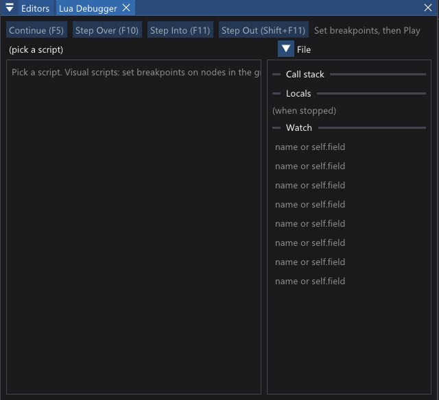
*Tools > Lua Debugger: Continue / Step Over / Step Into / Step Out, the script file, call stack, locals and watches.*

**Tools > Lua Debugger** (Visual Studio style): pick a script, click a line number (or hover a line
and press F9) for a breakpoint, then Play. When the line runs the game freezes and the debugger
shows where it stopped, the call stack (click a frame), its locals and `self`'s fields, and a watch
list. **Continue** (F5), **Step Over** (F10), **Step Into** (F11), **Step Out** (Shift+F11).

Visual scripts: right-click a node > **Toggle Breakpoint** (or select it and press F9; save the graph
first). While playing, nodes that run glow orange (Blueprint's execution flow); at a breakpoint the
node is outlined red and the Lua Debugger shows the values (node outputs are named `n<node>_<pin>`).

### Coding with Claude Code (Claude MCP plugin)

**Edit > Editor Preferences > Plugins** lists the editor's plugins (Unreal's Edit > Plugins); tick one
to enable it, click its name for its settings. **Claude MCP** lets Claude Code work in the running
editor through MCP (Model Context Protocol): it writes scripts into `Content/` (they reload by
themselves) and uses these tools to see and test them:

| Tool | Does |
| --- | --- |
| `console` | Any console command: `play`, `stop`, `save`, `open <level>`, `graph.Open <asset>`, `validate`... |
| `lua` | Runs Lua in the game while playing (several lines allowed) |
| `list_objects` | Every object in the level: name, parent, world position, components (`scene.List`) |
| `list_assets` | Assets in Content/ with type and path, optionally filtered (`asset.List`) |
| `read_log` | The latest Output Log lines, e.g. script errors after Play (`log.Tail`) |

Set it up once:

1. Edit > Editor Preferences > Plugins: tick **Claude MCP** (Port 7780 unless that is taken).
2. Click **Claude MCP** > **Copy Command** and run it in a terminal (`claude mcp add lsd-engine -- ".../lsd_mcp.exe" --port 7780`),
   or click **Write .mcp.json** to add it to this project only.
3. Start Claude Code in the project folder; `/mcp` shows **lsd-engine** connected, and the plugin
   page says *Claude is connected*. Then ask it, e.g. "make the Door open when the player presses E
   near it, then test it".

`lsd_mcp.exe` (built next to `lsd_editor.exe`, `tools/mcp/`) is the bridge Claude Code starts; it
sends each tool call to the editor as a console line over 127.0.0.1, the same channel as the Remote
Console. Only programs on this PC can connect; untick the plugin when you are not using it. It is
editor-only: packaged games never listen.

### LSD Assistant (an AI coder in the editor)

**Tools > LSD Assistant** opens a chat with your own AI model that knows LSD_Engine: ask how to code
something, or have it write a script and apply it. It writes **code only** (Lua, JavaScript, C / C++,
UI documents): no meshes, textures, materials or other art. When code needs something visible (a gun,
a pickup, a target) it uses a Cube or Sphere placed and sized from code, for you to swap for real art
later; its Create button only writes code files. It answers as one of four roles, picked at the top of
the Chat tab: **Gameplay Programmer**, **Engine Expert**, **UI Programmer**, **Code Reviewer**. Every message carries
the open level, the selected object (its components and values) and the asset list, so answers fit
your project (untick **Project context** to leave it out). It knows the engine's Lua API from the
engine's own documentation and maps Unreal features you name onto LSD_Engine's.

**Pictures**: **Screenshot** attaches the editor as it looks now to your next
message, or type an image's path in the box under it (PNG, JPG, BMP...): "why is this wall black?",
"make the HUD look like this". It is halved until its longer side is at most 1568 px and sent once,
with that message. Needs a model that sees images (Claude; GPT-4o and others on OpenAI-compatible servers).

Set it up once in **Edit > Editor Preferences > Plugins > LSD Assistant**:

| Provider | Model | Endpoint | Key |
| --- | --- | --- | --- |
| Anthropic (Claude) | `claude-opus-5-5` (best), `claude-sonnet-5-5`, `claude-haiku-5-5` | empty | your Anthropic API key, or `ANTHROPIC_API_KEY` |
| OpenAI-compatible | the server's model name | empty for OpenAI; `http://localhost:11434/v1` Ollama, `http://localhost:1234/v1` LM Studio, `https://openrouter.ai/api/v1` OpenRouter | its key, `OPENAI_API_KEY`, or none for local servers |

Claude also takes an **Effort** (low: quick answers, high: hard problems). The key is kept on this
PC only (`Saved/editor_settings.json`, never in the project or Git).

When a reply contains a file (a code block headed like ```` ```lua Content/Script/Door.lua ````),
the block has **Copy**, **Create** (or **Overwrite**, which asks twice) and, for scripts, **Attach to
Selected** (a Script component running it, undoable). It may only write inside `Content/` and
`Source/`. **Ctrl+Enter** sends; **Stop** ends a reply early (what it wrote stays); **New Chat** starts over. Replies appear as they are written
(streamed); a file block gets its buttons once the reply is done. Requests go from this PC straight to the
endpoint (through the system's `curl`); a failed one puts your message back in the box.

**Tools** (Unreal: an agent with editor access, like the Claude MCP plugin below): it can act in the editor
by itself with the same tools as the MCP bridge: console commands (play, stop, save, open...), Lua in the
running game, the object and asset lists, the Output Log, reading files and writing code files (Content/
and Source/ only). It reads, writes, presses Play, reads the log for errors and fixes them. **Editor
Preferences > Plugins > LSD Assistant > Tools**: **Off**, **Ask before each tool call** (the default: the
calls show in the chat with **Allow**, **Allow All** for this chat, **Deny**) or **Allowed**. Each call and
its folded result show in the chat; it stops after 12 tool rounds per message. `debug.*` commands are
refused. Console: `assistant.Ask <message>` sends a message as if typed.

**Lessons** (the second tab) teach how a feature is coded, step by step with the Unreal equivalent,
and set it up in one click: select a rigged character, pick a lesson, **Apply to Selected Character**.
Existing files are kept, so your edits survive a second Apply. The console does the same:
`assistant.Lesson <n>`.

- **Gun on a hand socket (soldier)**: a Cube gun in the right hand through a `weapon_r` socket on
  `hand_r` (RightHand / mixamorig:RightHand on other rigs), 10/10 ammo, **RMB** aims (the spring arm
  eases in over the right shoulder, the dot turns red, and IK raises the hand along the view so the gun points at
  the crosshair: Hand Bone, Shoulder Bone, Aim Reach), **LMB** shoots (a ray from the camera through
  the crosshair, a tracer from the gun, `on_damage(self, amount, shooter)` on what it hits), **R**
  reloads (Reload Time, "Reloading..." on the HUD, Reload Montage on the upper body; each shot plays Shoot Montage). It is one component, a Script running
  `Content/Weapon/Weapon.lua`; its Details show socket, ammo, max ammo, range, damage, reload time,
  aim distance and shoulder, and the crosshair's size, colours and visibility. Apply also makes
  `WBP_Crosshair.rml`, `IA_Aim`, `IA_Fire`, `IA_Reload` and maps RMB / LMB / R in the character's
  Mapping Context. To hold the gun differently, edit the `weapon_r` socket in the Mesh Editor.
  Step by step with pictures: [EXAMPLES.md](EXAMPLES.md#7b-a-gun-in-the-hand-lsd-assistant-lesson).

  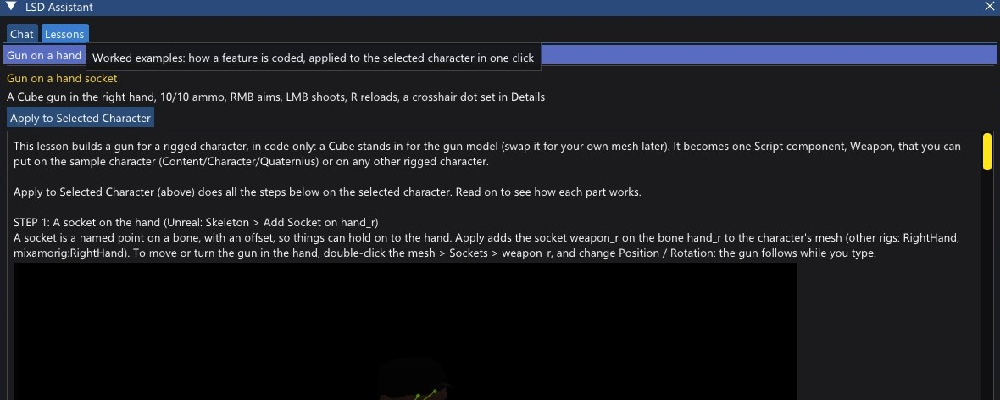
  *The Lessons tab: pick a lesson, Apply to Selected Character, read how each part is coded.*

### Editor utility scripts and widgets

Unreal's Editor Utility Blueprints / Widgets / Scripted Actions: a Lua script or a visual script that
runs **in the editor**, on the level you are editing (not in Play), to automate level work. It gets the
whole `lsd` API (`lsd.find`, `lsd.spawn`, `lsd.position` / `set_position`, `lsd.get` / `set` / `add` /
`remove` for any component's properties, `lsd.set_name`, `lsd.set_world_settings` (the level's Game Mode or
Level Script), `lsd.assets`, `lsd.log`...) plus `lsd.editor`:

| Call | What it does |
| --- | --- |
| `function run(self)` | What Run does (a visual script: its **Event Start**) |
| `lsd.editor.selection()` | The selected objects, `{e, ...}` |
| `lsd.editor.select({e, ...})` | Replaces the selection |
| `lsd.editor.open_asset(name)` | Opens an asset as a double-click would |
| `lsd.editor.console(line)` | Runs a console command |
| `lsd.editor.panel(title, widgets)` | A dockable panel (the Editor Utility Widget) |
| `lsd.raycast`, `sphere_trace` / `box_trace` / `capsule_trace`, `overlap_sphere` / `overlap_box` | As in Play, against the level's collision (Unreal's editor line traces): Static Meshes with collision, instanced copies, sprites, tile maps, Blocking Volumes, built as Play builds them; snap objects to the ground with them. The collision is rebuilt for each run, button press, spawn and edit; objects the running script moves keep their old collision until the next run |

Run one: Content Browser > right-click the script > **Run Editor Utility**, or `utility.Run <name>` in
the console. Name it `EU_<something>` and it is also listed in **Tools > Editor Utilities**, in the
toolbar's **Utilities** menu (next to Play) and in the Outliner's right-click **Scripted Actions**
(run on the selection). Everything one run (or one panel button) changes in the level is **one undo
step** (Ctrl+Z). Utilities never run while playing, and never in a packaged game (`lsd.editor` raises
there).

A panel declares its widgets as a list: `{"label", text}`, `{"button", label, function}`,
`{"checkbox" | "number" | "text", label, variable, default}`. Checkboxes, numbers and text fields
set the script's global of that name; a button calls the script's function:

```lua
-- Content/Tools/EU_LineUp.lua
function run(self)
  lsd.editor.panel("Line Up", {
    {"number", "Spacing", "spacing", 2},
    {"checkbox", "Flat", "flat", true},
    {"button", "Line Up Selection", "line_up"},
  })
end

function line_up()
  for i, e in ipairs(lsd.editor.selection()) do
    local x, y, z = lsd.position(e)
    lsd.set_position(e, (i - 1) * spacing, y, flat and 0 or z)
  end
end
```

Running it again rebuilds its panel. `lsd.spawn(name, x, y, z)` places a prefab, a mesh asset or a
built-in shape ("Cube").

### C and C++ scripts

Game code can also be C or C++ (Unreal: your project's C++ module): **Tools > New C / C++ Script**
writes `Source/<Name>.cpp`, **Tools > Compile Game Code** (Ctrl+Alt+F11) builds `Binaries/Game.dll`,
and a **Native Script** component (Details > Add Component) runs the script on an object with the
same events as a Lua script. It reloads when rebuilt, also during Play. Click-by-click:
[How to code in LSD_Engine](How%20to%20code%20in%20LSD_Engine.md#11-c--c-instead-of-lua); every
command: [CODING.md](CODING.md).

### JavaScript scripts

A Script component takes a `.js` file as well as a `.lua` one: Content Browser > right-click >
**New JavaScript Script**. It is the same thing in another language: the same events (`on_start`,
`on_update`, `on_hit`, UI actions, `lsd.broadcast` / `lsd.call` names), the same `lsd` API, the same
`properties` in Details, reload on save with `self` kept, and errors with the file and line in the
Output Log. Two differences: several results come back as an array, and events must be top-level
`function` declarations (a `const f = () => {}` is not seen).

```js
var properties = { speed: 90 };   // Details, per object
function on_start(self) { console.log("Hello from " + self.name); }
function on_update(self, dt) {
  const [x, y, z] = lsd.rotation(self.entity);
  lsd.set_rotation(self.entity, x, y, z + self.speed * dt);
}
```

Tables you get back (`lsd.get`, `lsd.game_instance()`) are copies: change them and hand them back
with `lsd.set` / `lsd.save_game`. `lsd.after(2, () => ...)` takes a JS function.

**Debugging JavaScript**: Tools > Lua Debugger lists `.js` scripts too. Breakpoints, Continue, Step
Over / Into / Out and the call stack work as for Lua; **Locals** shows `self` and its fields (QuickJS
has no access to a function's other locals: put a value on `self`, or `console.log` it). Breakpoints
stop on lines that start a statement; on a line that continues one (a `.then(...)` chain, an object
literal's fields) the stop comes at the next statement. Only Play from the editor is instrumented; a
packaged game runs the scripts as written.

### Abilities, effects and attributes (Gameplay Ability System)

The smallest version of Unreal's Gameplay Ability System, set up in Details and driven from scripts:

1. **Attributes**: Details > Add Component > **Attribute Set** on the object (Unreal's Attribute Set). Add
   rows: **Name** (Health, MaxHealth, Stamina...), **Base**, **Min** (default 0), **Max** (0 = none) or
   **Max Attribute** (Health: `MaxHealth`). **Current** is the base with the lasting effects on it, clamped;
   in Play the **Effects** list shows what is on the object.
2. **Effects**: Content Browser > New Data Asset > **GameplayEffect** (Unreal's Gameplay Effect).
   **Duration Type**: Instant (changes the base for good: damage, healing, costs), Has Duration (lasts
   **Duration** seconds: a buff) or Infinite (until `lsd.remove_effect`). **Modifiers**: attribute + Add /
   Multiply / Override + magnitude (-10 with Add is 10 damage). **Period** (damage over time): every Period
   seconds the modifiers change the base, the first one a Period after it is applied (5 s, period 1 = 5 ticks).
   **Granted Tags**: gameplay tags the target has while it lasts (`lsd.has_tag` and Has Tag see them).
   **Stacking**: None (another copy), Refresh (timer starts over), Stack (one more stack up to Max Stacks;
   modifiers count once per stack). **Cue Sound** / **Cue Effect** (Gameplay Cues): a sound and a particle
   system / prefab, by asset name, played at the target when it is applied.
3. **Abilities**: New Data Asset > **GameplayAbility** (Unreal's Gameplay Ability): **Cost Effect** (an Instant
   effect on the owner, e.g. Stamina -20; it cannot activate if that takes an attribute below its Min),
   **Cooldown** seconds and / or a **Cooldown Effect** (blocked while the owner has its granted tags),
   **Required Tags** (all needed), **Blocked Tags** (any blocks: Status.Stunned), **Active Tags** (granted while
   it runs), **Function** (called on the owner's scripts: `function dash(self, ability)`), **Montage** (an
   animation played on the owner), **Active Seconds** (0 = the montage's length, or it ends at once).
4. Give the object an **Ability System** component and add the abilities (or `lsd.give_ability(e, "GA_Dash")`).

```lua
function on_start(self)
  lsd.apply_effect(self.entity, "GE_Burning")            -- by asset name
end
function on_update(self, dt)
  if lsd.pressed("IA_Dash") then
    local ok, why = lsd.try_activate_ability(self.entity, "GA_Dash")   -- why: "cooldown", "cost", "blocked"...
  end
end
function dash(self, ability) lsd.log("dashing") end                     -- the ability's Function
function on_attribute_changed(self, name, value, old)                     -- Health, Stamina... changed
  if name == "Health" then lsd.health_bar(self.entity, value / lsd.attribute(self.entity, "MaxHealth")) end
end
function on_ability_ended(self, ability, cancelled) end
```

Visual scripts: **Abilities** nodes (Apply Gameplay Effect, Remove Gameplay Effect, Try Activate Ability,
Cancel Ability, Give Ability, Get Attribute, Set Attribute) and **Event Attribute Changed** / **Event Ability
Ended**. C / C++ and JavaScript call the same `lsd` functions. Limits: it runs where it is called and is not
replicated (in multiplayer, call it on the server: `lsd.has_authority()`), at most 16 attributes, 16 effects
and 16 abilities per object, no attribute-based magnitudes or effect executions (compute the number in a script
and use `lsd.set_attribute`).

## 10. Visual scripting

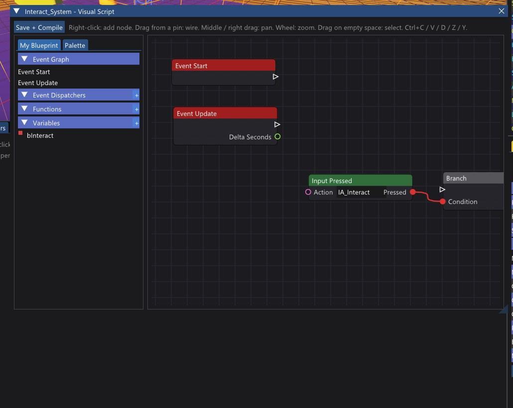
*A visual script (Interact_System): My Blueprint on the left (Event Graph, Event Dispatchers, Functions, Variables), nodes and wires on the canvas, Save + Compile at the top.*

**The panels** (Unreal's Blueprint editor), on the left of the graph window (drag its edge to resize):

- **My Blueprint**: **Event Graph** lists the built-in events in the graph (click one to jump to it);
  **Event Dispatchers** lists the Custom Events (click to jump, **+** adds one, drag one onto the
  canvas for a Call Event that fires it on every object that has it); **Functions** lists them (click to jump, drag one onto the canvas for a Call
  Function, **+** adds one), **Variables** lists the declared variables (**+** adds one). Drag a
  variable onto the canvas for Get / Set (hold Ctrl for Get, Alt for Set). Names used by Get / Set
  nodes but not declared are listed greyed with **Declare**.
- **Collapse to Function** (Unreal's Collapse Nodes / Collapse to Function): select nodes, right-click
  one > **Collapse to Function**. They move below the graph under a new Function (rename it on its
  node), and a **Call Function** takes their place with the wires rerouted: values coming in become
  its A / B / C, a value going out comes back as Result through a Return. The selection needs one
  white wire in and may have one white wire out, 3 values in and 1 value out (no events); Ctrl+Z undoes it.
- **Details** (under My Blueprint, for the selected variable): Name (Enter renames it and every Get /
  Set follows), Type, Default, **Instance Editable** (numbers, booleans and text: each object using
  the script can change it in its Details, under the Script), Tooltip, how many nodes use it
  (**Find** jumps to the next), Delete.
- **Palette**: every node by category, with search; double-click one to add it in the middle of the
  view, or drag it where you want it. Material Graphs, Sound Cues and Behavior Trees get it too.

Declared variables start with their defaults on every object (before Event Start).

**Editing the graph**: right-click for the node menu; wheel zooms about the mouse; drag on empty space
to box-select (Ctrl / Shift add); drag a node's title to move the whole selection; **Ctrl+C / X / V /
D** copy, cut, paste (at the mouse) and duplicate; **Ctrl+Z / Ctrl+Y** undo and redo inside the graph;
Delete removes the selection. **Comment** (Utilities) is a labelled box: type its title when it is
selected alone, drag its corner to size it, drag its title to move it with the nodes inside.
**Reroute** nodes bend wires (any data type; Reroute (Exec) for white wires).

**Functions** (Blueprint functions): a **Function** node (give it a Name) starts one, with up to three
arguments A, B, C of any type; **Return** hands a value back; **Call Function** runs it by name and
gives its Result. Inside a Function, **Set / Get Local Variable** keep values for that call only;
**Set / Get Variable** store any type on the object. Flow has the standard macros **For Loop**,
**While Loop** (10 000 rounds at most) and **Flip Flop**.

**Your own nodes** (Blueprint function libraries): New Data Asset > **ScriptNode**. Name the asset
what the node is called, pick a Category, add input and output pins, and write the Lua it becomes:
`$1`, `$2`... are the inputs by position (the white Exec pin counts as 0), `$o0` the first output's
variable, `#0` where the next node's code goes. Without Exec pins the node is pure and
**Expression** is its output, e.g. `($0 * 2)`. It appears in the node menu once saved. C++ code can
add nodes the same way with `lsd::script::register_node`.

**Nodes from C / C++**: a function in the game code marked `LSD_NODE(fn, "Category", "pin names",
"tooltip")` (or `LSD_PURE_NODE`) is in the node menu once Tools > Compile Game Code has built it;
see [CODING.md](CODING.md#your-functions-as-nodes).

**Nodes from JavaScript**: any `.js` file in Content can describe some of its functions as nodes.
They show in the node menu (under their category, default JavaScript) as soon as the file is saved,
and run in one shared context per file:

```js
var nodes = {
  heal:  { title: "Heal", category: "Health", tooltip: "Adds health, returns the new value",
           inputs: { target: "object", amount: ["number", 10] }, output: "number" },
  clamp01: { pure: true, inputs: { value: "number" }, output: "number" },
};
function heal(target, amount) { /* ... */ return 100; }
function clamp01(value) { return Math.min(1, Math.max(0, value)); }
```

Pin types: `number`, `boolean`, `string`, `vector`, `object` (defaults to the graph's own object),
`any`; `["number", 10]` gives the value used when nothing is wired. A node has an Exec pin unless it
is `pure`; `output` adds a Result pin. Renaming the file or the function breaks graphs that use it
(the node id is `JS_<file>_<function>`), like renaming a C++ function.

**Level script** (Unreal's Level Blueprint): Window > World Settings > **Level Script** picks a
visual script (or Lua file) that belongs to the level: Event Start, Custom Events, timers for that
level's one-off moments. It runs on an object named LevelScript while the level plays.

**New Visual Script** makes a Blueprint-style event graph. White exec wires set the order; coloured
wires carry values. **Save + Compile** (Ctrl+S) turns it into Lua; pick the graph on a Script
component exactly like a `.lua` file. Playing objects pick up changes within half a second.
When the graph has problems (an event twice, white wires in a loop, an unknown node), **Compiler
Results** lists every one under the toolbar, a line each; click a line to select its node and centre
the view on it.

A worked example (press a key, trace, tell the hit object) is in
[How to code in LSD_Engine](How%20to%20code%20in%20LSD_Engine.md#worked-example-press-a-key-to-interact-with-what-you-look-at).
Transform has **Get Forward Vector** (the way an object faces) and Objects **Get Player Character**.

Node groups: Events (Start, Update, Hit, Overlap Begin / End), Flow (Branch, Sequence, Delay, Do Once,
Set Timer), Transform, Objects (Spawn, Destroy, Find, Has Tag), Math, Input, Variables, Data (Data
Table, Curve), Audio, Animation, AI, UI, Save Game, Utilities (Print String, Game Time).

**Math nodes** (Unreal's math library, same names; type in the node menu's search):

| Group | Nodes |
| --- | --- |
| Math | + - * / %, Power, Square Root, Absolute, Negate, Sign, Floor, Ceil, Round, Truncate, Fraction, Min, Max, Clamp, Lerp, Ease (Smooth Step), Map Range Clamped / Unclamped, In Range, Wrap, FInterp To, Nearly Equal, > < >= <= == !=, Select Float, Exp, Log, Pi |
| Math \| Trig | Sin, Cos, Tan (radians), Sin / Cos / Tan (Degrees), Asin, Acos, Atan, Atan2, Degrees To Radians, Radians To Degrees |
| Math \| Vector | Make / Break Vector, Vector + - Vector, Vector * Vector, Vector * Float, Vector / Float, Negate Vector, Vector Length, Vector Length XY, Distance, Normalize, Dot Product, Cross Product, Lerp (Vector), Get Unit Direction, VInterp To, Clamp Vector Length, Rotate Vector Around Z, Equal (Vector) |
| Math \| Random | Random Float, Random Float in Range, Random Integer in Range, Random Bool, Random Unit Vector |
| Math \| Boolean | NOT, AND, OR, XOR, NAND, Equal (Boolean) |

Divisions by zero give 0 (no errors in Play); angles are radians unless the node says Degrees. FInterp
To / VInterp To take the frame's Delta Time (On Update's) for smooth follows.

---

## 11. Animation

**Mesh Editor**: double-click a mesh. Drag the preview to turn it (wheel: zoom); the side shows its
size, triangles and LODs, and its import settings (Save / Reimport). **Normals** sets the shading
(Blender's Shade Smooth / Flat / Auto Smooth). Every mesh, static or rigged, is **Smooth** by
default (averaged across faces by topology, so UV seams do not show); **Solid (Flat)** gives
faceted faces, **Import** keeps the file's normals, **Auto Smooth** keeps edges sharper than
**Smoothing Angle** hard. Static meshes of 64+ triangles get
up to five simpler LODs, automatically; **LOD 1 / 2 / 3 Screen Size** (Unreal's LOD Screen Size) set how small the
mesh must look before each takes over (larger = sooner); LOD 4 and 5 take over at half and a quarter of LOD 3's
size. Each LOD is built to about one triangle per four pixels at the size it takes over (so a dense 200 000-triangle
prop far away costs a few hundred), but never further than its outline staying within about a pixel of the real
shape; very far LODs of meshes that will not simplify cleanly (many separate pieces) are clustered instead. They are
built the first time the mesh is drawn and kept in DerivedData (`<mesh>.lsdmesh.lod`), so the next load reads them.
Shadows use the LOD the camera sees; Instanced Static Mesh copies each pick their own (their shadows too).
Rigged (skeletal) meshes get them too, per material section, with the same settings: the simpler
triangles reuse the mesh's own vertices, so skinning, morph targets and clothes following the body
behave as at full detail; their shadows use the LOD the camera sees too. A
Static Mesh's **Max Draw Distance** hides it (and its shadow) beyond that distance; a **Cull Distance
Volume** (Place tab) does it for every static mesh inside by size (Size / Distance rules: pebbles
vanish sooner than houses). Anything smaller on screen than about three pixels across is not drawn, nor its
shadow (Unreal's Min Screen Radius; `r.MinScreenSize`, bounding radius over distance, 0.0015 by default, 0 = draw
everything). For rigged meshes: the bone
tree (click a bone to see it in the preview) and **Sockets**: select a bone, **+ Socket**, move it
with Offset / Turn, Save. Then give a prop **Attach To Socket** (the character's object name and
the socket) to carry it, or ask a script: `lsd.socket(e, "Hand_R")` -> x, y, z, fx, fy, fz.
A bone's name works wherever a socket's does (Attach To Socket, a Camera's Follow Bone).

**Retarget Pose** (Unreal's retarget base pose / the IK Retargeter's Retarget Pose; Skeleton section):
the pose a rig is matched in when animations move between rigs, so an A-pose character and a
T-pose one line up limb for limb. **Show Retarget Pose** previews it; select a bone and **Turn** it
(degrees about X / Y / Z, its children follow); **Auto Align (T-pose)** (humanoid rigs) turns the
arms straight out and the legs straight down; **Reset Bone** / **Reset** undo; Save keeps it in the
mesh's .meta. Clips from other files are re-imported with it; the mesh's own takes are unchanged.
Only FBX clips use it (glTF clips are not retargeted between rigs).

**Unreal rigs** (the Mesh Editor's Skeleton section shows **Rig**): characters with Unreal's bone
names are recognised, whoever made them (Character Creator, Mixamo-to-UE exports...):

| Rig | Recognised by |
| --- | --- |
| UE4 Mannequin | `pelvis`, `spine_01`–`spine_03`, `neck_01` |
| UE5 Manny | `spine_01`–`spine_05`, `neck_01`–`neck_02`, twist bones (`upperarm_twist_01_l`...) |
| UE5 Manny (Simple) | the UE5 bones without twist bones (extra helper bones such as `cc_base_*` are fine) |

An animation made on any of them plays on the others (Unreal's IK Retargeter, done on import):
when the rigs or their rest poses differ, each bone copies its rotation as a change from its rest
pose, UE4's three spine bones drive UE5's five (and back), bones with no driver (twist, helper)
stay at rest under their parent, and the pelvis's movement is scaled by the height difference. The
Output Log says when a clip is retargeted. Same-rig animations play unchanged.

Other humanoids retarget too (Unreal's IK Retargeter between any two characters): when an FBX's bone names do not
match the character's, each bone is driven by the file's bone playing the same part, worked out from the names in
any common naming (Unreal `thigh_l`, Mixamo `mixamorig:LeftUpLeg`, Blender `DEF-thigh.L`, Character Creator
`CC_Base_L_Thigh`, `Hips` / `LeftUpLeg`...): pelvis, spine (spread over spine, chest and upper chest from the pelvis
up), neck, head, shoulders, arms, hands, legs, feet and toes. Fingers, twist and end bones stay at rest. So a Mixamo
animation plays on a UE5 character and back. For now this is done for FBX files (glTF animations need matching names).

**Facing** (Skeletal Mesh): Unreal characters face sideways in their files (Unreal's Character
Blueprint turns the mesh -90). **Auto** turns recognised Unreal rigs to face the object's forward
(+X: where a Character walks and its camera looks); pick +X / +Y / -X / -Y for other files whose
front points elsewhere. Sockets, IK and picking follow the turn.

Drop a rigged FBX, glTF or GLB into the viewport to get a **Skeletal Mesh**. Pick the **Animation** file (the
same file, or another one with the same bone names: the Mixamo workflow; FBX and glTF mix) and the **Clip** (Details
lists the file's clips by name and length). With an Animation Graph, Details shows the state it is
in while it plays. Animations
play in the editor too. A rigged glTF uses its first skin; its animations become clips, and its morph
targets (shape keys, by their target names) and animated weights work as an FBX's do (retargeting between
Unreal rigs is FBX-only for now).

**Preview and trim a take** (Unreal's Animation Sequence preview and Crop): double-click the rigged
mesh; the Mesh Editor's **Animations** list plays any take of the file in the preview (Pause, and the
slider scrubs frame by frame). **Trim...** keeps only part of the take: drag **Start** / **End** (seconds
of the take as the file has it; End 0 = to its end) or scrub and click **Start Here** / **End Here**,
then **Save**. The take is cut wherever it plays (Skeletal Mesh, Animation Graphs, montages); **No Trim**
brings the whole take back. Notify times count from the new start. The trims are the file's
**Clip Ranges** in its .meta, also in its Details.

**Materials on a Skeletal Mesh** (Unreal's Material Slots and Override Materials): the mesh is drawn
per material of its file, each with its slot's material (see Import Materials and Textures in
section 3). Details > Skeletal Mesh > **Materials** has a row per slot: pick or drop a material on a
row to change that slot on this object only; the **<** button goes back to the mesh's. The single
**Material** field above covers every slot at once (clear it to see the slots).

**Notifies** (Unreal's AnimNotify): in the animation file's Details, add a time and a sound; it plays
at the object when the clip passes that time in Play.

**Root Motion** (Unreal's Root Motion from Everything): tick Skeletal Mesh > **Root Motion** for clips made
with travel (a walk that moves forward, a lunge, a dodge). In Play the root's sideways travel moves the
object instead of sliding the mesh away: a Character goes through its capsule (so walls stop it), any other
object moves itself. The editor shows the clip in place. The travel comes from Unreal's `root` bone, or the
top bone of other rigs (Mixamo's Hips). Montages started with Root Motion work the same way.

**Curves** (Unreal's Anim Curves): named values keyed along a take, read by scripts while it plays:
`lsd.anim_curve(self, "Footstep")` (visual scripts: **Get Curve Value**). In the Mesh Editor's Animations,
scrub to a time, type the curve's name and value, **Key Curve Here**, then **Save**. Values run straight
between keys and hold past the ends; a blend mixes the clips' values like the pose (a clip without the
curve counts as 0). The keys are the file's **Curve Keys** in its Details too. Curves made in the DCC
come in by themselves: a user-defined number property animated in an FBX take (a Maya / Blender custom
attribute on any node, a locator or the root as often as a bone) is a curve of the same name (Unreal's
imported curves); keys in the Mesh Editor with that name win.

**Animation Graph** (New Data Asset > Animation Graph; Unreal's Anim Blueprint state machine):

- **States**: a clip, or a 1D **blend space** (clips placed along a parameter such as Speed), or a
  2D one: also fill **Blend Parameter Y** (e.g. Direction) and each sample's **Position Y**
  (walk forward at Speed 1.5 / Direction 0, strafe right at 1.5 / 90, left at 1.5 / -90...). Between
  samples it mixes the three around the value; outside them, the nearest edge.
- **Transitions**: from a state (or any) to another when a parameter is greater / less / true /
  false, or the clip finished, with a crossfade time.
- **Where clips come from**: the graph's **Animation** (empty = the mesh's) is the default file, and a
  state's or sample's **Clip** number picks a take in it. A state or sample can also name its own
  **Animation** file, for one take per file as Mixamo and Unreal export them (`Anim_Idle.fbx`,
  `Anim_Walk.fbx`...); its Clip then counts in that file (usually 0). Animation notifies (sounds) fire
  for clips from the graph's own file.
- **The State Machine window** (Unreal's Anim Blueprint state machine): double-click an AnimGraph in the
  Content Browser. States are boxes (name, what they play), transitions arrows with a dot (two between
  the same states lean apart), **Entry** points at the start state and **Any State** holds transitions
  taken from whatever plays. Click a box or a dot to edit it on the right (renaming a state renames it
  in its transitions); drag boxes to arrange them, middle-drag to pan; right-click the canvas for **Add
  State**, a state for **Add Transition To**, **Add Transition From Any State**, **Set as Entry**,
  **Delete State** (or the Delete key). **Save** writes it; meshes using it pick it up at once. In Play the
  state the first object using the graph is in is outlined green.

  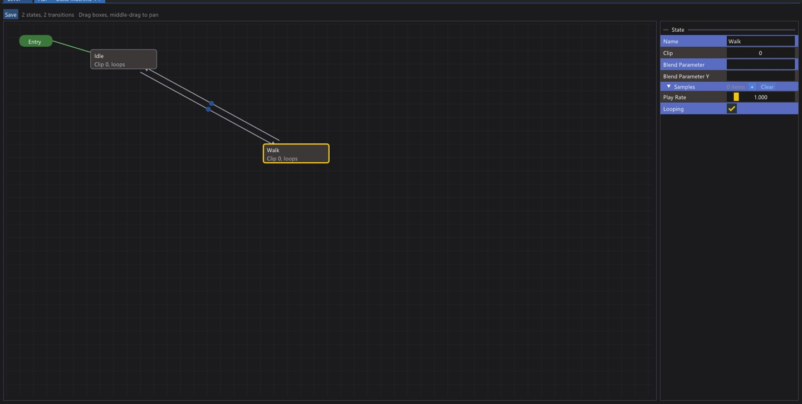
  *The State Machine window: Entry, the Idle and Walk states and their transitions; Walk selected, its fields on the right.*
- **Layers** (Unreal's Layered Blend per Bone): an AnimGraph's **Layers** (up to 4) each play a clip from a **Bone**
  down (`spine_01`: the upper body) over what the states play: aim, reload or wave while the legs run. **Weight**
  sets how much (1 replaces those bones), or name a **Weight Parameter** and set it from scripts
  (`lsd.set_anim_param(e, "Aim", 1)` / Set Anim Parameter) to fade the layer in and out. Montages still play on top.
- Pick the graph in the Skeletal Mesh's **Anim Graph**. A Character feeds **Speed**,
  **VerticalSpeed**, **InAir** and **Direction** (degrees from facing to moving, right positive,
  like Unreal's Calculate Direction) automatically; set your own with `lsd.set_anim_param` or the
  Set Anim Parameter node.

**Montages** (Unreal's Play Montage with a slot and Layered Blend per Bone): `lsd.play_montage(e,
"Anim_Reload", 1, "spine_01")` (or the **Play Montage** node) plays an animation file once on top of
whatever the object plays (a clip, an Anim Graph or Motion Matching), from that bone down: `spine_01`
reloads with the upper body while the legs keep walking; leave the bone empty for the whole body. It
blends in and out (Blend, seconds); `on_montage_ended(self)` runs when it ends; **Stop Montage**
blends it out early. **Slots** (Unreal's montage slots): the seventh argument (or the node's **Slot**
pin, `Default` when empty) names a slot. A new montage replaces only the one in its slot, and
montages in different slots play together, for example `lsd.play_montage(e, "Anim_Stab", 1,
"spine_01", 0.2, false, "UpperBody")` while a `Face` slot blinks. `lsd.stop_montage(e, blend, slot)`
and `lsd.montage_playing(e, slot)` take a slot too; without one they cover every slot. IK (lsd.ik_reach) still applies on top.
**Root motion** (Unreal's Root Motion from Montages Only): the sixth argument (`true`, or the node's
**Root Motion** pin) lets a whole-body montage move the player's Character by the clip's own root
travel (dodges, lunges, attacks that step) instead of the input; the mesh stays on its capsule. The
root is the skeleton's first joint (`root` on Unreal rigs, `Hips` on Mixamo); in-place clips do not move.

**Motion Matching** (built-in locomotion, the technique behind Unreal's Motion Matching and its Game
Animation Sample): tick **Character > Animation > Motion Matching** and the character's Skeletal Mesh
animates itself, with no Anim Graph to build. Leave it off to use your own Animation Graph.

- **The clips**: with **Motion Database** empty, it takes every animation FBX next to the character's
  mesh whose name says locomotion (Idle, Walk, Run, Jog, Sprint, Strafe, Turn, Start, Stop, Pivot).
  For control, make **New Data Asset > Motion Database**, list the clips (file, take, looping), and
  pick it in the Character. Animations must be yours to use (your own, or packs licensed for any
  engine); Epic's sample content is for Unreal only.
- **How it picks**: every frame of those clips is described by where the feet are and how they and
  the hips move, and where the character goes over the next second and which way it faces. Every
  0.1 s (Search Interval) the frame nearest to the current pose plus the path your input asks for is
  found, and it moves there. **Blend Mode** says how: **Inertial** (the default, Unreal's
  Inertialization) jumps to the new frame at once and eases out the difference from the old pose
  over Blend Time, so it reacts sooner and never mixes two clips (no foot sliding from blends);
  **Crossfade** blends the two clips over Blend Time. **Mirror** (Unreal's Mirror Data Table, Inertial
  only) also uses every clip mirrored, so a left turn serves as a right turn and a left-foot start as a
  right-foot one: half the clips for the same coverage. Bones are paired by name (`_l` / `_r`,
  `Left` / `Right`, `l_` / `r_`) and reflected across the character's forward axis (the Skeletal Mesh's
  Facing); the skinning pose is the reference, so it must be symmetric (T or A pose). The capsule still moves the character; the animation
  follows it. Clips made in place get their movement from the planted foot; root-motion clips use
  their root (Unreal rigs' `root`) or travelling hips.
- **Tags** (Unreal's Pose Search databases per stance): give clips **Tags** in the Motion Database
  ("crouch", "swim", "air" or your own, comma-separated). A tagged clip is picked only while its tag is
  asked for, the untagged ones otherwise: the Character asks for **crouch** while crouched, **swim** in
  water and **air** off the ground by itself, and `lsd.set_motion_tag(self, "injured")` (or the **Set
  Motion Tag** node) asks for your own ("" goes back to automatic). With no clip carrying the tag asked
  for, the untagged ones play, so adding tags never leaves it without a pose. The Character's Details
  show what it plays, the match cost and the tag (the debugger line); under it, **Pose search
  candidates** (Unreal's Rewind Debugger pose search view) lists the six nearest frames to the last
  search, nearest first, each cost split into pose and path, so you see why one clip beat another.
- **Big databases**: the search groups frames 16 at a time and skips whole groups that cannot beat the
  best match so far (the same answer as checking every frame), so minutes of motion stay cheap.
- **Tuning** (in the Motion Database): Trajectory / Facing / Pose weights (follow the input more
  closely, or stay smoother), Same Clip Window, and the foot / hips bones if their names are unusual
  (found by name otherwise: foot_l / LeftFoot / CC_Base_L_Foot, pelvis / Hips). Set the Character's
  Walk Speed near your walk clip's speed (about 1.5 m/s for a walk, 3.5 for a jog) for the best
  matches. Details > Skeletal Mesh shows what plays: "Motion Matching: Anim_Walk at 0.78 s".

**Outfit** (Unreal's modular characters with a Leader Pose Component): add it to the object with the
body's Skeletal Mesh. It lists body areas (empty: Hair, Hat, Glasses, Shirt, Jacket, Gloves / Glove L,
Pants, Belt, Shoes / Shoe L, Backpack with their UE5 bones). Each area takes a **Mesh** and a **Bone**.
The Outfit makes a child per worn piece. A mesh skinned to the same skeleton gets a Skeletal Mesh
with **Leader Pose** set to the body, so it copies the body's pose bone by bone (by bone name) and
plays no animation of its own. A rigid mesh is attached to the area's bone. Scripts change it with
`lsd.set_outfit(e, "Shirt", "SK_Shirt_Blue")` (a mesh name or GUID, "" takes it off). **Skeletal Mesh >
Leader Pose** works on its own too: name the body object and the mesh follows it.

**Morph targets** (Unreal's Morph Targets; Blender shape keys, Maya blend shapes): export them
with the rigged FBX or glTF. A mesh with shape keys and no armature works too: it imports as a
Skeletal Mesh with a single Root bone (drop it in and its Morphs play), each part where the file puts it. The shading follows the shape: each target's normals are worked out at
import the way the mesh's are (its Normals setting), so a puffed cheek or a raised brow lights correctly. The Mesh Editor lists them under **Morph Targets**: click one to preview it
(the slider sets the preview weight) and its name is copied. On the Skeletal Mesh, add rows to
**Morphs** (name + weight 0..1), or from a script `lsd.set_morph(e, "Smile", 0.7)` / the **Set Morph
Target** node (on a Character it finds the mesh below it). Shape keys animated in the FBX takes
(facial animation) play with the clip, blended like the bones; a **Morphs** row with the same name
overrides the clip. Several targets with the same name (head,
teeth, brows) move together. Shapes are mixed on the GPU (a compute pass into each object's own copy when its
weights change, like Unreal's GPU morph targets), so whole crowds can animate their faces; up to 256 targets per
mesh (more mix on the CPU).

---

## 12. Audio

**Music**: `lsd.play_music("Explore", 2)` crossfades to a track over 2 seconds (the same track again
does nothing); `lsd.music_layer("Drums", 1, 0.5)` brings in a stem that plays in step with the
track (export stems the same length as the track), `lsd.music_layer("Drums", 0, 3)` fades it out;
`lsd.stop_music(2)`. The same as Play Music / Set Music Layer / Stop Music nodes. Mark music files
Stream and Looping in their import settings.

**Dynamic music** (Unreal's Quartz clock with music layers): Content Browser > right-click > New Data
Asset > **Music**. Set its **Tempo** (bpm), **Beats Per Bar** and **Quantize** (Beat or Bar), then
add **Segments** (a name such as Explore or Combat, and its base track) and **Stems** (a layer, the
segment it belongs to or empty for all, and the intensity range **From** / **Full** over which it fades
in). `lsd.play_music("MU_Forest", 1)` starts the first segment with its stems;
`lsd.music_intensity(0.8)` fades every stem to its gain at that intensity over **Intensity Fade**
seconds; `lsd.music_segment("Combat")` switches on the next beat or bar of the music's own clock (the
mixer's sample clock, not the frame), crossfading over **Switch Fade**. Nodes: Set Music Intensity,
Switch Music Segment. Export segments and stems a whole number of bars long so the grid stays in step
when they loop.

**Sound Synths** (Unreal's MetaSounds): Content Browser > right-click > **New Sound Synth** makes a
`.lsdsynth` graph that *makes* sound while it plays instead of picking files. Double-click opens it in
the graph window (Play previews it). Wires carry a signal (a number per sample); an unwired input uses
the typed number.

| Node | Does |
| --- | --- |
| Oscillator | Sine, Saw, Square or Noise at Frequency (Hz) times Amplitude |
| Envelope (ADSR) | 0..1: Attack, Decay to Sustain while Gate is above 0.5, then Release |
| Filter | Low Pass or High Pass at Cutoff (Hz), Resonance 0..1 |
| Gain | In times Gain (an Envelope into Gain shapes a tone) |
| Mix | A + B + C + D |
| Parameter | a value set while it plays: `lsd.set_audio_param("Pitch", 330)` / Set Audio Parameter |
| Trigger | 1 for Length seconds each time `lsd.trigger_audio("Hit")` / Trigger Audio fires (feed an Envelope's Gate or a Wave Player's Play) |
| Wave Player | a sound asset as a signal; from the start each time Play rises |
| Output | what is heard, Volume, Duration (0 = until stopped) |

A Sound Synth plays anywhere a sound does (`lsd.play_sound`, Sound Emitters, Play Sound nodes), with
the class, attenuation and concurrency from its own settings. Example, an engine whose pitch follows
speed: Parameter "RPM" into an Oscillator (Saw) into a Filter, and in a script
`lsd.set_audio_param("RPM", 40 + speed * 6)`.

- **Spatial sound**: a sound with an Attenuation that spatialises pans between the speakers as the
  listener turns and moves (the camera is the listener) and fades by distance. **Air Absorption**
  (Sound Attenuation, Unreal's Enable Air Absorption) dulls it with distance: open at Min Distance,
  low-passed to **Air Absorption Far** at Max Distance. **Reverb Send** sends more of it to a reverb the
  farther it is (none at Min Distance, **Reverb Send Far** at Max), so far sounds feel far.

- **Sound** assets: volume, pitch, looping, streaming, Sound Class, Attenuation, Concurrency, Subtitle (shown at the bottom of the screen while it plays when the player has Subtitles on; see section 16).
- **Sound Emitter** component (drag a sound into the viewport; Unreal's Ambient Sound).
- **Sound Cue** graphs: Wave Player, Random (no repeat), Modulator, Mixer, Concatenator, Delay,
  Looping, Switch (on an audio parameter); Play previews it.
- **Sound Class** (volume groups, with a Submix effect chain: reverb, filters, EQ, echo,
  compressor), **Sound Mix** (push / pop volume changes with fades; an adjuster's **Lowpass** muffles
  the class and its children, for pause menus and underwater), **Attenuation**, **Concurrency**.
  **Project Settings > Audio > Base Sound Mix** is pushed whenever the game starts (Unreal's Base
  Sound Mix).
- **Window > Audio Mixer** (Unreal's submix graph with meters; `show.AudioMixer 1`): every Sound Class
  under Master, the Submix effects it runs through on the way to its parent, and a live peak meter in
  dB (green, yellow when loud, red at full scale: clipping). Leave it open while playing to balance the mix.
- **Audio Volume**: reverb while the listener is inside; sounds through its walls are muffled.
  Where volumes overlap, the higher **Priority** wins (a small room inside a big cave).
- **Occlusion** (Sound Attenuation > Occlusion, Unreal's Enable Occlusion): a sound with it on is
  muffled to **Occlusion Muffle** while anything with collision is between it and the listener.
- Lua: `lsd.play_sound`, `push_mix`, `set_audio_param`, `trigger_audio`, `set_class_volume`,
  `music_intensity`, `music_segment`; `stat audio` lists playing sounds.

---

## 12b. Timelines (cutscenes)

Unreal's Sequencer, the basics. Content Browser > New Data Asset > **Timeline**, then double-click it.

1. Select an object in the level and press **+ Track** (a Transform track for it). Change a track's
   type on the left: **Property** (a number on a component, written `PointLight.intensity`),
   **Event** (calls a Lua function / Custom Event by name), **Sound**, **Camera Cut** (looks through
   the Camera object named in the key).
2. Drag the playhead (the orange line) to a time, move the object with the gizmo, press **Key**.
   Scrubbing previews the level; **Restore Level** (or closing the window) puts objects back.
3. Click a key to edit it; drag it to move it (snaps to 1/30 s, Ctrl for free); Delete removes it.
4. Play it: `lsd.play_timeline("TL_Intro")` or the **Play Timeline** node. When it ends,
   `on_timeline_finished(self, name)` runs and camera cuts hand the view back to the player.

**Keys and curves.** Each key's **Interpolation** (in the key panel) sets how values go to the next
key: **Auto** (a smooth cubic curve with automatic tangents, like Sequencer's Auto keys; flat at the
first and last key), **Linear** or **Constant** (a step). On the ruler Auto keys are diamonds, Linear
triangles, Constant squares. Tick **Curves** for the curve view (Sequencer's Curve Editor) of the
selected Transform or Property track: pick a channel (Location X..Rotation Z, Value, or Red..Alpha)
and drag a key up or down. Property tracks animate colours too: write `PointLight.color` and **Key**
records the light's colour now.

**Shots and sub-sequences** (Sequencer's Shot track). A **Shot** track's keys each start a shot that
lasts until the next one (drawn as bars): the key's text is the camera to look through, and
**Sub-Sequence** names another Timeline that plays as that shot, from its start when the shot starts
(its Transform / Property tracks, and its camera cuts when the shot has no camera of its own).
**Camera Lock** in the toolbar makes the level view look through the Camera Cut / Shot camera at the
playhead, with that camera's lens and focus.

**Cine Camera** (Unreal's Cine Camera Actor). A Camera component's **Cine Camera** section: **Focal
Length** (mm; 0 = use Field of View), **Sensor Width / Height** (the film back, 36 x 24 mm full
frame), **Aperture** (f-stop: 1.4 shallow focus, 16 most things sharp; 0 = no depth of field) and
**Focus Distance**, or **Focus Object** (an object's name: tracked focus). The lens drives the
post-process depth of field whenever the view looks through that camera (Play, Camera Lock, movie
renders), over any Post Process Volume's own.

**Render Movie** (Movie Render Queue). Toolbar > **Render Movie**: Frame Rate and Resolution, then
**Render**. The level view plays the timeline through its cameras one frame at a time and saves each
frame as a PNG in `Saved/MovieRenders/<timeline>/<timeline>_0000.png`... (an image sequence: make a
video from it with any editor). Console: `sequence.Render TL_Intro 30 1920 1080`.

## 13. Particles

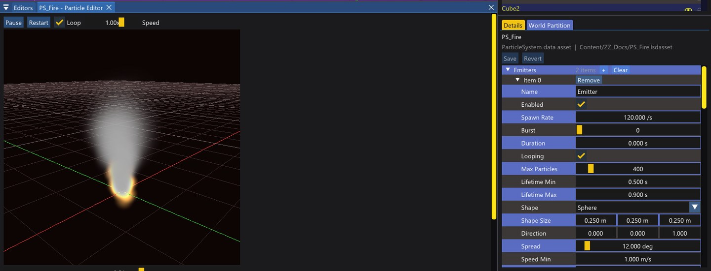
*The Particle Editor (double-click a Particle System): Pause / Restart / Loop / Speed, the preview, and the emitters in Details on the right.*

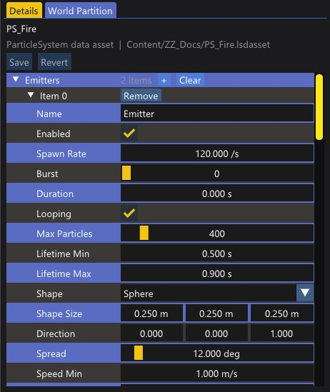
*A Particle System's emitters in Details: spawn rate, burst, duration, looping, max particles, lifetime, shape...*

**New Data Asset > Particle System** (Unreal's Niagara System), up to 8 emitters each with: spawn
rate, burst, duration and looping, lifetime, shape (point, sphere, box), direction and cone spread,
speed, gravity, wind, drag, start / end colour and size, spin, texture (or a soft dot), Alpha or
Additive blending, local or world space. **Over Life** (Niagara's Scale Sprite Size / Scale Color):
add **Size Over Life** keys (time 0..1 through the life, times Size Start) to puff up then shrink,
and **Color Over Life** keys for fire-to-smoke colour ramps; they replace the start / end blend.
From a script, `lsd.spawn("PS_Explosion", x, y, z)` puts one at a point; it deletes itself when
it has played out (**Auto Destroy** on the Particle Effect, for non-looping systems).

**Renderer** (Niagara's renderers), per emitter:

| Renderer | Draws | Use it for |
| --- | --- | --- |
| Sprite | a camera-facing quad per particle (texture or a soft dot) | fire, smoke, sparks |
| Mesh | a lit mesh per particle in one instanced draw (**Mesh**: an asset or `Cube` / `Sphere`; Size scales it, Spin turns it, or **Align To Velocity** points its +X where it flies; one colour per emitter) | rocks, debris, shell casings |
| Ribbon | one strip through the particles from oldest to newest, facing the camera, as wide as their size and coloured by their age | trails behind swords, rockets, magic |

For a trail, give a Ribbon emitter a steady spawn rate, speed 0 and world space, and move the object:
the particles stay where they were born and the ribbon joins them.

**Lit** (Renderer, Alpha sprites and ribbons; Niagara's lit sprite material): the particles take the
level's light instead of showing their colour as it is: the sky and ground ambient, the sun and the
Point / Spot Lights near them, soft enough that light from behind still shows through. Use it for
smoke, dust and snow; leave fire and sparks unlit and Additive. In Play, lit particles in the sun's shadow (under a roof, behind a wall) lose its light; local lights do
not cast shadows on them.

**Soft Distance** (Renderer; Niagara's soft particles / Unreal's DepthFade): sprites fade out over this many
metres where they meet a surface, instead of showing a hard line where they cut through the floor or a
wall (ground fog, smoke, dust). 0 = off. It needs the post-process path (on by default in the viewport
and in the game).

**Collision** (Niagara's Collision module), world-space emitters only: **Floor** bounces off a flat
floor at **Floor Height** (also in the editor); **World** hits whatever physics collides with (in
Play; up to 1024 rays a frame for all effects together). **Bounce** is the speed kept off the
surface, **Friction** the speed lost along it, **Kill On Hit** removes the particle at its first hit
(rain, bullets).

Double-click it to open the **Particle Editor**: a preview (orbit with the mouse), play / pause /
restart, speed, a timeline to scrub and per-emitter particle counts, and the **Emitter Stack**
(Niagara's stack): a tab per emitter (**+** adds one) and its modules in the order a particle meets
them, under coloured stages: **Emitter** (name, on / off, local space), **Emitter Update** (Spawn),
**Particle Spawn** (Initialize Particle, Shape, Velocity), **Particle Update** (Forces, Color, Size,
Rotation, Over Life, Collision) and **Render** (Renderer). Shape, Velocity, Forces, Color, Size,
Rotation, Over Life and Collision each have a **Use** box (Niagara's module checkboxes): untick one to
see the effect without it; its settings stay for when you tick it again. **Bounds** draws the box the
live particles fill (and its size), to see how far an effect reaches. **Min Quality** on an emitter
(Niagara's emitter scalability) leaves it out below that Effects Quality: extra embers or mist only
on stronger PCs. **Sim Target GPU** (Niagara's GPU Compute Sim) runs an emitter on the graphics card: up to a
million particles (Max Particles), spawned and moved by a compute pass and drawn as sprites straight from it, with
Floor collision; they are not sorted (Additive looks best) and take no lighting, height fog or World collision. On a
PC without it the emitter runs on the CPU. Each stage folds away; **Remove Emitter**
takes the shown one out. In a wide window the stack sits beside the preview. Edits save by themselves
a moment later (like Details, which shows the same modules as categories), and the preview follows
them. Drag the system into the viewport to place a **Particle Effect** (Active, Time Scale, Preview in
the editor).

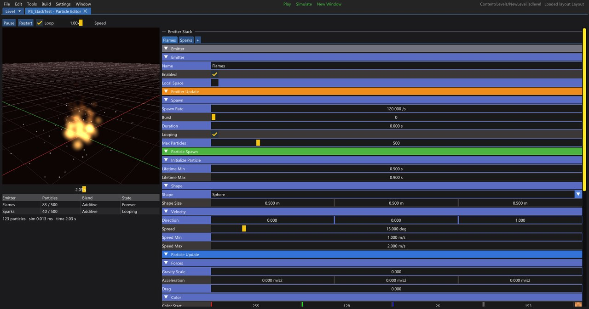
*The Particle Editor with its Emitter Stack: Flames and Sparks tabs, the stages and their modules.*

---

## 14. AI

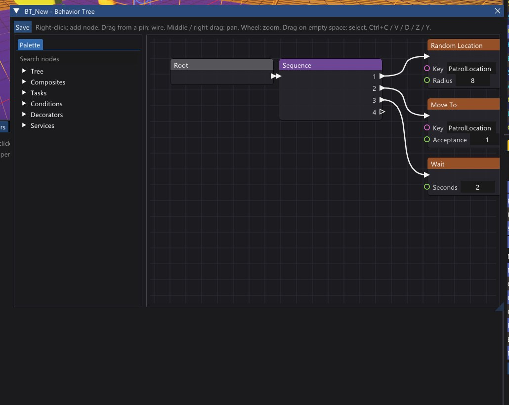
*The Behavior Tree editor: Palette on the left (Tree, Composites, Tasks, Conditions, Decorators, Services), Root > Sequence > Random Location / Move To / Wait on the canvas.*

1. Place a **Nav Mesh Bounds** volume around the walkable area (optional: without one the whole
   level is used). Press **P** to see the navmesh in green (walls and objects hide the parts behind them; in Play too, or
   `show.Navigation 1`). World Settings > Navigation sets agent
   radius / height, step height, slope and cell size. The navmesh lies on what blocks in Play: a mesh's
   box, or its own triangles when its **Collision Shape** is **Mesh** (arches, ramps, stairs). A **Nav Modifier Volume** cuts its box out of the
   navmesh (Unreal's Nav Modifier with the Null area): AI paths round it though nothing blocks there.
   A **Nav Link** (Place > Nav Link; Unreal's Nav Link Proxy) joins two places the navmesh does not: a
   gap to jump, a ledge to drop off, a ladder. It runs from the object to its **End** (in the object's
   space); untick **Both Ways** for a one-way drop. Agents cross it in a straight line. Show Navigation
   draws it as a line between the two ends.
   **World Settings > Navigation > Runtime Rebuild** (Unreal's Runtime Generation: Dynamic): in Play the
   navmesh is built again about a second after something solid stops moving (a door that opened, a
   bridge that fell, a crate pushed aside); agents keep walking to where they were going. Things that
   never stop moving (a platform a script swings) are left out after three seconds (the Output Log says
   which). Scripts can ask for it at once: `lsd.rebuild_navmesh()`. The navmesh is built in tiles (about
   10 m across), and a rebuild redoes only the tiles where something changed (`Navmesh rebuilt (n tiles
   changed, ... ms)` in the log), so a door in a big level costs little.
2. Give an enemy a **Nav Agent** (speed, radius, height): it can walk with `lsd.move_to` or the AI
   Move To node, steering round other agents.
3. Give it an **AI Controller** with a **Behavior Tree** (New Behavior Tree; Unreal's Behavior Tree
   + Blackboard):

| Node | What it does |
| --- | --- |
| Root | where the tree starts |
| Selector | tries children top to bottom until one does not fail; higher ones interrupt lower ones |
| Sequence | runs children in order until one fails |
| Move To | walks to a location in a blackboard key; follows it if it moves |
| Wait, Random Location, Set Key, Clear Key | waiting, patrols, blackboard edits |
| Run Script | calls a function of the agent's Lua script (return true / false / nothing = running) |
| Run Behavior | runs another Behavior Tree here, by name (Unreal's Run Behavior): share a patrol or a search between enemies |
| Is Set, Compare | conditions on blackboard keys |
| Blackboard Condition | decorator: runs its one child only while Key <Op> Value holds (or is set / not set), stopping it the moment it does not |
| Loop, Cooldown, Time Limit, Force Success | decorators: repeat the child, rest after it, give up after a time, ignore its failure |
| Service | calls a Lua function every Interval seconds while its child runs (update a target key, look around) |

Unreal attaches decorators and services to a node; here they are nodes with one child that wrap it.

Perception fills the blackboard: **CanSeePlayer** (1 while in sight range, field of view and line
of sight), **PlayerLocation** (last seen), **NoiseLocation** / **HeardNoise** (from
`lsd.report_noise`), **Damaged** / **DamageAmount** / **Attacker** / **AttackerLocation** (when a script hurts it
with `lsd.apply_damage(target, amount, instigator)` or the **Apply Damage** node; Unreal's damage sense),
**TouchedPlayer** (the player bumps into it, seen or not; Unreal's touch sense). What it saw or heard fades: PlayerLocation, EnemyLocation and NoiseLocation /
HeardNoise are cleared **Memory Seconds** (10) after the last sighting or noise (0 keeps them), so a
"search where it was last seen" branch ends by itself. **Team** (Unreal's affiliation): agents on
different teams (not 0) see each other as enemies, **CanSeeEnemy** / **EnemyLocation** (the nearest
one in view). An agent on the **Player Team** is friendly and never sets CanSeePlayer. While playing,
the open tree's running branch glows green (a Run Behavior node glows while its tree runs). Select an object
with an AI Controller to see its sight cone (green) and hearing range (blue) in the viewport.

**Blackboard asset** (Unreal's Blackboard Data): New Data Asset > **BlackboardData** lists the keys a tree
uses, each with a **Type** (Bool, Float, Int, Vector, Object), a starting value and a note. Pick it in the
AI Controller's **Blackboard**: every key but Objects starts at its value when Play begins, an Int is
rounded and a Bool is 0 or 1 when a script writes it, and `lsd.set_blackboard` with a key the asset lacks
(a typo) or the wrong kind of value (a location for a number) is refused with a warning in the Output Log,
once per key. Perception's keys (CanSeePlayer, PlayerLocation...) need not be listed. Without an asset any
key goes, as before.

**Edit trees while playing**: save the behaviour tree and, within a second, every agent running it starts
again from the new tree's root (what it was doing is stopped first). A save that does not load keeps the old tree.

### State Trees

A **State Tree** (Unreal's State Tree) is the other way to give an AI Controller a brain: a list of states,
one active at a time. Each state runs its **Tasks** in order (like a Sequence: one failing ends the rest) and
leaves through its **Transitions**, checked in order every frame (the first that fires wins).

1. Content Browser > New Data Asset > **StateTreeData**. Double-click it; Details lists the **States**
   (the first one is where it starts). Press **+** to add a state, give it a **Name**.
2. Add **Tasks**: **Kind** is Move To, Wait, Run Script, Set Key, Clear Key, Random Location, Use Smart
   Object or Run Query (the Behavior Tree's tasks). **Key**, **Text** and **Value** are their settings
   (hover each for what it means for each kind: Move To walks to Key within Value metres, Wait waits
   Value seconds, Run Script calls the Lua function in Text...).
3. Add **Transitions**: **Trigger** is On Succeeded / On Failed / On Completed (the tasks finished: all
   succeeded, one failed, either), On Condition (Key Op Value on the blackboard, checked every frame, so it
   interrupts what the state is doing: "CanSeePlayer is set" -> Chase) or After Time (Value seconds in the
   state). **To State** is the state's name (its own name starts it again).
4. On the enemy's **AI Controller**, pick it in **State Tree**. It runs instead of the Behavior Tree, with
   the same blackboard and perception keys.

Example: *Patrol* (Random Location -> PatrolLocation, Move To PatrolLocation; On Completed -> Patrol, On
Condition CanSeePlayer is set -> Chase), *Chase* (Move To PlayerLocation; On Condition CanSeePlayer not set
-> Patrol). Shortcut: states are flat (no child states yet), and the asset is read when Play starts.

### Smart Objects

A **Smart Object** (Unreal's Smart Objects) marks something AI can use: a bench, a workstation, a
vending machine. Add the **Smart Object** component (Add Component > AI) to the object:

| Property | What it does |
| --- | --- |
| Activity | what it is for (Sit, Work...): tasks look for this name |
| Slots | where users stand, from the object (turns with it); each slot holds one user at a time |
| Duration | how long one use lasts (0: until the script says it is done) |
| Script Function | a function of the *user's* Lua script, called every frame while it uses the object (true: done, false: failed, nothing: still using) |
| Animation | a montage the user plays as it starts (by asset name) |
| Face Object | the user turns to the object while using it |
| Enabled | off: nobody uses it (a broken machine) |

The **Use Smart Object** task (Behavior Tree node, State Tree task kind) finds the nearest free slot with
that **Activity** (empty: any) within **Radius**, claims it (no one else takes it), walks there, uses it
and then frees it; it fails when none is free or the slot cannot be reached. A user that is interrupted
(a higher branch, a transition) lets its slot go. From scripts: `lsd.claim_smart_object(e, "Sit", 15)`
returns the object and where to stand (walk there with `lsd.move_to`), `lsd.release_smart_object(e)` frees it.

### Environment queries

An **Environment Query** (Unreal's EQS) finds the best point near an AI: cover from the player, a spot to
flank from, a place to stand near a goal. New Data Asset > **EnvQueryData**:

- **Generator**: **Rings** (Rings x Points Per Ring, evenly out to Radius) or a **Grid** (Radius = half its
  width, Spacing between points), **Around** the querier or the **Target** (a blackboard key with a
  location, Target Key; the querier itself when it is not set). **On Navmesh** snaps the points onto the
  navmesh and drops the ones off it.
- **Tests**, in order: **Distance** (from the target or the querier), **Can See Target** (a ray at eye
  height), **Reachable** (a navmesh path from the querier), **Facing** (1 ahead of the querier, -1
  behind). **Purpose**: Score, Filter (drops points outside Min..Max; for yes / no tests, the ones that
  fail) or both. **Weight**: positive prefers high values (far, visible, ahead), negative low ones (near,
  hidden). Each scoring test is scaled 0..1 over the points still in, so metres and yes / no mix.
- **Debug Draw**: in Play each run draws its points for 2 s: green the best, red to yellow by score, grey dropped.

Use it with the **Run Query** task (Behavior Tree node, State Tree task kind: the query's name in
Query / Text, the best point into Key), then Move To that key; from scripts `lsd.run_query(e, "EQ_Cover")`
returns x, y, z (nil when every point was dropped). Cover from the player: Target Key PlayerLocation, a
Can See Target test scored with Weight -1 (hidden points win), then Distance from the Querier with
Weight -0.5 (the nearer of them).

---

## 15. Game UI


*The UI window (double-click a .rml document): + Text / Button / Image / Panel, the live preview / designer canvas on the left, the HTML / CSS code on the right.*

Game UI is HTML / CSS (RmlUi) with a designer like UMG's: **New UI Document** creates a `.rml` file
with a starter panel. Double-click it to open the **UI window**: code on the right, a live preview
on the left. Style sheets (`.rcss`) open in the same window.

The preview is also the **designer canvas** (UMG's Designer tab):

- **+ Text / + Button / + Image / + Panel** add an element (with an id) to the document.
- **Click** an element in the preview to select it (it needs an `id`; clicking text inside a panel
  picks the nearest element with one). **Drag** it to move it (Ctrl: 10 px steps); an element in
  the normal flow becomes `position: relative`. **Delete** removes it.
- The selection has three gold **resize handles** (UMG's): the right edge sets `width`, the bottom
  edge `height`, the corner both (Ctrl: 10 px steps).
- The **Hierarchy** tab (UMG's Hierarchy panel) lists every element nested as in the text; click one
  to select it. Elements without an `id` are greyed out (give one an id to select it).
- The **Details** tab shows the selection's text, **On Click** (the Lua function it calls) and common
  style properties. Empty fields come from the style sheet.
- **Anchor** (in Details; UMG's Anchors), for elements with `position: absolute` straight under `body`: nine
  points (corners, edge middles, centre). The element keeps its distance to that point when the screen is
  another size: a health bar anchored bottom left stays in the corner on any monitor. Picking one keeps the
  element where it is (it writes `right` / `bottom`, or `left: 50%` with a margin for the middle); dragging
  keeps the anchor.
- Everything you do there is written into the code as the element's inline `style` and attributes,
  so the code and the canvas always agree; edit either.

```html
<rml>
<head>
<style>
body { font-family: sans; }
div { display: block; }
#hud { position: absolute; left: 30px; top: 30px; color: #FFE51A; font-size: 28px; white-space: nowrap; }
button { display: block; padding: 8px 20px; background-color: #025291; color: white;
         nav: auto; tab-index: auto; focus: auto; }
button:focus, button:hover { background-color: #EEA70E; }
</style>
</head>
<body>
<div id="hud">Score: <span id="score">0</span></div>
<button id="play" onclick="start_game" autofocus>Play</button>
</body>
</rml>
```

- Show it from Lua (`local doc = lsd.ui_open("UI_HUD")`) or as the Game Mode's HUD.
- Change it: `lsd.ui_set_text(doc, "score", 1250)`, `lsd.ui_set(doc, "bar", "style", "width: 40%")`
  (nodes **Set UI Text** and **Set UI Attribute**). A worked health and stamina HUD is in
  [Examples for first timers](Examples/Examples.md).
- **Data bindings** (UMG's property bindings): instead of setting elements one by one, give the
  document's body `data-model="game"` and name values in it; `lsd.ui_data(name, value)` (a number,
  text or boolean) updates every open document that uses them. Names not set yet read as 0.

  ```html
  <body data-model="game">
  <div id="bar"><div id="fill" data-style-width="game.health + '%'"></div></div>
  <div>{{game.name}}: {{game.health}} HP</div>
  <div data-if="game.health < 25">Low health!</div>
  </body>
  ```

  ```lua
  lsd.ui_data("name", "Soldier")
  lsd.ui_data("health", self.health)   -- the bar, the label and the warning follow
  ```

  **Lists** (UMG's List View fed by an array): pass a table, and `data-for` repeats an element per
  item; `{{item.field}}` reads a row's field, the second name is its index (from 0), and
  `{{game.<name>.size}}` counts it. For `data-for` the `data-model` must be on an element inside the
  body, not on `<body>` itself (RmlUi reads the repeated markup while the document loads):

  ```html
  <body><div data-model="game">
  <div>Items: {{game.inventory.size}}</div>
  <div data-for="item, i : game.inventory">{{i + 1}}. {{item.name}} x{{item.count}}</div>
  </div></body>
  ```

  ```lua
  lsd.ui_data("inventory", {{name = "Sword", count = 1}, {name = "Potion", count = 3}})
  ```

  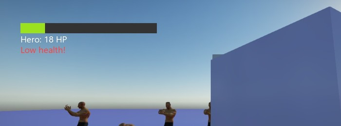
  *The bar's width, the label and the warning above, after `lsd.ui_data("health", 18)`.*

  `data-class-low="game.health < 25"` (a class while true) and `data-attr-src="game.icon"` work the
  same way. Lists (`data-for`) are not offered yet: one value per name.
- **Events**: `onclick="start_game"` calls `start_game(self, element_id)` in every script that has it.
- **The document's own script** (a Widget Blueprint's event graph, in JavaScript): put `Menu.js` next
  to `Menu.rml`. It runs when the document opens; its functions answer the document's events before
  Lua does, so UI-only logic (tabs, toggles, text) stays with the UI:

  ```js
  function onOpen() { ui.setText("title", "Ready?"); }      // runs once the document is up
  function start_game(id) {
    ui.setText(id, "Loading...");
    ui.send("begin_level", id);   // passes it on to Lua: begin_level(self, element_id)
    ui.close();                   // closes this document
  }
  ```

  `ui.setText(id, text)`, `ui.setAttribute(id, name, value)`, `ui.setProperty(id, name, value)`,
  `ui.value(id)`, `ui.close()`, `ui.send(action, id)`, `console.log(...)` / `console.error(...)`.
  A function that runs over half a second is stopped (an endless loop cannot freeze the game).
- **Widget animations** (UMG's widget animations): write the animation in the document's style as RCSS
  `@keyframes` (or `transition` on a class), then play it from a script:

  ```css
  @keyframes pop { from { transform: scale(0.2); opacity: 0; } to { transform: scale(1); opacity: 1; } }
  ```

  `lsd.ui_play_animation(doc, "panel", "pop 0.4s cubic-out")` plays it (again from the start if it is
  already playing; `"pulse 1s infinite alternate"` loops, `"none"` stops), and `lsd.ui_animate(doc,
  "panel", "left", "600px", 0.5, "cubic-in-out")` tweens one property from where it is now (tweens:
  linear, quadratic, cubic, back, bounce, elastic, sine... with `-in`, `-out` or `-in-out`). In the
  document's own `.js`: `ui.playAnimation(id, "pop 0.4s")` and `ui.animate(id, property, value, seconds,
  tween)`; in visual scripts: the **Play UI Animation** node. `onanimationend="fn"` on the element calls
  `fn` when an animation ends (Unreal's On Animation Finished).
- **Menus**: `lsd.ui_show_cursor(true)` frees the mouse for the UI; `lsd.ui_show_cursor(false)` gives the
  mouse and keys back to the game (Unreal's Set Input Mode Game Only). Arrow keys / D-pad move the
  focus between elements with `nav: auto`; Enter / Space / gamepad A press it. A menu can be hidden and
  shown again with `lsd.ui_style(doc, "menu", "display", "none" / "block")`; it keeps its focus.
  A Quit button calls `lsd.quit()` (Unreal's Quit Game): Play stops in the editor, a packaged game closes.
- **Over objects**: `lsd.ui_follow(doc, "tag", enemy, 2.2)` keeps an element above an object.
- **UI in the level** (Unreal's Widget Component in World space): add a **UI Panel** component (Add
  Component > UI) and pick a **Document**. The document is drawn on a flat panel **Width** x **Height**
  metres, centred on the object, standing up and facing -Y (turn the object to aim it); **Resolution**
  is how many pixels across it is laid out in (Unreal's Draw Size). It shows in the editor too, its own
  `.js` runs, its `onclick="fn"` actions reach the scripts in Play and `lsd.ui_data` bindings update it.
  In Play, while the mouse cursor is shown (`lsd.ui_show_cursor(true)`), hovering and clicking on the
  panel work like on a screen menu (untick **Clickable** for a display only). **Lit** lets the level's
  lights shade it (off: its own colours, like a screen). Limits: a wall in front of a panel does not
  stop a click on it, half-see-through parts come out a little darker than on screen, and pictures in
  the document are a little lighter.
- **Ready-made HUD widgets** (no document to make; also the UI nodes Health Bar, Remove Health Bar,
  Damage Number, Show Prompt):
  - `lsd.health_bar(enemy, hp / max_hp)` puts a bar over an object that goes from green to red as it
    empties. Call it again to update it; `lsd.remove_health_bar(enemy)` takes it away.
  - `lsd.damage_number(enemy, 25)` shows a number that rises from the object and fades within a second.
  - `lsd.prompt("Press E to open")` shows a prompt at the bottom of the screen, `lsd.prompt(nil)` hides it.
    `lsd.prompt("Pick up", item)` floats over an object instead; it fades in and out (0.15 s, still while
    paused), and calling it every frame costs nothing. `lsd.prompt("Board", train, {max_distance = 8})` also
    fades it out while the camera is more than 8 m from the object.

  Widgets of destroyed objects go by themselves.

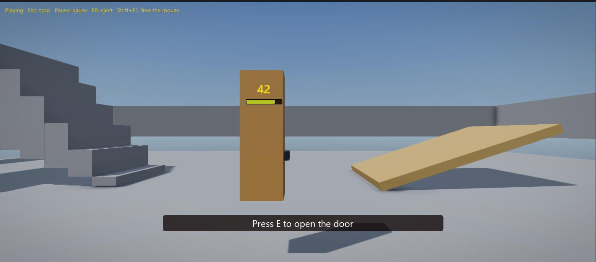
*A health bar and a damage number over the player, and a prompt.*
- **A ready-made settings menu**: `lsd.settings_menu()` opens (or closes) an options menu over the game:
  Quality (Low to Epic), Fullscreen, Master / Music / Effects volume, Mouse sensitivity, Invert look and
  the accessibility options (Text size, Subtitles, Colour blindness and its strength),
  saved with the player's settings as they change, with the mouse cursor shown while it is open. Bind it
  to Esc or a Pause button; for your own look, copy its idea into a `.rml` with `lsd.get_settings` /
  `lsd.set_settings`. UI actions that should run once whatever scripts exist go to `lsd.on_ui(action,
  function(element_id) end)` (the menu's buttons use it).
- **Button sounds** (UMG's Hovered / Pressed sounds): **Project Settings > User Interface > UI Hover
  Sound** and **UI Click Sound** (empty: silent), **UI Sound Volume** and **UI Sound Class** (empty: the
  Sound Class named `UI` if the project has one, so the player's **UI Volume** setting applies; under
  Master either way). Every clickable element plays them in Play: a `<button>`, a `<select>`, an `<input>`
  of type button / submit / checkbox / radio, anything with `onclick` (not `disabled` ones). The hover
  sound plays once when the mouse or the arrows / D-pad focus enter one (not again while it stays there,
  and not when a document opens under a still cursor); the click sound when it is pressed (mouse, Enter,
  the gamepad's A). Per element: `data-hover-sound="SFX_Beep"`, `data-click-sound="<name or GUID>"`
  (on an element they also make it clickable; on the body they are the document's default),
  `data-sound="none"` or a sound `none` for silence. New projects from a template get
  `Content/Templates/UI/SFX_UI_Hover.wav` / `SFX_UI_Click.wav` (generated: a 25 ms 2400 Hz tick and a 60 ms
  1300 to 800 Hz blip; `tools/ui_sounds.py` writes the same pair, as in `Content/UI/Sounds`). `ui.LogSounds 1`
  logs each one with its voice.
- **Safe zone** (Unreal's Display Safe Zone): **Project Settings > User Interface > UI Safe Zone** (%)
  lays the game UI out that far in from every edge of the view, so a TV that crops the picture keeps
  the HUD whole (5 % is usual for TVs, 0 for monitors). World-anchored elements still sit over their objects.
- Fonts: `font-family: sans` is always there; add your own `.ttf` / `.otf` to `Content/Fonts` and use
  their family name. Fonts in `Content/Fonts/Fallback` (Unreal's composite font fallbacks) fill in the
  glyphs the others lack: drop Noto Sans JP / SC / KR / Arabic there and Japanese, Chinese, Korean or Arabic
  text shows in every font-family. Every element starts inline: give blocks `display: block`.

---

## 16. Saving, settings and languages


*Edit > Project Settings (saved in Config/project.json, shared with the team): description, maps, multiplayer, chat, voice, localisation, platform...*


*Edit > Editor Preferences (per user, Saved/editor_settings.json): startup, autosave, camera speed, snapping, Content Browser, plugins.*

**Save games** (Unreal's SaveGame): any Lua value made of numbers, strings, booleans and tables.

```lua
lsd.save_game("Slot1", {level = 3, coins = 250, position = {x = 1, y = 2, z = 0}})
local save = lsd.load_game("Slot1")   -- nil if there is none
```

Files go to `Saved/SaveGames/<slot>.json`. Visual scripts: Save Value / Load Value.

**Versions** (Unreal's custom save versions): pass your save format's number when it changes, and
upgrade older saves when they load; saves written without one are version 1.

```lua
lsd.save_game("Slot1", {level = 3, gold = 250}, 2)      -- version 2: "coins" became "gold"
local save, version = lsd.load_game("Slot1")
if save and version < 2 then save.gold, save.coins = save.coins, nil end
```

**In the background** (Unreal's Async Save Game to Slot): `lsd.save_game_async(slot, value [, version])`
writes the file off the frame (no hitch for big saves); loading, checking or deleting that slot waits for it.

Whole objects (the components you name, Transform when you name none) by object name, so a load
into a freshly opened level puts them back:

```lua
lsd.save_objects("Slot1", {lsd.find("Door"), lsd.find("Chest")}, {"Transform", "Script"}, {coins = 250})
local extra, found = lsd.load_objects("Slot1")   -- extra.coins == 250; objects gone from the level are skipped
```

**Player settings** (Unreal's Game User Settings) are in `Saved/GameUserSettings.json`: fullscreen,
quality, master / music / effects volume, mouse sensitivity, invert look, language, and accessibility:

- `ui_text_scale` (0.5 to 3, 1 = as designed): all game UI text bigger or smaller (menus, HUD, subtitles,
  UI Panels); layouts make room for it. (The UI window's preview follows it too.)
- `subtitles` (on by default): a Sound or Sound Cue with a **Subtitle** shows it at the bottom of the screen
  while it plays (the latest one wins); a subtitle that is a string table key is shown translated.
- `color_deficiency` (0 Off, 1 Deuteranopia, 2 Protanopia, 3 Tritanopia), `color_deficiency_strength` (0..1)
  and `color_deficiency_simulate` (Unreal's r.Color.Deficiency): a colour-blind filter in the post-process
  pass. It corrects the picture (colours that the player cannot tell apart are moved to ones they can);
  with simulate on it shows how the game looks to that player instead, to check your own colours.
  The game UI drawn over the view is not filtered.

`lsd.set_settings({ui_text_scale = 1.5, color_deficiency = 1})` changes them from a script. The first run picks
the quality that suits the graphics card. An options menu reads and changes them:

```lua
local s = lsd.get_settings()
lsd.set_settings({quality = 1, master_volume = 0.6})   -- applied at once and saved
```

Music and effects volume drive the Sound Classes named **Music** and **SFX** if the project has them.

**Languages** (Unreal's String Tables): make a Data Table with a `Key` column and one column per
language, and pick it in Project Settings > Localization:

```csv
Key,en,fr
MENU_PLAY,Play,Jouer
MENU_QUIT,Quit,Quitter
```

UI text that is exactly a key is translated (`<button>MENU_PLAY</button>`); in Lua use
`lsd.text("MENU_PLAY")`. `lsd.set_language("fr")` switches and reloads open UI documents.

**Tools > Gather Text** (Unreal's Localization Dashboard > Gather Text; console `loc.Gather`) fills
the table for you. It finds every `lsd.text("KEY")` in Lua and JavaScript scripts, every Localized
Text / Format Text node's key, and every text shown in a UI document (`<button>Start Game</button>`
adds the key `Start Game`, which translates because the whole text is a key). Keys the table lacks
are added at the end; UI texts get their first-language cell filled with the text itself. Then
translate the other columns. Without a table it makes `Content/Localization/ST_Game.csv` and sets it
in Project Settings. Texts built at run time (`lsd.text("LEVEL_" .. n)`) are not found: add those by hand.

**Arguments and plurals** (Unreal's Format Text): write `{0}`, `{1}`... in the text and pass the
values after the key: `lsd.text("SCORE", score)` (or the **Format Text** node). For words that
change with a number, `{0}|plural(one=apple,other=apples)` picks by the language's rule (French
counts 0 as one); add `zero=` for a special empty case. Languages with more forms use CLDR's names:
`two`, `few` and `many` too (Russian and Ukrainian 2-4 few, 5-20 many; Polish 22-24 few; Czech 2-4 few;
Arabic zero, one, two, few, many; Japanese, Chinese and Korean only `other`). A form the text lacks uses `other`:

```text
Key,en,fr
APPLES,"{0} {0}|plural(one=apple,other=apples)","{0} {0}|plural(one=pomme,other=pommes)"
```

---

## 17. Packaging and shipping

1. **Edit > Project Settings**: project name, company, **Game Default Level**, icon, splash, Steam App ID.
2. Build the Release engine once: `cmake --build --preset windows-msvc --config Release` (it also
   refreshes `lsd_editor.exe` in the project folder).
3. **Build > Build Release Engine** first if the editor says so (the package copies the Release engine, which
   runs without Visual Studio): it builds it from the engine's source with CMake in the background, the
   status bar shows the progress, `Saved/Logs/ReleaseBuild.log` the whole output. Close any running copy of
   the root `lsd_editor.exe` first (the build replaces it).
4. **File > Package Project**. It validates the assets, then writes `Build/<Project Name>/`:
   the game exe, `Content/`, `Config/`, the Visual C++ runtime and `game.json`.
   It also writes `Packages/`: one list per level of the assets it uses (Bitsquid's resource packages); the game
   loads a level's meshes from it while the level opens, so they do not load in the middle of play.
   And `DerivedData/Shaders/`: the shaders your editor compiled (the project's and the built-in ones), so a player's
   first start reads them instead of compiling (open the levels once on D3D12 and on Vulkan before packaging, so
   their Material Graphs are in it; on Vulkan a player then needs no Vulkan SDK for Material Graphs).
5. Copy that folder to another PC and run the exe. It opens the default level in Play, full window,
   without the editor; **Esc** quits (Project Settings > Input > **Escape Quits Game** off: Esc is the game's
   own key, for a pause menu, and scripts end the game with `lsd.quit()`). Logs and saves go into its own `Saved/`.

**Plugins** (Unreal's Plugins): a folder `Plugins/<Name>/` with `plugin.json` (name, version, description,
enabled), its own `Content/` and, if it has game code, `Source/*.cpp` / `*.c`. **Edit > Plugins** lists them with an
**Enabled** checkbox (it applies at once) and **New Plugin** makes the folder. An enabled plugin's `Content/` shows in the
Content Browser as `Plugins/<Name>/...` (its .meta files stay inside the plugin, so references keep working when the
plugin moves between projects), its `Source/` files join `Game.dll` at the next **Tools > Compile Game Code**, and
**Package Project** ships its content inside the game's `Content/Plugins/<Name>/`. A disabled plugin is invisible
to all three.

**DLC and patches** (Unreal's chunking and patch .pak): **File > Package DLC** writes `Build/DLC/<Name>/` with
`Content/` and `manifest.lsdmanifest` (every file with its hash). *Folder* is what to include, as the Content Browser
shows it: `Levels/Episode2` or `Plugins/MyPlugin`. For a **patch** fill *Base manifest* with the
`manifest.lsdmanifest` of the package players have (every Package Project writes one, in its folder): only assets new or
changed since are packaged, so a patch is small. Copy the DLC folder into the shipped game's `DLC/` folder: at start the
game mounts every `DLC/<Name>/Content`, in name order, and a file with the same path replaces the base one (same GUID, as
its .meta travels with it) while new files are simply added. Name patches so they sort in order: `Patch1`, `Patch2`.

**Cooking** (Unreal's cook): tick **Project Settings > Packaging > Cook Used Assets Only** and the
package gets only the assets the game uses: found from the Project Settings (Game Default Level, Game
Mode, input, sound mixes...) through references, and through names and paths in scripts, graphs and UI
(`lsd.play_sound("Door")`, `lsd.open_level("Level2")`, a stylesheet's href), each with its compiled
data so nothing compiles on the first run. `cook_report.txt` in the package lists what was left out:
check it, since an asset only named in a string built at run time (`"Level" .. n`) is not found.

**Editor-only data** (Unreal's Developers folder and editor-only actors): folders named `Developers` or
`EditorOnly` in Content never ship, and an object with an **Editor Only** component (Add Component >
Editor > Editor Only, with a **Note** for the team) and everything under it is left out of Play and
stripped from the packaged levels: reference meshes, notes, scale figures, test helpers.

**Build Configuration** (Project Settings > Packaging; Unreal's Development / Shipping): a Development
package still takes `-remote` (Tools > Remote Console from the editor), `-exec` lines and smoke tests,
for testing on other PCs; a Shipping package, the one players get, ignores them (its log and crash
reports stay, for bug reports).

**Platform** (Project Settings > Platform; Unreal's Windows platform settings):

- **Icon**: a square PNG, 256 x 256 is plenty. It is the game window's icon and, on Windows,
  it is written into the packaged exe, so Explorer, the taskbar and shortcuts show it.
- **File details**: the exe's Properties > Details carry the project name, the **Company** and version 1.0.
- **Splash**: an image (up to 1280 px) shown centred over everything while the packaged game starts,
  for at least **Splash Seconds** and until the level is playing. It is copied into the package as
  `splash.<ext>`. Empty: no splash.
- **Steam App ID** goes into `steam_appid.txt` next to the exe.

`lsd_editor.exe -game` runs the current project the same way without packaging (with a `splash.png`
in the project folder, the splash too).

---

## 18. Testing and profiling


*`stat unit` in the console: frame rate and the time per part of the frame, top-right of the viewport.*


*Window > Memory: RAM and video memory in use, and each allocator's size and blocks.*


*Tools > Remote Console: connect to a game started with -remote and type console commands into it.*

- **Tools > Smoke Test Level**: plays the level for 5 seconds and reports every error logged.
  On a build server: `lsd_editor.exe -nosound -level=Content/Levels/Main.lsdlevel -smoketest=10`
  exits with 0 (clean) or 1 (errors).
- **Remote Console** (Tools menu): start the packaged game with `-remote`, click Connect, and type
  console commands into it while it runs; each one's log lines come back to the window. On another
  PC (a test machine on the network, a handheld) start it with `-remote -remotepassword=<a password>`.
  It then listens on every network instead of this PC only. In the window, type that PC's address
  (192.168.x.x) as **Host** and the **Password**, then Connect. A wrong password closes the connection;
  five in a row close the remote console until the game restarts. Shipping packages ignore `-remote`.
  **Push Changes** (once connected): every Content file you save in the editor from then on is sent to
  the game, which hot-reloads it as if edited there: tweak a script, a material, a UI document or a level and
  see it on the test PC without packaging again. Live values go through the console too (`lua`, cvars).
- **Tools > Run Unit Tests**: runs the engine's test suites in the background.
- **HighResShot 2** (console): saves the main view at twice its size as a PNG in
  `Saved/Screenshots/` (up to 8×, post-processing included; works on D3D12 and OpenGL).
- **Window > Memory** / **memreport** (console): memory per system (Unreal's stat memory): the engine's own heap, **Physics (Jolt)**, **Audio (miniaudio**: decoded sounds and streams), **Scripts (Lua)** and any arenas, with peaks; the process's RAM and the video memory budget.
- **Texture streaming** (Unreal's, on by default; `r.TextureStreaming 0` turns it off): a texture is
  read and decoded on a worker thread the first time something needs it, and a few finished ones go
  onto the GPU each frame. Levels open without waiting for their images: a material draws in its
  plain colour for a moment, then its textures appear. Changed texture files reload the same way.
  It also streams by distance: each object asks for about as many texels as it covers on screen, so a
  character far away holds a small copy of its 4K maps and gets them sharp again as you walk up (about
  half a second later). Textures only far objects use go smaller and free their memory. The Quality
  setting scales it (Low a quarter of the detail .. Epic double). `stat dump` lists the textures on the
  GPU, how many are streamed down and the texels they hold. When video memory runs short while playing
  (over 90% of what the system allows), the detail halves until it fits, and comes back when there is room.
- **Texture pool** (Unreal's texture streaming pool, `r.Streaming.PoolSize`): streamed textures stay within
  `r.TexturePoolSize` MB of video memory (0, the default: a quarter of the video memory budget; `-vram=<MB>`
  changes that budget). Over it, the textures drawn least recently give up their sharpest mips first (down
  to 64 px); a texture that needs to get sharper waits until it fits. So a level with more texture than
  the card holds still opens and plays: what you look at up close is sharp, the rest is blurrier.
  Per texture: Details > Texture > **Mip Streaming** (on by default; off = Unreal's Never Stream: always all of
  it, never squeezed, for UI-like or hero textures). Saving a texture's settings reloads it. `stat dump`
  prints `texture pool: resident X MB of Y MB, n requests (n loading), n held back by the pool`.
- **Occlusion culling** (Unreal's, on by default; `r.OcclusionCulling 0` turns it off): static and skeletal meshes, and each copy of an Instanced Static Mesh, hidden
  behind the nearest big opaque meshes (up to 16 a frame, each up to 4096 triangles: walls, blockout
  shapes, buildings) are not drawn. It only skips what is surely hidden, so nothing pops; `stat dump`
  shows how many it skipped (culled ... (occluded n)). Masked and translucent meshes do not hide anything.
- **Shadow caching** (Unreal's cached shadow maps, on by default; `r.ShadowCaching 0` turns it off):
  a Point or Spot Light's shadow is drawn once and kept while nothing it shows moves, so a room of
  static lights costs nothing per frame. Moving a mesh, the light or an Instanced Static Mesh redraws
  it the next frame; a Skeletal Mesh within the light's reach redraws it every frame. The sun's cascades
  are kept the same way while the camera stands still (or moves less than a shadow texel) and nothing
  in them moves; with a Skeletal Mesh in them (the player) the two far cascades are drawn on alternate frames
  instead (`r.ShadowStagger`). Local light
  shadows need Shadows quality High or Epic. `stat dump` shows how many tiles were kept.
- **Shadow Resolution** (Point / Spot Light; Unreal's Shadow Resolution Scale): **Medium** is the usual
  tile, **High** four times the texels (a hero light's crisp shadow), **Low** a quarter (fill lights; more
  of them fit). A light whose tiles do not fit gets the next size down; a High point light (six views)
  usually ends up Medium.
- **stat unit** (console): frame rate, game / render / UI CPU time, draw calls, triangles, culled
  meshes, memory. **stat audio**: playing sounds.
- **stat dump** (console): writes one frame's numbers to the Output Log: CPU times, GPU wait, GPU
  time per stage (shadows, scene, post, UI; timestamp queries on D3D12 and OpenGL), draws, objects
  culled, shadow casters skipped (skinned meshes and instanced copies outside a shadow view) and the
  editor UI's time per panel (Unreal's `stat gpu` + `stat unit` in one line). For big scenes it adds the
  triangles from Instanced Static Meshes, the shadow passes' draws and triangles, the first view's CPU time by
  part (shadows, occluders, static meshes, instanced, the rest), the meshes on the GPU (vertex, index and LOD
  index MB, time spent loading them and building LODs) and the video memory in use.
- **Tracy** (Unreal Insights): configure with `-DLSD_TRACY=ON`, build, run, and connect the Tracy
  profiler v0.11.1 to see every frame's timeline.
- Logs: `Saved/Logs/Editor.log` (Game.log in a packaged game); the previous run is kept as
  `-previous`. Crashes: `Saved/Crashes/<date-time>/crash.dmp` + log (open the dump in Visual Studio).

### Large scenes (many dense meshes and big textures)

A city of kit buildings from a Marketplace pack (thousands of objects, meshes of 5 000 to 200 000 triangles,
2K-4K textures) runs without hand work; this is what the engine does for it and what you can set.

**Automatic** (nothing to set):

- **Auto LODs** for every static mesh of 64+ triangles: up to five simpler versions, each built to about one
  triangle per four pixels at the size it takes over, never further than about a pixel off the real outline
  (section 11, Mesh Editor). A mesh with its own LODs in the file (Unreal's `_LOD1` nodes, FBX LOD groups) uses
  those instead. They are built in the background and kept in DerivedData, so a project opens faster the
  second time.
- **Each copy of an Instanced Static Mesh** (Foliage, PCG output, kit pieces placed by the thousand) picks its
  own LOD by its own distance, in the view and in every shadow, and copies outside the view or behind the big
  nearby walls are left out.
- **Shadows** draw the LOD the camera sees, so a far house casts its simple shape; the sun's far cascades go
  simpler still where their texels (tens of centimetres) cannot show more (`r.ShadowLOD`), and the two far
  cascades are drawn on alternate frames while the view moves little (`r.ShadowStagger`).
- **Still objects cost little**: each object's world matrix, bounds and mesh are kept between frames while it
  does not move (an Instanced Static Mesh's copies too), and a whole object (all its copies) outside a view or a
  shadow cascade is dropped with one test.
- **Specks are not drawn**: anything under about three pixels across on screen, and its shadow.
- **Automatic instancing**: separate objects with the same mesh, LOD and material are drawn in one call.
- **Texture streaming** and the **texture pool** (above) keep video memory in budget; `-vram=<MB>` pretends the
  card has that much, to check a level still runs on a 2 GB or 4 GB card.

**What you set** (Unreal's equivalents in brackets):

| Setting | Where | What it does |
| --- | --- | --- |
| LOD 1 / 2 / 3 Screen Size | Mesh Editor (the mesh's import settings) | How small the mesh must look before each LOD takes over; larger = sooner. LOD 4 / 5 follow at half and a quarter of LOD 3's |
| Max Draw Distance | Static Mesh in Details | Not drawn (nor its shadow) beyond it (Max Draw Distance) |
| Cull Distance Volume | Place tab | The same by object size inside a box (Cull Distance Volume) |
| HLOD | World Settings > HLOD, then Build > Build HLODs | Far cells of static meshes become one merged proxy each (Hierarchical LOD) |
| View Distance | Engine Scalability | Every LOD switch and cull distance x 0.5 .. x 1.5 |
| `r.MinScreenSize` | console | Smallest drawn size, bounding radius over distance (0.0015; 0 = draw everything) |
| `r.ForceLOD n` | console | Draw everything at LOD n, to look at an LOD (-1: by distance) |
| `r.GPUCulling` | console | Draws of 1024+ copies culled on the GPU (on); smaller ones are culled on the CPU, which is faster for them |
| `r.ShadowLOD` | console | Sun cascades draw casters at the simplest LOD their texels still show (on; never finer than the camera's) |
| `r.ShadowStagger` | console | The two far sun cascades drawn on alternate frames while the view moves little (on; far moving things' shadows lag a frame) |
| Mip Streaming / Max Size | Texture in Details | Never Stream a hero texture; cap a texture's size |

**Reading `stat dump`** on a big scene (look from where it is slowest, then type `stat dump`):

- `draws, triangles`: the first view's. `instanced triangles`: how many of those come from Instanced Static
  Meshes. `shadows: draws, triangles`: every shadow pass of the frame together.
- `render cpu: shadows, occluders, static meshes, instanced, rest`: where the CPU's drawing time goes.
  `render cpu detail`: the sun's casters found, its cache keys, its static / skeletal / instanced caster draws, the
  local lights' shadows, and the frame's mesh and instance tables (matrices, bounds, LODs worked out once a frame).
- `game cpu detail` (in Play): the game thread by part: live edits, movers / rides / streaming, physics, bodies
  written back, camera / movement / sounds, triggers, scripts (your Lua / JavaScript / C++ `on_update`s and the `lsd.*`
  calls they make), AI / network, animation, effects / audio.
- `gpu: shadows, scene (meshes, effects, normals / velocity), post`: where the GPU's goes. The normals /
  velocity part redraws the scene's opaque meshes for SSR / AO and TAA / motion blur (about half the scene).
- `meshes n: vertices, indices, LOD indices MB, loading took .. ms (LODs ..)`: mesh memory and load time.
  `video memory used X of Y MB`: the whole process's, as the driver reports it (D3D12, Vulkan).
- `since the last dump: worst frame, frames over 50 ms`: hitches (the first look at a new area loads its meshes
  and textures).
- `texture pool: resident X MB of Y MB, n requests (n loading), n held back`: requests should settle when the
  camera stands still; many held back means the pool is too small for what is in view.

Measured on the favela benchmark (D3D12, RX 7900 XTX, far view over 1 900 kit objects and 7 142 instanced copies):
5.7 million triangles in view and 6.4 million in the shadows, 12.8 ms of GPU, became 0.94 million and 1.1 million,
about 3.5 ms; the street view went from 4.6 to 2.4 ms. See BACKLOG, "Capacity (large scenes)".

---

## 19. Reference

### Components

| Category | Components |
| --- | --- |
| Common | Transform |
| Rendering | Static Mesh (**Box UV**: one texture tile per metre on every face however it is scaled, for blockout walls and floors; the material's **Box UV Tiling** (UVs category, tiles per metre, Unreal's World Aligned Texture size) changes that: 0.25 = a tile every 4 m) |
| Animation | Skeletal Mesh (**Morphs**: morph target weights) |
| Lights | Directional, Point, Spot, Sky Light |
| Environment | Sky, Height Fog, Post Process Volume, Lightmass Importance Volume |
| Camera | Camera (FOV, Auto Activate: Play looks through it; `lsd.set_view(e [, blend])` / `lsd.set_view(nil [, blend])` cut or blend between views, like Set View Target with Blend; `lsd.camera_shake(strength [, seconds, frequency])`; nodes Set View Target with Blend, Set View Target to Player, Camera Shake). A Camera attached to the Character (child object) is the player's view (Player View: First / Third Person, Motion, Follow Bone); `lsd.set_camera_view("first" \| "third" \| "camera")`, `lsd.camera_view()`, `lsd.camera_location()`, `lsd.camera_forward()` (where the view looks: shoot along it for a crosshair) (nodes Set Camera View, Is Third Person, Get Camera Location) |
| Rendering | Decal (a texture projected down onto what is inside its box: scale the box to fit, the alpha cuts it out; 16 visible at once) |
| Rendering | Instanced Static Mesh (many copies of one mesh in one draw: rocks, grass, props; Details > Scatter fills a circle at random; no collision; each copy is drawn at its own LOD and left out when outside the view, behind the occluders or under `r.MinScreenSize`; a draw of 1024+ copies is culled on the GPU instead, against last frame's depth too, `r.GPUCulling 0` to compare) |
| Animation | Attach To Socket (keeps this object on a socket of another object's skeletal mesh: a sword in a hand) |
| Animation | Foot IK (Unreal's foot placement, in Play: the pelvis drops for the lower foot, each foot reaches its ground and turns to its slope, eased so stairs do not pop; foot bone names, max step, ankle height, Max Foot Angle, Speed) |
| Movement | Rotating Movement (degrees per second), Projectile Movement (start velocity, gravity scale, follows velocity, stops and sends on_hit when it hits, optional destroy) |
| Volumes | Blocking, Kill, Trigger, Audio Volume |
| Physics | Rigid Body, Physics Joint, Cloth |
| Gameplay | Player Start, Character, Script, Tags (the **+** button picks from Project Settings > Gameplay Tags), Spline, Spline Follower, Attribute Set, Ability System ([abilities](#abilities-effects-and-attributes-gameplay-ability-system)) |
| Audio / Effects | Sound Emitter, Particle Effect |
| AI | Nav Mesh Bounds, Nav Modifier Volume, Nav Agent, AI Controller, Smart Object |
| Prefab | Prefab Instance (added for you) |

### Lua API

Objects and transforms

| Function | Returns / does |
| --- | --- |
| `lsd.find(name)` | entity by name, or nil |
| `lsd.name(e)`, `lsd.alive(e)`, `lsd.destroy(e)` | |
| `lsd.find_all(name)` | list of every entity named `name` or a numbered copy ("Sphere2", "Sphere 2"): Get All Actors |
| `lsd.find_tagged(tag)` | list of every entity with that gameplay tag (matched like `has_tag`) |
| `lsd.set_name(e, name)` | renames it in the Outliner (names may repeat) |
| `lsd.get_world_settings()` / `lsd.set_world_settings(t)` | the level's World Settings (`kill_z`, `gravity`, `game_mode`, `level_script`...; asset fields are GUIDs from `lsd.assets`); set writes only the fields given |
| `lsd.position(e)` / `lsd.set_position(e, x, y, z)` | local position, metres; on the player's Character, set_position teleports it (respawns, checkpoints; Unreal's Teleport). On an object with static collision (a mesh with Collision, a Blocking Volume) the collision moves with it, and with its children; `lsd.set` of its Transform scale or its Static Mesh Collision rebuilds it the next frame |
| `lsd.world_position(e)` | x, y, z in the world (with its parents' moves; Unreal's Get Actor Location) |
| `lsd.rotation(e)` / `lsd.set_rotation(e, x, y, z)` | local rotation, degrees |
| `lsd.velocity(e)` | vx, vy, vz in m/s: the player's Character, a vehicle, a mover or a rigid body; 0, 0, 0 for anything else (Unreal's Get Velocity) |
| `lsd.add_impulse(e, x, y, z [, at_x, at_y, at_z])` | a kick in N s on e's simulated RigidBody (Unreal's Add Impulse; mass 10 and impulse 10 = 1 m/s); through a world point it spins it too. False when e has no dynamic body |
| `lsd.set_velocity(e, x, y, z)` / `lsd.set_angular_velocity(e, x, y, z)` | sets a RigidBody's speed (m/s) or spin (degrees/s, world axes; Unreal's Set Physics Linear / Angular Velocity). False when e has no dynamic body |
| `lsd.set_parent(e, parent [, keep_world])` / `lsd.parent(e)` | attaches e under parent (nil detaches); by default it stays where it is in the world, `false` keeps its Transform as it was (now relative to the parent). False if it would make a loop. Helmets, held items (Unreal's Attach To Actor) |
| `lsd.spawn(name, x, y, z)` | a prefab, mesh asset, particle system (an explosion at a point) or shape ("Cube"); the new entity |
| `lsd.get(e, "Type")`, `lsd.set(e, "Type", t)`, `lsd.add`, `lsd.remove`, `lsd.has` | any component. `lsd.add(e, "RigidBody", {mass = 2})` in Play makes e simulate (its static collision becomes the moving body), by the next frame or at once for `lsd.add_impulse` / `set_velocity` |
| `lsd.has_tag(e, "Enemy")` | gameplay tags (dotted: "Damage" matches "Damage.Fire") |
| `lsd.has_any_tag(e, "A, B")` / `has_all_tags` / `has_no_tag` | several tags at once (Has Any Tag / Has All Tags nodes) |
| `lsd.raycast(x, y, z, dx, dy, dz, dist)` | `e, px, py, pz, nx, ny, nz` or nil; `e` is the object hit (ragdoll limbs: their character; broken Destructibles: the object or its piece); in Editor Utilities too |
| `lsd.sphere_trace(x1, y1, z1, x2, y2, z2, r)` (also `box_trace(..., hx, hy, hz)`, `capsule_trace(..., r, half_h)`) | first hit like raycast, or nil |
| `lsd.overlap_sphere(x, y, z, r)` / `lsd.overlap_box(x, y, z, hx, hy, hz)` | `{e, ...}` the objects touching it |
| `lsd.spline_point(e, d)`, `lsd.spline_length(e)` | |

Time, input, logging, data

| Function | Returns / does |
| --- | --- |
| `lsd.time()` | seconds of game time since Play started (slowed or stopped by `lsd.time_scale`) |
| `lsd.real_time()` | seconds since Play started on the wall clock, paused or not (pause menu animations) |
| `lsd.time_scale([s])` | Unreal's Set Global Time Dilation; returns the scale. `0` pauses the game world (physics, the player, AI and Nav Agents, Movers / traffic, animation, particles, timers, `dt` of `on_update`) and the mouse no longer turns the player; `0.2` is slow motion, `0.05` for a tenth of a second a hit-stop. UI, input (`lsd.pressed` still fires: unpause with it), the remote console, sounds and the network keep running. Back to 1 when Play stops or the level changes. Multiplayer: ignored on a client; on a server it slows what the server simulates, each client still moves its own player at full speed |
| `lsd.after(s, fn)`, `lsd.every(s, fn)`, `lsd.cancel(id)` | timers (game time: they wait while paused) |
| `lsd.input("IA_Move")` | `x, y` of an Input Action |
| `lsd.pressed("IA_Jump")` | true on the frame it fires |
| `lsd.log(...)`, `lsd.log_error(...)` | Output Log |
| `lsd.table("DT_Items")` | Data Table as `{Row = {Column = value}}` |
| `lsd.curve("C_Ramp", t)` | Curve data asset value (x, y, z for a Curve Vector; r, g, b, a for a Curve Color) |
| `lsd.curve_table("CT_Levels", "Damage", t)` | a curve table row at time t |

Audio and animation

| Function | Returns / does |
| --- | --- |
| `lsd.play_sound(name [, x, y, z] [, loop])` | voice id (2D, or at a position); a last argument `true` loops a sound file until `lsd.stop_sound(id)` (a Sound Cue loops with its own Looping node) |
| `lsd.play_sound_on(e, name [, loop])` | voice id, spatial at e and following it (an engine, a radio in a car; Unreal's Spawn Sound Attached); stops when e is destroyed |
| `lsd.stop_sound(id)`, `lsd.push_mix(name)`, `lsd.pop_mix(name)` | |
| `lsd.set_audio_param(name, v)`, `lsd.set_class_volume(name, v)` | Sound Cue Switches and Sound Synth Parameters read audio parameters |
| `lsd.trigger_audio(name)` | fires Sound Synth Trigger nodes of that name |
| `lsd.play_music(name [, fade])`, `lsd.stop_music([fade])`, `lsd.music_layer(name, volume [, fade])` | a track, or a Music asset (segments and stems) |
| `lsd.music_intensity(v)`, `lsd.music_segment(name)` | Music asset: stems fade to their gain at v (0..1); switch segment on the next beat / bar |
| `lsd.set_anim_param(e, name, v)` | Animation Graph parameter |
| `lsd.play_montage(e, animation [, rate, from_bone, blend, root_motion, slot])` | Plays an animation file once over what e plays (Play Montage); from_bone `spine_01` = the upper body; returns its length; `on_montage_ended(self)` when it ends |
| `lsd.stop_montage(e [, blend])`, `lsd.montage_playing(e)` | |
| `lsd.settings_menu([open])` | the built-in options menu (quality, fullscreen, volumes, mouse, accessibility); no argument toggles it |
| `lsd.on_ui(action, fn)` | a UI action (onclick / onchange name) handled once, engine-wide, before scripts' functions |
| `lsd.rebuild_navmesh()` | builds the navmesh again now (after moving walls or doors); agents keep walking |
| `lsd.apply_damage(target, amount [, instigator])` | calls the target's `on_damage(self, amount, instigator)` (Event Any Damage; instigator nil when none); an AI target senses it |
| `lsd.attribute(e, name)` | an Attribute Set value: current, base (nil if none) |
| `lsd.set_attribute(e, name, base)` | sets the base (clamped; added if missing); `on_attribute_changed(self, name, value, old)` runs on change |
| `lsd.apply_effect(target, effect)`, `lsd.remove_effect(target, effect)` | a Gameplay Effect by asset name: ok / how many removed |
| `lsd.give_ability(e, ability)` | adds a Gameplay Ability to e's Ability System; false if no such asset |
| `lsd.try_activate_ability(e, ability)` | ok, why ("cooldown", "cost", "blocked", "missing tags", "active"): pays the cost, starts the cooldown, runs its Function / Montage |
| `lsd.end_ability(e, ability)`, `lsd.cancel_ability(e, ability)` | ends it early (cancel also stops its montage); `on_ability_ended(self, ability, cancelled)` |
| `lsd.ability_cooldown(e, ability)` | cooldown seconds left |
| `lsd.anim_curve(e, name)` | an animation curve's value where e's animation is now (0 when none has it) |
| `lsd.set_morph(e, name, weight)` | Morph target weight on the skeletal mesh (0 rest, 1 full) |
| `lsd.ragdoll(e[, on])` | e's skeletal mesh (or its child's) falls as a ragdoll (true, default) or animates again (false) |
| `lsd.set_material_parameter(name, value)` / `(name, r, g, b[, a])` | A global material parameter (Project Settings > Materials) for every material; false if no such name |
| `lsd.morph_names(e)` | The skeletal mesh's morph target names (a creator's sliders) |
| `lsd.set_outfit(e, slot, mesh [, r, g, b])` | What the Outfit wears in a body area (mesh name or GUID, "" = none) |
| `lsd.assets(type [, folder])` | `{{name, guid, folder}, ...}` of a type ("Mesh", "Prefab", "Sound"..., or a data asset's own type: "AnimGraph", "InputAction"...) under a Content/ folder, by name. "Sound" also lists Sound Synths (they stay under "Sound Cue" too) |

AI

| Function | Returns / does |
| --- | --- |
| `lsd.move_to(e, x, y, z)`, `lsd.stop_move(e)`, `lsd.is_moving(e)` | Nav Agent movement |
| `lsd.find_path(x, y, z, tx, ty, tz)` | list of `{x, y, z}` corners |
| `lsd.bb_set(e, key, v)`, `lsd.bb_get(e, key)`, `lsd.bb_clear(e, key)` | blackboard |
| `lsd.report_noise(x, y, z [, loudness])` | AI hearing |
| `lsd.claim_smart_object(e [, activity [, radius]])` | the nearest free Smart Object slot (activity "" = any, radius 15 m), held for e: object, x, y, z, or nil |
| `lsd.release_smart_object(e)` | frees the slots e holds |
| `lsd.run_query(e, query)` | an Environment Query asset by name, run for e: its best point x, y, z, or nil |

UI, saving, settings, languages

| Function | Returns / does |
| --- | --- |
| `lsd.ui_open(name)` | document handle |
| `lsd.ui_close(doc)`, `lsd.ui_set_text(doc, id, text)`, `lsd.ui_set(doc, id, attr, value)` | |
| `lsd.ui_value(doc, id)` | a text field's text |
| `lsd.ui_data(name, value)` | a data binding: `{{game.name}}` in documents with `data-model="game"`; a table is a list for `data-for` |
| `lsd.ui_show_cursor(on)` | menus: free the mouse (false: the game has it again) |
| `lsd.quit()` | Quit Game: Play stops in the editor, a packaged game closes |
| `lsd.ui_follow(doc, id, e [, height])`, `lsd.ui_unfollow(doc, id)` | world-anchored UI |
| `lsd.ui_style(doc, id, property, value)`, `lsd.ui_rml(doc, id, markup)` | one style property; an element's contents as markup |
| `lsd.ui_play_animation(doc, id, anim)`, `lsd.ui_animate(doc, id, property, value [, seconds, tween])` | widget animations: RCSS @keyframes, or one property tweened |
| `lsd.health_bar(e, fraction [, height, color])`, `lsd.remove_health_bar(e)` | a health bar over e |
| `lsd.damage_number(e, amount [, color])`, `lsd.prompt(text [, e [, {max_distance = m}]])` | a rising damage number; a prompt (nil hides; over an object it fades in / out and hides past max_distance from the camera) |
| `lsd.save_game(slot, v [, version])`, `lsd.save_game_async(slot, v [, version])`, `lsd.load_game(slot)` -> value, version, `lsd.has_save(slot)`, `lsd.delete_save(slot)` | |
| `lsd.save_objects(slot, objects, [components], [extra])`, `lsd.load_objects(slot)` | whole objects' components by name |
| `lsd.get_settings()`, `lsd.set_settings(t)` | player settings |
| `lsd.text(key)`, `lsd.set_language(code)`, `lsd.languages()` | localisation |
| `lsd.ik_reach(e, bone, x, y, z [, weight])`, `lsd.ik_look_at(e, bone, x, y, z [, weight [, fx, fy, fz]])` | IK each frame you call it: a hand on a ledge (two-bone), a head following a target (aim along the bone's own +X unless given). With **Skeletal Mesh > Full Body IK** ticked (Unreal's Full Body IK) the reach targets move the whole body: the pelvis shifts and the spine turns toward targets out of a limb's reach, then the limbs bend |
| `lsd.enum(name)`, `lsd.struct(name)` | editor-made types: New Data Asset > UserEnum (names, numbered from 0) / UserStruct (fields with defaults); returns nil if missing |
| `lsd.broadcast(name, ...)`, `lsd.call(e, name, ...)`, `lsd.implements(e, name)` | events between objects (event dispatchers, interface messages): name(self, ...) on every script, or e's |
| `lsd.draw_line(x1, y1, z1, x2, y2, z2 [, r, g, b [, seconds]])`, `lsd.draw_sphere(x, y, z, radius ...)`, `lsd.draw_box(x, y, z, hx, hy, hz ...)`, `lsd.draw_text(x, y, z, text ...)` | debug drawing over the viewport (seconds 0: this frame) |
| `lsd.key_down(name)` | true while a key or button is held (Unreal's Is Input Key Down): "F", "Left Shift", "Left Mouse Button", "Gamepad Face Bottom". For quick prototypes and hold-to-do timers; an Input Action is still the way for anything the player may rebind |
| `lsd.bindings(action)`, `lsd.rebind(action, old_key, new_key)`, `lsd.key_pressed()` | key rebinding (Enhanced Input's player mappings): saved in GameUserSettings.json, applied every Play; Move / Look / Jump name the built-in controls |
| `lsd.input_record(file)`, `lsd.input_play(file)`, `lsd.input_stop()` | input recording: the Input Actions' values and frame times to / from `Saved/<file>` (tests, demos) |

Events a script can define: `on_start(self)`, `on_update(self, dt)`, `on_hit(self, other)`,
`on_overlap_begin(self, other)`, `on_overlap_end(self, other)`, UI actions `name(self, element_id)`,
behaviour tree tasks `name(self, dt)`.

### Keyboard shortcuts

| Keys | Action |
| --- | --- |
| RMB + WASD / QE, MMB, Alt+LMB, F | fly, pan, orbit, frame selection |
| W / E / R, Ctrl+` | move / rotate / scale gizmo, local / world |
| Ctrl+Z / Y, Ctrl+S, Ctrl+Shift+S, Ctrl+N | undo / redo, save, save as, new level |
| Ctrl+C / X / V / D, Delete, End | clipboard, duplicate, delete, drop to floor |
| Ctrl+G, Shift+G, Ctrl+A | group, ungroup, select all |
| Alt+G / J / H / K, Alt+4 / 3 / 2, G, P | views, view modes, game view, navmesh |
| Alt+P, Alt+S, Esc, Pause, ], F8, Shift+F1 | play, simulate, stop, pause, step, eject, free mouse |

These are the defaults. **Edit > Editor Preferences > Keyboard Shortcuts** (Unreal's Keyboard
Shortcuts) changes them: click a command's keys, then press the new ones (hold Ctrl / Shift / Alt
with them; Esc cancels). **x** leaves a command without keys, **Reset** / **Reset All** bring the
defaults back, the search box finds a command or a key, and a red **also ...** shows another command
on the same keys. The menus show the keys you chose. Your changes are saved in
`Saved/editor_settings.json` (per user, not in Git). Camera bookmarks (Ctrl+0-9 / 0-9) and flying
stay fixed.

Save, Undo, Redo, Copy, Cut, Paste, Duplicate and Delete are shared with the asset editor windows
(Visual Script / material / sound cue / behaviour tree graphs, Data Tables, the UI window, Timelines,
the State Machine), like Unreal's generic commands: rebind one and it changes everywhere. While an
asset editor has focus, the level's shortcuts stay out of it (Delete there never deletes the selected
level object). **Debugging** holds the Lua Debugger's Continue / Step Over / Step Into / Step Out
(F5 / F10 / F11 / Shift+F11; its buttons show the keys you chose), and **Toggle Breakpoint** (F9) works
on a graph node and a debugger line.

### Command line

| Flag | Meaning |
| --- | --- |
| `-gpu-debug` | D3D12 GPU crash data (DRED breadcrumbs and page faults, also on with `-validation`): logged if the device is removed |
| `-rhi=d3d12 / opengl / vulkan`, `-gpu=<n>`, `-validation` | graphics backend, card, debug layer (D3D12; Vulkan with the Vulkan SDK). Vulkan draws everything D3D12 does: lit, textured, animated and instanced meshes, the same lit look as D3D12 (one shared shader: specular, normal / ORM maps, fog, probes, decals, reflections, lightmaps), shadows, particles, game UI and post-processing, and Material Graph materials when the Vulkan SDK is installed (its DXC compiles them; without it they draw with the built-in material) (install the [Vulkan SDK](https://vulkan.lunarg.com) to build it: `winget install KhronosGroup.VulkanSDK`) |
| `-level=<path>`, `-play`, `-game` | open a level, start Play, run as the game |
| `-nosound` | no audio device |
| `-hidden` | the window is created hidden and never shown, raised or focused: no splash, no file dialog, no Explorer / browser, the mouse is never captured. It still renders, so `-frames`, `-exec`, `-remote`, `-screenshot` and `screenshot` work; Play in a New Window and the extra multiplayer players start hidden too. For automated runs on a PC someone is using: `lsd_editor.exe -hidden -nosound -frames=300` |
| `-exec="<console line>"` | run a console command on the first frame, after `-play` has started (repeatable) |
| `-smoketest=<seconds>`, `-frames=<n>`, `-screenshot=<n>` | automation |
| `-remote[=port]` | listen for the editor's **Tools > Remote Console** (this PC only, port 7780 by default): type console commands into a running game, e.g. `stat unit`, `r.ForceLOD 2` |
| `-import=<file>`, `-place=<asset>`, `-select=<name>` | scripted setup |
