# LSD_Engine Manual

How to use LSD_Engine to build a game. Written for people who know Unreal Engine: every feature is
mapped to its Unreal name. For how the engine works inside, see [ARCHITECTURE.md](ARCHITECTURE.md);
for step-by-step projects, see [EXAMPLES.md](EXAMPLES.md); for game code in C / C++ and every
command, see [CODING.md](CODING.md); to start coding step by step, see
[How to code in LSD_Engine](How%20to%20code%20in%20LSD_Engine.md).

Contents

1. [Getting started](#1-getting-started)
2. [The editor](#2-the-editor)
3. [Content and assets](#3-content-and-assets)
4. [Building a level](#4-building-a-level)
5. [Lighting, sky and post-processing](#5-lighting-sky-and-post-processing)
6. [Materials](#6-materials)
7. [Playing and the player](#7-playing-and-the-player)
8. [Physics](#8-physics)
9. [Lua scripting](#9-lua-scripting)
10. [Visual scripting](#10-visual-scripting)
11. [Animation](#11-animation)
12. [Audio](#12-audio)
13. [Particles](#13-particles)
14. [AI](#14-ai)
15. [Game UI](#15-game-ui)
16. [Saving, settings and languages](#16-saving-settings-and-languages)
17. [Packaging and shipping](#17-packaging-and-shipping)
18. [Testing and profiling](#18-testing-and-profiling)
19. [Reference](#19-reference)

---

## 1. Getting started

### Build

LSD_Engine builds with CMake and MSVC (Visual Studio 2026) on Windows; Clang on Linux.

1. Open the repository folder in VS Code (with the CMake Tools and C/C++ extensions).
2. Pick the configure preset **windows-msvc** when CMake Tools asks.
3. Build (F7), or in a terminal:

   ```powershell
   cmake --preset windows-msvc
   cmake --build --preset windows-msvc
   ```

4. Run the tests: `ctest --preset windows-msvc`.

The first configure downloads the third-party libraries (SDL3, Jolt, LuaJIT, RmlUi...), pinned to
fixed versions; it takes a few minutes once.

### Run the editor

```powershell
build\windows-msvc\editor\Debug\lsd_editor.exe
```

It picks the best graphics card and Direct3D 12. Add `-rhi=opengl` to use OpenGL instead. The
editor reopens the last level you had open. The project lives next to the executable's working folder:

| Folder | What it holds | Unreal |
| --- | --- | --- |
| `Content/` | Your assets: meshes, textures, levels, scripts, sounds... | Content |
| `Config/` | Project settings (`project.json`) and the editor theme | Config |
| `Saved/` | Logs, autosaves, crash reports, the player's settings and save games | Saved |
| `DerivedData/` | Compiled assets (made automatically, safe to delete) | DerivedDataCache |

---

## 2. The editor


*The editor: 1 menu bar, 2 Play / Simulate / New Window, 3 the Level tab and one tab per open asset editor, 4 workspaces, 5 viewport toolbar, 6 viewport, 7 Outliner, 8 Details, 9 Content Browser (with Place and Output Log), 10 the dock where asset editors open.*

**The menus** (Unreal's main menu): click a name in the menu bar.

| | |
| --- | --- |
|  | **File**: new / open / save levels, recent levels, Validate Assets, Import, Package Project. |
|  | **Edit**: undo / redo, duplicate, group, copy / paste, Drop to Floor, **Editor Preferences**, **Project Settings**. |
| 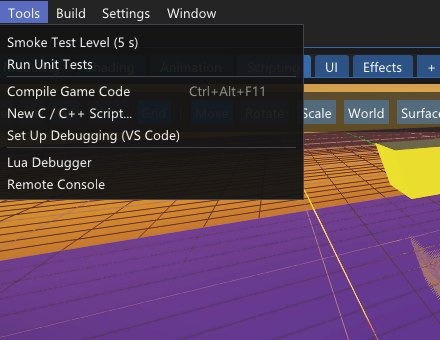 | **Tools**: smoke test and unit tests, Compile Game Code, New C / C++ Script, Set Up Debugging (VS Code), Lua Debugger, Remote Console. |
|  | **Build**: Build Lighting, Build Navigation, Validate Assets, Package Project. |
| 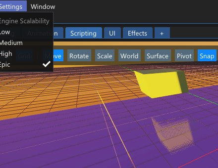 | **Settings**: Engine Scalability (Low / Medium / High / Epic). |
|  | **Window**: Undo History, World Settings, Message Log, Memory, Layout (save / load panel layouts). |

| Panel | Where | Unreal equivalent |
| --- | --- | --- |
| Viewport | Top-left | Level Viewport |
| Outliner / Hierarchy | Top-right | World Outliner |
| Details / World Partition | Bottom-right | Details panel |
| Content Browser, Place, Output Log | Bottom | Content Browser, Place Actors, Output Log |

The menu bar has **File** (levels, Recent Levels, Validate Assets, Package Project), **Edit** (undo, copy, Project
Settings, Editor Preferences), **Tools** (smoke test, unit tests) and **Window** (Undo History, World
Settings, Message Log, **Layout**). While playing it shows **Stop / Pause / Eject**. Window > Layout
saves the panel arrangement under a name (Unreal's Save Layout As), loads one back, or resets to the default.

### Level modes (click the Level tab)


*Click the Level tab to pick a mode (Unreal's Modes): Select, 3D Modeling, Foliage, Landscape, Animation Sequence, PCG, VFX, 2D.*


*Landscape mode: its tools open on the left of the viewport (Create, Sculpt, Smooth, Flatten).*


*Foliage mode: pick a mesh, set brush size and density, then paint on surfaces with LMB (Shift+LMB erases).*


*3D Modeling mode: place blockout shapes (Cube, Sphere, Plane) with Box UV and collision.*


*PCG mode: add a PCG Volume; it scatters a mesh on the surfaces inside its box.*

Like Unreal's mode dropdown: click the **Level** tab (when it is showing) and a list opens: **Select**
(the default), **3D Modeling**, **Foliage**, **Landscape**, **Animation Sequence**, **PCG** and **VFX**.
The tab then reads e.g. *Level: Landscape*, and the mode's tools open in a panel at the viewport's left
(close it, or pick Select, to go back). Console: `mode Landscape`.

| Mode | What it does (Unreal) |
| --- | --- |
| **3D Modeling** | Place Cube / Sphere / Plane blockout shapes (Box UV on by default), size the selected one in metres, snap its size to 0.5 m (Modeling Mode basics; no extrude / bevel yet) |
| **Foliage** | Pick a mesh, brush size, density (copies per m2), scale range; **LMB drag** paints copies onto surfaces, **Shift+LMB** erases. Copies go to *Foliage* objects (Instanced Static Meshes, 1024 each) |
| **Landscape** | **Create Landscape** (a square of terrain, 65 x 65 heights) where the view looks, then sculpt: **Sculpt** (LMB raises, Shift lowers), **Smooth**, **Flatten** (to the height where the stroke began), brush size and strength, Flatten All. It collides in Play; its material is on its Static Mesh |
| **Animation Sequence** | Your Timelines (double-click to edit), New Timeline, a button to the Animation workspace (Sequencer) |
| **PCG** | **Add PCG Volume**: a box that scatters copies of a mesh on the surfaces inside it by rules in Details (mesh, density per 100 m2, seed, max slope, scale range, random turn, align to surface). Move, size or change it and it rebuilds; the copies are in *<volume>_Output* |
| **VFX** | Your particle systems (double-click to edit, **Place** puts one where the view looks), New Particle System, a button to the Effects workspace (Niagara) |

In Foliage and Landscape a ring shows the brush; clicks paint instead of selecting (Alt, RMB and MMB
still move the camera). Every stroke is one undo step.

### Panel tabs and workspaces (the two rows under the menu bar)

| | |
| --- | --- |
| 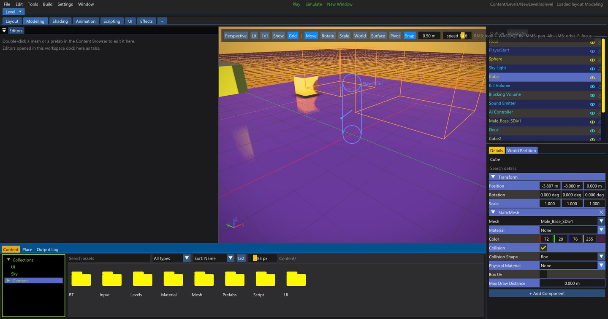 | 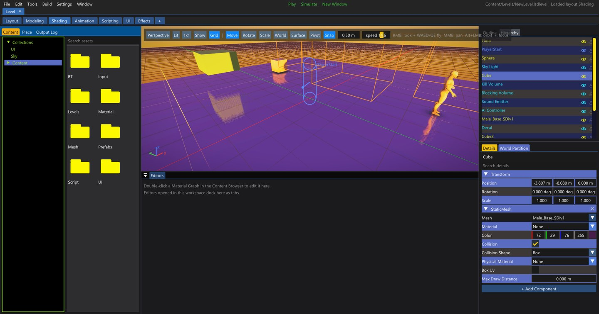 |
| *Modeling: a big viewport, mesh and prefab editors docked on the left.* | *Shading: material graphs dock under the viewport.* |
|  |  |
| *Animation: timelines and animation graphs.* | *Scripting: the Lua Debugger and visual scripts beside a small viewport.* |
|  | 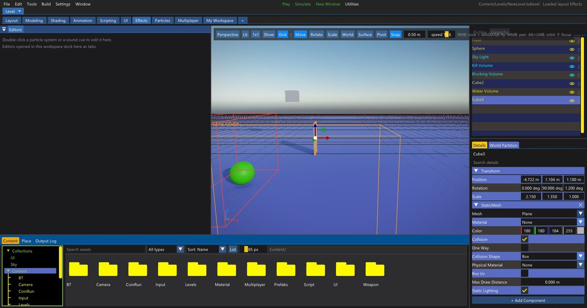 |
| *UI: UI documents and their designer.* | *Effects: particle systems and sound cues.* |

**Panel tabs** (the top row, like Unreal's tabs across the top of the editor): the first tab is
**Level** (the viewport, Outliner, Details, Content Browser). An editor you open from Layout (double-click
a Material Graph, a Timeline, a mesh..., or Tools > Lua Debugger) opens as its own full-screen tab
next to it and comes forward. Click a tab to switch; its **x** (or middle-click) closes it, saving a
changed graph like the window's own close did. Drag tabs to reorder them. Play always shows the Level.

**Workspaces** (the second row, only on the Level tab) are Blender's workspace tabs: each is a whole
arrangement of the level's panels for one job; the original arrangement is **Layout**, and it is
unchanged.

| Tab | What it shows | Editor area (asset editors opened there dock in it) |
| --- | --- | --- |
| **Layout** | Viewport, Outliner, Details, Content Browser (the original) | none: editors open as panel tabs |
| **Modeling** | Viewport with an editor beside it | Mesh Editor, Prefab editor |
| **Shading** | Content Browser left, viewport, node editor under it | Material Graphs (Blender's Shader Editor) |
| **Animation** | Viewport, editor along the bottom | Timelines (Sequencer), Animation Graphs |
| **Scripting** | Small viewport, big editor area with the **Lua Debugger** | Visual scripts |
| **UI** | Viewport, editor along the bottom | UI documents (UMG) |
| **Effects** | Viewport with an editor beside it | Particle systems (Niagara), Sound Cues |

Each workspace remembers how you resize and rearrange it (in `Saved/Layouts/Workspaces/`).
Right-click a tab > **Reset to Default** to rebuild it. **+** saves the current arrangement as a new
workspace under a name; right-click yours > **Delete**. Window > Layout > Reset to Default resets the
active workspace. Console: `workspace Shading`.

### Moving around the viewport


*The viewport toolbar: view (Perspective / Lit / 1x1 / Show / Grid), gizmo (Move / Rotate / Scale, World or Local, Surface, Pivot, Snap and its step), camera speed.*

Unreal's controls: hold the **right mouse button** and use **W A S D Q E** to fly, the mouse to
look; **middle mouse** pans; **Alt + left mouse** orbits; **F** frames the selection; the mouse wheel
during a fly changes speed. **Alt+G / J / H / K**: perspective / top / front / right view. The layout
button on the viewport toolbar cycles **1x1 → 1x2** (perspective beside top) **→ 2x2** (perspective, top,
front, right); each pane keeps its own camera. Console: `layout 1|2|4`. **Show** on the toolbar turns on
the grid, axis gizmo, navigation (P), **Bounds** (yellow mesh boxes) and **Collision** (cyan: what blocks in Play).
**Alt+4 / 3 / 2**: Lit / Unlit / Wireframe; the view mode button also has **Normals**, **Lighting Only**
(Alt+6: every surface grey), **Collision** (Alt+C: what blocks in Play) and **Overdraw** (Alt+0: bright where
many surfaces stack). **G**: game view (hides editor icons).

### Selecting and transforming

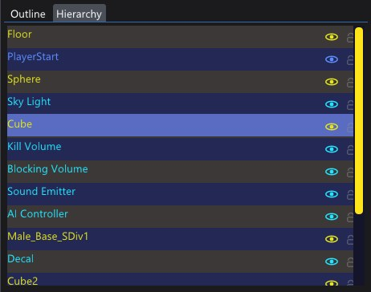
*The Outliner (Unreal's World Outliner): every object in the level; click to select, the eye hides it, the lock stops it being picked. Hierarchy shows parents and children.*

Click an object to select it; Ctrl+click to add; drag a box to select many. Selected meshes and
sprites get an orange outline, like Unreal's. **W / E / R** switch the
gizmo to move / rotate / scale. Hold **LMB** on an arrow to move along that axis (X red, Y green, Z blue,
the level's axes in World space), on a square between two arrows to move in that plane;
**Alt+LMB** drag duplicates and moves the copy; **Shift+LMB** drag brings the camera along with the
object. **Ctrl+`** toggles local / world space; Snap (toolbar) uses the snap
steps from Editor Preferences; **Surface** (toolbar) keeps moved objects on the surface under them and
holding **V** while moving snaps to the nearest vertex of another mesh. **Pivot** (or **Alt+V**) lets the
gizmo move the pivot the object turns and scales about (right-click it: Reset Pivot). Clicking picks
the triangle under the mouse, not just the box around a mesh. **End** drops the selection to the floor, **Delete** removes it,
**Ctrl+D** duplicates, **Ctrl+G / Shift+G** group / ungroup, **Ctrl+C / X / V** copy, cut, paste.
Drag one object onto another in the Outliner to attach it (children follow their parent).
**Folders** (Hierarchy tab, like Unreal's Outliner folders): right-click objects > Move to Folder > New
Folder, then type its name. Click a folder to fold it, drop objects on it to file them, right-click it to
rename or delete it (its objects stay). Folders only organise the Outliner; they have no transform.
The Outline tab's **type filter** lists only objects with a chosen component (StaticMesh, PointLight...).

### Details

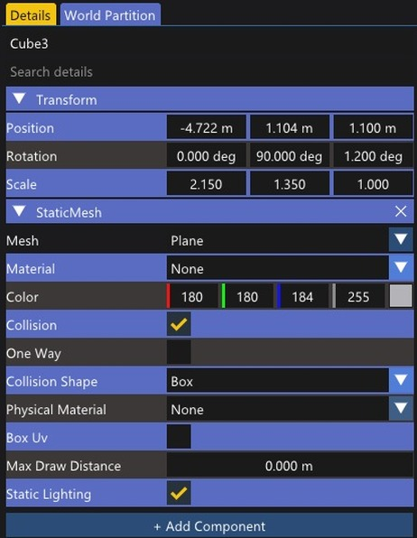
*Details for the selected object: one block per component (Transform, Static Mesh...), + Add Component at the bottom, Search details at the top.*

**Live editing:** every edit takes effect as you make it, while playing too: objects' components,
the player's Character (speeds, camera, capsule, input), rigid bodies (mass, friction, bounciness),
World Settings gravity, the player's Mapping Context and Input Actions (keys, triggers: reloaded
within a quarter second, the player's rebound keys kept), and data assets selected in the Content Browser (materials, particle
systems, curves...: written as you edit, at most ten times a second, and reloaded at once; **Revert**
goes back to how it was when you selected it). Mesh import settings are the exception: Save reimports
the file (a big mesh would stall frames if it reimported while you drag a slider).

**Hover help everywhere:** rest the mouse on any property, button, menu item, Place tab item or
component in **+ Add Component** for a short description of what it does.

The Details panel shows the selected object's components (each a collapsible section) or the
selected asset's settings. Every field has a tooltip. Right-click a field for **Reset to Default**.
Select several objects to edit them together. **Add Component** at the bottom adds any component.

### Undo, autosave, crash recovery

Every change is undoable (**Ctrl+Z / Ctrl+Y**, Window > Undo History). Unsaved levels are
autosaved to `Saved/Autosaves` every few minutes. If the editor crashes, the next start offers to
restore the autosave, and the Message Log names the crash report folder (`Saved/Crashes/...`).

### Console


*The Output Log tab (beside Content and Place): filters for messages, warnings and errors, and the console line at the bottom.*

The **Output Log** tab has a console line at the bottom. Type `help` to list every command. A few:
`stat unit` (frame timings), `stat audio`, `view top`, `viewmode wireframe`, `validate`, `package`,
`test.Smoke`. While playing, `lua <code>` runs Lua (e.g. `lua lsd.log(lsd.time())`).

---

## 3. Content and assets

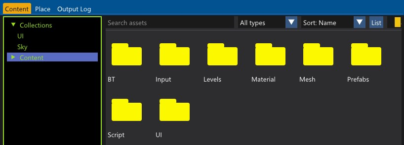
*The Content Browser: folders on the left (and Collections), assets on the right with search, type filter, sort and list / tile view. Double-click an asset to open its editor.*

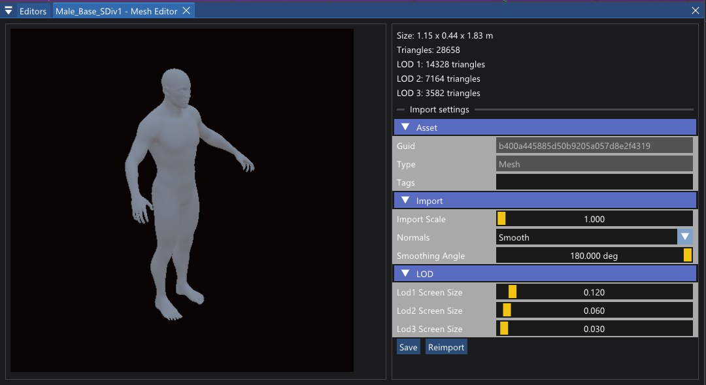
*The Mesh Editor (double-click a mesh): preview, size and triangle counts, import settings (scale, normals), LOD screen sizes; Save / Reimport.*


*The Prefab Editor (double-click a prefab): its objects on the left, a preview, and Details for the selected part; Save updates every copy in the level.*

Drop files from Explorer onto the editor window to import them into the open Content Browser folder.

**Back / forward:** with the mouse over the Content Browser, **Mouse 4** goes back to the folder you
were in before and **Mouse 5** forward again (like a web browser). Anywhere else in the editor, Mouse 4 /
Mouse 5 go back and forward between the tabs under the menu bar (Level and the asset editors).
Every asset gets a `.meta` file next to it holding its GUID (its permanent identity) and import
settings. Rename and move assets in the Content Browser: references keep working because they point
at the GUID, not the file name. Select an asset and type words into **Tags** in Details (comma-separated,
like Unreal's asset metadata): the Content Browser search box matches tags as well as names.

| You drop / create | It becomes | Opens in | Unreal |
| --- | --- | --- | --- |
| `.fbx`, `.gltf`, `.glb` | Mesh (a skinned mesh if it has bones) | Details (import scale) | Static / Skeletal Mesh |
| `.png .jpg .tga .bmp .psd` | Texture | Details (max size) | Texture |
| `.wav .ogg .flac .mp3` | Sound | Details (volume, class...); double-click plays | Sound Wave |
| `.csv` | Data Table | Data Table window | Data Table |
| `.lua` | Lua Script | your text editor | — |
| New Level / File > Save Level As | Level (`.lsdlevel`) | the viewport | Level |
| New Material | Material (data asset) | Details | Material (simple) |
| New Material Graph | Material Graph (`.lsdmatgraph`) | graph window + live preview | Material Editor |
| New Visual Script | Visual Script (`.lsdgraph`) | graph window | Blueprint Event Graph |
| New Sound Cue | Sound Cue (`.lsdcue`) | graph window | Sound Cue |
| New Behavior Tree | Behavior Tree (`.lsdbt`) | graph window | Behavior Tree |
| New UI Document | UI Document (`.rml`) | UI window | Widget Blueprint |
| New Data Asset > type | Data asset (`.lsdasset`) | Details | Data Asset |
| Outliner: right-click an object > Create Prefab | Prefab (`.lsdprefab`) | the level | Blueprint Class (placed actor) |

Data asset types: Input Action, Input Mapping Context, Game Mode, Curve, Curve Vector, Curve Color, Physical Material, Material, Material
Instance, Sound Class, Sound Attenuation, Sound Concurrency, Sound Mix, Submix, Animation Graph,
Particle System.

**Data Tables**: right-click a column name > **Type** (number, int, bool, string, vector; the header
becomes `Damage:number`) and cells that do not fit turn red; Lua then reads them typed (`007` stays
text in a string column). **Export JSON** writes the rows next to the .csv. A Data Table whose column
headers are times is a **curve table** (Unreal's Curve Table): `lsd.curve_table("CT_Levels", "Damage", t)`
or the Evaluate Curve Table node reads a row, linear between columns.

**Curves**: drag keys in the graph, double-click to add, right-click to delete; click a key, then
drag its handle to set its tangent (the key turns User; Auto in Details goes back). **Curve Vector**
(X, Y, Z) and **Curve Color** (R, G, B, A) pick the channel to edit with buttons above the graph;
`lsd.curve` returns 3 or 4 values for them (Evaluate Vector Curve node).

All text assets (levels, graphs, data assets, UI) are plain text: they merge and diff in Git.

**Importing**: drop files or a whole folder (its sub-folders are kept) onto the editor, or **File >
Import...** to pick several. They go into the Content Browser's current folder. Changed source files
recompile on their own; select an asset to change its import settings in Details (Save writes its
`.meta`).

**Live Link** (Blender, Maya...): set Edit > Editor Preferences > **Live Link Folder** to the folder
you export to. Every time you export there (FBX, textures, sounds), the editor copies the file into
`Content/LiveLink/` and it reloads in the level, also while playing.

**Thumbnails**: meshes show themselves; Materials, Material Instances and Material Graphs show a
sphere wearing them (colour, textures, a graph's shader); textures show the image and sounds their
waveform; Behavior Trees and Lua scripts are dark tiles reading **BT** and **.Lua**. They update when
the asset's file changes.

**Browsing**: **List** / **Tiles** and the size slider change the view; the sort menu orders by name,
type, last change or size. Ctrl-click and Shift-click select several assets (then right-click:
Delete Selected, Reimport, Add to Collection). Right-click a folder > **Add to Favourites**; right-
click assets > **Add to Collection** (a named set of assets from any folders, like Unreal's
Collections). Both appear above the folder tree. Right-click an asset > **Duplicate** copies it
with its import settings; **Reimport** reads the source file again. In the Outliner, right-click an
object > **Find in Content Browser** (or Ctrl+B) shows its mesh or script.

**Files with several meshes** (Unreal's import with Combine Meshes off): a mesh asset draws the whole
file as one mesh. Right-click it > **Create Prefab from Parts** makes `BP_<name>`: one child object
per mesh and material in the file (named `Node` or `Node_Material`), each with its node's pivot,
position, rotation and scale from the DCC (a door turns about its hinge), plus an `M_<material>`
Material for each material in the file (base colour, metallic, roughness; base colour, normal and
glTF metallic-roughness textures if Textures with the same file names are already in Content).
Import the textures first. Drag the prefab into the level and move, hide or re-material its parts
like any objects.

**References**: right-click an asset > **Reference Viewer** lists what uses it and what it uses
(click to follow, double-click to find in the Content Browser). Deleting warns about anything that
still uses the asset. A missing reference shows in red with **Replace with selected**; **Replace its
references with...** points everything at the asset selected in the Content Browser instead
(Unreal's Replace References). Reopen the level afterwards to see the change.

**Source control** (Unreal's Source Control, Git only). When the project folder is a Git repository,
asset tiles get a badge: yellow **M** changed, green **A** new, blue **R** renamed (the `.meta`
counts too). Right-click an asset > **Source Control**: **History** (its last 50 commits), **Diff
Against Last Commit**, **Submit...** (commits the asset and its `.meta` with your description; push
from your Git tool to share it), **Refresh Status**. Status is re-read every few seconds.

**File > Validate Assets** reports references to missing assets, oversize textures and (optional,
Project Settings > Validation) name prefixes such as `SM_`, `T_`, `M_`, `BT_`, `UI_`.

---

## 4. Building a level


*The Place tab (Unreal's Place Actors): drag a shape, light, volume, camera, vehicle... into the viewport.*


*Window > World Settings: Kill Z, gravity, exposure, Game Mode, Level Script and navigation settings for this level.*

- **File > New Level** starts with a floor and a Player Start (add lights from the Place tab).
- Drag meshes from the Content Browser into the viewport, or use the **Place** tab for built-in
  shapes (Cube, Sphere, Plane), lights, volumes, Player Start, Sky, Fog, Post Process Volume, Sound
  Emitter, Particle Effect, Spline, Nav Mesh Bounds, Nav Agent, AI Controller...
- Drop a Material onto an object in the viewport to apply it.
- **Volumes** are the unit cube scaled by their transform: **Blocking Volume** (invisible wall),
  **Kill Volume** (respawns the player), **Trigger Volume** (tells scripts when something enters),
  **Audio Volume** (reverb inside), **Post Process Volume**, **Nav Mesh Bounds**, **Nav Modifier Volume** (cut out of the navmesh).
- **Prefabs** are reusable objects: right-click an object in the Outliner > Create Prefab (it takes
  its children too), then drag the prefab in as often as you like. Edit one copy and **Apply to
  Prefab** (Details) to update the prefab; per-copy changes are
  remembered as overrides (**Revert to Prefab** in Details). That includes components and child
  objects a copy adds or removes: they stay so when the prefab changes (Revert drops them too).
  Prefabs inside prefabs refresh from their own asset, so a changed lamp prefab shows in every room
  prefab that holds it.
- **Splines**: place a Spline, click a point to move it with the gizmo, Add / Remove Point in Details;
  **Alt-drag** a point to add one after it; the selected point shows a **tangent handle** (drag it to
  bend the curve there; Tangents in Details, zero = automatic). **Spline Meshes** (Add Component) puts
  copies of a mesh every Spacing metres along it, turned along the curve: fences, rails, lamp posts.
  A **Spline Follower** moves an object along it (moving platforms, patrols).
- **World Settings** (Window menu): kill height, gravity, exposure, the Game Mode and the navmesh
  settings for this level.

Save with **Ctrl+S**. Levels live in `Content/` like any asset.

---

**Prefab editor**: double-click a prefab to edit it on its own (Unreal's Blueprint editor viewport):
drag the preview to turn it, pick objects in the tree, **+ Child** adds a part, **Delete** removes
one, edit components on the right (+ Add Component, X to remove). **Save** updates every copy in
the level; what a copy overrides stays its own.

## 5. Lighting, sky and post-processing

Lights use physical units, like Unreal:

| Component | Units / notes |
| --- | --- |
| Directional Light | lux; its +X axis is the light's direction; Cast Shadows, Shadow Distance (cascaded shadows) |
| Point Light | lumens, attenuation radius, shadows |
| Spot Light | lumens, inner / outer cone, shadows |
| Sky Light | ambient from above and below |

Colour can be set by temperature (Kelvin). **World Settings > Exposure (EV100)** sets the camera
exposure: 1.5 suits the default sun; a real 100 000 lux sun wants about 15.

Atmosphere:

- **Sky**: a gradient (zenith, horizon, ground) with a sun disc where the first Directional Light
  comes from. Without one the viewport stays its plain dark colour. **Atmosphere** (on by default,
  Unreal's Sky Atmosphere): the colours follow the sun's height, so turning the Directional Light
  sets the time of day: blue noon, an orange horizon and red sun at sunrise / sunset, dark night.
  The sun's light takes the same colour, and a **Sky Light** with **Capture Sky** (default) lights
  the level with the sky's colours. Untick Atmosphere to pick the colours yourself.
- **Height Fog**: exponential fog, thickest at the object's height and thinning upwards; density,
  falloff, colour, start distance, max opacity.
- **Post Process Volume**: unbound (everywhere) or a box; the highest priority one the camera is in
  wins. Exposure compensation, filmic (ACES) tonemapper, saturation, contrast, tint, vignette,
  **bloom** (intensity, threshold: bright and emissive parts glow) and **anti-aliasing** (FXAA, or
  **Temporal AA**: smoother and steadier, a little softer, can ghost on fast motion).
  **Reflections** (screen-space: smooth surfaces mirror what is on screen; intensity, distance),
  **Ambient Occlusion** (intensity, radius: darker creases and contact points, from the depth
  buffer like Unreal's SSAO) and **Depth of Field** (focal distance, focal region that stays sharp,
  transition, max blur in pixels; focal distance 0 = off).
  **Exposure** (Unreal's Auto Exposure / eye adaptation, on by default): the image is metered every
  frame and eased toward mid grey, so dark interiors brighten and sunlit views darken over a moment;
  Min / Max EV limit how far it moves from World Settings exposure, Speed Up / Down how fast,
  exposure compensation shifts the result. Untick Auto Exposure for a fixed, manual exposure.
  The scene is drawn into a target and these run as a post-process pass. **Without a volume the
  level gets a new volume's defaults** (filmic tonemapper, bloom, AO, reflections, FXAA, auto
  exposure), as in Unreal; add one to change them. AO, DOF and TAA need a perspective view.

Reflections and ambient light (Unreal's Sky Light): every surface reflects the sky / ground colours
along its reflection, sharper the smoother it is (metals and polished floors pick up the sky), with
the usual energy-conserving split-sum BRDF, darkened by AO and where baked probes say it is
indoors. Screen-space reflections add what is on screen on top.

Quality (the player's setting, Low → Epic) scales shadows: Low has none, Medium sun only, Epic
casts further.

### Sub-levels and streaming

Place tab > **Sub Level** (Unreal's Level Instance / level streaming): pick a **Level** in Details and
that level's objects appear under this object, moving with it. They are not saved into this level
(open the sub-level to edit them; the copy here updates when you save it) and clicking them selects
the Sub Level object. In Play a sub-level is loaded from the start, or, with **Load Distance**, only
while the player is that near (it unloads a little further away); untick **Load at Start** to load it
only from scripts: `lsd.load_sublevel(e)` / `lsd.unload_sublevel(e)` or the **Load / Unload Stream
Level** nodes. Their scripts and physics start and stop with them. Sub-levels inside sub-levels are
not loaded yet.

### Vehicles, transports and moving meshes

Three ready-made objects in the **Place** tab, coloured cubes as placeholders (put your own mesh in
their Static Mesh):

- **Drivable Vehicle** (red, Unreal's vehicle Blueprint): walk up and press **E** to get in. **W / S**
  throttle and reverse, **A / D** steer, **Shift** boost, **Ctrl** or **Space** handbrake, **E** gets
  out (beside it). It hugs the ground (steps and ramps up to half a metre), stops at walls, pushes
  what it hits, and the camera follows behind. Details > Vehicle: Ground or **Flying** (Space climbs,
  Ctrl sinks), top speed, reverse, acceleration, braking, turn rate, boost, the seat, camera distance.
- **Transport (Ride)** (blue: trains, ferries, lifts, cable cars): **E** near it hops on, and you
  travel on its seat without driving; **E** gets off. It comes with a Mover going back and forth
  20 m with a 3 s stop at each end: change its route in the Mover (a Spline for rails), or use a
  Spline Follower instead.
- **Moving Mesh (Mover)** (green): moves by itself. **Path**: *Direction* (any velocity vector,
  forever or for Duration seconds), *Back and Forth* (to Offset and back), or *Spline* (a Spline
  object's route by name, facing along it). **Repeat**: Once, Loop or Ping-Pong; **Pause** at each
  end; **Spin** turns it while it moves. **Start**: Begin Play, **Trigger** (when the player enters a
  Trigger Volume of that name), **Game Time** (seconds into the game) or **Script**; **Repeat
  Minutes** runs the route again from the start every so many minutes (60 = hourly, 0 = never).
  What stands on it rides along.

Visual scripts: **Enter Vehicle**, **Exit Vehicle**, **Get Driven Vehicle**, **Hitch Ride**,
**Leave Ride**, **Start / Stop / Restart Mover**. Lua: `lsd.enter_vehicle(e)`, `lsd.exit_vehicle()`,
`lsd.vehicle()`, `lsd.ride(e)`, `lsd.stop_riding()`, `lsd.start_mover(e)`, `lsd.stop_mover(e)`,
`lsd.restart_mover(e)`; vehicles and transports get `on_enter(self, player)` / `on_exit`.

### Multiplayer

One checkbox: **Settings > Project Settings > Multiplayer > Multiplayer**. Off (the default), the
game is single player and nothing networked runs. On:

- **Play** hosts (a listen server: you are player 0) and opens a game window for each other player
  (**Play Players**, default 2), which joins it on the level as it is. Stop closes them.
- Tick **Net Replicated** on an object (Details > Add Component > Multiplayer) to share it (Unreal's
  Replicates): the server's copy is the real one, every client shows it. Clients play other objects
  back about 100 ms in the past (**Interpolation**), blending between updates, so lag and lost
  packets look smooth instead of jumpy; physics runs on the server only. Objects scripts spawn on the
  server appear everywhere, and go everywhere when destroyed.
- Every player has an **avatar** the others see (**Player Avatar**: a mesh asset or shape). Your
  own player moves on your machine (no waiting for the network) and the others see it.
- Scripts: `lsd.has_authority()` (the server, or single player), `lsd.server_event(name, ...)`
  (Run on Server), `lsd.multicast(name, ...)` (server to everyone), `lsd.client_event(player, name,
  ...)`, `lsd.set_team(player, team, squad)`, events `on_player_joined(self, id)`,
  `on_player_left`, `on_connected`, `on_disconnected`. In single player the same calls just run
  locally, so one script works both ways.
- **Text chat** (Project Settings > Chat): All, Team, Squad (off by default) and Proximity (off by
  default, with a range). The server routes every line (a client cannot pick who hears it). The
  built-in **Chat Box** (Enter to type, Tab for the channel, Esc to cancel) can be turned off to make
  your own with `lsd.chat(channel, text)` and `on_chat(self, from, channel, text)`.
- **Voice chat** (Project Settings > Voice; on by default in multiplayer games): hold **V** to talk
  to your team (or, if team voice is off, the first of proximity / squad / all that is on), hold **B**
  to talk to everyone when **Voice All** is on, or tick **Open Mic**. **Voice Squad** and **Voice
  Proximity** are optional; proximity voice gets quieter with distance and is silent past Chat >
  Proximity Range. Opus at about 24 kbit/s per speaker; the server decides who hears whom, like chat;
  each speaker plays through a short jitter buffer, so a slow network costs a little delay, not
  stutter. The chat box shows *Talking* while you transmit. The microphone opens only when voice chat
  is on and the game is multiplayer (never in `-nosound` runs).
- Packaged games: `-server` hosts, `-dedicated` hosts without a player, `-connect=address[:port]`
  joins (port 7777 by default). Tick rate, port and max players are in the same settings.

### 2D games (Paper2D)


*The Level tab's 2D mode: 2D View (orthographic, top-down on the X / Z plane), New Sprite / Tile Map, and the tile palette for painting.*

Click the Level tab > **2D**. The panel's **2D View** looks along +Y without perspective (H in
the viewport), the way a side-on 2D game is seen; 2D content lives in the X-Z plane.

- **Sprite** (Unreal's Paper2D Sprite + Flipbook): pick an Image, click **Sprite**. A 1 m quad
  (scale it with the Transform), pivot at the bottom centre. For a **sprite sheet** set Columns /
  Rows in Details and the cell in **Frame**; **Frame Count** > 1 plays that many cells at **FPS**
  (a flipbook, Loop or once). Flip X / Y mirror it; **Pixel Art** keeps texels sharp; **Lit** lets
  the level's lights shade it (off: its own colours, like most 2D games); **Collision** makes it
  block in Play. Scripts switch animations with `lsd.set(e, "Sprite", {frame = 8, frame_count = 4})`.
- **Tile Map** (Paper2D Tile Map): pick the tileset image, click **Tile Map**, set the tileset's
  Columns / Rows, the map's Width / Height and Tile Size in Details. The panel shows the tileset:
  click a tile, then **LMB paints** it on the map in the viewport and **Shift+LMB erases** (each
  stroke is one undo). Painted tiles block in Play (rows of tiles become boxes).
- **2D physics**: RigidBody > **Lock 2D** keeps a body in its X-Z plane, turning only around Y.
- **Side-scroller player**: Character > **Side Scroller**: Move's left / right walks along X,
  Jump jumps, and the player's Sprite faces the way it walks.
- **2D camera**: a Camera with **Orthographic** (and Ortho Height, metres of world on screen) and
  Auto Activate; make it a child of the player, about 10 m back on -Y turned to look along +Y
  (rotation Z 90), so it follows.

### Baked lighting (Build Lighting)

Without baking, the Sky Light's ambient is the same everywhere, so the inside of a closed room is
as bright as a field. **Build > Build Lighting** (Unreal's Lightmass with a Volumetric Lightmap)
fixes that:

1. Save the level (the result goes next to it as `<Level>_BuiltData.lsdlight`, loaded with it and
   packaged with it).
2. Optional: place a **Lightmass Importance Volume** (Place tab or Add Component) around the
   playable area. Without one, probes cover all the static meshes up to 30 m high. Its **Probe
   Spacing** sets the distance between probes (0: as fine as the 512-probe budget allows).
3. Build > Build Lighting. The status bar shows the progress; the editor stays usable.

Each probe records the sky it can see and the light bounced once off the surfaces around it (from
the sun, local lights and sky; colours from the object's Color and its Material's base colour).
Static and moving objects use it for their ambient light: rooms get darker, colours bleed onto
neighbours. Direct light and shadows stay real-time. Rebuild after moving walls or lights.

---

## 6. Materials

### Simple Materials

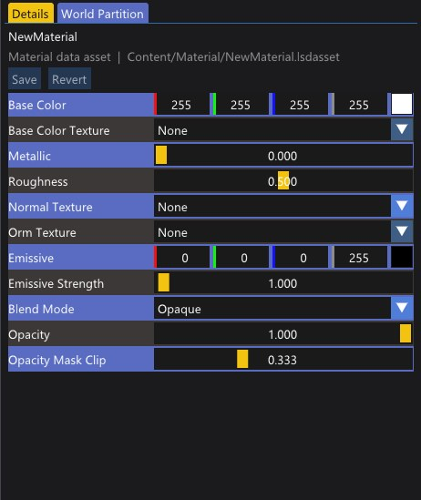
*A Material asset is edited in Details: base colour (or texture), metallic, roughness, normal / ORM textures, emissive, blend mode, opacity.*

**New Material** creates a physically based material: base colour (+ texture), metallic, roughness,
normal map, ORM map (occlusion / roughness / metallic packed like glTF), emissive. Drop it on an
object or pick it in the object's Static Mesh > Material. Edits show immediately. **Blend Mode**:
Opaque; **Masked** (cut-outs from the base colour alpha below Opacity Mask Clip: leaves, fences);
**Translucent** (glass, water; Opacity sets how see-through; drawn after opaque objects, far to near);
**Additive** (adds light: fire, glows).

**Material Instance**: a parent material plus ticked overrides (Unreal's Material Instance Constant).

### Material Graphs


*The Material Graph editor: node Palette on the left, the graph in the middle, a live preview (sphere or cube) on the right. Save updates every object that uses it.*

**New Material Graph** opens a node graph (Unreal's Material Editor). Right-click to add nodes; drag
from a pin to wire. The preview on the right (sphere or cube) updates 0.3 s after each change.

| Category | Nodes |
| --- | --- |
| Output | Material Output: Base Color, Metallic, Roughness, Emissive, Normal, Ambient Occlusion, Opacity, Blend Mode (Opaque, Masked, Translucent, Additive) |
| Constants | Constant, Color, Time |
| Parameters | Scalar Parameter, Vector Parameter (changed by Material Instances, no recompile) |
| Texture | Texture Sample (pick the texture; Type: Color / Normal / Data) |
| Coordinates | Texture Coordinate (tiling), Panner, World Position, Vertex Normal, Camera Vector, Fresnel |
| Math | Add, Subtract, Multiply, Divide, Lerp, One Minus, Power, Clamp, Dot, Normalize, Sine, Abs, Frac |
| Utility | Break Vector, Make Vector |

Numbers and colours connect freely (a number becomes a grey colour). Up to 3 textures and 16
parameters per material. **Save** to update the level. A Material Instance whose parent is a graph
lists the graph's parameters (button **Add the graph's parameters**) to set per instance.

---

## 7. Playing and the player


*Play in the editor: the viewport becomes the game. Esc stops, Pause pauses, F8 ejects to fly around; the top line says so.*

**Keep Simulation Changes**: while playing, right-click objects in the Outliner (or press K when
ejected with F8) to keep what Play did to them (where physics dropped them, changed properties):
when you stop, they keep it, as one undo step.

Press **Play** (or **Alt+P**). **Esc** stops; **Pause** pauses (`]` steps a frame); **F8** ejects to
fly around the running game; **Shift+F1** frees the mouse. Changes made while playing are undone
when Play stops, like Unreal's PIE. **Simulate** (**Alt+S**, next to Play) runs physics, scripts and AI
while you keep the editor camera and selection (F8 possesses the player). **New Window** (**Alt+N**)
plays the level as it is now, unsaved edits included, in a window of its own, the way the packaged
game runs (Unreal's New Editor Window PIE); the editor stays free to edit, and the button becomes
**Close Window**. The menu bar's **Settings >
Engine Scalability** sets the graphics quality (Low to Epic), saved with the player's settings.

The player is the first object with a **Character** component; without one, a default walker
appears at the Player Start (or the camera). A Character walks, jumps, climbs steps and slopes, and
can have a third-person camera (**Camera Distance**). Give it a **Crouch Action** (an Input Action,
held) to crouch to **Crouch Height** at **Crouch Speed**; it stands up again only where there is room.
Inside a **Water Volume** (Place tab) it swims at **Swim Speed** where you look, Jump rising. Animation
Graphs get the parameters **Crouching** and **Swimming** (0 / 1) along with Speed, VerticalSpeed and InAir.

**The player's camera** (Unreal's Camera + Spring Arm on the Character): add a child object to the
Character (Outliner: drag it onto the Character), give it a **Camera** component (Auto Activate off)
and move it in the viewport; Play looks from where you put it, and mouse look turns it (Use Pawn
Control Rotation). On the Camera, **Player View**:

| Setting | What it does |
| --- | --- |
| View: First Person | the view sits at the Camera (or at **Follow Bone**) |
| View: Third Person | the view sits **Arm Length** behind the Camera, pulled in when a wall is in the way |
| Follow Bone | First Person follows this bone of the Character's skeleton, so head bob and crouching move it: `head` on UE4 / UE5 rigs |
| Motion: Mouse Look | the mouse turns the view; rotate the Camera object (E) to tilt it, e.g. 10° down |
| Motion: Orbit Bone | the mouse circles the view around Follow Bone at Arm Length |
| Motion: Ride Bone | the Camera keeps where you put it relative to Follow Bone (place it in the viewport) and moves and turns only with that bone's animation: a head or body cam |
| FOV | the player's lens |

Move, rotate and scale the Camera object with the gizmo like any object (it is the Unreal Camera
component: a child of the Character); scale does not change what a camera sees.

The Character's **Camera Offset** (x forward, y left, z up) shifts the view without a Camera object:
`0, -0.5, 0.2` looks over the right shoulder. Switch views while playing with the **Set Camera View**
node (or `lsd.set_camera_view("first" | "third" | "camera")`); **Get Camera Location** and **Is Third
Person** read it back.

While playing, the mouse belongs to the game: the cursor is hidden and the editor's panels ignore it.
**Shift+F1** (or a game menu that shows the cursor) gives it back; click the viewport to return.

### Input (Enhanced Input)


*An Input Action (IA_Interact) in Details: value type, trigger (Down, Pressed, Hold...), trigger time, chord action.*

- **Input Action** data assets: Move (2D axis), Look, Jump (button), with a **Trigger** (Pressed,
  Released, Hold, Tap...), a **Chord Action** (counts only while another action is held too: Shift + E,
  Unreal's Chorded Action) and **Smoothing** (seconds the value eases over: steadier look).
- **Input Mapping Context**: which keys, mouse axes and gamepad buttons drive which action; each
  mapping has a scale (-1 negates) and its own **Dead Zone** (on top of the sticks' built-in 0.15).
- Pick the context and the Move / Look / Jump actions on the Character. Content Browser > **New
  Input Setup** creates a ready set (WASD, mouse, Space, gamepad).
- A Character with no context set uses the built-in WASD / mouse / Space controls.
- Players rebind keys from your options menu with `lsd.bindings`, `lsd.rebind` and `lsd.key_pressed`
  (Lua API); rebinds are saved in `Saved/GameUserSettings.json` and applied every time Play starts.

### Game Mode

A **Game Mode** data asset, picked in World Settings, sets the player prefab, a Lua script that runs
for the whole game (on an object called GameMode), a **Player Controller** script (on an object called
PlayerController: the player's input and menus, apart from the body; `lsd.player()` is the Character it
drives), a **HUD** UI document shown when the game starts and **Show Cursor** for menus.

**Changing level** (Unreal's Open Level): `lsd.open_level("Level2")` loads another level after this
frame. Data that must survive the change lives in kept tables, plain data only (numbers, strings,
booleans, tables):

| Lua | Unreal |
| --- | --- |
| `lsd.game_instance()` | Game Instance |
| `lsd.player_state()` | Player State |
| `lsd.subsystem("Quests")` | a Game Instance Subsystem |

They last for the whole Play (a new Play starts them empty); write to `lsd.save_game` to keep them
between runs. In the editor, Stop always returns to the level you were editing.

---

## 8. Physics

Jolt Physics. Meshes with **Collision** ticked and Blocking Volumes are static; a mesh's **Collision
Shape** is its bounds (Box, fast) or its own triangles (**Mesh**: arches, ramps, stairs; Unreal's Use
Complex As Simple). Add a **Rigid Body** component to simulate an object (box, sphere, capsule or
**Convex** hull of the mesh; mass, friction, bounciness). A **Physical Material** data asset (friction,
bounciness) picked on a mesh or Rigid Body sets its surface: ice, rubber, mud. Rigid Body
**Collision Preset**: Block All, or **Debris** (hits only the static level: not the player or other
objects). **Kinematic** Rigid Bodies follow their Transform (scripts, timelines) and push what they
meet without being pushed. **Physics
Joint** links two objects (fixed, hinge, ball, slider, **cone**: swings within a cone, twist limited; limits;
motors: doors, chains, rotating platforms). **Spring Frequency** makes hinge / slider limits give like a
spring; **Break Force** makes it snap when pulled harder (the object's scripts get `on_joint_break`).
Select the object and click the joint's yellow ring in the viewport to move its pivot with the gizmo. Scripts get `on_hit` when contacts begin and can `lsd.raycast`, sweep a sphere, box or
capsule (`lsd.sphere_trace` / `box_trace` / `capsule_trace`) or list what overlaps a shape
(`lsd.overlap_sphere` / `overlap_box`). Visual scripts have **Line Trace**, **Sphere Trace**, **Capsule
Trace** and **Sphere Overlap** (its Loop Body runs once per object found), like Unreal's traces.

---

## 9. Lua scripting

**Exposed properties** (Unreal's Instance Editable variables): put a `properties` table at the top
of a script and each object using it shows those values in Details, under its Script, to change per
object (Reset returns to the script's value). They are on `self` before `on_start`:

```lua
properties = { speed = 5, label = "Door", locked = false }
function on_start(self) lsd.log(self.label, self.speed, self.locked) end
```

Add a **Script** component and pick a `.lua` file (Content Browser > New Lua Script makes one).
Each object runs its own copy:

```lua
function on_start(self)          -- once, when Play starts
  self.speed = 2
end

function on_update(self, dt)     -- every frame, dt in seconds
  local x, y, z = lsd.position(self.entity)
  lsd.set_position(self.entity, x, y, z + self.speed * dt)
end

function on_overlap_begin(self, other)   -- something entered this Trigger Volume
  lsd.log(lsd.name(other), "entered")
end
```

`self` is a table per object: `self.entity`, `self.name`, plus anything you store. Saving the file
while playing reloads it and keeps `self`. Errors stop that script and show in the Output Log with
the line.

Scripts run **sandboxed**: no `io`, no `os.execute` / `os.remove` (only `os.time`, `os.clock`,
`os.date`), no native modules or FFI, no bytecode (`load` takes text only). Save data with
`lsd.save_game`; share code with `require("Module")`, which looks in `Content/` and `Content/Scripts/`.

Any component can be read and written by name, with the field names you see in Details:

```lua
local c = lsd.get(self.entity, "Character")        -- a copy, as a table
lsd.set(self.entity, "Character", {walk_speed = 8}) -- writes only these fields
lsd.add(self.entity, "RigidBody", {mass = 5})
```

The full `lsd` API is listed in [section 19](#lua-api).

---

### Debugging scripts


*Tools > Lua Debugger: Continue / Step Over / Step Into / Step Out, the script file, call stack, locals and watches.*

**Tools > Lua Debugger** (Visual Studio style): pick a script, click a line number (or hover a line
and press F9) for a breakpoint, then Play. When the line runs the game freezes and the debugger
shows where it stopped, the call stack (click a frame), its locals and `self`'s fields, and a watch
list. **Continue** (F5), **Step Over** (F10), **Step Into** (F11), **Step Out** (Shift+F11).

Visual scripts: right-click a node > **Toggle Breakpoint** (or select it and press F9; save the graph
first). While playing, nodes that run glow orange (Blueprint's execution flow); at a breakpoint the
node is outlined red and the Lua Debugger shows the values (node outputs are named `n<node>_<pin>`).

### Coding with Claude Code (Claude MCP plugin)

**Edit > Editor Preferences > Plugins** lists the editor's plugins (Unreal's Edit > Plugins); tick one
to enable it, click its name for its settings. **Claude MCP** lets Claude Code work in the running
editor through MCP (Model Context Protocol): it writes scripts into `Content/` (they reload by
themselves) and uses these tools to see and test them:

| Tool | Does |
| --- | --- |
| `console` | Any console command: `play`, `stop`, `save`, `open <level>`, `graph.Open <asset>`, `validate`... |
| `lua` | Runs Lua in the game while playing (several lines allowed) |
| `list_objects` | Every object in the level: name, parent, world position, components (`scene.List`) |
| `list_assets` | Assets in Content/ with type and path, optionally filtered (`asset.List`) |
| `read_log` | The latest Output Log lines, e.g. script errors after Play (`log.Tail`) |

Set it up once:

1. Edit > Editor Preferences > Plugins: tick **Claude MCP** (Port 7780 unless that is taken).
2. Click **Claude MCP** > **Copy Command** and run it in a terminal (`claude mcp add lsd-engine -- ".../lsd_mcp.exe" --port 7780`),
   or click **Write .mcp.json** to add it to this project only.
3. Start Claude Code in the project folder; `/mcp` shows **lsd-engine** connected, and the plugin
   page says *Claude is connected*. Then ask it, e.g. "make the Door open when the player presses E
   near it, then test it".

`lsd_mcp.exe` (built next to `lsd_editor.exe`, `tools/mcp/`) is the bridge Claude Code starts; it
sends each tool call to the editor as a console line over 127.0.0.1, the same channel as the Remote
Console. Only programs on this PC can connect; untick the plugin when you are not using it. It is
editor-only: packaged games never listen.

### C and C++ scripts

Game code can also be C or C++ (Unreal: your project's C++ module): **Tools > New C / C++ Script**
writes `Source/<Name>.cpp`, **Tools > Compile Game Code** (Ctrl+Alt+F11) builds `Binaries/Game.dll`,
and a **Native Script** component (Details > Add Component) runs the script on an object with the
same events as a Lua script. It reloads when rebuilt, also during Play. Click-by-click:
[How to code in LSD_Engine](How%20to%20code%20in%20LSD_Engine.md#11-c--c-instead-of-lua); every
command: [CODING.md](CODING.md).

### JavaScript scripts

A Script component takes a `.js` file as well as a `.lua` one: Content Browser > right-click >
**New JavaScript Script**. It is the same thing in another language: the same events (`on_start`,
`on_update`, `on_hit`, UI actions, `lsd.broadcast` / `lsd.call` names), the same `lsd` API, the same
`properties` in Details, reload on save with `self` kept, and errors with the file and line in the
Output Log. Two differences: several results come back as an array, and events must be top-level
`function` declarations (a `const f = () => {}` is not seen).

```js
var properties = { speed: 90 };   // Details, per object
function on_start(self) { console.log("Hello from " + self.name); }
function on_update(self, dt) {
  const [x, y, z] = lsd.rotation(self.entity);
  lsd.set_rotation(self.entity, x, y, z + self.speed * dt);
}
```

Tables you get back (`lsd.get`, `lsd.game_instance()`) are copies: change them and hand them back
with `lsd.set` / `lsd.save_game`. `lsd.after(2, () => ...)` takes a JS function. There is no
debugger for JS yet (use `console.log`); the Lua Debugger lists Lua files only.

## 10. Visual scripting


*A visual script (Interact_System): My Blueprint on the left (Event Graph, Event Dispatchers, Functions, Variables), nodes and wires on the canvas, Save + Compile at the top.*

**The panels** (Unreal's Blueprint editor), on the left of the graph window (drag its edge to resize):

- **My Blueprint**: **Event Graph** lists the built-in events in the graph (click one to jump to it);
  **Event Dispatchers** lists the Custom Events (click to jump, **+** adds one, drag one onto the
  canvas for a Call Event that fires it on every object that has it); **Functions** lists them (click to jump, drag one onto the canvas for a Call
  Function, **+** adds one), **Variables** lists the declared variables (**+** adds one). Drag a
  variable onto the canvas for Get / Set (hold Ctrl for Get, Alt for Set). Names used by Get / Set
  nodes but not declared are listed greyed with **Declare**.
- **Collapse to Function** (Unreal's Collapse Nodes / Collapse to Function): select nodes, right-click
  one > **Collapse to Function**. They move below the graph under a new Function (rename it on its
  node), and a **Call Function** takes their place with the wires rerouted: values coming in become
  its A / B / C, a value going out comes back as Result through a Return. The selection needs one
  white wire in and may have one white wire out, 3 values in and 1 value out (no events); Ctrl+Z undoes it.
- **Details** (under My Blueprint, for the selected variable): Name (Enter renames it and every Get /
  Set follows), Type, Default, **Instance Editable** (numbers, booleans and text: each object using
  the script can change it in its Details, under the Script), Tooltip, how many nodes use it
  (**Find** jumps to the next), Delete.
- **Palette**: every node by category, with search; double-click one to add it in the middle of the
  view, or drag it where you want it. Material Graphs, Sound Cues and Behavior Trees get it too.

Declared variables start with their defaults on every object (before Event Start).

**Editing the graph**: right-click for the node menu; wheel zooms about the mouse; drag on empty space
to box-select (Ctrl / Shift add); drag a node's title to move the whole selection; **Ctrl+C / X / V /
D** copy, cut, paste (at the mouse) and duplicate; **Ctrl+Z / Ctrl+Y** undo and redo inside the graph;
Delete removes the selection. **Comment** (Utilities) is a labelled box: type its title when it is
selected alone, drag its corner to size it, drag its title to move it with the nodes inside.
**Reroute** nodes bend wires (any data type; Reroute (Exec) for white wires).

**Functions** (Blueprint functions): a **Function** node (give it a Name) starts one, with up to three
arguments A, B, C of any type; **Return** hands a value back; **Call Function** runs it by name and
gives its Result. Inside a Function, **Set / Get Local Variable** keep values for that call only;
**Set / Get Variable** store any type on the object. Flow has the standard macros **For Loop**,
**While Loop** (10 000 rounds at most) and **Flip Flop**.

**Your own nodes** (Blueprint function libraries): New Data Asset > **ScriptNode**. Name the asset
what the node is called, pick a Category, add input and output pins, and write the Lua it becomes:
`$1`, `$2`... are the inputs by position (the white Exec pin counts as 0), `$o0` the first output's
variable, `#0` where the next node's code goes. Without Exec pins the node is pure and
**Expression** is its output, e.g. `($0 * 2)`. It appears in the node menu once saved. C++ code can
add nodes the same way with `lsd::script::register_node`.

**Nodes from C / C++**: a function in the game code marked `LSD_NODE(fn, "Category", "pin names",
"tooltip")` (or `LSD_PURE_NODE`) is in the node menu once Tools > Compile Game Code has built it;
see [CODING.md](CODING.md#your-functions-as-nodes).

**Nodes from JavaScript**: any `.js` file in Content can describe some of its functions as nodes.
They show in the node menu (under their category, default JavaScript) as soon as the file is saved,
and run in one shared context per file:

```js
var nodes = {
  heal:  { title: "Heal", category: "Health", tooltip: "Adds health, returns the new value",
           inputs: { target: "object", amount: ["number", 10] }, output: "number" },
  clamp01: { pure: true, inputs: { value: "number" }, output: "number" },
};
function heal(target, amount) { /* ... */ return 100; }
function clamp01(value) { return Math.min(1, Math.max(0, value)); }
```

Pin types: `number`, `boolean`, `string`, `vector`, `object` (defaults to the graph's own object),
`any`; `["number", 10]` gives the value used when nothing is wired. A node has an Exec pin unless it
is `pure`; `output` adds a Result pin. Renaming the file or the function breaks graphs that use it
(the node id is `JS_<file>_<function>`), like renaming a C++ function.

**Level script** (Unreal's Level Blueprint): Window > World Settings > **Level Script** picks a
visual script (or Lua file) that belongs to the level: Event Start, Custom Events, timers for that
level's one-off moments. It runs on an object named LevelScript while the level plays.

**New Visual Script** makes a Blueprint-style event graph. White exec wires set the order; coloured
wires carry values. **Save + Compile** (Ctrl+S) turns it into Lua; pick the graph on a Script
component exactly like a `.lua` file. Playing objects pick up changes within half a second.
When the graph has problems (an event twice, white wires in a loop, an unknown node), **Compiler
Results** lists every one under the toolbar, a line each; click a line to select its node and centre
the view on it.

A worked example (press a key, trace, tell the hit object) is in
[How to code in LSD_Engine](How%20to%20code%20in%20LSD_Engine.md#worked-example-press-a-key-to-interact-with-what-you-look-at).
Transform has **Get Forward Vector** (the way an object faces) and Objects **Get Player Character**.

Node groups: Events (Start, Update, Hit, Overlap Begin / End), Flow (Branch, Sequence, Delay, Do Once,
Set Timer), Transform, Objects (Spawn, Destroy, Find, Has Tag), Math, Input, Variables, Data (Data
Table, Curve), Audio, Animation, AI, UI, Save Game, Utilities (Print String, Game Time).

---

## 11. Animation

**Mesh Editor**: double-click a mesh. Drag the preview to turn it (wheel: zoom); the side shows its
size, triangles and LODs, and its import settings (Save / Reimport). **Normals** sets the shading
(Blender's Shade Smooth / Flat / Auto Smooth). Every mesh, static or rigged, is **Smooth** by
default (averaged across faces by topology, so UV seams do not show); **Solid (Flat)** gives
faceted faces, **Import** keeps the file's normals, **Auto Smooth** keeps edges sharper than
**Smoothing Angle** hard. Meshes of 512+ triangles get
up to three simpler LODs; **LOD 1 / 2 / 3 Screen Size** (Unreal's LOD Screen Size) set how small the
mesh must look before each takes over (larger = sooner). Shadows use the LOD the camera sees. A
Static Mesh's **Max Draw Distance** hides it (and its shadow) beyond that distance; a **Cull Distance
Volume** (Place tab) does it for every static mesh inside by size (Size / Distance rules: pebbles
vanish sooner than houses). For rigged meshes: the bone
tree (click a bone to see it in the preview) and **Sockets**: select a bone, **+ Socket**, move it
with Offset / Turn, Save. Then give a prop **Attach To Socket** (the character's object name and
the socket) to carry it, or ask a script: `lsd.socket(e, "Hand_R")` -> x, y, z, fx, fy, fz.
A bone's name works wherever a socket's does (Attach To Socket, a Camera's Follow Bone).

**Unreal rigs** (the Mesh Editor's Skeleton section shows **Rig**): characters with Unreal's bone
names are recognised, whoever made them (Character Creator, Mixamo-to-UE exports...):

| Rig | Recognised by |
| --- | --- |
| UE4 Mannequin | `pelvis`, `spine_01`–`spine_03`, `neck_01` |
| UE5 Manny | `spine_01`–`spine_05`, `neck_01`–`neck_02`, twist bones (`upperarm_twist_01_l`...) |
| UE5 Manny (Simple) | the UE5 bones without twist bones (extra helper bones such as `cc_base_*` are fine) |

An animation made on any of them plays on the others (Unreal's IK Retargeter, done on import):
when the rigs or their rest poses differ, each bone copies its rotation as a change from its rest
pose, UE4's three spine bones drive UE5's five (and back), bones with no driver (twist, helper)
stay at rest under their parent, and the pelvis's movement is scaled by the height difference. The
Output Log says when a clip is retargeted. Same-rig animations play unchanged.

**Facing** (Skeletal Mesh): Unreal characters face sideways in their files (Unreal's Character
Blueprint turns the mesh -90). **Auto** turns recognised Unreal rigs to face the object's forward
(+X: where a Character walks and its camera looks); pick +X / +Y / -X / -Y for other files whose
front points elsewhere. Sockets, IK and picking follow the turn.

Drop a rigged FBX into the viewport to get a **Skeletal Mesh**. Pick the **Animation** file (the
same FBX, or another one with the same bone names: the Mixamo workflow) and the **Clip** (Details
lists the file's clips by name and length). With an Animation Graph, Details shows the state it is
in while it plays. Animations
play in the editor too.

**Notifies** (Unreal's AnimNotify): in the animation file's Details, add a time and a sound; it plays
at the object when the clip passes that time in Play.

**Animation Graph** (New Data Asset > Animation Graph; Unreal's Anim Blueprint state machine):

- **States**: a clip, or a 1D **blend space** (clips placed along a parameter such as Speed), or a
  2D one: also fill **Blend Parameter Y** (e.g. Direction) and each sample's **Position Y**
  (walk forward at Speed 1.5 / Direction 0, strafe right at 1.5 / 90, left at 1.5 / -90...). Between
  samples it mixes the three around the value; outside them, the nearest edge.
- **Transitions**: from a state (or any) to another when a parameter is greater / less / true /
  false, or the clip finished, with a crossfade time.
- Pick the graph in the Skeletal Mesh's **Anim Graph**. A Character feeds **Speed**,
  **VerticalSpeed**, **InAir** and **Direction** (degrees from facing to moving, right positive,
  like Unreal's Calculate Direction) automatically; set your own with `lsd.set_anim_param` or the
  Set Anim Parameter node.

**Morph targets** (Unreal's Morph Targets; Blender shape keys, Maya blend shapes): export them
with the rigged FBX. The Mesh Editor lists them under **Morph Targets**: click one to preview it
(the slider sets the preview weight) and its name is copied. On the Skeletal Mesh, add rows to
**Morphs** (name + weight 0..1), or from a script `lsd.set_morph(e, "Smile", 0.7)` / the **Set Morph
Target** node (on a Character it finds the mesh below it). Shape keys animated in the FBX takes
(facial animation) play with the clip, blended like the bones; a **Morphs** row with the same name
overrides the clip. Several targets with the same name (head,
teeth, brows) move together. Shapes are mixed on the CPU when a weight changes, so animate a few
faces at a time, not crowds.

---

## 12. Audio

**Music**: `lsd.play_music("Explore", 2)` crossfades to a track over 2 seconds (the same track again
does nothing); `lsd.music_layer("Drums", 1, 0.5)` brings in a stem that plays in step with the
track (export stems the same length as the track), `lsd.music_layer("Drums", 0, 3)` fades it out;
`lsd.stop_music(2)`. The same as Play Music / Set Music Layer / Stop Music nodes. Mark music files
Stream and Looping in their import settings.

- **Sound** assets: volume, pitch, looping, streaming, Sound Class, Attenuation, Concurrency, subtitle.
- **Sound Emitter** component (drag a sound into the viewport; Unreal's Ambient Sound).
- **Sound Cue** graphs: Wave Player, Random (no repeat), Modulator, Mixer, Concatenator, Delay,
  Looping, Switch (on an audio parameter); Play previews it.
- **Sound Class** (volume groups, with a Submix effect chain: reverb, filters, EQ, echo,
  compressor), **Sound Mix** (push / pop volume changes with fades; an adjuster's **Lowpass** muffles
  the class and its children, for pause menus and underwater), **Attenuation**, **Concurrency**.
  **Project Settings > Audio > Base Sound Mix** is pushed whenever the game starts (Unreal's Base
  Sound Mix).
- **Audio Volume**: reverb while the listener is inside; sounds through its walls are muffled.
  Where volumes overlap, the higher **Priority** wins (a small room inside a big cave).
- **Occlusion** (Sound Attenuation > Occlusion, Unreal's Enable Occlusion): a sound with it on is
  muffled to **Occlusion Muffle** while anything with collision is between it and the listener.
- Lua: `lsd.play_sound`, `push_mix`, `set_audio_param`, `set_class_volume`; `stat audio` lists
  playing sounds.

---

## 12b. Timelines (cutscenes)

Unreal's Sequencer, the basics. Content Browser > New Data Asset > **Timeline**, then double-click it.

1. Select an object in the level and press **+ Track** (a Transform track for it). Change a track's
   type on the left: **Property** (a number on a component, written `PointLight.intensity`),
   **Event** (calls a Lua function / Custom Event by name), **Sound**, **Camera Cut** (looks through
   the Camera object named in the key).
2. Drag the playhead (the orange line) to a time, move the object with the gizmo, press **Key**.
   Scrubbing previews the level; **Restore Level** (or closing the window) puts objects back.
3. Click a key to edit it; drag it to move it (snaps to 1/30 s, Ctrl for free); Delete removes it.
4. Play it: `lsd.play_timeline("TL_Intro")` or the **Play Timeline** node. When it ends,
   `on_timeline_finished(self, name)` runs and camera cuts hand the view back to the player.

## 13. Particles


*The Particle Editor (double-click a Particle System): Pause / Restart / Loop / Speed, the preview, and the emitters in Details on the right.*


*A Particle System's emitters in Details: spawn rate, burst, duration, looping, max particles, lifetime, shape...*

**New Data Asset > Particle System** (Unreal's Niagara System), up to 8 emitters each with: spawn
rate, burst, duration and looping, lifetime, shape (point, sphere, box), direction and cone spread,
speed, gravity, wind, drag, start / end colour and size, spin, texture (or a soft dot), Alpha or
Additive blending, local or world space. **Over Life** (Niagara's Scale Sprite Size / Scale Color):
add **Size Over Life** keys (time 0..1 through the life, times Size Start) to puff up then shrink,
and **Color Over Life** keys for fire-to-smoke colour ramps; they replace the start / end blend.
From a script, `lsd.spawn("PS_Explosion", x, y, z)` puts one at a point; it deletes itself when
it has played out (**Auto Destroy** on the Particle Effect, for non-looping systems).

**Renderer** (Niagara's renderers), per emitter:

| Renderer | Draws | Use it for |
| --- | --- | --- |
| Sprite | a camera-facing quad per particle (texture or a soft dot) | fire, smoke, sparks |
| Mesh | a lit mesh per particle in one instanced draw (**Mesh**: an asset or `Cube` / `Sphere`; Size scales it, Spin turns it, or **Align To Velocity** points its +X where it flies; one colour per emitter) | rocks, debris, shell casings |
| Ribbon | one strip through the particles from oldest to newest, facing the camera, as wide as their size and coloured by their age | trails behind swords, rockets, magic |

For a trail, give a Ribbon emitter a steady spawn rate, speed 0 and world space, and move the object:
the particles stay where they were born and the ribbon joins them.

**Collision** (Niagara's Collision module), world-space emitters only: **Floor** bounces off a flat
floor at **Floor Height** (also in the editor); **World** hits whatever physics collides with (in
Play; up to 1024 rays a frame for all effects together). **Bounce** is the speed kept off the
surface, **Friction** the speed lost along it, **Kill On Hit** removes the particle at its first hit
(rain, bullets).

Double-click it to open the **Particle Editor**: a preview (orbit with the mouse), play / pause /
restart, speed, a timeline to scrub and per-emitter particle counts. Edit in Details; the preview
follows unsaved changes. Drag the system into the viewport to place a **Particle Effect**
(Active, Time Scale, Preview in the editor).

---

## 14. AI


*The Behavior Tree editor: Palette on the left (Tree, Composites, Tasks, Conditions, Decorators, Services), Root > Sequence > Random Location / Move To / Wait on the canvas.*

1. Place a **Nav Mesh Bounds** volume around the walkable area (optional: without one the whole
   level is used). Press **P** to see the navmesh in green. World Settings > Navigation sets agent
   radius / height, step height, slope and cell size. A **Nav Modifier Volume** cuts its box out of the
   navmesh (Unreal's Nav Modifier with the Null area): AI paths round it though nothing blocks there.
2. Give an enemy a **Nav Agent** (speed, radius, height): it can walk with `lsd.move_to` or the AI
   Move To node, steering round other agents.
3. Give it an **AI Controller** with a **Behavior Tree** (New Behavior Tree; Unreal's Behavior Tree
   + Blackboard):

| Node | What it does |
| --- | --- |
| Root | where the tree starts |
| Selector | tries children top to bottom until one does not fail; higher ones interrupt lower ones |
| Sequence | runs children in order until one fails |
| Move To | walks to a location in a blackboard key; follows it if it moves |
| Wait, Random Location, Set Key, Clear Key | waiting, patrols, blackboard edits |
| Run Script | calls a function of the agent's Lua script (return true / false / nothing = running) |
| Is Set, Compare | conditions on blackboard keys |
| Blackboard Condition | decorator: runs its one child only while Key <Op> Value holds (or is set / not set), stopping it the moment it does not |
| Loop, Cooldown, Time Limit, Force Success | decorators: repeat the child, rest after it, give up after a time, ignore its failure |
| Service | calls a Lua function every Interval seconds while its child runs (update a target key, look around) |

Unreal attaches decorators and services to a node; here they are nodes with one child that wrap it.

Perception fills the blackboard: **CanSeePlayer** (1 while in sight range, field of view and line
of sight), **PlayerLocation** (last seen), **NoiseLocation** / **HeardNoise** (from
`lsd.report_noise`). While playing, the open tree's running branch glows green. Select an object
with an AI Controller to see its sight cone (green) and hearing range (blue) in the viewport.

---

## 15. Game UI

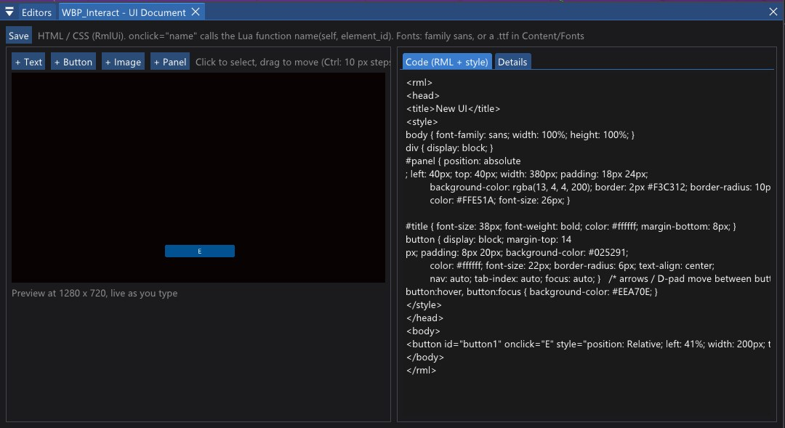
*The UI window (double-click a .rml document): + Text / Button / Image / Panel, the live preview / designer canvas on the left, the HTML / CSS code on the right.*

Game UI is HTML / CSS (RmlUi) with a designer like UMG's: **New UI Document** creates a `.rml` file
with a starter panel. Double-click it to open the **UI window**: code on the right, a live preview
on the left. Style sheets (`.rcss`) open in the same window.

The preview is also the **designer canvas** (UMG's Designer tab):

- **+ Text / + Button / + Image / + Panel** add an element (with an id) to the document.
- **Click** an element in the preview to select it (it needs an `id`; clicking text inside a panel
  picks the nearest element with one). **Drag** it to move it (Ctrl: 10 px steps); an element in
  the normal flow becomes `position: relative`. **Delete** removes it.
- The **Details** tab shows the selection's text, **On Click** (the Lua function it calls) and common
  style properties. Empty fields come from the style sheet.
- Everything you do there is written into the code as the element's inline `style` and attributes,
  so the code and the canvas always agree; edit either.

```html
<rml>
<head>
<style>
body { font-family: sans; }
div { display: block; }
#hud { position: absolute; left: 30px; top: 30px; color: #FFE51A; font-size: 28px; white-space: nowrap; }
button { display: block; padding: 8px 20px; background-color: #025291; color: white;
         nav: auto; tab-index: auto; focus: auto; }
button:focus, button:hover { background-color: #EEA70E; }
</style>
</head>
<body>
<div id="hud">Score: <span id="score">0</span></div>
<button id="play" onclick="start_game" autofocus>Play</button>
</body>
</rml>
```

- Show it from Lua (`local doc = lsd.ui_open("UI_HUD")`) or as the Game Mode's HUD.
- Change it: `lsd.ui_set_text(doc, "score", 1250)`, `lsd.ui_set(doc, "bar", "style", "width: 40%")`.
- **Events**: `onclick="start_game"` calls `start_game(self, element_id)` in every script that has it.
- **The document's own script** (a Widget Blueprint's event graph, in JavaScript): put `Menu.js` next
  to `Menu.rml`. It runs when the document opens; its functions answer the document's events before
  Lua does, so UI-only logic (tabs, toggles, text) stays with the UI:

  ```js
  function onOpen() { ui.setText("title", "Ready?"); }      // runs once the document is up
  function start_game(id) {
    ui.setText(id, "Loading...");
    ui.send("begin_level", id);   // passes it on to Lua: begin_level(self, element_id)
    ui.close();                   // closes this document
  }
  ```

  `ui.setText(id, text)`, `ui.setAttribute(id, name, value)`, `ui.setProperty(id, name, value)`,
  `ui.value(id)`, `ui.close()`, `ui.send(action, id)`, `console.log(...)` / `console.error(...)`.
  A function that runs over half a second is stopped (an endless loop cannot freeze the game).
- **Menus**: `lsd.ui_show_cursor(true)` frees the mouse for the UI. Arrow keys / D-pad move the
  focus between elements with `nav: auto`; Enter / Space / gamepad A press it.
- **Over objects**: `lsd.ui_follow(doc, "tag", enemy, 2.2)` keeps an element above an object.
- Fonts: `font-family: sans` is always there; add your own `.ttf` / `.otf` to `Content/Fonts` and use
  their family name. Every element starts inline: give blocks `display: block`.

---

## 16. Saving, settings and languages

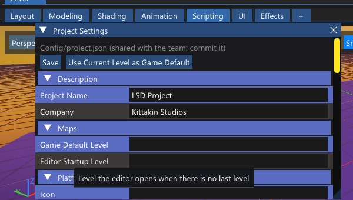
*Edit > Project Settings (saved in Config/project.json, shared with the team): description, maps, multiplayer, chat, voice, localisation, platform...*

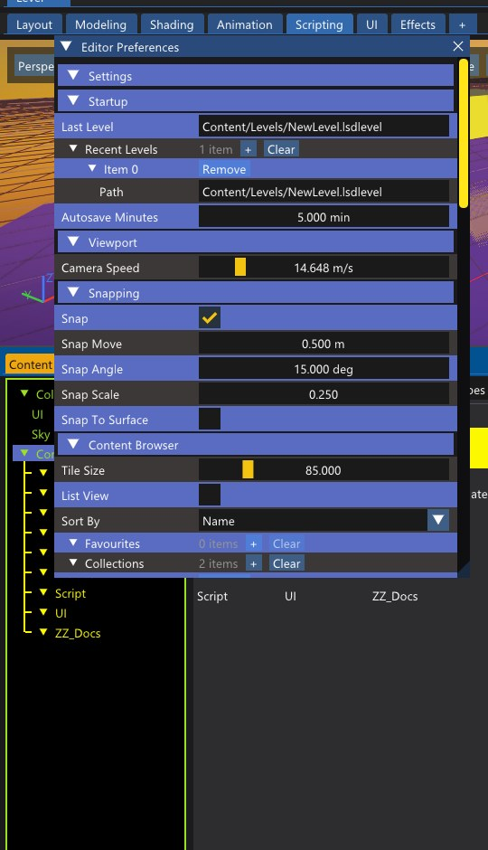
*Edit > Editor Preferences (per user, Saved/editor_settings.json): startup, autosave, camera speed, snapping, Content Browser, plugins.*

**Save games** (Unreal's SaveGame): any Lua value made of numbers, strings, booleans and tables.

```lua
lsd.save_game("Slot1", {level = 3, coins = 250, position = {x = 1, y = 2, z = 0}})
local save = lsd.load_game("Slot1")   -- nil if there is none
```

Files go to `Saved/SaveGames/<slot>.json`. Visual scripts: Save Value / Load Value.

Whole objects (the components you name, Transform when you name none) by object name, so a load
into a freshly opened level puts them back:

```lua
lsd.save_objects("Slot1", {lsd.find("Door"), lsd.find("Chest")}, {"Transform", "Script"}, {coins = 250})
local extra, found = lsd.load_objects("Slot1")   -- extra.coins == 250; objects gone from the level are skipped
```

**Player settings** (Unreal's Game User Settings) are in `Saved/GameUserSettings.json`: fullscreen,
quality, master / music / effects volume, mouse sensitivity, invert look, language. The first run picks
the quality that suits the graphics card. An options menu reads and changes them:

```lua
local s = lsd.get_settings()
lsd.set_settings({quality = 1, master_volume = 0.6})   -- applied at once and saved
```

Music and effects volume drive the Sound Classes named **Music** and **SFX** if the project has them.

**Languages** (Unreal's String Tables): make a Data Table with a `Key` column and one column per
language, and pick it in Project Settings > Localization:

```csv
Key,en,fr
MENU_PLAY,Play,Jouer
MENU_QUIT,Quit,Quitter
```

UI text that is exactly a key is translated (`<button>MENU_PLAY</button>`); in Lua use
`lsd.text("MENU_PLAY")`. `lsd.set_language("fr")` switches and reloads open UI documents.

**Arguments and plurals** (Unreal's Format Text): write `{0}`, `{1}`... in the text and pass the
values after the key: `lsd.text("SCORE", score)` (or the **Format Text** node). For words that
change with a number, `{0}|plural(one=apple,other=apples)` picks by the language's rule (French
counts 0 as one); add `zero=` for a special empty case:

```text
Key,en,fr
APPLES,"{0} {0}|plural(one=apple,other=apples)","{0} {0}|plural(one=pomme,other=pommes)"
```

---

## 17. Packaging and shipping

1. **Edit > Project Settings**: project name, **Game Default Level**, icon, Steam App ID.
2. Build the Release engine once: `cmake --build --preset windows-msvc --config Release`.
3. **File > Package Project**. It validates the assets, then writes `Build/<Project Name>/`:
   the game exe, `Content/`, `Config/`, the Visual C++ runtime and `game.json`.
4. Copy that folder to another PC and run the exe. It opens the default level in Play, full window,
   without the editor; **Esc** quits. Logs and saves go into its own `Saved/`.

`lsd_editor.exe -game` runs the current project the same way without packaging.

---

## 18. Testing and profiling


*`stat unit` in the console: frame rate and the time per part of the frame, top-right of the viewport.*

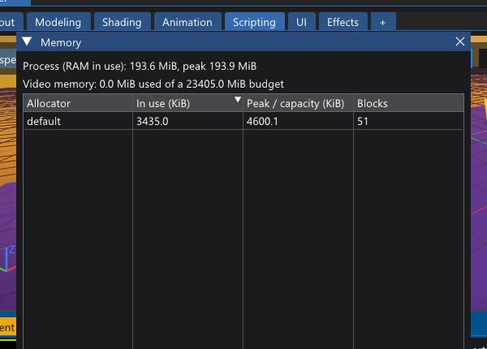
*Window > Memory: RAM and video memory in use, and each allocator's size and blocks.*

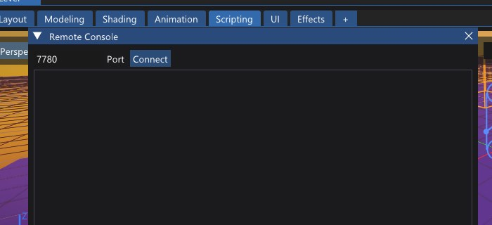
*Tools > Remote Console: connect to a game started with -remote and type console commands into it.*

- **Tools > Smoke Test Level**: plays the level for 5 seconds and reports every error logged.
  On a build server: `lsd_editor.exe -nosound -level=Content/Levels/Main.lsdlevel -smoketest=10`
  exits with 0 (clean) or 1 (errors).
- **Remote Console** (Tools menu): start the packaged game with `-remote`, click Connect, and type
  console commands into it while it runs; each one's log lines come back to the window.
- **Tools > Run Unit Tests**: runs the engine's test suites in the background.
- **HighResShot 2** (console): saves the main view at twice its size as a PNG in
  `Saved/Screenshots/` (up to 8×, post-processing included; works on D3D12 and OpenGL).
- **Window > Memory** / **memreport** (console): memory per allocator, the process's RAM and the video memory budget.
- **stat unit** (console): frame rate, game / render / UI CPU time, draw calls, triangles, culled
  meshes, memory. **stat audio**: playing sounds.
- **stat dump** (console): writes one frame's numbers to the Output Log: CPU times, GPU wait, GPU
  time per stage (shadows, scene, post, UI; timestamp queries on D3D12 and OpenGL), draws and the
  editor UI's time per panel (Unreal's `stat gpu` + `stat unit` in one line).
- **Tracy** (Unreal Insights): configure with `-DLSD_TRACY=ON`, build, run, and connect the Tracy
  profiler v0.11.1 to see every frame's timeline.
- Logs: `Saved/Logs/Editor.log` (Game.log in a packaged game); the previous run is kept as
  `-previous`. Crashes: `Saved/Crashes/<date-time>/crash.dmp` + log (open the dump in Visual Studio).

---

## 19. Reference

### Components

| Category | Components |
| --- | --- |
| Common | Transform |
| Rendering | Static Mesh (**Box UV**: one texture tile per metre on every face however it is scaled, for blockout walls and floors) |
| Animation | Skeletal Mesh (**Morphs**: morph target weights) |
| Lights | Directional, Point, Spot, Sky Light |
| Environment | Sky, Height Fog, Post Process Volume, Lightmass Importance Volume |
| Camera | Camera (FOV, Auto Activate: Play looks through it; `lsd.set_view(e [, blend])` / `lsd.set_view(nil [, blend])` cut or blend between views, like Set View Target with Blend; `lsd.camera_shake(strength [, seconds, frequency])`; nodes Set View Target with Blend, Set View Target to Player, Camera Shake). A Camera attached to the Character (child object) follows it |
| Rendering | Decal (a texture projected down onto what is inside its box: scale the box to fit, the alpha cuts it out; 16 visible at once) |
| Rendering | Instanced Static Mesh (many copies of one mesh in one draw: rocks, grass, props; Details > Scatter fills a circle at random; no collision) |
| Animation | Attach To Socket (keeps this object on a socket of another object's skeletal mesh: a sword in a hand) |
| Animation | Foot IK (feet planted on steps and slopes in Play; foot bone names, max step, ankle height) |
| Movement | Rotating Movement (degrees per second), Projectile Movement (start velocity, gravity scale, follows velocity, stops and sends on_hit when it hits, optional destroy) |
| Volumes | Blocking, Kill, Trigger, Audio Volume |
| Physics | Rigid Body, Physics Joint |
| Gameplay | Player Start, Character, Script, Tags (the **+** button picks from Project Settings > Gameplay Tags), Spline, Spline Follower |
| Audio / Effects | Sound Emitter, Particle Effect |
| AI | Nav Mesh Bounds, Nav Modifier Volume, Nav Agent, AI Controller |
| Prefab | Prefab Instance (added for you) |

### Lua API

Objects and transforms

| Function | Returns / does |
| --- | --- |
| `lsd.find(name)` | entity by name, or nil |
| `lsd.name(e)`, `lsd.alive(e)`, `lsd.destroy(e)` | |
| `lsd.position(e)` / `lsd.set_position(e, x, y, z)` | local position, metres |
| `lsd.rotation(e)` / `lsd.set_rotation(e, x, y, z)` | local rotation, degrees |
| `lsd.spawn(name, x, y, z)` | a prefab, mesh asset, particle system (an explosion at a point) or shape ("Cube"); the new entity |
| `lsd.get(e, "Type")`, `lsd.set(e, "Type", t)`, `lsd.add`, `lsd.remove`, `lsd.has` | any component |
| `lsd.has_tag(e, "Enemy")` | gameplay tags (dotted: "Damage" matches "Damage.Fire") |
| `lsd.has_any_tag(e, "A, B")` / `has_all_tags` / `has_no_tag` | several tags at once (Has Any Tag / Has All Tags nodes) |
| `lsd.raycast(x, y, z, dx, dy, dz, dist)` | `e, px, py, pz, nx, ny, nz` or nil |
| `lsd.sphere_trace(x1, y1, z1, x2, y2, z2, r)` (also `box_trace(..., hx, hy, hz)`, `capsule_trace(..., r, half_h)`) | first hit like raycast, or nil |
| `lsd.overlap_sphere(x, y, z, r)` / `lsd.overlap_box(x, y, z, hx, hy, hz)` | `{e, ...}` the objects touching it |
| `lsd.spline_point(e, d)`, `lsd.spline_length(e)` | |

Time, input, logging, data

| Function | Returns / does |
| --- | --- |
| `lsd.time()` | seconds since Play started |
| `lsd.after(s, fn)`, `lsd.every(s, fn)`, `lsd.cancel(id)` | timers |
| `lsd.input("IA_Move")` | `x, y` of an Input Action |
| `lsd.pressed("IA_Jump")` | true on the frame it fires |
| `lsd.log(...)`, `lsd.log_error(...)` | Output Log |
| `lsd.table("DT_Items")` | Data Table as `{Row = {Column = value}}` |
| `lsd.curve("C_Ramp", t)` | Curve data asset value (x, y, z for a Curve Vector; r, g, b, a for a Curve Color) |
| `lsd.curve_table("CT_Levels", "Damage", t)` | a curve table row at time t |

Audio and animation

| Function | Returns / does |
| --- | --- |
| `lsd.play_sound(name [, x, y, z])` | voice id (2D, or at a position) |
| `lsd.stop_sound(id)`, `lsd.push_mix(name)`, `lsd.pop_mix(name)` | |
| `lsd.set_audio_param(name, v)`, `lsd.set_class_volume(name, v)` | |
| `lsd.set_anim_param(e, name, v)` | Animation Graph parameter |
| `lsd.set_morph(e, name, weight)` | Morph target weight on the skeletal mesh (0 rest, 1 full) |

AI

| Function | Returns / does |
| --- | --- |
| `lsd.move_to(e, x, y, z)`, `lsd.stop_move(e)`, `lsd.is_moving(e)` | Nav Agent movement |
| `lsd.find_path(x, y, z, tx, ty, tz)` | list of `{x, y, z}` corners |
| `lsd.bb_set(e, key, v)`, `lsd.bb_get(e, key)`, `lsd.bb_clear(e, key)` | blackboard |
| `lsd.report_noise(x, y, z [, loudness])` | AI hearing |

UI, saving, settings, languages

| Function | Returns / does |
| --- | --- |
| `lsd.ui_open(name)` | document handle |
| `lsd.ui_close(doc)`, `lsd.ui_set_text(doc, id, text)`, `lsd.ui_set(doc, id, attr, value)` | |
| `lsd.ui_value(doc, id)` | a text field's text |
| `lsd.ui_show_cursor(on)` | menus: free the mouse |
| `lsd.ui_follow(doc, id, e [, height])`, `lsd.ui_unfollow(doc, id)` | world-anchored UI |
| `lsd.save_game(slot, v)`, `lsd.load_game(slot)`, `lsd.has_save(slot)`, `lsd.delete_save(slot)` | |
| `lsd.save_objects(slot, objects, [components], [extra])`, `lsd.load_objects(slot)` | whole objects' components by name |
| `lsd.get_settings()`, `lsd.set_settings(t)` | player settings |
| `lsd.text(key)`, `lsd.set_language(code)`, `lsd.languages()` | localisation |
| `lsd.ik_reach(e, bone, x, y, z [, weight])`, `lsd.ik_look_at(e, bone, x, y, z [, weight [, fx, fy, fz]])` | IK each frame you call it: a hand on a ledge (two-bone), a head following a target (aim along the bone's own +X unless given) |
| `lsd.enum(name)`, `lsd.struct(name)` | editor-made types: New Data Asset > UserEnum (names, numbered from 0) / UserStruct (fields with defaults); returns nil if missing |
| `lsd.broadcast(name, ...)`, `lsd.call(e, name, ...)`, `lsd.implements(e, name)` | events between objects (event dispatchers, interface messages): name(self, ...) on every script, or e's |
| `lsd.draw_line(x1, y1, z1, x2, y2, z2 [, r, g, b [, seconds]])`, `lsd.draw_sphere(x, y, z, radius ...)`, `lsd.draw_box(x, y, z, hx, hy, hz ...)`, `lsd.draw_text(x, y, z, text ...)` | debug drawing over the viewport (seconds 0: this frame) |
| `lsd.bindings(action)`, `lsd.rebind(action, old_key, new_key)`, `lsd.key_pressed()` | key rebinding (Enhanced Input's player mappings): saved in GameUserSettings.json, applied every Play; Move / Look / Jump name the built-in controls |

Events a script can define: `on_start(self)`, `on_update(self, dt)`, `on_hit(self, other)`,
`on_overlap_begin(self, other)`, `on_overlap_end(self, other)`, UI actions `name(self, element_id)`,
behaviour tree tasks `name(self, dt)`.

### Keyboard shortcuts

| Keys | Action |
| --- | --- |
| RMB + WASD / QE, MMB, Alt+LMB, F | fly, pan, orbit, frame selection |
| W / E / R, Ctrl+` | move / rotate / scale gizmo, local / world |
| Ctrl+Z / Y, Ctrl+S, Ctrl+Shift+S, Ctrl+N | undo / redo, save, save as, new level |
| Ctrl+C / X / V / D, Delete, End | clipboard, duplicate, delete, drop to floor |
| Ctrl+G, Shift+G, Ctrl+A | group, ungroup, select all |
| Alt+G / J / H / K, Alt+4 / 3 / 2, G, P | views, view modes, game view, navmesh |
| Alt+P, Alt+S, Esc, Pause, ], F8, Shift+F1 | play, simulate, stop, pause, step, eject, free mouse |

### Command line

| Flag | Meaning |
| --- | --- |
| `-rhi=d3d12 / opengl / vulkan`, `-gpu=<n>`, `-validation` | graphics backend, card, D3D12 debug layer |
| `-level=<path>`, `-play`, `-game` | open a level, start Play, run as the game |
| `-nosound` | no audio device |
| `-exec="<console line>"` | run a console command on the first frame, after `-play` has started (repeatable) |
| `-smoketest=<seconds>`, `-frames=<n>`, `-screenshot=<n>` | automation |
| `-remote[=port]` | listen for the editor's **Tools > Remote Console** (this PC only, port 7780 by default): type console commands into a running game, e.g. `stat unit`, `r.ForceLOD 2` |
| `-import=<file>`, `-place=<asset>`, `-select=<name>` | scripted setup |
