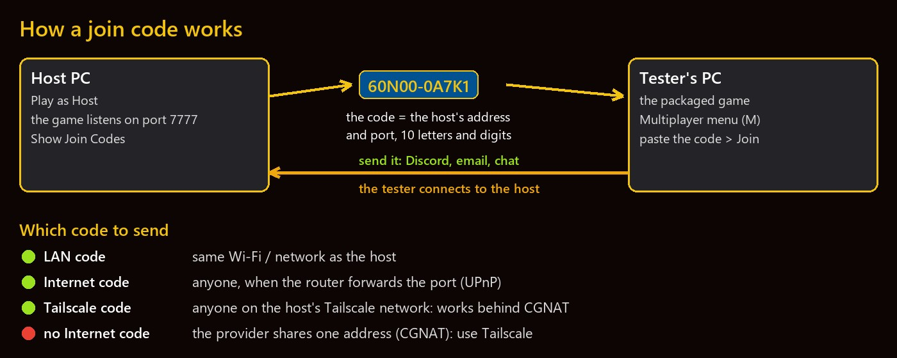
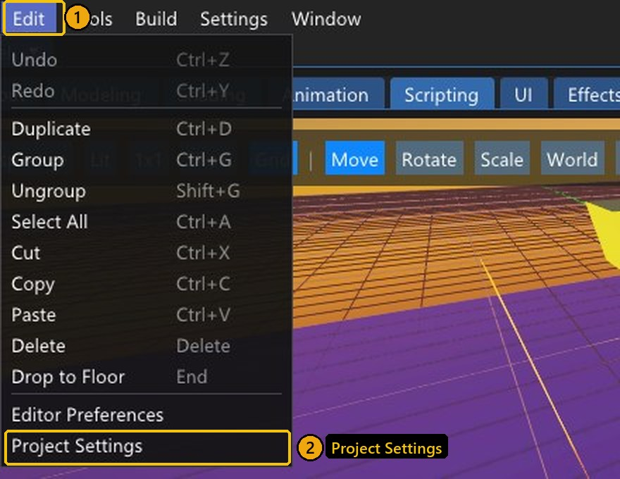
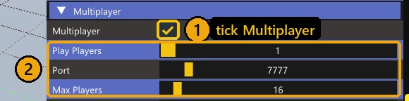
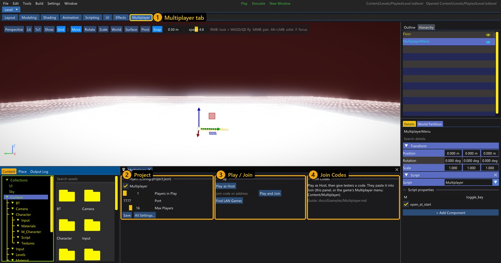
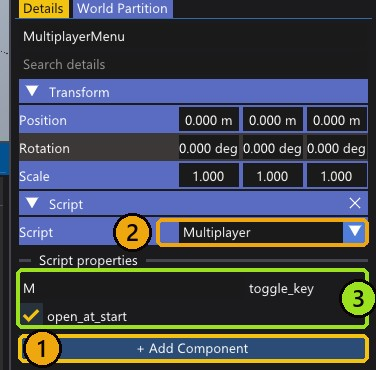
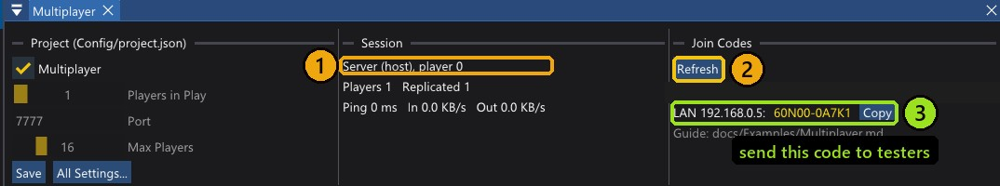
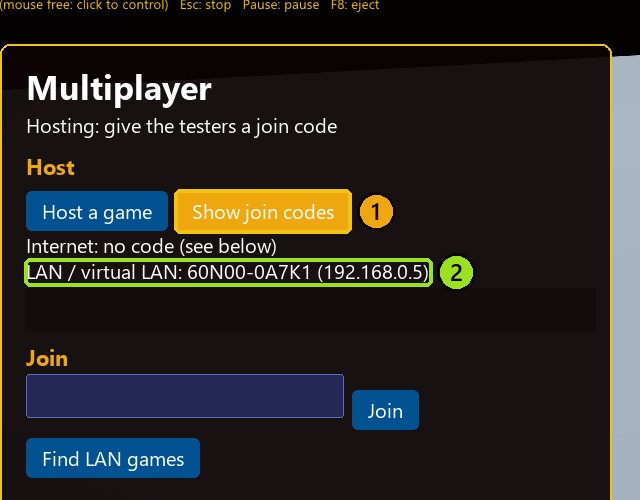
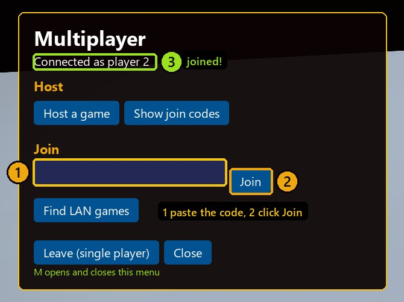
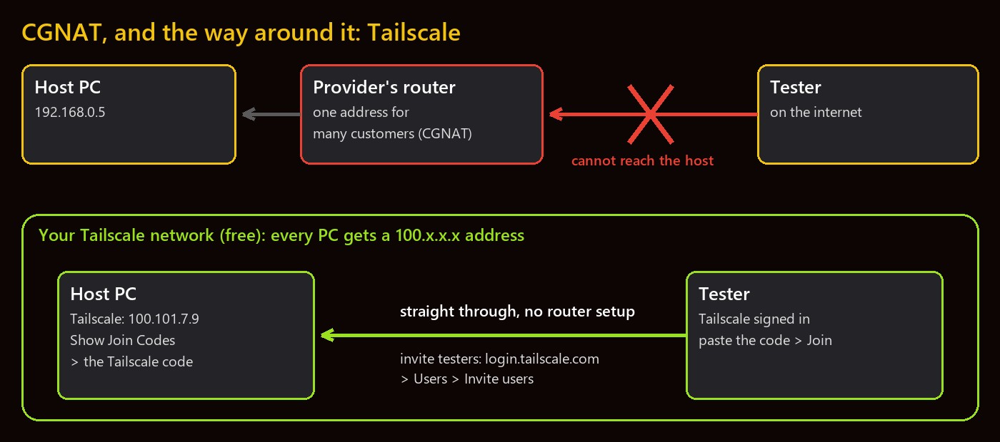

# Multiplayer playtests, step by step

How to get playtesters into your game: switch multiplayer on, add the Host / Join menu, host, send
a join code, and let the testers join. In Unreal terms: the multiplayer options of Play (Net Mode,
Number of Players), a Host / Join widget over Create / Find / Join Session, and Session Frontend's
player list, in one workspace tab.

What you need: the editor, and the same packaged build on every tester's PC (File > Package Project,
then send them the `Build/<Project Name>/` folder).

The numbers in each picture match the numbered steps under it.

---

## How it works (read this once)

You **host**: your game listens for players. The editor gives you a **join code**, 10 letters and
digits like `60N00-0A7K1`. It is not a password: it is your PC's address and the game's port,
written so it is easy to paste and read out (typos are caught). You send it to the testers any way
you like; their game uses it to connect straight to yours. No server of ours is in between.

There is a code for each way your PC can be reached. Send the one that fits the tester:

- **LAN**: they are on your Wi-Fi or network.
- **Internet**: anyone, if your router agreed to forward the game's port (it is asked for you).
- **Tailscale**: anyone on your Tailscale network. This one works behind any router (step 8).

---

## 1. Switch multiplayer on

1. Click **Edit** in the menu bar.
2. Click **Project Settings**.

1. Scroll to **Multiplayer** and tick **Multiplayer**.
2. Check the values under it:
   - **Play Players**: how many players Play opens in the editor (1 = only you; 2 or more opens a
     game window per extra player, all on this PC, handy for a quick test alone).
   - **Port**: the UDP port the host listens on (7777 unless something else uses it).
   - **Max Players**: how many players one host takes, the host included.

Then click **Save** at the top of the window. It writes `Config/project.json`: commit it, so the
whole team (and every package) gets multiplayer.

## 2. Open the Multiplayer workspace

1. Click the **Multiplayer** tab in the workspace row under the menu bar (after Effects).
2. **Project**: the same settings as step 1, with **Save** and **All Settings...** (chat and voice).
3. **Play / Join**: **Play as Host**, a box for a code with **Play and Join**, **Find LAN Games**.
   While playing this column becomes **Session**: server or client, your player number, players
   connected, ping, traffic.
4. **Join Codes**: while you host, **Show Join Codes** lists your codes, each with **Copy**.

## 3. Give your game the Host / Join menu

The testers need a place to paste a code in the packaged game. The engine has one ready.

First open the level the game starts on (Project Settings > Maps > Game Default Level) and select
any object, or place an empty one from the Place tab. Then, in **Details**:

1. Click **+ Add Component** and pick **Script**.
2. In the Script row, pick **Multiplayer** (`Content/Multiplayer/Multiplayer.lua`).
3. Its settings appear under **Script properties**: **toggle_key** (M opens and closes the menu)
   and **open_at_start** (the menu shows when the game starts).

Save the level (Ctrl+S). The menu's look is `Content/Multiplayer/WBP_Multiplayer.rml`:
double-click it to restyle it in the UI window, like a UMG widget.

## 4. Host

In the editor: Multiplayer panel > **Play as Host** (or just Play, Alt+P).
In the packaged game: it hosts when it starts (the menu also has **Host a game**).

## 5. Get a join code (editor)

1. The Session column says **Server (host), player 0**: you are hosting.
2. Click **Show Join Codes**. The first time it also asks your router to forward the port (UPnP,
   a couple of seconds); the forward is removed when Play stops.
3. Each code has a **Copy** button: copy one and send it to the testers (Discord, email, chat).

## 5b. Get a join code (packaged game)

1. In the game's Multiplayer menu (M), click **Show join codes**.
2. The codes appear under it: send one to the testers.

When there is no **Internet** code, the reason is written under the codes (and in the Output Log),
for example *the router's internet address 100.x.x.x is shared (CGNAT or a second router)*. That
is not a bug: see step 8.

## 6. The testers join

Each tester starts the packaged game (the Multiplayer menu shows, or press **M**), then:

1. Pastes the code into the box under **Join**. A plain address works too (`192.168.0.5`, or
   `203.0.113.7:7777`). On the same network, **Find LAN games** fills the box for them.
2. Clicks **Join**.
3. The status line says **Connecting...**, then **Connected as player N**. If the host is on
   another level, the game takes the tester there by itself.

Your Session column counts them in. **Leave (single player)** goes back to playing alone;
**Close** (or M) hides the menu.

## 7. Test it alone first

Before sending a code, set **Players in Play** to 2 and Play: a second game window opens and joins
you, on this PC. If that works, the game side is right, and anything left is the network (step 8).

## 8. Behind CGNAT: Tailscale

Some internet providers share one public address between many customers (**CGNAT**: common on
mobile, 4G / 5G home internet and some fibre). Nobody outside can reach your PC through it, so
there is no Internet code. [Tailscale](https://tailscale.com) gets around it: it puts your PC and
the testers' PCs on one private network over the internet, each with a 100.x.x.x address. Free for
small groups.

1. **You**: install Tailscale and sign in (a Google, Microsoft or GitHub account).
2. **You**: at login.tailscale.com > **Users** > **Invite users**, invite each tester by email (or
   share only your PC: **Machines** > your PC > **Share...**).
3. **Each tester**: accepts the invite, installs Tailscale and signs in.
4. **You**: host (step 4) and Show Join Codes: send the **Tailscale** line's code.
5. **Testers**: join with that code (step 6).

Find LAN games does not find games over Tailscale: use the code.

**ZeroTier** works the same way: make a network at my.zerotier.com, testers join its network ID in
the ZeroTier app, you tick them in as members. Your ZeroTier address is one of the **LAN** lines.

**Or by hand**: forward UDP 7777 in your router to your PC and give testers your public address (a
"what is my IP" page) as `1.2.3.4:7777`. Not possible behind CGNAT.

## 9. When it does not connect

| What you see | What to do |
| --- | --- |
| "Could not reach the host (or it left)" | the code is old (the host's address changed), or the host stopped Play: get a new code |
| Connecting... forever | Windows Firewall on the host: allow the game (Private and Public) when Windows asks, or in Windows Security > Firewall > Allow an app |
| No Internet code | your provider uses CGNAT, or UPnP is off in the router: use the Tailscale code (step 8) |
| "Could not host on port 7777 (in use?)" in the Output Log | another copy of the game is hosting on this PC; fine for a second copy that joins |
| "The server is on level X, which this machine does not have" | the tester has an older build: send the new package |
| No Multiplayer menu in the game | Project Settings > Multiplayer is off, or the Multiplayer script is not on an object in the starting level; press M |

## For scripters

The menu is ordinary Lua: copy it and change it. The calls it uses:

| Call | Does |
| --- | --- |
| `lsd.net_host([level])` | host from a menu; Play restarts as the server (on `level`, default this one) |
| `lsd.net_join(code)` | a join code or address; Play restarts as a client and follows the server to its level |
| `lsd.net_leave([level])` | back to single player |
| `lsd.net_join_code()` | `{upnp, message, internet, lan = {{address, code, tailscale}, ...}}` for the host |
| `lsd.net_find_games(seconds)` | games on the local network |
| `on_connected(self, id)`, `on_disconnected(self)` | how a join went |

More in [MANUAL.md](MANUAL.md#multiplayer) (replication, events, chat, voice) and [CODING.md](CODING.md).
